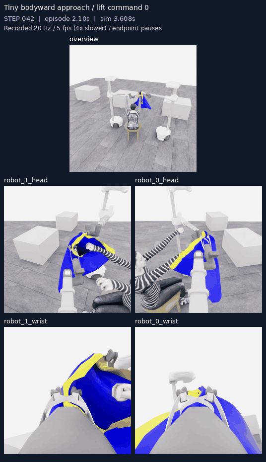

# M1: 같은 손을 향한 미세 접근과 점진 하강

**사용자가 높이를 승인한 뒤, 들린 손의 자세에 맞춰 몸쪽으로 아주 조금 접근하며 낮아지는 구간을 실행했다.** 새1 act·2전이(0.10초)에서 파지 기준점 world Y는 R0/R1 +1.24/+1.91mm, Z는 −0.92/−0.95mm 변했다. 추가 lift 명령 없이 하강이 관측됐고, 곧바로 물리0 `hold-0005`에서 검토를 기다린다.

[현재 HOLD 5카메라](../user-reviews/20261116-astra-m1-checkpoint-001/hold-0005/README.ko.md) · [직전 HOLD](../user-reviews/20261116-astra-m1-checkpoint-001/hold-0004/README.ko.md) · [이전 구간별 GIF](../../gallery/20261116-m1-guided-segments/README.ko.md)

## 명령과 실제 변화

같은 run `20261116-astra-m1-checkpoint-001`의42→44전이다. D15는 두 베이스의 작은 평면 이동만2전이 명령했다. 양쪽 닫기 의도와 lift 목표를 유지했고, lift·arm·wrist·base yaw 명령은0이었다. 아래 값은 공개 로봇 pose의 변화이며 단위는 mm다.

| 로봇 | grasp world X | grasp world Y | grasp world Z | lift 관절 |
|---|---:|---:|---:|---:|
| R0 | −0.013 | +1.240 | −0.917 | −0.924 |
| R1 | +0.048 | +1.913 | −0.951 | −0.926 |

베이스 world Y는 +1.13/+1.96mm 변했다. **world 좌표의 변위는 몸통·손까지의 거리나 천의 이동량이 아니다.** lift 목표가 그대로인데도 하강했다는 사실을 기록하며, 목표 추종·잔류 운동·접촉 중 어느 하나를 단독 원인으로 확정하지 않는다. [명령과 실제 운동을 구분하는 기전](../../MECHANISMS.ko.md#6-현재-m1에서-확인한-기전-중립-명령-뒤에도-운동은-남는다)

## 현재 화면과 다음 판단

직전과 현재의 head/wrist 화면에서 손·연결 손목의 노출과 처진 천의 큰 배치는 비슷하게 유지되어 보인다. 변화가1–2mm 수준이므로 RGB만으로 손과 입구의 정렬 개선이나 진입을 확인하기 어렵다. 모델도 진입은 미확인으로 남겼다. 현재 영상과 이동량을 보고 다음 접근 방향·하강량을 판단한다.

D16 stop은 simulator에 전달하지 않았고 추가 전이0이다. 별도 자동 settle은 없다. 누적17모델 호출·13 act·44전이이며, 기록기·환경이 열린 live HOLD다. 사용자 응답 전 물리 진행0, 마감·QC·고정 백업 전 상태를 유지한다.

## 근거

수치는 완료 ACK와 불변 공개 입력 `guided-00015`–`guided-00016/observation.json`, HOLD4·5 관측에서 계산했다. 실행 중 HDF5는 열지 않았다. world 파지점 계산과 해석 범위는 [앞선 분석](20261116-m1-right-hand-clearance.ko.md)을 따른다. GIF는 전후 hash·HOLD 상태를 확인한 고정 복사본의42·43·44경계로 만들었다. [복사 근거](../../gallery/20261116-m1-guided-segments/source-hold-0005.json) · [GIF 메타데이터](../../gallery/20261116-m1-guided-segments/tiny-bodyward-approach.json)
