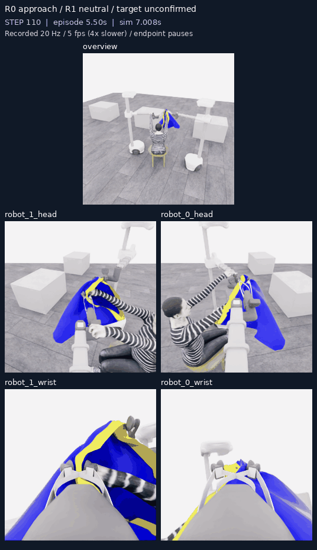

# M1 분기: R0만 접근 명령, 중립 R1의 이동도 관측

**사용자 지시를 이어서 적용해 오른손에 가까운 R0에만 접근 명령을 보낸 뒤, 사용자 종료 지시에 따라 135전이에서 마감했다.** 실행 `20261116-astra-right-hand-hold10-001`의110→135전이에서 파지점 평면 순변위는 R0 약41.57mm였고,9채널 모두0인 R1도 약12.66mm 움직였다. 오른팔 줄무늬 두 간격의 도달은 확인하지 못했다. 마지막 `hold-0002` 이후 추가 물리 전이는0이며 아래 화면은 종료한 실행의 기록이다.



[마지막 HOLD 5카메라](../user-reviews/20261116-astra-right-hand-hold10-001/hold-0002/README.ko.md) · [새 출발 HOLD](../user-reviews/20261116-astra-right-hand-hold10-001/hold-0001/README.ko.md) · [기존 HOLD10](../user-reviews/20261116-astra-m1-checkpoint-001/hold-0010/README.ko.md) · [복귀 재생과 신규 실행 GIF 구분](../../gallery/20261116-right-hand-hold10/README.ko.md)

## 사용자 지시와 좌우 식별

사용자는 왼손 부근에서 로봇이 부딪히는 것 같다고 판단하여 앞 구간으로 돌아가 **오른손에 가까운 로봇만 줄무늬 두 칸 정도** 진행하도록 지시했다. 기존 HOLD10/110전이를 비교 출발점으로 삼고, 공개 화면을 다시 확인하여 아래처럼 연결했다.

| 공개 영상으로 연결한 대상 | 새 분기의 제어 의도 |
|---|---|
| `robot_0` ↔ 마네킹의 해부학적 오른손 | 기존 몸쪽 방향으로 한쪽 접근 |
| `robot_1` ↔ 마네킹의 해부학적 왼손 | 9채널0 명령, 기존 닫기 의도 유지 |

overview는 뒤통수·등을 보는 구도다. 어깨→팔꿈치→손의 연결을 추적하고 각 head 화면의 전경 로봇 팔과 대조했다. R1 head의 전경 그리퍼 곁 아래쪽 손은 왼손, 반대편 높은 지지 곁 손은 오른손으로 이어진다. **최근 R1 wrist에서 가려진 손을 오른손이라고 단정한 이전 actor 판단은 이번 분기의 기준으로 사용하지 않는다.** 이 식별에는 로봇 변위의 비대칭이나 내부 인체 기하를 사용하지 않았다.

사용자의 충돌 추정과 [기존 마지막3전이의 R1 비대칭](20261116-m1-third-stripe.ko.md)은 구분한다. grasp Y 감소·yaw/arm 변화는 측정됐지만 충돌 원인은 확인되지 않았다. 기존 run의 원본 관측·명령·평가 기록은 그대로 보존한다.

## 기존 HOLD10과 새 출발의 비교

기존과 같은 원본 슬롯에서 기존 행동110개를 재생했다. **live 상태를 정확히 되감은 복원이 아니다.** 아래는 새 HOLD1−기존 HOLD10의 공개 파지 기준점 차이이며 단위는 mm다.

| 로봇 | grasp world ΔXYZ | 차이 크기 |
|---|---|---:|
| R0 | +1.342, −0.346, −1.239 | 1.859 |
| R1 | +0.132, +0.442, +0.434 | 0.634 |

공개5뷰에서 두 지지·손과 팔의 연결·전체 천 배치는 비슷하게 유지된다. R1 wrist의 노란 경계와 주름에는 미세 차이가 있다.5RGB의 평균 채널 차이는0.46–3.56/255이고 depth 유효마스크 변경은 카메라별 최대0.62%다. 속도·관절·제어 목표도 완전히 같지 않다. 영상·수치의 유사성을 숨은 물리 상태나 이후 반응의 동일성으로 간주하지 않는다.

이 공개 비교에서는 큰 배치 변경이 없어 원래 승인된 한쪽 접근을 시작할 수 있다고 판단했다. 새 출발에 대한 별도의 사용자 승인이 있었다는 뜻은 아니며, 기존 지시를 같은 목적의 분기에 이어서 적용한다.

## R0 단독 명령과 양쪽의 실제 움직임

“두 칸”은 복귀한 위치에서 오른팔의 짙은 띠 사이 두 간격 정도를 추가로 진행하는 시각 목표로 해석했다. 새9 act·25전이(1.25초) 동안 R0의 기존 베이스 평면 명령만 적용했다. R1의9채널, R0의lift·arm·yaw·wrist 명령은 모두0이었다. 양쪽 닫기 의도를 유지했다. 아래 단위는 mm다.

| 로봇 | 새110→135 grasp world ΔXYZ | grasp XY 순변위 | base world Y 변화 |
|---|---|---:|---:|
| R0 | +3.716, +41.402, −0.658 | 41.569 | +45.894 |
| R1 | +1.041, +12.617, +0.521 | 12.660 | +7.789 |

**R1에 접근을 명령하지 않은 것과 R1이 실제로 고정된 것은 다르다.** R1 grasp Y 변화는 같은3전이 구간에서 +1.018mm(112→115)에서 +1.615mm(130→133)로 다시 커졌다. 이를 처음 속도의 단순한 감쇠만으로 단정하지 않는다. 잔류 운동·제어 추종·천이나 접촉에 의한 결합 중 원인 구분은 남아 있다. 위 파지점 변위도 천의 이동량이나 손 통과량은 아니다.

## 목표 관계와 현재 판단

R0 head의 오른전완 곁 노란 경계에는 작은 변화가 있지만 손·경계 일부가 파지부에 가려 두 간격 진행을 확정하기 어렵다. R0 wrist는 전경 housing과 천의 가림이 크다. R1 head에서 연결된 오른팔을 함께 보아도 유효한 입구 전체는 확인되지 않는다. 왼손쪽 R1 wrist에서는 상단 노란 경계가 더 펴지고 손의 가림은 남는다. 큰 지지 붕괴는 보이지 않지만 비접촉이나 왼쪽 무이동을 입증하지 않는다.

모델은 마지막 짧은 조작 뒤에도 부분적으로 가려진 경계로 남은 두 간격 목표를 신뢰 있게 판단할 수 없다고 stop을 요청했다. **목표 도달·입구 진입·소매 통과는 미확인**이다. D9 stop은 물리0 HOLD로 전환했고 별도 자동 settle은 없었다. 이후 사용자의 종료 지시로 물리0 `finish_episode`를 실행해135전이에서 마감했다.110전이는 복귀 재생이며 새 모델 시연25전이·10모델 호출(9 act+stop)과 구분한다. QC·고정 백업의 최신 결과는 [STATUS](../../project/STATUS.md)에서 관리한다.

비교에는 두 run의 불변 공개 관측, 신규 `guided-00000`–`guided-00009`, 완료 ACK를 사용했다. 실행 중 HDF5는 열지 않았고 내부 인체·천 상태나 평가를 행동 정답으로 사용하지 않았다. 신규 GIF는 고정 사본의110–135 모든26경계다. [고정 사본 근거](../../gallery/20261116-right-hand-hold10/source-hold-0002.json) · [GIF 메타데이터](../../gallery/20261116-right-hand-hold10/right-hand-only-two-stripes.json)

## 다음 출발점으로 남긴 체크포인트

마지막 R0 접근을 시작하기 전 새 분기의 HOLD1, step110·tick1320에서 저장한 근사 슬롯이 있다. 원래 M1의 HOLD10을 직접 저장한 파일은 아니며, 같은 초기 슬롯과110개 행동을 재생한 뒤 얻은 새 상태다. 저장 당시 모델 호출0회·추가 물리0전이였고 실제 파일 SHA·receipt·코드/자산7개 해시를 다시 확인했다.

```text
/output/collections/20261116-astra-right-hand-hold10-001/checkpoints/20261116-astra-right-hand-hold10-001-start/slot_20261116-astra-right-hand-hold10-001-start.npz
```

슬롯 SHA256은 `c26cc58caf6176ce2b1120a9ea1e68d0a7e0f4f88c0e46978c4aa3de3f0b05e6`, 같은 폴더의 `receipt.json` SHA256은 `bb53e3914ec7479a01944df8b1dd8e7758f5206905f4418ed0d15dcdbc7f5872`다. source group은 `20261113-astra-side-hem-fresh-001`이다. [저장 검증 기록](../../gallery/20261116-right-hand-hold10/start-checkpoint-verification.json)

**저장은 확인했지만 이 새 슬롯에서의 복원은 아직 시험하지 않았다.** 복원은 속도·접촉 캐시 등이 초기화되고 기존1.5초 정착을 거치는 근사 경로이므로, 이후 실행에서 공개5뷰와 로봇 상태를 다시 비교한 뒤 새 행동으로 넘어가야 한다. 저장 시점과 정확히 같은 천 상태·반응을 보장하지 않는다.

사용자가 지정한 다음 방향은 이 마지막 R0 접근 전 출발점에서 **두 로봇을 마네킹의 해부학적 왼손 쪽으로 함께 이동한 뒤 옷을 양손에 모두 걸치는 것**이다. 현재 로봇 화면의 좌우와 해부학적 왼쪽을 혼동하지 않는다. 이 방향은 미실행 계획이며 구체적인 단계와 검토 기준은 [COLLECTION_PLAN](../../COLLECTION_PLAN.md)에서 관리한다. 공식 영상에서 본 양측 지지·상방 이동·하강은 참고 순서일 뿐, 현재 파지에서 양손 통과가 성립한다는 검증은 아니다. [기존 공식 영상 검토와 한계](../research/2026-11-07-official-demo-route-review.ko.md)
