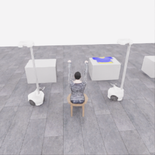
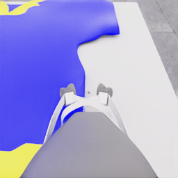

# 첫 자동 수집의 속도와 과제 난도 검토

**기준 시각: 2026-11-06 02:41:09 UTC.** `20261106-astra-dressing-001`의 완료된 판단 **10개, index 0~9**만 집계했습니다. 당시 index 10의 모델 응답은 기록되었지만 행동 적용 완료가 확인되기 전이므로 이 분석에서 제외했습니다. 이후 진행 상황을 나타내는 실시간 보고서가 아닙니다.

현재 방식은 느립니다. 해당 구간에서 **6.10 simulation초를 진행하는 데 모델 호출과 환경 실행 합계 637.79초, 약 10.63분**이 들었습니다. 대부분은 모델 호출 시간입니다. 준비와 접근을 거쳐 파지 및 작은 들어올림을 시도했으나, 이 기준 구간에서 공식 득점과 파지 성공은 확인하지 못했습니다. 50점까지의 도달 시간이나 성공률을 추정할 근거는 아직 없습니다.

## 분석 범위와 근거

- 실행 모델: `gpt-6-astra`, 추론 설정 `ultra`, Codex CLI `0.166.0`.
- 출처: `output/operator-traces/20261106-astra-dressing-001/attempt.json`, `decisions.jsonl`, 해당 시도의 공개 관측 이미지·로봇 상태, 별도 평가의 점수 이벤트 요약.
- 시간은 `decisions.jsonl`의 `decision`과 동일 index의 `applied_segment`를 연결하여 계산했습니다. 기준 시각 뒤의 변경으로 값이 달라지지 않도록 index 0~9를 고정했습니다.
- 공개 관측은 지정된 RGB 카메라 5개, 공개 로봇 상태와 모델에 전달된 깊이 요약입니다. 원시 상태, 숨겨진 물체 기하·부착 상태·평가 측정값은 행동 해석에 사용하지 않았습니다. 작성 중인 HDF5도 열지 않았습니다.
- 아래 `stage`와 시각 판단은 actor가 공개 관측으로 작성한 의도·해석입니다. 공식 성공 라벨과 구분합니다. 별도 점수 요약은 검토용이며 actor의 다음 입력으로 전달하지 않습니다.

## 시간 분해

| 항목 | 완료 10개 판단의 측정값 | 해석 |
|---|---:|---|
| 기록된 제어 전이 | 122개 | 20 Hz 기준 6.10 simulation초 |
| actor 호출 합계 | 503.41초, 78.93% | 공개 입력 준비 중 actor 내부 처리, Docker·CLI 시작, 요청·응답을 포함. 서버 내부 추론 시간만 분리한 값이 아님 |
| 환경 dispatch 합계 | 134.38초, 21.07% | 행동 전송부터 새 관측 응답까지. 물리·렌더링·평가·저장·직렬화 등의 합이며 순수 물리 연산만의 시간이 아님 |
| 두 구간 합계 | 637.79초 | 시뮬레이터 초기화·종료 및 이 두 구간 밖의 처리 시간은 제외 |
| actor 호출 평균 / 중앙값 | 50.34초 / 51.22초 | 호출마다 15.21~93.79초 |
| 환경 dispatch / 제어 전이 | 평균 1.10초 | 0.05 simulation초당 처리 비용 |
| 두 구간 합계 / simulation초 | 약 104.55초 | 이 구간의 시간 비율이며 전체 실행 시간 기준 벤치마크가 아님 |

환경이 ready를 반환한 시뮬레이션 시각은 1.525000초였고, index 9 완료 뒤 시각은 7.625000초였습니다. 두 값의 차이인 6.10초만 행동 진행량으로 계산합니다. 초기 reset의 15.21 wall초는 별도로 기록되며, Kit 시작을 포함한 전체 초기화 비용과 같지 않습니다.

**20 Hz 기록과 20 Hz 모델 판단은 다릅니다.** 첫 세 판단은 각각 20전이, 즉 1 simulation초를 한 묶음으로 실행했습니다. 이후 묶음은 6~12전이, 즉 0.3~0.6초로 짧아졌습니다. 122개 전이를 기록했지만 독립적으로 선택한 행동은 10개입니다. 모델이 응답을 준비하는 동안 같은 명령을 계속 실행하는 구조도 아닙니다. 모델 대기 중 물리 시간 정지는 앞선 모델 없는 연결 시험에서 검증했습니다.

이 구조에서는 짧은 접촉 조정마다 수십 초의 호출 비용을 다시 지불합니다. 판단을 세밀하게 할수록 작은 행동 변화와 실제 시간의 비율이 커지는 이유입니다. 다만 긴 행동 묶음으로 바꾸었을 때 성공률이 유지되는지는 이번 자료로 알 수 없습니다.

## 단계별 진행과 불확실성

| 판단 index | actor 단계 | 적용 전이 / simulation초 | 공개 응답에서 확인한 의도와 한계 |
|---|---|---:|---|
| 0 | 준비 | 20 / 1.0초 | 열린 그리퍼의 높이를 조정하고 두 로봇의 초기 접근 방향을 구분 |
| 1~4 | 접근 | 62 / 3.1초 | 두 로봇을 의복의 서로 다른 가장자리로 이동·정렬하려고 시도 |
| 5 | 복구 | 8 / 0.4초 | 손목·베이스의 변화를 보고 테이블 접촉 가능성을 제기하며 조정. **충돌은 actor의 가설이며 이 분석에서 확정하지 않음** |
| 6 | 접근 | 10 / 0.5초 | 그리퍼 위치와 손목 각도를 다시 조정 |
| 7 | 파지 준비 | 6 / 0.3초 | 열린 손가락이 가장자리를 둘러싼 것으로 해석하고 미세 조정 |
| 8 | 파지 시도 | 8 / 0.4초 | 두 그리퍼에 닫기 명령. 이후 의복 움직임으로 성공을 확인해야 한다고 명시 |
| 9 | 들어올림 시험 | 8 / 0.4초 | 두 그리퍼의 작은 수직 이동. 응답에서 아직 어느 쪽 파지도 시각적으로 확인하지 못했다고 명시 |

단계 의도는 준비 1개, 접근 5개, 복구 1개, 파지 2개, 들어올림 1개입니다. 시각 판단은 `progressing` 6개, `recovering` 1개, `uncertain` 3개입니다. 접근 단계의 `progressing`을 공식 과제 성공으로 읽어서는 안 됩니다. 기준 구간의 점수 이벤트에는 득점 이벤트가 없고, 기록된 점수 요약은 **0점·success=false**입니다. 종료된 최종 평가가 아니므로 이 시도의 최종 결과를 뜻하지 않습니다.

복구 판단 index 5의 actor 호출이 93.79초로 가장 길었습니다. 모호한 관측을 해석한 구간과 긴 호출이 함께 나타났지만, 한 사례만으로 불확실성이 지연의 원인이라고 단정할 수는 없습니다.

## 카메라와 접촉 판단이 어려운 이유

모델 입력은 256×256 RGB 5개와 카메라별 16×16 깊이 중앙값, 공개 로봇 상태를 포함합니다. 손목 영상에서는 손가락과 의복 가장자리를 가까이 볼 수 있지만, 손가락·의복·테이블이 겹쳐 보입니다. 공개 overview 영상은 두 로봇의 배치를 보여 주지만 작은 접촉 부위를 판별하기에는 화면상 크기가 작습니다.

깊이 요약 한 칸은 원본의 16×16 픽셀에 대응하므로 손가락, 의복 가장자리, 테이블의 세부 차이를 모두 보존하지 않습니다. 공개 로봇 상태와 닫기 명령으로는 의복이 실제로 잡혔는지 확정할 수 없습니다. 따라서 닫기 이후 의복이 따라 움직이는지 여러 관측을 비교하는 절차가 필요하고, 이번 actor도 최종 응답에서 그 불확실성을 남겼습니다. 이는 두 로봇의 협력 파지와 변형 의복을 다루는 과제 자체의 난도와 연결됩니다.

현재까지 확보한 자료는 성공 시연보다 **접근·복구·파지 가설 검증 과정**의 자료입니다. 서로 다른 단계와 관측 전후 관계를 보존한 것은 유용하지만, 실행 중의 `quality_status=unreviewed` 자료를 학습용 승인 시연으로 간주하지 않습니다.

### 기준 구간의 실제 공개 카메라 이미지

아래 두 이미지는 actor에 전달된 원본 PNG를 바이트 변경 없이 복사했습니다. 초기 overview와 마지막 검토 관측의 손목 카메라로, **서로 다른 카메라의 육안 검토 자료**입니다. 파지 성공이나 목표 상태를 확정하는 증거가 아닙니다.

| 초기 공개 overview | index 9 적용 뒤 로봇 0 손목 카메라 |
|---|---|
|  |  |
| 관측 `00000`, 다음 판단 index 0, 공개 시뮬레이션 시각 1.5250000795초 | 관측 `00010`, 완료 판단 index 9, 다음 판단 index 10, 공개 시뮬레이션 시각 7.6250003977초 |

실행 ID는 두 이미지 모두 `20261106-astra-dressing-001`입니다. 원본 경로와 SHA256 전체 값은 [이미지 출처 기록](../assets/20261106-initial-review/provenance.json)에 보존했습니다. overview의 SHA256은 `b7131fbb89a47994540657dad32c0fe751b5a620a37a53f82708ef9d8dba3f3a`, 손목 이미지의 SHA256은 `95e8dfda7ecaff369548e4fab8b2743f96f3c8bec8c81ca341367076eb5213ca`입니다.

## 시뮬레이션이 10% 빠른 서버의 영향

같은 판단·같은 행동 묶음·같은 모델 호출 시간이 유지되고, 환경 dispatch 전체만 개선된다는 조건으로 계산합니다. 순수 물리 연산만 빨라지는 경우에는 개선 폭이 더 작습니다. 다른 서버에서 이 수집기를 직접 비교한 결과가 아닙니다.

현재 시간 분해를 `T = 503.41 + 134.38`초로 놓으면 다음과 같습니다.

- 환경 구간의 **소요 시간이 10% 감소**하는 정의: 전체 반복 시간 감소율은 `(134.38 / 637.79) × 0.10 = 약 2.11%`입니다.
- 환경 구간의 **처리 속도가 1.1배**가 되는 정의: `T_new = 503.41 + 134.38 / 1.1 = 약 625.57초`이므로 전체 처리 속도 개선은 `637.79 / 625.57 − 1 = 약 1.95%`입니다.

따라서 이번 표본의 주된 지연은 서버의 시뮬레이션 속도만으로 설명되지 않습니다. 모델 호출 주기와 관측·행동 묶음의 관계를 함께 측정해야 합니다. 단, 여기서 추론 설정이나 묶음을 변경한 성능 비교를 수행한 것은 아닙니다.

## 지금 결론 낼 수 있는 범위

공개 관측 → 모델 판단 → 제한된 행동 → 새 관측 → 별도 기록의 반복은 작동하고 있습니다. 첫 접근 실패 가능성을 인식하고 복구한 뒤 파지를 시험하는 과정도 라벨로 남고 있습니다. 반면 접촉 성공과 공식 득점은 이 기준 구간에서 확인하지 못했습니다.

진행 중인 한 시도의 초반 자료만으로 완료 성공률, 5점 이후의 진행 속도, 50점 도달 시간을 계산하지 않습니다. 정상 종료 뒤 전수 검수와 공식 평가를 연결하고, 여러 시도의 단계 도달 여부·실패 유형·복구 비용을 비교해야 다음 판단을 내릴 수 있습니다.

관련 실행과 연결 검증은 [당일 수집 일지](2026-11-06.md)에 기록합니다.
