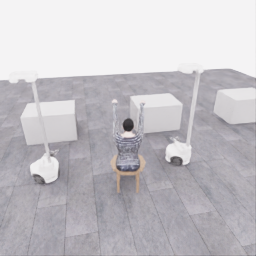
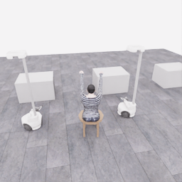

# 2026-11-06 · 환경 복원·협력 운반·중지와 서버 인계

[수집 과정 목차](../README.ko.md) · [저장소 소개](../../../README.md) · [현재 상태](../../project/STATUS.md) · [환경 복원 수치](../../project/sessions/20261106-l40s-restore.json)

## 한눈에 보는 시간 순서

| UTC | 실행·변경 | 확인한 결과 |
|---|---|---|
| 02:28–02:45 | 첫 착의 시도 E00 | 0점·중단, 167전이 보존 |
| 03:25–03:35 | 픽업 탐색 E04 | 0점, 공식 유지 2.9초·168전이 |
| 03:42–03:56 | 유지 여유를 둔 E05 | **한 로봇 픽업 부분 점수 5점**, 실제 공식 유지 3.35초·253전이 |
| 04:08–04:17 | 중립 스트리밍 4회 비교 | 4과정·260/260전이 검사 완료, 실제 영상 수신은 미확인 |
| 04:20:36 시작 | E06: E05 행동 재실행 후 착의 계속 | 새 평가 5점 확인 뒤 사용자 지시로 중단·보존. [고정 중간 기록](../experiments/2026-11-06-dressing-continuation.ko.md) |
| 04:40:12–06:04:06 | E07: 0점부터 두 로봇 협력 들기·운반 | [정상 종료·1,067전이 검사 통과](../attempts/20261106-astra-coordinated-fresh-001/README.ko.md), 공식 5점·착의 success=false·rate 0점/초 |
| 06:09:24 | E08: 운반 구간 분기 시작 실패 | 스트림 설정 누락, 환경·기록기·actor 시작 전 모델·전이 0 |
| 06:15:37–06:18:57 | E09: 재실행 중 사용자 중지 | 모델 0, ACK 120·저장 141전이. 종료 응답 순서 오류·파일 미완료 3오류로 검사 실패 |
| 종료 후 | 기록·클린 서버 인계 | 현재 새 수집·설치·재시도 없음. 검증된 E07 원본과 prefix 700을 후속 후보로 보존 |

[**첫 5점 반복 영상**](../../gallery/20261106-astra-pickup-hold5-001.ko.md) · [**방법별 비교**](../experiments/2026-11-06-method-comparison.ko.md) · [**공식 점수·종료 검토**](../reviews/20261106-astra-pickup-hold5-001.ko.md)

## 오늘의 목표와 기록 범위

지속적인 시도·실패 분석·쉬운 개선·필요 연구를 거쳐 다양한 50점 시연을 수집하는 방향을 유지합니다. **현재는 사용자가 쉬었다가 클린 서버에서 소매 통과를 이어가도록 요청해 수집을 일시 중지했습니다.** Codex CLI `gpt-6-astra`/`ultra`, 한 로봇 픽업·E06 재실행·E07 협력 운반과 착의 미완료, E08·E09 실패를 보존합니다. 이전 계속 수집 승인은 해당 시점의 이력이며 현재 재시도를 시작하는 지시로 사용하지 않습니다.

결과 숫자만 나열하지 않고 폴더와 파일, 프롬프트·최종 행동, 이미지·영상, 점수 획득 과정, 소요 시간, 변경 이유와 사용자 피드백을 연결합니다. 개인 접속 주소·인증·내부 기하·seed·원본 진단 로그·숨겨진 모델 추론은 공개하지 않습니다.

**최신 상태:** E07은 06:04:06 UTC 정상 종료·1,067전이 검사 통과, 공식 5점·착의 success=false·rate 0점/초입니다. E08은 초기화 전 실패, E09는 사용자 중지 후 불완전 마감·검사 실패로 보존했습니다. 다음 서버에서는 종료 프로토콜 수정·CPU 검증과 원본 복원·SHA·전수 검사 후 E07의 700전이 운반 구간에서 소매 통과를 이어갈 계획입니다. 아래 시작·중간 스냅샷과 과거 목표·시간·프롬프트는 해당 시점의 이력으로 유지합니다.

<details>
<summary>1. 환경 복원과 처음 만든 기록</summary>

## 1. 환경 복원과 처음 만든 기록

### 서버·도구

| 항목 | 확인한 값·상태 |
|---|---|
| 최초 복제 기준 | `8537ccc7a21c017f107d8f52992c626af882c21b` |
| 자동 수집 구현 게시 | `0981d2a686c89131447289f158281d997ac9d365` |
| GPU | NVIDIA L40S, 46,068 MiB, 드라이버 `580.126.09` |
| CPU·RAM | Xeon Platinum 8452Y, 12 vCPU, RAM 약 70 GiB |
| 디스크 | 시작 시 작업 파일시스템 여유 약 569 GB |
| Docker | `29.1.5` |
| HF CLI | `huggingface_hub==2.2.0`, `hf` 실행과 로그인 도움말 확인. 인증 완료 여부는 별도 확인 |
| Codex CLI | `0.166.0`, `gpt-6-astra`, `ultra`, 이미지 입력 지원·실제 호출 확인 |
| actor 이미지 | `python:3.12-slim@sha256:4840d514c583a4d3d8cad3940e68dee6f0f6f3635c12fcd0a3d74c21a5b93a54` |

약 10% 빨랐던 비교 서버 대신 기존 L40S 구성을 사용합니다. 이전 속도 비교는 [11월 3일 기록](../../project/END_20261103.ko.md)에 있으며, 오늘의 연결 시험은 동일 조건 서버 벤치마크가 아닙니다.

### 공식 환경 확인

| 단계 | 실제 경과 시간 | 확인 범위 |
|---|---:|---|
| build | 186.182초 | 공식 컨테이너 구성 |
| prepare | 8.408초 | 에셋·실행 장면 준비 |
| smoke | 355.673초 | 종료 코드 0, `PHYRC-SMOKE-PASS`, 37 control frames |

smoke에서 두 로봇의 관절 이동·그리퍼 전환과 저장·불러오기를 확인했습니다. 이는 파지 유지·전체 착의 성능 검사가 아닙니다.

처음 실행한 주요 명령:

```bash
participant/ops/bootstrap.sh --check
participant/ops/bootstrap.sh --install
uv tool install huggingface_hub==2.2.0
hf version
hf auth login --help
```

`hf auth login`은 별도 사용자 터미널에서 수행할 인증 절차로 안내했습니다. 인증 내용은 기록하지 않습니다.

### 초기 저장 연결

`20261106-jupyter-live-integration`에서 정해진 작은 동작으로 **3개 에피소드·63전이·3.15 simulation초**를 기록했습니다. 전체 프로세스 113.635초와 capture 81.623초는 측정 시작·종료 범위가 다릅니다. 해시·완료 상태·행동 범위·`next_obs.previous_action`·관측 연속성·0.05초·12 physics ticks를 검사했습니다. 공식 과제 점수는 평가하지 않았습니다.

```bash
.venv/bin/python participant/ops/run.py --id 20261106-jupyter-live-integration -- \
  ./run.sh python /scripts/collect_integration.py \
  --output /output/collections/20261106-jupyter-live-integration \
  --preview /output/live/collection.html
```

로컬 원본: `output/collections/20261106-jupyter-live-integration/`. 원격 재다운로드 검증은 수행하지 않았습니다.

</details>

<details>
<summary>2. 화면 연결에서 받은 피드백과 수정</summary>

## 2. 화면 연결에서 받은 피드백과 수정

처음에는 기존 Jupyter 경로의 이미지 관찰을 검증했습니다. HTML 자체 새로고침은 sandbox/referrer 조건 때문에 403이 발생했고, JupyterLab의 신뢰된 출력으로 3개 합성 프레임 갱신·HTTP 200·종료 후 갱신 중지를 확인했습니다. 맥북 Chrome에서도 실제 카메라 이미지 표시를 확인했습니다.

사용자가 원한 것은 기존 WebRTC의 실시간 화면이었습니다. 포트를 직접 등록하는 작업도 에이전트가 수행하도록 방향을 바로잡았습니다. 뷰어를 고정 버전으로 빌드하고 현재 클라이언트로 제한한 TCP 8210·8211·49100, UDP 47998 매핑을 구성했습니다. 실제 외부 번호와 주소는 공개하지 않습니다.

| 관찰한 문제 | 변경·검증 | 결과 |
|---|---|---|
| native nft 규칙을 기존 iptables 경로에서 다루지 못함 | 전용 `inet phyrc_stream` 테이블과 실제 규칙 검사 추가 | 다른 서비스 테이블을 바꾸지 않는 경로 확보 |
| NetBird가 INPUT에 포괄 허용 규칙을 추가함 | 로컬 목적지 스트리밍 포트만 prerouting에서 제한 | 검증을 완화하지 않고 중계 경로 제한 유지 |
| Jupyter와 WebRTC 유입 중계가 다름 | 실제 SYN과 연결된 peer를 확인해 필요한 중계만 허용 | 브라우저 페이지 연결 확인 |
| HTTP 뷰어와 접속 방식·입력 origin 불일치 | 실제 IPv4 HTTP 접속과 origin을 일치시킴 | 맥북 Chrome 실시간 영상 확인 |

초기 연결 진단 `20261106-webrtc-live-r2`의 1,101전이·14,316 raw states는 정상 저장했지만 성공 시연으로 집계하지 않습니다. 이후 자동 수집용 `collector_stream.py`는 **관찰 전용**으로 만들었습니다. 브라우저 로봇 입력을 적용하지 않으며 인간·모델 제어권 전환은 미구현입니다.

</details>

<details>
<summary>3. 공개 관측 actor 구현과 독립 검증</summary>

## 3. 공개 관측 actor 구현과 독립 검증

### 분리한 실행 경계

- 시뮬레이터·공식 평가·HDF5는 신뢰된 제어기에서 관리합니다.
- actor에는 native Codex 실행 파일, 공개 입력, 새 Codex home만 연결합니다. 호스트 `.codex` 전체·저장소·평가·audit·raw·개발 세션 문맥을 연결하지 않습니다.
- actor 컨테이너는 GPU·host network·Docker socket·외부 공개 포트를 사용하지 않습니다. 내부 Docker망에서 허용 모델·인증 origin의 HTTPS CONNECT만 중계합니다.
- 직접 인터넷과 호스트 서비스 접근 차단, 허용 origin 연결, 저장소·Docker socket·호스트 메타데이터 부재, 종료 후 전용 네트워크 삭제를 실제 컨테이너에서 확인했습니다.
- 도구 기능을 최소화하고 실행 이벤트가 나오면 행동을 거부합니다. CLI의 모든 built-in 도구가 사라졌다고 가정하지 않습니다.
- 공개 PNG는 픽셀만 재인코딩합니다. 턴별 고정 경로를 사용하여 현재 이미지를 덮어써도 재개한 세션의 과거 이미지가 바뀌지 않게 했습니다.

무모델 Docker 검사에서는 인증 내용 대신 빈 fixture를 사용했습니다. `--strict-config` 검사도 통과했습니다. 전체 자동 수집 구현의 CPU 검사는 **50개 통과**했으며, 이후 추가되는 공개 패키지 도구 검사는 별도로 구분합니다.

공개 패키지 도구 추가 후 최신 CPU 검사는 **56개 통과**했습니다.

### 실제 이미지 2턴 시험

| 실행 | 입력·확인 | 결과 |
|---|---|---|
| `20261106-codex-cli-probe` | 첫 합성 이미지 | 모델의 유효한 JSON 응답은 있었으나 시작 안내를 도구 실행으로 오인하여 parser 실패 |
| `20261106-codex-cli-probe-r2`, 턴 0 | 빨강 이미지와 기억할 짧은 표식 | 현재 빨강·첫 이미지 빨강, 7.1796초 |
| 같은 실행, 턴 1 | 초록 이미지와 명시적 동일 UUID 재개 | 현재 초록·첫 이미지 빨강·표식 기억, 5.9770초 |

두 번째 실행은 이미지 입력·구조화 출력·명시적 세션 재개를 통과했습니다. 호출 합계 **13.1566초**에는 공개 입력 준비·Docker/CLI·요청/응답이 포함되며 모델 내부 추론시간만 측정한 값은 아닙니다.

첫 실패의 안내는 의도적으로 끈 Code Mode와 개발 중 feature의 시작 경고였습니다. 모든 오류를 허용한 것이 아니라 `turn.started` 전의 정확한 알려진 비실행 안내만 구분했습니다. 실제 도구·인증 오류·알 수 없는 항목은 계속 실패로 처리합니다. 근거: 로컬 `output/sessions/20261106-codex-cli-probe-r2/result.json`.

</details>

<details>
<summary>4. 모델 없이 GPU 수집 경로를 먼저 확인</summary>

## 4. 모델 없이 GPU 수집 경로를 먼저 확인

### 첫 실행의 실패 보존

`20261106-auto-runtime-wiring`은 native stdout 혼입, Docker stdin 전달, 종료 큐의 대기 문제가 함께 드러났습니다. 정상 프로토콜과 로그를 구분하고 입력을 유지하며, 종료 시 읽기 스레드·큐가 정리를 막지 않도록 수정했습니다. 원본에는 **중립 1전이**, `complete=false`, `termination_reason=input_closed`가 남았습니다. 종료 대기 제한은 180초였고 실패 원본의 완료 표시를 바꾸지 않았습니다.

### 재시도 결과

`20261106-auto-runtime-wiring-r2`는 정해진 작은 명령으로 **3전이·0.15 simulation초**를 기록했습니다. capture 시간 68.6658초, 관찰 렌더 158회를 기록했습니다. 10초 입력 대기 전후의 물리 시계가 같았고, 전체 전이·해시·종료·평가 라벨 검사를 통과했습니다.

별도 공식 평가: `valid=true`, 누적 0점, `success=false`, `score_status=no_contact`, `final_score=null`. 접촉 기반 분모가 성립하지 않았으므로 이를 0점/초로 바꾸지 않습니다. 출처는 `integration_test`, 학습 승인은 `unreviewed`입니다.

근거: `output/sessions/20261106-auto-runtime-wiring-r2/result.json`, `output/collections/20261106-auto-runtime-wiring-r2/validation.json`.

</details>

<details>
<summary>5. 실제 Astra와 로봇 관측을 연결한 시도</summary>

## 5. 실제 Astra와 로봇 관측을 연결한 시도

### 초기화 실패와 조건별 재시도

| run ID 뒤 구분 | UTC 시작 | 변경·목적 | 전체 실제 시간 | 종료 상태 |
|---|---|---|---:|---|
| `20261106-codex-robot-wiring` | 02:11:56 | 실제 공개 관측과 모델을 연결한 첫 실행 | 2.0225초 | 초기화 실패, 모델 결정 0·전이 0 |
| `-r2` | 02:15:45 | 수집기 인자를 파싱한 뒤 Kit에 전달되는 `sys.argv` 분리 | 1.9209초 | 동일 초기화 구간 실패 |
| `-r3` | 02:19:15 | 시뮬레이터를 actor 네트워크보다 먼저 시작 | 1.0933초 | 동일 초기화 구간 실패 |
| `-r4` | 02:20:58 | native crash 진단 강화 | 1.0962초 | 동일 초기화 구간 실패 |
| `-r5` | 02:23:14 | 긴 inline prompt 대신 제한된 `--prompt-file` 경로 전달 | 85.7008초 | 3개 모델 결정·3전이·정상 종료 |

긴 prompt가 OS 명령행 인자로 전달되는 조건에서 native crash를 재현했고, 파일 전달 후 초기화와 수집을 완료했습니다. `sys.argv` 변경·초기화 순서 조정·진단 추가만으로는 해결되지 않았습니다. **내부 native 원인을 확정한 것은 아니며 재현 조건을 피한 변경과 실행 결과를 확인했습니다.** 실패 4회와 부모·재시도 이유를 그대로 보존합니다.

### r5 프롬프트와 실제 결정

공통 프롬프트는 공개 관측으로 협력 착의를 수행하되 숨은 상태·평가 피드백에 접근하지 않고, 파지를 명령만으로 성공이라 가정하지 않으며, 최대 20개의 0.05초 단계를 실행하도록 정의합니다. wiring 추가 프롬프트는 **양쪽 lift +0.03·그리퍼 열기 2단계 → 정지 → 종료**를 명시했습니다. 따라서 이 실행은 미리 정한 작은 명령을 실제 CLI·관측·기록 경로에 통과시킨 시험입니다.

| 결정 | 최종 tool | 실제 적용 | 모델 단계/의견 | actor 호출 시간 |
|---:|---|---|---|---:|
| 0 | `act` | 두 로봇 lift 속도 비율 +0.03, gripper -1, 나머지 0. 총 2전이 | preparation / uncertain | 8.0833초 |
| 1 | `stop` | 중립 속도, 기존 그리퍼 의도 유지. 1전이 | preparation / uncertain | 8.8794초 |
| 2 | `finish_episode` | 추가 물리 전이 없이 종료 | preparation / uncertain | 7.0824초 |

첫 행동의 실제 `(2,9)` JSON 배열은 다음과 같습니다. 행 순서는 robot 0, robot 1이며 열 순서는 전후·좌우·회전·lift·arm·wrist yaw/pitch/roll·gripper입니다.

```json
[[0,0,0,0.03,0,0,0,0,-1],[0,0,0,0.03,0,0,0,0,-1]]
```

프롬프트 원문은 로컬 `output/operator-traces/20261106-codex-robot-wiring-r5/prompt.txt`에, 최종 결정과 적용 구간은 같은 폴더의 `decisions.jsonl`에 보존합니다. 공개 패키지는 원문 입력과 최종 JSON·짧은 행동 설명만 선별하며 숨겨진 추론이나 원본 CLI 이벤트를 게시하지 않습니다.

### r5의 실제 화면·영상·공개 입력

[시도별 상세 페이지](../attempts/20261106-codex-robot-wiring-r5/README.ko.md)에서 5개 카메라의 초기·최종 이미지와 결정별 실제 행동을 볼 수 있습니다. 다음 두 이미지는 지정 `overview` 카메라의 저장 픽셀입니다.

| 첫 관측 · 공개 simulation clock 약 1.525초 | 마지막 다음 관측 · 약 1.675초 |
|---|---|
| [](../attempts/20261106-codex-robot-wiring-r5/images/initial-overview.png) | [](../attempts/20261106-codex-robot-wiring-r5/images/final-overview.png) |

**[▶ 실제 관측 영상](../attempts/20261106-codex-robot-wiring-r5/overview.mp4)**은 저장된 `obs` 3프레임을 순서대로 1 fps로 재생한 3초 영상입니다. 20 Hz 원본에 비해 **20배 느리게** 보여주며 모델 대기·초기화 시간은 포함하지 않습니다. 마지막 `next_obs`는 위 종료 이미지에서 확인합니다. 이 짧은 영상을 파지·착의 성공으로 설명하지 않습니다.

[실제 입력 프롬프트](../attempts/20261106-codex-robot-wiring-r5/prompt.txt) · [최종 결정·적용 구간 JSONL](../attempts/20261106-codex-robot-wiring-r5/decisions.jsonl) · [공식 평가 이벤트](../attempts/20261106-codex-robot-wiring-r5/score-events.jsonl) · [요약·해시 manifest](../attempts/20261106-codex-robot-wiring-r5/manifest.json)

공개 패키지는 약 652 KB이며 초기·최종 RGB 10장, 영상, 프롬프트와 선별한 구조화 기록을 포함합니다. r5의 `award_batches=[]`, success 이벤트 0개를 그대로 기록했습니다. 획득하지 않은 단계에 점수나 가상의 경로를 붙이지 않습니다.

### r5 결과와 시간 해석

| 항목 | 확인한 값 |
|---|---:|
| 전체 제어기 실행 | 85.7008초 |
| 수집기 capture | 83.1187초 |
| actor 3회 호출 합계 | 24.0452초 |
| 환경 dispatch 합계 | 4.8175초 |
| 관찰 렌더링 | 332회, 총 10.0082초 |
| 실제 기록 | 3전이, 0.1500000078 simulation초 |
| 정상 종료 | `status=completed`, `complete=true`, simulator exit 0 |
| 전체 기술 검사 | `quality_passed=true`, errors 없음, 3/3전이 확인 |
| 별도 공식 평가 | `valid=true`, 0점, `success=false`, `no_contact`, `final_score=null` |
| 학습 승인 | `unreviewed` |

측정 범위가 겹치므로 표의 시간들을 더해서 전체 시간을 재구성하지 않습니다. 모델 내부 추론시간은 제공되지 않았습니다. **이 결과는 50점이나 착의 성공이 아닙니다.**

검사에 사용한 명령:

```bash
PYTHONPATH=.:src/PhyRC_Sim .venv/bin/python -m participant.collection.codex_client \
  --run-id 20261106-codex-robot-wiring-r5 --mode wiring \
  --model gpt-6-astra --effort ultra --decisions 3 --max-steps 100 --webrtc \
  --parent-attempt 20261106-codex-robot-wiring-r4 \
  --retry-reason bounded_prompt_file_instead_of_inline_process_argument
PYTHONPATH=.:src/PhyRC_Sim .venv/bin/python -m participant.collection.validate_capture \
  output/collections/20261106-codex-robot-wiring-r5 \
  --output output/collections/20261106-codex-robot-wiring-r5/validation.json
```

위 ID와 report 파일은 이미 존재하므로 그대로 재실행하지 않습니다. 재현은 새 run ID와 새 검사 파일로 수행합니다. WebRTC 접속 환경은 비공개 현재 값으로 준비하며 명령에 주소를 적지 않습니다.

</details>

<details>
<summary>6. 첫 실제 착의 시도 시작</summary>

## 6. 첫 실제 착의 시도 시작

`20261106-astra-dressing-001`을 02:28:49 UTC에 `source=gpt`, `--mode dressing --decisions 40 --max-steps 1000 --webrtc`로 시작했습니다. wiring에서 명시한 세 동작 대신 공개 관측을 바탕으로 과제 행동을 생성합니다. 40회는 모델 결정 예산, 1,000단계는 50 simulation초의 상한이며 실제로 모두 사용한다는 뜻은 아닙니다.

### 종료와 검수

이 시도는 **02:45:03 UTC에 SIGTERM으로 중단**됐습니다. `attempt.json`의 상태는 `interrupted`, 오류 표시는 `KeyboardInterrupt / SIGTERM`입니다. 완료 모델 결정 15개가 166전이를 만들었고, 정리 과정의 중립 1전이를 포함해 **총 167전이·8.35 simulation초**를 보존했습니다. 전체 경과 시간은 973.8618초입니다. 수집기는 exit 0으로 파일을 마감했고 `capture.complete=true`, 전체 기술 검사 167/167전이·errors 없음입니다.

최종 공식 평가는 `valid=true`, **0점·success=false·no_contact·final_score=null**입니다. 5점에는 도달하지 못했고 감시 조건 발동으로 종료한 것도 아닙니다. SIGTERM 발생 주체·원인은 단정하지 않습니다. 제어기의 중단 상태와 수집기의 정상 파일 마감을 구분하며, 중단을 과제 완료로 표시하지 않습니다. 이 종료 검수 시점에는 새 수집과 최적화를 시작하지 않았습니다.

세션 누적 usage를 호출별 사용량처럼 합산한 오류도 확인했습니다. 기존 합산 토큰 값을 비용 분석에 쓰지 않고 원본과 해석을 검증합니다. 위 실제 경과 시간·물리 전이·평가 결과는 별도 측정입니다.

[첫 착의 시도 공개 패키지](../attempts/20261106-astra-dressing-001/README.ko.md)와 [종료 검토](../reviews/20261106-astra-dressing-001.ko.md)를 생성했습니다. 초기·최종 5개 카메라 RGB 10장, 실제 프롬프트·최종 행동·적용 구간·점수 이벤트와 해시를 포함합니다. [관측 영상](../attempts/20261106-astra-dressing-001/overview.mp4)은 167개 연속 `obs` 프레임을 5 fps로 재생한 **33.4초·4배 저속** 영상이며 실제 대기 시간을 포함하지 않습니다.

기존 r5와 첫 착의 시도의 원본 `actor_usage`는 수정하지 않고 [토큰 사용량 정정](../corrections/20261106-token-accounting.ko.md), [r5 정정 JSON](../corrections/20261106-codex-robot-wiring-r5.json), [착의 시도 정정 JSON](../corrections/20261106-astra-dressing-001.json)을 별도로 연결했습니다. 완료한 15회 호출의 누계는 확인했지만 SIGTERM으로 중단된 16번째 호출은 최종 usage가 없어 전체 청구 사용량을 확정할 수 없습니다.

### 첫 점수에서 멈추고 검토하기

사용자는 5점 또는 10점 획득 시 과정을 먼저 리뷰하고 추가 진행하기를 요청했습니다. 이에 **공식 누적 5점 이상을 처음 확인하면 현재 행동 응답 경계에서 정상 종료**하도록 별도 신뢰된 감시기를 활성화했습니다. 40회 결정 예산이 남아 있어도 5점 리뷰 조건이 우선합니다. 평가값을 actor 프롬프트에 넣지 않습니다. 이후 계속 실험하라는 요청을 받았지만 첫 5점에서 리뷰하는 조건은 유지합니다.

운영 상태는 `output/operator-traces/20261106-astra-dressing-001/review_gate.json`에 보존합니다. 설정 확인 당시 `status=watching`이며 이 상태는 5점을 이미 얻었다는 뜻이 아닙니다. 여러 항목이 동시에 획득되어 10점 이상으로 올라가면 실제 batch와 점수를 그대로 기록합니다. 현재 속도·과제 난도·입력 제약 분석도 이 검토의 일부입니다.

후속 요청에서 우선 목표를 **5점**으로 조정했고, 당시에는 지연 솔루션의 웹 조사·가이드 작성만 진행하며 사용자 피드백 전 적용을 보류했습니다. 최초 과제 프롬프트와 코드·모델·추론 설정을 소급 변경하지 않았습니다. 이 문단은 당시 요청과 실행 범위를 보존합니다.

[5점 수집을 위한 호출 지연 개선 가이드](../guides/call-latency-options.ko.md)를 작성했습니다. 조건부 계획·로컬 공개 관측 피드백·상주 프로세스·입력·속도 옵션의 효과와 한계를 구분했습니다. 작성 시점에는 제안만 정리했고 `gpt-6-astra`/`ultra` 단일 actor의 최적화를 적용하지 않았습니다.

### 최신 방향: 안정적인 수집과 다양한 순차 실험

이후 사용자는 오늘은 빠른 성공·점수보다 안정적인 데이터 수집 시스템, 다양한 방법 시도, 과정의 잦은 기록을 우선하며 계속 진행하도록 요청했습니다. 이에 앞선 적용 보류를 현재 지침으로 유지하지 않고 **계측 수정 → 상주 호출 pilot → 짧은 다중 행동**을 순서대로 검증합니다. Astra와 `ultra`, 공개 관측 경계, 첫 5점 리뷰 조건은 유지합니다. 각 단계의 실제 변경·실행·실패·검사 결과는 새 기록으로 추가하며, 계획을 적용 완료로 표시하지 않습니다.

[초기 속도·난도 분석](2026-11-06-initial-review.md)은 **02:41:09 UTC, 완료 판단 index 0~9**를 고정해 검토했습니다. 122전이·6.10 simulation초 동안 actor 503.41초와 환경 dispatch 134.38초를 기록했습니다. 두 구간 합계의 약 78.93%가 actor 호출이며, 순수 내부 추론시간과는 다릅니다. 준비·접근·복구·파지·작은 들어올림 시도를 구분했고 해당 기준 구간의 공식 점수는 0점입니다. 분석의 공개 이미지·시간 분해·조건부 서버 속도 비교는 연결된 문서에 있으며 이후 최종 결과를 대신하지 않습니다.

</details>

<details>
<summary>7. 오늘 받은 피드백과 반영</summary>

## 7. 오늘 받은 피드백과 반영

| 기술적 피드백 요약 | 반영한 변경 | 상태 |
|---|---|---|
| 기존 L40S에서 장시간 수집을 이어가기 | 현재 서버 복원과 짧은 검증부터 수행 | 완료 |
| HF 인증은 다른 터미널에서 수행 | 지정 HF CLI 설치·실행 확인 | 설치 완료, 인증 내용 비공개 |
| 기존 WebRTC 실시간 화면 사용, 필요한 포트는 에이전트가 등록 | 실제 경로·중계·origin 확인 후 Chrome 연결 | 확인 완료 |
| 최대 지원 Astra 설정으로 수집 | CLI 0.166.0, gpt-6-astra/ultra의 실제 이미지·로봇 wiring 검증 | 확인 완료 |
| README 본문 대신 별도 페이지에서 과정·폴더·명명·이미지·영상·프롬프트를 상세히 기록 | 수집 목차·날짜별 일지·r5 시도별 공개 패키지 생성·연결 | 반영 완료, 후속 시도도 같은 구조로 추가 |
| 단계별 누적 점수와 50점에 이르는 다양한 경로를 보존 | 항목별 점수 이벤트·재시도·복구·시간·출처를 함께 분석하는 기준 추가 | 이벤트 기록 구현, 다경로 수집·집계는 진행할 과제 |
| 이후 여러 VLA baseline, RL, world model에 활용 | 공통 입력·행동·평가·예산과 분리된 출처 그룹, 연속 전이 보존 기준 명시 | 후속 계획, 학습 실행 전 |
| 5점 또는 10점에서 과정을 먼저 리뷰하고 추가 진행 | 첫 누적 5점 이상에서 행동 응답 경계 종료, 별도 감시 상태 기록 | 당시 E05의 첫 5점에서 종료·리뷰 대기. 이후 피드백 013으로 계속 진행 승인 |
| 목표를 5점으로 조정하고 지연 해법은 먼저 조사·가이드 검토 | 당시 적용 보류, 원래 실행 프롬프트 보존, 가이드 작성 | 당시 이력 보존. 후속 계속 진행 요청으로 범위 갱신 |
| 빠른 득점보다 안정적인 수집 시스템·다양한 시도·잦은 과정 기록 | 계측 수정·상주 호출 pilot·짧은 다중 행동을 순차 검증 | 당시 진행 범위. 모델·ultra 유지, 이후 5점 리뷰 대기는 해제 |

새 문서 범위와 다경로·후속 실험 요청은 [피드백 JSONL](../feedback/2026-11-06.jsonl)의 `fb-20261106-001`, `fb-20261106-002`로 수동 기록했습니다. 둘 다 `actor_input_changed=false`이며 현재 과제 모델의 입력을 자동 변경하지 않았습니다.

중간 점수에서 검토하고 속도·난도를 분석하는 요청은 `fb-20261106-003`으로 기록했으며 `implementation_status=review_gate_active`, `actor_input_changed=false`입니다.

5점 목표와 지연 해법 조사·미적용 조건은 `fb-20261106-004`에 당시 상태로 기록했습니다. 최신 계속 진행 요청은 `fb-20261106-005`로 추가하며 이전 원문과 적용 이력을 덮어쓰지 않습니다.

피드백은 결과가 나올 때만 모으지 않고 시도 중 의미 있는 단계 변화·실패·방향 수정 시 공유합니다. 자동 수집 화면에서 사람이 직접 로봇을 조작한 것으로 기록하지 않습니다. 현재 제어권 전환은 미구현입니다.

</details>

<details>
<summary>8. 단계 점수 경로와 후속 실험을 위한 보존 기준</summary>

## 8. 단계 점수 경로와 후속 실험을 위한 보존 기준

`score_samples.jsonl`은 평가 시점의 누적 점수와 항목별 상태를, `score_events.jsonl`은 `score_awarded` 등 변화를 기록합니다. **같은 `physics_tick`에 여러 항목이 획득되면 하나의 동시 획득 batch로 취급합니다.** 파일의 행 나열 순서로 실제 소매·목 통과 순서를 만들어내지 않습니다.

연속 시도 내부 복구, 새 에피소드 재시도, 출처 그룹을 구분해 경로를 비교합니다. 여러 경로가 실제 50점에 도달한 자료는 아직 확보하지 않았습니다. 단계 의도·점수 batch·적용 구간을 연결한 경로 집계는 후속 분석이며, 실패·무득점·중단·평가 무효 자료도 남깁니다.

후속 VLA 비교는 episode와 source group이 서로 겹치지 않는 고정 split에서 공통 공개 입력·행동·공식 평가·실행 예산을 사용하도록 계획합니다. RL의 보상·종료 신호는 정책 입력과 분리합니다. world model은 연속 `obs, 실제 action, next_obs, delta_t=0.05`를 보존하고 유효 마스크·정지·reset·결측 구간을 구분하는 데이터 구성이 필요합니다. **오늘의 연결 시험으로 VLA 학습·RL·world model 학습을 실행한 것은 아닙니다.**

</details>

## 9. 계측·호출 방법 비교와 첫 공식 픽업 5점

후속 실행은 [방법별 비교 기록](../experiments/2026-11-06-method-comparison.ko.md)에 연결했습니다. CLI `exec`를 기본으로 유지하며 실제 성공한 연결 경로와 보류한 실험을 구분합니다.

| 단계 | 실제 확인한 결과 |
|---|---|
| E01 계측 수정 | thread 누계 차분 usage v2와 호출 구간 계측, 실제 모델3호출·3전이 검사 통과 |
| E02 상주 App Server | r1~r5 호환성 실패 기록 보존. 모델 요청 시도3회·승인 응답0개, 실제 2턴 미통과로 보류 |
| E03 한 호출의 3구간 | 1호출·3구간·3전이 검사 통과. E01과 실제 적용 행동 배열 동일, 다른 배치·프롬프트의 단일 연결 시험 비교 |
| E04 픽업 탐색 | 13호출·168전이 검사 통과. 모델 완료 판단과 달리 공식0점·success=false, 인정 유지 2.9초 |
| E05 유지 목표에 여유를 둔 재시도 | 18호출·18결정, 첫 공식 pickup5점·success=false, 253전이 검사 통과·당시 리뷰 종료, 이후 후속 시도 승인 |

E04는 [공개 관측·행동 패키지](../attempts/20261106-astra-pickup-plan2-001/README.ko.md)와 [종료 검토](../reviews/20261106-astra-pickup-plan2-001.ko.md)를 보존했습니다. 3초의 공식 유효 유지 조건에 0.1초 부족했으며 이후 계속 유지됐을 것이라고 보정하지 않았습니다. E05에서는 평가기를 바꾸지 않고 공개 관측으로 안정된 상승을 확인한 뒤 5 simulation초 유지를 목표로 주었습니다. 이 5초는 프롬프트의 행동 목표이며 공식 조건은 원래 3초입니다.

### E05의 획득·감시·정리 경계

[E05 공개 관측·영상·행동·점수 패키지](../attempts/20261106-astra-pickup-hold5-001/README.ko.md)를 생성했고 manifest의 모든 공개 파일 해시와 평가·검사 결과를 확인했습니다.

| 항목 | 확인한 값 |
|---|---|
| 실행 ID | `20261106-astra-pickup-hold5-001` |
| 시작 / 종료 UTC | 03:42:40 / 03:56:28 |
| 최초 공식 획득 | pickup +5점, 누적 5점, 평가 시계12.3초·physics tick2952 |
| 획득 이벤트 UTC | 03:56:15.847846 |
| 감시가 확인한 응답 경계 | 03:56:23 UTC, 252전이·12.6 simulation초 |
| 중립 정리 / 최종 저장 | 1전이 / 총253전이·12.65 simulation초 |
| 전체 / actor / 환경 wall | 828.299761 / 479.009279 / 281.723673초 |
| 공식 평가 | valid=true, pickup=5, raw_points=5, success=false |
| rate 상태 | no_contact, 최종 rate=null |
| 종료 / 파일 | review_ready, capture_complete=true |
| 기술 검사 | 253/253 전이·오류 없음 |

점수 이벤트는 행동 구간 안에서 발생했고 내장 감시는 현재 행동의 응답을 받은 뒤 중립 정리·종료했습니다. **원래 공식 3초 유효 유지 조건에 도달해 먼저 멈춘 것이며 5초 유지 달성을 확인한 결과는 아닙니다.** 점수5·착의 success·파일 마감·기술 검사·학습 승인은 서로 다른 라벨입니다. 실제 점수를 모델의 다음 관측이나 프롬프트로 전달하지 않았습니다.

원본은 `output/operator-traces/20261106-astra-pickup-hold5-001/`과 `output/collections/20261106-astra-pickup-hold5-001/`에 보존합니다. 이 시도는 당시 첫 5점 리뷰 조건으로 종료했습니다. 이후 사용자 승인으로 50점까지의 새로운 과제 시도를 시작했습니다.

### 관찰 화면·재생 자료·환경 시간 분석

[공개 시연 갤러리](../../gallery/README.ko.md)는 큰 자동 반복 GIF와 원본 MP4를 함께 제공합니다. 프레임을 합성하지 않고 기존 영상의 전체 구간을 사용했으며 변환 명령·해시·배속·크기를 자료별로 남겼습니다.

같은 WebRTC 관찰 페이지에 프롬프트·최종 응답·기록·공식 점수 패널을 배포했고 로봇 제어 버튼은 제거했습니다. 이번 변경의 Mac 원격 화면 확인은 사용자 응답을 기다립니다. 관찰용 평가 표시가 actor 입력으로 연결되는 것은 아닙니다.

[이전 서버·현재 수집 경로 비교](../experiments/2026-11-06-server-comparison.ko.md)는 오늘 사람용 라이브182창·보조101창과 과거 측정을 선별 수치·SHA로 연결합니다. 현재 사람용 RTF는 약0.1045, 11월3일 다른 L40S의 처리량은 현재 표본보다 약9.95% 높았습니다. AI 즉시 센서 저장·평가·모델 대기는 별도로 해석합니다. [중립 WebRTC 비용 비교 계획](../experiments/2026-11-06-streaming-benchmark-plan.ko.md)의 4회 실행은 04:08:11–04:17:14 UTC에 끝났습니다. [실측 결과](../experiments/2026-11-06-streaming-benchmark-result.ko.md)는 260/260전이 검사 통과, 20 step 요청·응답 OFF 평균 20.587초·ON 평균 21.781초(+5.80%)입니다. 조건당 2회이며 실제 브라우저 영상 수신은 확인하지 못해 시청 비용이나 전체 AI 수집 속도로 일반화하지 않습니다.

## 10. 첫 5점 이후 문서 정리와 50점 후속 시도 승인

사용자는 추가 피드백 대기 없이 전체 페이지를 영상·짧은 텍스트·시간·구조·탐색 중심으로 정리하고 50점까지 계속 시도하도록 승인했습니다. 기존 원본과 상세 기록은 지우지 않고 핵심 표·링크·접기를 추가했습니다. 최신 전체 CPU 검사는 110개 통과했고, 앞선 50·56·85개 검증은 해당 시점의 이력으로 유지합니다.

E05의 종료 당시 `review_ready`·공식 5점·success=false 기록은 바꾸지 않습니다. 후속 시도는 새로운 승인에 맞게 목표·예산·종료 조건을 확인하고 기록합니다. 저장된 파일을 읽는 것과 물리 상태를 정확히 복원해 이어가는 것은 다르며, checkpoint의 정확한 재개는 아직 계획·검증 단계입니다. [피드백 013](../feedback/2026-11-06.jsonl)

## 11. E06: 이전 행동을 재실행한 뒤 50점까지 이어가기

`20261106-astra-dressing-continue-001`을 **04:20:36.042201 UTC**에 시작했습니다. E05의 원본 파일·전수 검사·SHA를 확인한 뒤 실제 행동 253전이를 19개 chunk로 재실행하고 새 Astra/ultra actor를 시작하는 경로입니다. 아직 실제 재현 결과는 확인 중이며 원본 5점을 새 결과에 복사하지 않습니다.

| 설정 | 이번 실행 |
|---|---|
| 후속 목표 | dressing, `--review-points 50` |
| 모델·계획 | 기존 Astra/ultra, 최대 2구간·구간당 최대 20전이 |
| 예산 | 새 결정 최대 80구간, 재실행을 포함한 전체 최대 2,400전이, 호출 제한 180초 |
| 출처 | E05 부모 실행, 같은 `20261106-astra-pickup-methods` source group |
| 기록 | 동시 득점 묶음·전이 경계·관측 참조를 색인하고 재실행 prefix와 새 행동을 구분 |

[재실행·분기 가이드](../guides/continuation-and-branches.ko.md)에 CPU 입력 검사와 정확한 물리 checkpoint가 아니라는 한계를 기록했습니다. E05의 기록·프롬프트·당시 `review_ready` 종료 상태는 바꾸지 않습니다.

## 12. 협력 과정 기준을 명확히 하고 0점부터 다시 시작하기

사용자는 기존 5점 영상에서 한 로봇만 옷을 드는 점을 지적하고, 공식 챌린지 참고 영상처럼 두 로봇이 모두 옷 근처로 이동해 함께 드는 과정을 처음부터 다시 시도하도록 요청했습니다. E05의 점수는 **한 로봇 픽업의 부분 점수 5점**으로 명확히 표시하고 협력 성공 시연으로 부르지 않습니다. 기존 영상·전이·프롬프트·시계·평가 자료는 그대로 유지합니다.

E06은 `interrupted`, `finished=true`, `activity=closed` 상태를 확인했습니다. 04:29:23 UTC 고정 스냅샷은 중간 시점 그대로 보존합니다. [종료 검토](../reviews/20261106-astra-dressing-continue-001.ko.md)는 04:34:37 UTC 마감, 386/386전이 검사 통과, 부분 점수 5점·success=false를 기록합니다. 386전이는 재실행 253·새 모델 행동 132·중립 정리 1로 구분합니다. 이때 E07은 이전 5점 상태나 행동을 재실행하지 않는 새 에피소드 준비 단계였습니다. 실제 시작은 다음 기록에 연결합니다.

| 새 시도의 우선순위 | 공개 관측으로 확인할 과정 |
|---|---|
| 두 로봇 모두 접근 | 한 로봇을 대기시킨 채 단독 픽업을 완료하는 대신 두 로봇의 접근·배치를 먼저 확인 |
| 양쪽 파지 | 두 그리퍼의 닫기 명령과 실제 옷 파지 확인을 구분 |
| 함께 들기 | 양쪽 파지를 확인한 뒤 협력 상승을 시도하고 풀림·실패·재접근도 기록 |

모델·추론 설정과 공식 행동·물리·평가를 유지합니다. 강제 위치·천 상태 설정이나 평가기 변경은 하지 않습니다. 입력 프롬프트와 실제 실행 결과는 수집 실행기가 새 run에 기록하며, 이 문단은 E07 실행 전 준비 시점의 기록입니다. [피드백 014](../feedback/2026-11-06.jsonl)

### 챌린지 지도와 두 로봇 사진을 메인에 복원

사용자 요청에 따라 메인 README의 0→50 설명 지도를 소개 바로 아래에 펼치고, 단계별 추가 점수·누적 예시·실제 증거 상태를 짧은 표로 연결했습니다. 기존 두 로봇 사람 부분 시연 사진도 펼치며 기술 상세만 접습니다. 설명 지도·사람 부분 시연·한 로봇 픽업 부분 점수·준비 중인 E07을 구분하고 원본 이미지는 바꾸지 않았습니다. [피드백 015](../feedback/2026-11-06.jsonl)

## 13. E07 실제 시작과 병행 연구 요청

`20261106-astra-coordinated-fresh-001`을 **04:40:12.390694 UTC**에 시작했습니다. 새로운 환경 reset이며 부모 E06의 행동 replay나 별도 seed 지정은 없습니다. 새 source group은 `20261106-coordinated-demo-methods`이고 E06은 전략 변경의 출처로만 연결합니다.

[시작 기록](../experiments/2026-11-06-coordinated-fresh.ko.md)은 04:44:26 UTC 기준 완료 2구간·40전이·모델 호출 시도 3회·재실행 0전이를 고정했습니다. `dressing/coordinated`, Astra/ultra·exec, 최대 2구간·계획 합계 40전이·단일 행동 20전이, 전체 80구간·2,400전이와 180초 호출 제한을 사용합니다. 종료 목표는 50점이고 협력 들기·착의 성공은 아직 확인하지 않았습니다.

[공식 참고 영상 분석](../experiments/2026-11-06-official-demo-strategy.ko.md)은 협력 과정의 참고 자료이며 새 시도의 달성 결과가 아닙니다. 사용자 추가 요청에 따라 스켈레톤·3D·모션 분석과 다양한 baseline을 병행 조사합니다. 연구 자료 작성·구현·실제 평가를 구분하고 아직 검증하지 않은 방법을 현재 actor가 사용했다고 표시하지 않습니다. [피드백 016](../feedback/2026-11-06.jsonl)

## 14. 공식 시연을 앞에 배치하고 공개 관측 연구를 분리해 기록

[메인 README](../../../README.md)의 점수 지도·점수표 위에 공식 원본 MP4로 연결되는 큰 영상 카드와 텍스트 링크를 배치했습니다. `417e997eacf007de2a7dea19be081f97803f685b`로 게시했고 기존 0→50 지도·과제 설명·원본 사진과 OpenWAM 버튼은 유지했습니다. 공식 참고 영상과 이 저장소의 실제 달성 결과는 구분합니다. [피드백 021](../feedback/2026-11-06.jsonl)

| 별도 연구 기록 | 이번에 확인한 범위 | 아직 하지 않은 것 |
|---|---|---|
| [Stanford OpenWAM 사용 가능성](../research/openwam-feasibility.ko.md) | 공식 사이트·논문·코드·공개 체크포인트·입력/행동·자원·라이선스 조사 | 설치·가중치 다운로드·모델 실행·현재 수집 적용 없음 |
| [B1 공개 depth 역투영](../experiments/2026-11-06-b1-depth-sanity.ko.md) | 중심 10표본의 광축 Z→카메라 XYZ 연결, 8유효·2invalid 보존 | 관절·옷 표적의 의미 정확도 검증 아님 |
| [B1b 색 후보와 depth](../experiments/2026-11-06-b1b-color-depth-roi.ko.md) | 공개 3장·6후보 연결, 가림 뒤 두 점이 같은 조각에 놓인 실패 보존 | 옷 양측·안정적인 파지점 판정 아님 |
| [B1c 배치·보류 비교](../experiments/2026-11-06-b1c-color-pair-comparison.ko.md) | 같은 에피소드 5개 개발 사례. obs2 간격 21→65픽셀, 보수적인 C는 2쌍 출력·3건 보류 | 독립 검증·실제 파지 성공·현재 actor 적용 없음 |
| [독립 시각 검토](../experiments/2026-11-06-cloth-edge-visual-review.ko.md) | 원본 RGB 3장에서 색 무늬·색 경계·천 외곽·파지점을 구분 | 내부 천 기하나 숨은 접촉을 정답으로 사용하지 않음 |

B1/B1b/B1c는 종료된 E06의 공개 관측으로 수행한 CPU 연구이며 실행 중 E07의 입력·행동을 바꾸지 않았습니다. 기존 실패를 보존한 뒤 작은 규칙 변경과 판단 보류를 비교했습니다. 같은 에피소드의 알려진 실패에 맞춘 개선이므로 일반 정확도나 수집 성능 향상으로 확대하지 않습니다. **05:14 UTC 전체 CPU 검사 141개 통과**는 기존 110개와 연구 관련 31개의 검사 결과이며, 진행 중인 E07의 최종 전수 검사와 별개입니다. [지각 기준선 목차](../research/2026-11-06-perception-baselines.ko.md)

## 15. E07의 새 5점과 공동 지지·회전·전진 중간 기록

실행 집계는 **05:17:25 UTC**에 고정했습니다. [공개 관측 중간 검토](../experiments/2026-11-06-coordinated-first5-review.ko.md)는 **05:18:51.347310 UTC 작성 기준**, 완료 관측 25~39·완료 실행 구간 25~38만 골라 같은 마지막 전이 경계 530까지 확인한 별도 자료입니다. 서로 다른 기록 시각과 실행 경계를 혼동하지 않습니다.

| 고정 실행 집계 | 확인한 값 |
|---|---|
| 완료 행동 구간 / 전체 전이 | 39개 / 530전이·26.50 simulation초 |
| 모델 호출 시도 | 35회, 그중 1회 진행 중 |
| 공식 중간 점수 | 5/50점. 첫 pickup 획득 경계 356·17.80 simulation초 |
| 공개 관측의 협력 과정 | 두 손끝 사이 천 유지·함께 들기·짝을 이룬 회전·마네킹 방향 공동 전진 |
| 미확인 | 이후 파지 안정성·소매 삽입·전체 착의·최종 평가·파일 닫힘·종료 후 전수 검사 |

이 5점은 E05의 한 로봇 픽업 점수를 복사한 것이 아니라 새 E07 실행의 평가입니다. 공동 지지·이동의 근거는 지정 카메라의 원본 사진·공개 로봇 상태·실제 행동에서 검토했고, 점수 자체를 양측 파지 성공의 증명으로 사용하지 않았습니다. 관측 37→39는 40전이·2초 함께 전진한 구간으로, 공개 베이스의 수평 시작·끝점 변위는 각각 약 0.6453m·0.6775m였습니다. 경로 길이나 마네킹까지의 거리를 측정한 값은 아닙니다.

후진 행동 중 로봇 1 손목 roll이 크게 변하고 반대 roll로 복구한 과정도 원본에 남겼습니다. 짧은 행동 설명과 실제 배열 채널의 차이는 개선할 검토 대상이며, 의도하지 않은 실수라고 단정하거나 실행 중 행동을 자동 교정하지 않았습니다. 사용자 피드백에 따라 **함께 옷을 들고 마네킹 방향으로 이동하는 구간을 의미 있게 보존하고, 기존 접근·파지·들기·운반 과정도 계속 개선**합니다. [피드백 022·023](../feedback/2026-11-06.jsonl)


## 16. 기존 행동 구간의 비용과 명명 형식 연결 검사

[첫 5점의 단계별 시간 분해](../experiments/2026-11-06-first5-time-breakdown.ko.md)는 E07 득점 전이356을 포함한 행동 완료 응답360까지 모델25호출·29구간을 고정했습니다. actor와 환경 계측 합1,608.870초 중 접근44.3%·득점 전 복구19.6%이며 초기화 포함 전체 시간과 구분합니다. E05와는 목표·배치가 달라 성능 A/B로 해석하지 않습니다.

[700전이 운반 구간](../experiments/2026-11-06-transport-waypoint.ko.md)은 마네킹 손 근처까지 옷을 옮긴 원본 사진3장과 후속 분기 후보를 보존합니다. 실제 checkpoint나 재실행을 만들지 않았으며, 원본 종료·전수 검사 후 같은 출처 묶음의 행동 재실행을 검토할 수 있습니다.

손목 회전이 행동 설명에 빠진 E07 구간을 계기로 [명명 채널 변환 prototype](../experiments/2026-11-06-named-action-encoding.ko.md)을 만들고 전체151개 CPU 검사를 통과했습니다. 이어 05:32:22–05:32:48 UTC에 [실제 CLI ABBA 4호출](../experiments/2026-11-06-action-encoding-cli-probe.ko.md)에서 명시된 단순 명령의 배열·명명 응답이 모두 정확히 일치했습니다. 명명 형식은 이 표본에서 출력142토큰, 배열은56토큰이며 일반적인 지연 효과·실제 과제 오류 감소는 미확인입니다. probe의 별도 CPU4개 검사와 모델4호출을 구분합니다. 기존 E07 runtime·actor 입력은 유지했고 시험 출력을 시뮬레이터에 보내지 않았습니다.


## 17. E07 정상 종료·전수 검사와 E08 운반 구간 분기 준비

E07은 **06:04:06 UTC**에 80개 결정 예산을 소진해 정상 종료했습니다. 종료 상태 `completed`, `finished=true`, `activity=closed`, `capture_complete=true`, simulator 종료 코드 0과 오류 없음이 일치했습니다. 이것은 수집 완료 상태이며 착의 성공을 뜻하지 않습니다. [전체 관측·영상·프롬프트·최종 평가 패키지](../attempts/20261106-astra-coordinated-fresh-001/README.ko.md)

| 최종 측정 | 확인한 값 |
|---|---:|
| 완료 결정 / 모델 호출 시도 | 80개 / 73회 |
| 저장·검사 전이 / simulation 시간 | 1,067/1,067 통과 / 53.35초 |
| 전체 벽시계 | 5,034.0375초 |
| actor 호출 계측 / 환경 요청·응답 | 3,737.8940초 / 1,202.3138초 |
| 공식 부분 점수 | 5/50 |
| 착의 success / score_status | false / no_dressing_points |
| 공식 최종 점수율 | 0점/초 |
| 기술 검사 / 학습 승인 | quality_passed=true / unreviewed |

전체 시간과 actor·환경 계측은 범위가 다르며 actor 시간을 모델 내부 추론 시간으로 해석하지 않습니다. 원본 근거는 `output/operator-traces/20261106-astra-coordinated-fresh-001/attempt.json`과 수집 폴더의 `evaluation_summary.json`, `validation.json`입니다. 공개 패키지는 필요한 입력·행동·평가·원본 해시만 선별합니다.

공동 지지·들기·회전·전진과 마네킹 손 근처까지의 운반은 [고정 중간 검토](../experiments/2026-11-06-coordinated-first5-review.ko.md)와 [관측 48·700전이 운반 지점](../experiments/2026-11-06-transport-waypoint.ko.md)에 남겼습니다. 전체 착의 점수는 추가로 얻지 못했지만 실제 협력 과정·손목 회전과 복구·운반 이후 접근을 실패 분석과 후속 비교 자료로 보존합니다. 05:17·05:18·05:31 UTC의 중간 기록을 최종 결과로 소급 바꾸지 않습니다.

**이 절을 작성한 시점에서 다음 E08은 준비 단계였습니다.** E07의 처음 700전이를 실제 행동으로 재실행하고 새 공개 관측에서 착의를 이어갈 계획입니다. 기존 프롬프트·조건과 source group `20261106-coordinated-demo-methods`를 유지해 부모·분기 관계를 남깁니다. 정확한 물리 checkpoint 복원은 아니며 재실행 후 천·접촉 상태와 새 평가를 다시 확인해야 합니다. 원본 5점을 복사하거나 중복 700전이를 독립 신규 시연으로 집계하지 않습니다. 당시 50점 후속 수집 승인을 바탕으로 준비했으며, 이후 실제 실패·사용자 중지는 다음 절에 기록합니다. [행동 재실행과 분기 조건](../guides/continuation-and-branches.ko.md)

## 18. E08 초기화 실패·E09 중지와 불완전 파일 보존

E08 `20261106-astra-coordinated-branch700-001`은 **06:09:24 UTC**, `STRETCH4_STREAM_HOST`가 없는 상태에서 관찰 스트림을 만들다가 0.465758초 만에 실패했습니다. 환경·DatasetWriter·actor가 시작되기 전이므로 모델 호출·결정·행동 재실행·물리전이는 모두 0입니다. 접속 값은 공개하지 않고 누락한 설정의 이름과 실패 위치만 남깁니다.

필수 스트림 설정을 사전 확인한 E09 `20261106-astra-coordinated-branch700-002`를 **06:15:34.491548 UTC**에 별도 run으로 실행 요청했고, attempt 기록의 시작 시각은 **06:15:37 UTC**입니다. E07을 부모로 하고 같은 source group `20261106-coordinated-demo-methods`, 프롬프트·조건과 첫 700전이 후보를 유지했습니다. **06:17:42.692865 UTC**에는 재실행 ACK 60·모델 호출 0을 확인했지만 이는 중간 스냅샷입니다.

사용자가 작업 정리·휴식·클린 서버 재개를 요청해 SIGTERM으로 중지했습니다. **06:18:57 UTC** controller 종료를 확인했으며, 진행 중이던 행동 응답과 종료 요청의 순서가 맞지 않아 `simulator response does not match request`를 남겼습니다. 사용자 중지라는 의도와 종료 프로토콜의 실패를 별도로 기록합니다.

| E09 최종 근거 | 확인한 값 |
|---|---|
| 종료 | failed, finished=false, capture_complete=false; simulator 종료 코드 0 |
| ACK 확인 재실행 | 120전이 |
| 저장·검사 | 141전이 = E07 원본 재실행 140 + 중립 정리 1 |
| ACK 차이 | 미확인 재실행 20 + 중립 1. 새 모델 행동 21개가 아님 |
| 모델 호출 / 결정 | 0 / 0 |
| 전체 벽시계 | 200.423550초 |
| 공식 평가 | valid=true, raw_points=0, success=false, no_contact, rate=null |
| 전수 기술 검사 | 141전이 확인 후 capture manifest·policy·audit 파일 미완료 오류 3개 |
| 후속 취급 | 실패 원본 보존. 완료 표시 수정·정상 재개 출처로 사용·새 수집 재시도 없음 |

[E09 종료 검토](../reviews/20261106-astra-coordinated-branch700-002.ko.md)와 [부분 관측·영상 패키지](../attempts/20261106-astra-coordinated-branch700-002/README.ko.md)를 보존했습니다. 에피소드의 `complete=true`·done 1개와 파일의 `complete=false`를 섞지 않습니다. 700전이를 끝내지 못했으며 재현 성공이나 새 점수 획득을 주장하지 않습니다. 다음 GPU 실행 전에 진행 중 응답을 정리한 뒤 종료 요청을 보내는 절차를 수정하고 CPU 회귀 검증해야 합니다. 이 시점에는 수정·검증·GPU 재시도를 실행하지 않았습니다.

## 19. 클린 서버 인계와 다음 한 가지 과제

**지금은 중지 상태입니다.** [세션 요약](../../project/SESSION_WRAPUP_20261106.ko.md)에 결과·연구·보존·다음 목표를 모았습니다. 코드·공개 기록·원본·검수·실패를 보존하고, 사용자가 재개를 요청한 뒤 [클린 서버 절차](../../project/START_HERE.ko.md)를 따릅니다. E07의 완료된 전체 collection·trace와 잠긴 자산을 복원·해시·전수 검사해야 하며, GitHub의 미리보기 PNG/MP4만으로 이어갈 수 없습니다. 원본은 현재 로컬에 있고 비공개 전송 묶음을 준비 중입니다. 기존 HF 데이터 저장소는 공개여서 이번 원본 백업에 사용하지 않았습니다. 원격 목적지·업로드 revision·재다운로드 검증을 확인하기 전에는 서버 밖 백업이 완결됐다고 표시하지 않습니다.

다음 과제는 **E07의 협력 운반 경계 700전이를 실제 행동으로 재실행한 뒤 새 공개 관측에서 소매 통과를 시도하는 것**입니다. E09 미완료 자료를 checkpoint로 고르지 않습니다. E07 부모·source group·중복 prefix를 유지하고, 정확한 물리 상태 복원이나 원본 점수의 자동 재획득은 약속하지 않습니다. 별도 연구의 명명 행동·지각 후보·OpenWAM을 새 actor에 자동 적용하지 않습니다.

공식 참고 영상은 원본 바이트를 유지한 GitHub 첨부 영상으로 README 안에서 재생되도록 연결했습니다. 실제 main 페이지의 재생 확인과 [출처·해시](../assets/20261106-official-demo-inline/provenance.json)를 보존하며, 이 참고 영상은 본 프로젝트가 수집한 성공 시연이나 actor 입력 자료가 아닙니다. 0→50 지도·점수표·기존 영상과 고정 시점 기록은 유지했습니다.


## 19. 비공개 원본 백업과 클린 서버 인계 완료

사용자 승인으로 기존 공개 데이터셋과 구분된 `leonayoon/phyrc-2027-phase1-private-backup`을 생성하고 `private=true`를 확인했습니다. 원본 5,166개와 설명·체크섬 목록을 포함한 5,168개 파일, 압축 11,779,782,360 bytes를 보존합니다. 자산·완료/불완전 collection·trace·공개 actor 입력·최종 행동·기존 teleop 원본을 포함하며 인증·숨겨진 추론·세션 DB는 제외합니다.

| 시각 UTC | 확인한 일 |
|---|---|
| 06:28:53 | 압축 안의 모든 파일 SHA256 검증 완료 |
| 06:32:32 | 새 로컬 폴더에 실제 복원·전체 manifest 검사·E07 700전이 입력 로드 통과 |
| 06:36:40 | HF 고정 revision `e1d32f9f9ea82438f90bc379452abf83a150999b` 업로드 완료 |
| 06:37:37 | 해당 revision에서 새 폴더로 재다운로드한 archive SHA256·메타데이터 4개 원본 일치 |

[보존 검증](../../project/sessions/20261106-transfer-snapshot.json) · [원격 검증](../../project/sessions/20261106-remote-backup-verification.json) · [필수 자산 CPU 검사](../../project/sessions/20261106-transfer-assets-check.json) · [클린 서버 복원 명령](../../project/START_HERE.ko.md)

기존 서버 원본은 유지합니다. 종료 프로토콜 수정·새 서버 smoke·700전이 물리 재실행·소매 통과는 수행하지 않았습니다. E09 incomplete 속성과 기술 검사 실패를 복원 중에도 그대로 유지합니다. ChatGPT GitHub 연결과 서버 CLI는 각각 공개 main 조회를 확인했고 전체 공개 패키지의 원격 bytes를 로컬과 대조했습니다. 현재 수집·GPU 모델 작업은 중지 상태입니다.
