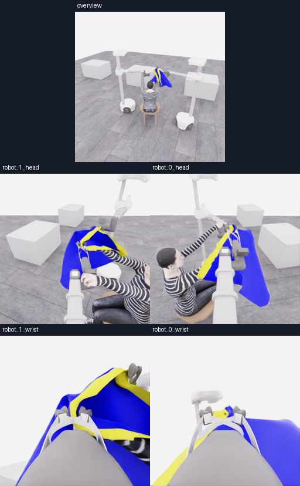

# 출발 상태 사용자 검토 · hold-0001

**현재 live HOLD. M1 모델 호출0·정책 행동0이며 사용자 답변 전까지 움직이지 않습니다.** run `20261116-astra-m1-checkpoint-001`, 관측 `d4b2a7f8c08b3fac9bf16948da0219d318e8f59cc651db7e93e67ada4964446b`, 기록 전이0, reset 정착 후 시뮬레이션 1.508333s.

[overview](overview.png) · [R1 head](robot_1_head.png) · [R0 head](robot_0_head.png) · [R1 wrist](robot_1_wrist.png) · [R0 wrist](robot_0_wrist.png)

E36/933 재생에서 저장한 slot을 복원했습니다. 별도 검증에서 정착 후 base 기준 파지점이 축별 최대6.4mm 달라졌고, 같은 짧은 lift의 R0 grasp Z는 재생 경계−0.208mm / 복원·정착 뒤+0.117mm였습니다. 화면상 파지와 손 근접은 대체로 유지됐지만 정확히 같은 제어 상태로 보지 않습니다. [검증 비교와 해석](../../../reviews/20261116-checkpoint-validation.ko.md)

**다음 선택을 텍스트로 알려주세요:** 현재 복원 상태에서 M1 진행 / E36 행동을 새로 재생한 말단에서 진행 / E34 등 이전 출발점 / 종료. 같은 상태에서 계속하면 reset하지 않습니다.

현재 관계의 소매 통과·유효 통로·지지 강도는 미확인입니다. 검증 probe는 착의 시연 성과가 아니며 첫 소매 추가 득점은0입니다. [관측 metadata](observation-metadata.json)
