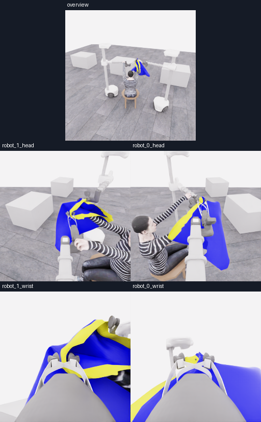

# 사용자 검토: 20261116-astra-m1-checkpoint-001 / hold-0002

**후퇴→하강→같은 손목 재접근 뒤 촬영한 HOLD · 이후 실제 사용자 답변으로 재개**

사용자가 구간별 GIF와, 오른손 전체를 드러낼 만큼 충분한 후퇴 후 옷의 처짐 확인을 요청했습니다. 같은 live 상태에서 재개했으며 현재 상태는 저장소 최상단을 확인하세요.

사용자 지시를 같은 live 상태에서 실행했습니다. 6호출·6결정 중5 act·16전이(0.80초)이며 마지막 stop 제안은 실행하지 않았습니다. 양쪽 닫기 의도를 유지했습니다. 파지 기준점은 약16mm 낮아졌고, 마지막 재접근의 world Y 변화는 약+7mm로 이전 후퇴 변위 전체를 되돌리지는 않았습니다. 천 자체의 이동량이나 손목까지 거리로 해석하지 않습니다. [단계별 실제 효과와 기전](../../../reviews/20261116-m1-front-lower-wrist.ko.md)

관측 `893fea342c192970b34e406fc93e541b771c7f16eac0d028bb2a8fa04a4cd5e7` · 전이16 · 기록 tick192 · 시뮬레이션2.308333s. 모든 화면은 같은 경계입니다. 촬영 당시 live HOLD이며 이후 상태는 [저장소 최상단](../../../../../README.md)을 확인하세요.

[overview](overview.png) · [robot_1_head](robot_1_head.png) · [robot_0_head](robot_0_head.png) · [robot_1_wrist](robot_1_wrist.png) · [robot_0_wrist](robot_0_wrist.png) · [관측 metadata](observation-metadata.json) · [조작 전 화면](../hold-0001/README.ko.md)

천과 그리퍼 하우징이 손목–입구 관계를 가려 **진입과 추가 접근 여유를 확인하지 못했습니다.** 열린 run이며 마감·QC·백업 전입니다. 이 경계에서의 대기는 실제 사용자 응답으로 끝났습니다.

당시 질문에 사용자는 충분한 추가 후퇴와 옷 처짐 확인을 선택했습니다.
