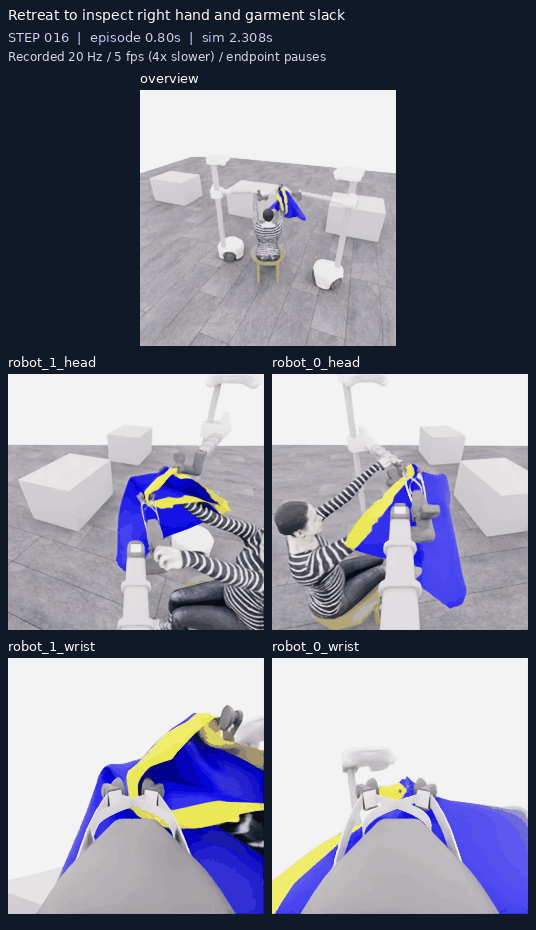
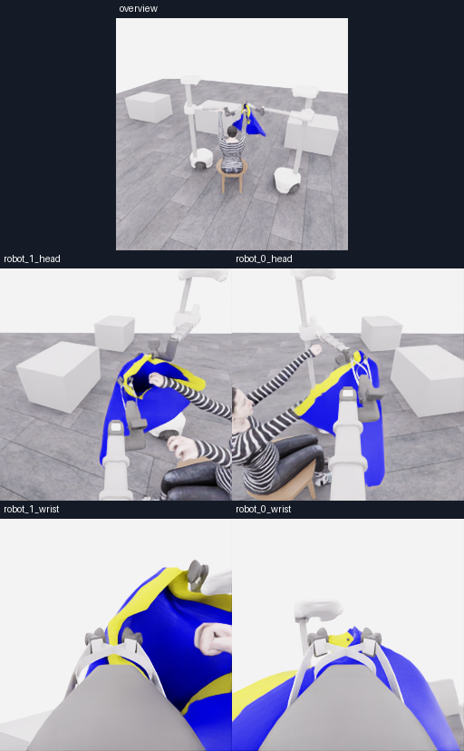

# 사용자 검토: 충분한 추가 후퇴와 옷 처짐

**20261116-astra-m1-checkpoint-001 / hold-0003 · 촬영 당시 live HOLD, 이후 사용자 지시로 재개**

사용자가 거리·처짐이 충분하다고 판단하고, 아주 조금 더 후퇴한 뒤 조금만 낮춰 다시 확인하도록 지시했습니다. 같은 상태에서 재개했으며 최신 상태는 저장소 최상단을 확인하세요.

사용자 지시대로 양쪽 파지 의도와 대략의 높이를 유지하며 몸에서 더 멀어졌습니다. 새5 act·23전이(1.15초), 누적12호출·10 act·39전이입니다. 추가 하강·재접근·재파지는 실행하지 않았고 마지막 stop은 물리 진행 없는 사용자 HOLD로 전환했습니다.

## 이번 움직임 GIF

실제20Hz 모든 기록 경계,4배 느린 재생과 시작·끝 정지입니다. 중간 프레임을 생성하지 않았습니다.

[최초 후퇴·하강·재접근까지 구간별 GIF 전체](../../../../gallery/20261116-m1-guided-segments/README.ko.md) · [단계별 이동량과 시각 분석](../../../reviews/20261116-m1-right-hand-clearance.ko.md)

## 현재5카메라

관측 `71f456b8de829a69541c67ca14ff74ed501fcd470ccadc1cf910e8e84a71d5c0` · 전이39 · 기록 tick468 · 시뮬레이션3.458333s. 모든 정지 화면은 같은 경계입니다. 이후 상태는 [저장소 최상단](../../../../../README.md)을 확인하세요.

[overview](overview.png) · [robot_1_head](robot_1_head.png) · [robot_0_head](robot_0_head.png) · [robot_1_wrist](robot_1_wrist.png) · [robot_0_wrist](robot_0_wrist.png) · [metadata](observation-metadata.json)

head 화면에서 손과 연결된 손목이 드러나고, 아래 노란 경계는 손 아래로 처져 보입니다. wrist 화면에는 일부가 화면 가장자리와 겹칩니다. 완전한 비접촉·옷 전체의 자유로운 처짐·다음 접근에 충분한 여유까지 확정하지 않습니다. 열린 run으로 마감·QC·백업 전이며 이 경계의 대기는 실제 사용자 답변으로 끝났습니다.

당시 질문에 사용자는 충분하다고 답하고 소폭 후퇴·하강을 선택했습니다.
