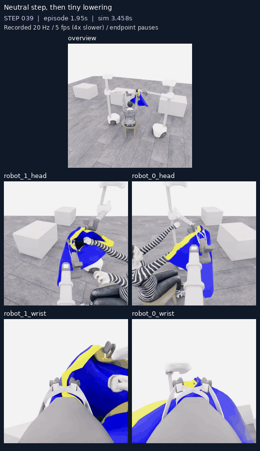
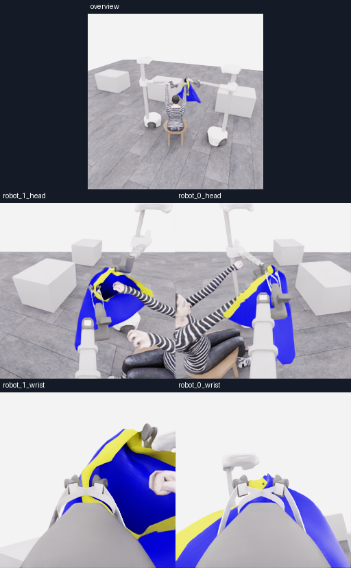

# 사용자 검토: 아주 작은 추가 후퇴와 하강

**20261116-astra-m1-checkpoint-001 / hold-0004 · live HOLD**

사용자가 충분하다고 판단한 이전 상태에서 아주 조금 더 멀어진 뒤 조금만 낮췄습니다. 첫 중립1전이에서 실제 추가 후퇴가 생겼고, 이어 lift−0.02 두전이를 실행했습니다. 이번2 act·3전이(0.15초), 누적15호출·12 act·42전이입니다. 마지막 stop은 실행하지 않았습니다.

## 이번 구간 GIF

실제20Hz 기록의4개 경계입니다. 중간 프레임은4배 느리게 재생하고 시작·끝에 정지를 넣었습니다. 변화가 작으므로 수치를 함께 확인하세요.

[동작별 GIF와 이전 구간 전체](../../../../gallery/20261116-m1-guided-segments/README.ko.md) · [현재 분석](../../../reviews/20261116-m1-small-clearance-lower.ko.md)

파지점 world Y 변화는 R0/R1 −4.59/−3.69mm, world Z는 −0.73/−0.82mm입니다. 로봇 기준점의 변화이며 천 재료점 이동량이나 손–천 간격과 다릅니다. 손·연결 손목 노출과 옷 처짐의 큰 배치는 대체로 유지됐습니다.1mm 미만 효과는 RGB만으로 확정하기 어렵습니다.

## 현재5카메라

관측 `289261ccf16f0a932f664853cbaad36611d099599fdaa1ec53e185b961ad1fa7` · 전이42 · 기록 tick504 · 시뮬레이션3.608334s. 모든 정지 화면은 같은 경계입니다. 이후 상태는 [저장소 최상단](../../../../../README.md)을 확인하세요.

[overview](overview.png) · [robot_1_head](robot_1_head.png) · [robot_0_head](robot_0_head.png) · [robot_1_wrist](robot_1_wrist.png) · [robot_0_wrist](robot_0_wrist.png) · [metadata](observation-metadata.json)

양쪽 닫기 의도를 유지했고 새 재파지·재접근은 없었습니다. 열린 run으로 마감·QC·백업 전이며 사용자 답변 전 물리 진행0입니다.

**현재 높이·여유를 확인해 주세요. 여기서 어느 방향으로 진행할까요?**
