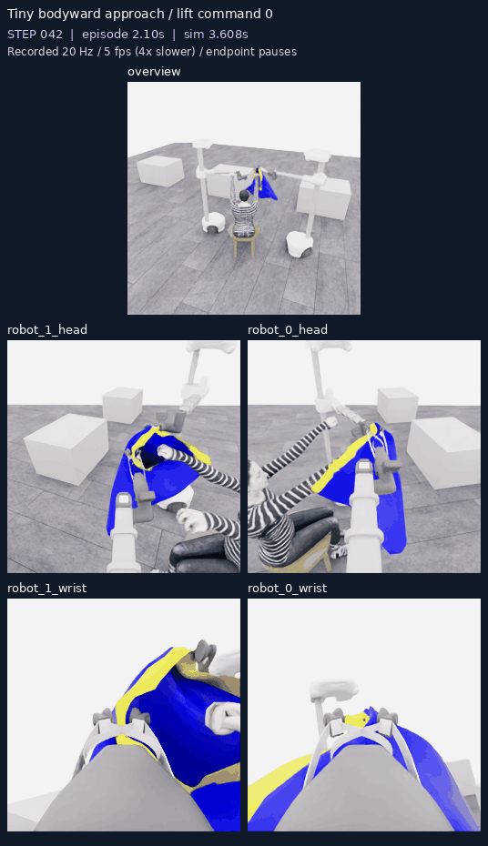
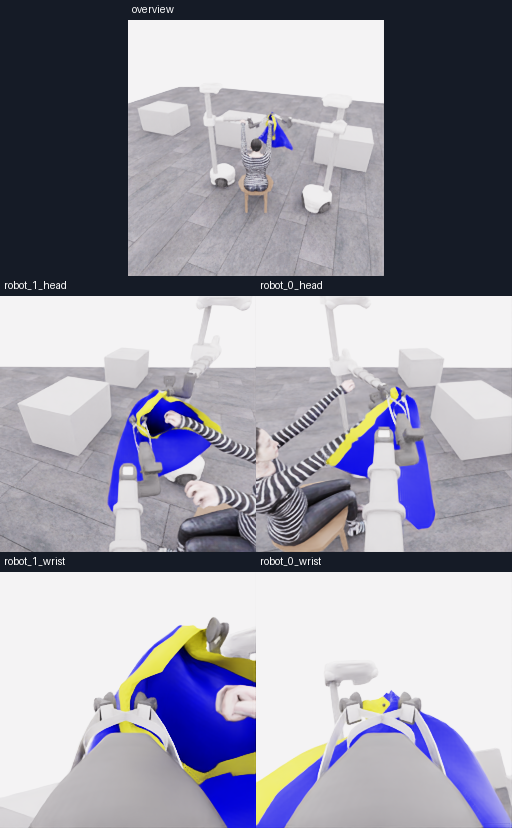

# 사용자 검토: 손을 든 자세에 맞춘 아주 작은 몸쪽 접근

**20261116-astra-m1-checkpoint-001 / hold-0005 · live HOLD**

사용자가 현재 높이를 적절하다고 판단하고, 손을 든 자세에 맞춰 조금씩 낮추면서 몸쪽으로 조금 이동한 뒤 다시 확인하도록 지시했습니다. 양쪽 파지를 유지한 새1 act·2전이(0.10초) 뒤 HOLD했습니다. 누적17호출·13 act·44전이이며 마지막 stop은 실행하지 않았습니다.

## 이번 움직임 GIF

실제20Hz 기록의42·43·44 경계를 모두 표시합니다. 중간 프레임은4배 느리게 재생하고 시작·끝에 정지를 넣었습니다. 미세한 변화는 수치를 함께 확인하세요.

[전체 구간별 GIF](../../../../gallery/20261116-m1-guided-segments/README.ko.md) · [이동량·현재 분석](../../../reviews/20261116-m1-tiny-body-approach.ko.md)

파지점 world Y 변화는 R0/R1 +1.24/+1.91mm, world Z는 −0.92/−0.95mm입니다. 베이스 평행이동만 작게 명령했고 lift명령0에서도 실제 하강이 나타났습니다. world Y를 몸통까지 거리나 천 재료점의 변위로 해석하지 않으며, 하강 원인을 이 값만으로 단정하지 않습니다.

손·연결 손목의 노출과 옷의 큰 배치는 유지되어 보입니다. 약1mm 변화에 따른 여유 증가·손 진입은 RGB만으로 확인하지 못했습니다.

## 현재5카메라

관측 `f370356a84de5469cae5391c787852a0a5a25381eb329f86bcd06ad11ca07388` · 전이44 · 기록 tick528 · 시뮬레이션3.708334s. 모든 정지 화면은 같은 경계입니다. 이후 상태는 [저장소 최상단](../../../../../README.md)을 확인하세요.

[overview](overview.png) · [robot_1_head](robot_1_head.png) · [robot_0_head](robot_0_head.png) · [robot_1_wrist](robot_1_wrist.png) · [robot_0_wrist](robot_0_wrist.png) · [metadata](observation-metadata.json)

열린 run으로 마감·QC·백업 전이며 사용자 답변 전 물리 진행0입니다.

**현재 접근 방향과 높이를 확인해 주세요. 같은 방향으로 조금 더 진행할까요?**
