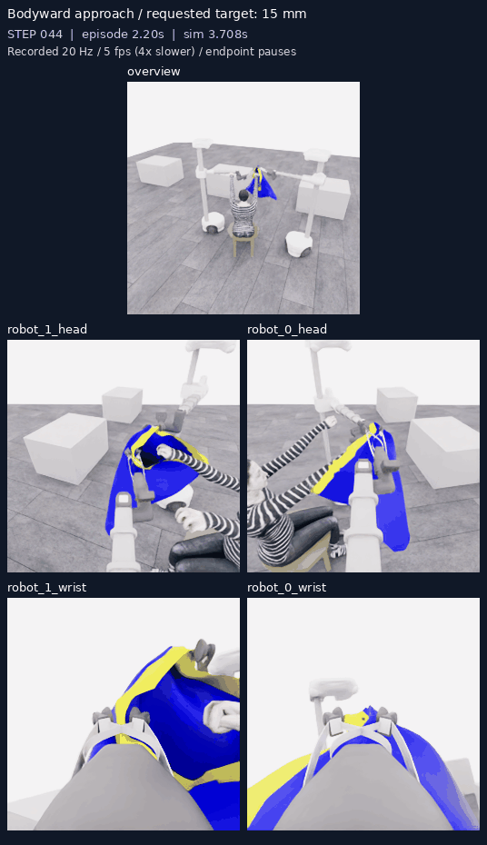
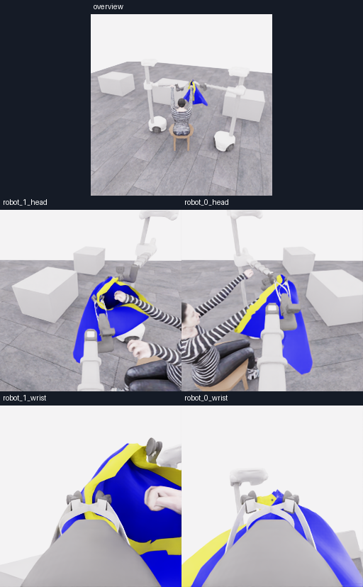

# 사용자 검토: 약15mm 추가 접근 후 현재 상태

**20261116-astra-m1-checkpoint-001 / hold-0006 · 촬영 당시 live HOLD, 이후 실제 사용자 답변으로 재개**

사용자가 같은 방향으로30mm 더 진행하도록 지시했습니다. 같은 live 상태에서 재개했으며 최신 상태는 저장소 최상단을 확인하세요.

같은 방향으로 약15mm 더 이동하라는 요청을 실제 파지점 이동량으로 확인하며 실행했습니다. 같은 손·양쪽 파지를 유지한 새3 act·8전이(0.40초) 뒤 HOLD했습니다. 누적21호출·16 act·52전이이며 마지막 stop은 실행하지 않았습니다.

## 이번 움직임 GIF

실제20Hz 기록의44–52 경계9장을 모두 표시합니다. 중간 프레임은4배 느리게 재생하고 시작·끝에 정지를 넣었습니다.

[전체 구간별 GIF](../../../../gallery/20261116-m1-guided-segments/README.ko.md) · [실제 이동량과 목표 비교](../../../reviews/20261116-m1-bodyward-15mm.ko.md)

두 파지점의 **추가XY순변위는14.87/14.96mm, 하강은1.26/1.27mm**입니다(R0/R1). 직전 실제평면방향에 대한 투영도14.87/14.96mm여서 요청량 근처에 도달하고 멈췄습니다. 이는 로봇 기준점 이동으로 손–천 간격이나 천 재료점의 이동량과 다릅니다. 새 lift명령은0이며 베이스 평행이동 중 실제 하강이 함께 관측됐습니다.

손·연결 손목의 노출과 옷의 큰 배치는 유지되어 보입니다. 손의 실제 진입은 아직 확인하지 못했습니다.

## 현재5카메라

관측 `de68eba2b2edc0360458d86ed736f5d637ccae9aa720f0cd1e414fa5538471f3` · 전이52 · 기록 tick624 · 시뮬레이션4.108334s. 모든 정지 화면은 같은 경계입니다. 이후 상태는 [저장소 최상단](../../../../../README.md)을 확인하세요.

[overview](overview.png) · [robot_1_head](robot_1_head.png) · [robot_0_head](robot_0_head.png) · [robot_1_wrist](robot_1_wrist.png) · [robot_0_wrist](robot_0_wrist.png) · [metadata](observation-metadata.json)

열린 run으로 마감·QC·백업 전이며 이 경계의 대기는 실제 사용자 답변으로 끝났습니다.

이 경계에서 사용자는 같은 방향으로30mm 더 이동하도록 답했습니다.
