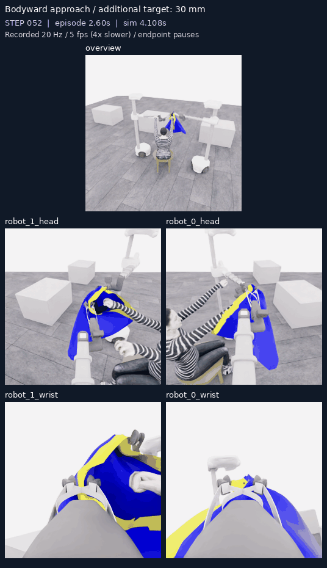
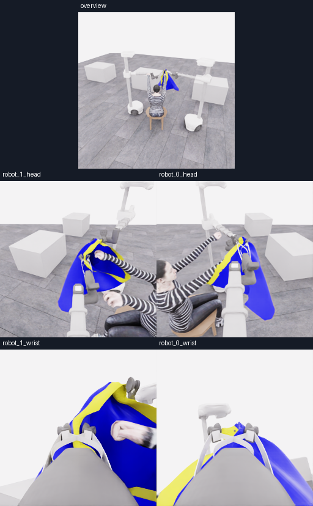

# 사용자 검토: 같은 방향30mm 추가 접근 후 현재 상태

**20261116-astra-m1-checkpoint-001 / hold-0007 · live HOLD**

현재 위치에서 같은 방향으로30mm 더 이동하라는 요청을 실제 파지점 이동량으로 확인하며 실행했습니다. 같은 손·양쪽 파지를 유지한 새5 act·16전이(0.80초) 뒤 HOLD했습니다. 누적27호출·21 act·68전이이며 마지막 stop은 실행하지 않았습니다.

## 이번 움직임 GIF

실제20Hz 기록의52–68 경계17장을 모두 표시합니다. 중간 프레임은4배 느리게 재생하고 시작·끝에 정지를 넣었습니다.

[전체 구간별 GIF](../../../../gallery/20261116-m1-guided-segments/README.ko.md) · [실제 이동량과 목표 비교](../../../reviews/20261116-m1-bodyward-30mm.ko.md)

두 파지점의 **추가XY순변위는30.44/30.19mm, 하강은0.24/0.19mm**입니다(R0/R1). 직전 실제평면방향에 대한 투영30.43/30.15mm로 요청량 근처에 도달하고 멈췄습니다. 이는 로봇 기준점의 이동이며 손–천 간격이나 천 재료점 이동량과 다릅니다. 베이스 평행이동만 명령했고 lift명령0으로 높이는 거의 유지됐습니다.

같은 손·연결 손목은 계속 보이고 양쪽 파지부와 처진 천의 큰 배치는 유지되어 보입니다. 손과 노란 경계의 상대 위치는 변했지만 실제 손 진입은 아직 확인하지 못했습니다.

## 현재5카메라

관측 `3f77008cf00cb97c06b2e325f220fac982e3c949d16b83743f20497d6730c971` · 전이68 · 기록 tick816 · 시뮬레이션4.908334s. 모든 정지 화면은 같은 경계입니다. 이후 상태는 [저장소 최상단](../../../../../README.md)을 확인하세요.

[overview](overview.png) · [robot_1_head](robot_1_head.png) · [robot_0_head](robot_0_head.png) · [robot_1_wrist](robot_1_wrist.png) · [robot_0_wrist](robot_0_wrist.png) · [metadata](observation-metadata.json)

열린 run으로 마감·QC·백업 전이며 사용자 답변 전 물리 진행0입니다.

**약30mm 추가 이동 후 손과 옷의 관계를 확인해 주세요. 다음 방향을 알려주실 때까지 현재 상태를 유지합니다.**
