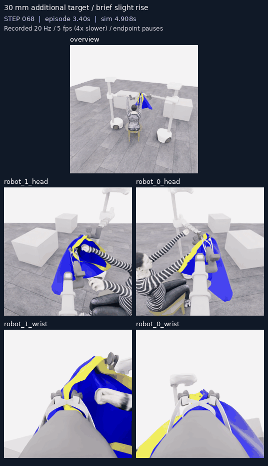
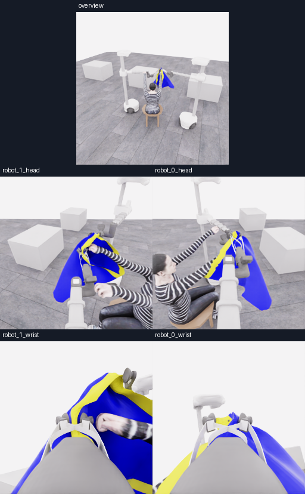

# 사용자 검토:30mm 추가 접근과 작은 상승 후 손 정렬

**20261116-astra-m1-checkpoint-001 / hold-0008 · 촬영 당시 live HOLD, 이후 실제 사용자 답변으로 재개**

사용자가 아주 조금 위로 올리면서50mm 더 이동하도록 지시했습니다. 같은 live 상태에서 재개했으며 최신 상태는 저장소 최상단을 확인하세요.

같은 몸쪽 방향으로30mm 더 이동하면서 아주 조금 올려 달라는 지시를 실행했습니다. 새5 act·16전이(0.80초) 뒤 HOLD했고, 누적33호출·26 act·84전이입니다. 마지막 stop은 실행하지 않았습니다.

## 이번 움직임 GIF

실제20Hz 기록의68–84 경계17장을 모두 표시합니다. 중간 프레임은4배 느리게 재생하고 시작·끝에 정지를 넣었습니다.

[전체 구간별 GIF](../../../../gallery/20261116-m1-guided-segments/README.ko.md) · [실제 이동량·상승·정렬 분석](../../../reviews/20261116-m1-bodyward-30mm-slight-rise.ko.md) · [이동 전 화면](../hold-0007/README.ko.md)

두 파지점의 **추가XY순변위는30.40/30.08mm, 상승은2.24/2.31mm**입니다(R0/R1). 첫3전이에만 작은 lift+.01을 주고 이후13전이는lift0으로 접근했습니다. 수치는 로봇 기준점 이동이며 손–천 간격이나 천 재료점 이동량이 아닙니다.

R1 wrist에서 손의 화면상 위치가 왼쪽 중앙 쪽으로 옮겨졌고 파란 천·노란 경계와의 상대관계가 달라졌습니다. 동시에 전경 그리퍼 하우징과의 화면상 간격도 좁아졌습니다. **정확히 옷 입구 가운데에 놓였는지, 실제로 진입했는지는 확정하지 못했습니다.** 여러 시점과 GIF를 함께 보고 사용자가 정렬을 판단합니다.

## 현재5카메라

관측 `74956cf7a7e8f26b842ed35f7303ced54474635cea116c8c315b6c69141b8d41` · 전이84 · 기록 tick1008 · 시뮬레이션5.708334s. 모든 정지 화면은 같은 경계입니다. 이후 상태는 [저장소 최상단](../../../../../README.md)을 확인하세요.

[overview](overview.png) · [robot_1_head](robot_1_head.png) · [robot_0_head](robot_0_head.png) · [robot_1_wrist](robot_1_wrist.png) · [robot_0_wrist](robot_0_wrist.png) · [metadata](observation-metadata.json)

열린 run으로 마감·QC·백업 전이며 이 경계의 대기는 실제 사용자 답변으로 끝났습니다.

이 경계에서 사용자는 아주 작은 상승을 더하며50mm 추가 접근하도록 답했습니다.
