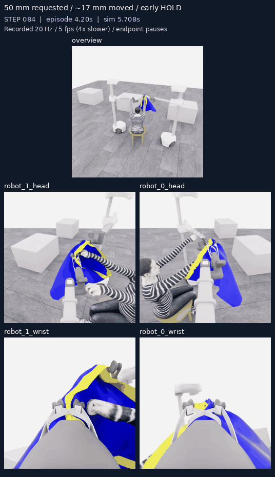
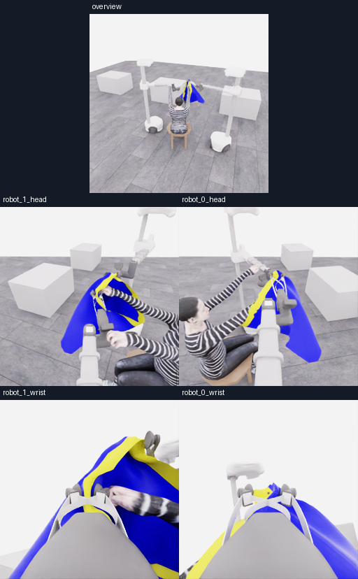

# 사용자 검토:50mm 요청 중 약17mm에서 가림으로 HOLD

**20261116-astra-m1-checkpoint-001 / hold-0009 · 촬영 당시 live HOLD, 이후 실제 사용자 답변으로 재개**

사용자가 “문제 없어 보입니다.33mm 이동 진행해주세요”라고 답해 같은 live 상태에서 재개했습니다. 최신 실행 상태는 저장소 최상단에서 확인하세요.

**요청한50mm를 모두 이동하지 않았습니다.** 같은 몸쪽 방향으로 파지 기준점이 R0/R1 **17.08/16.86mm** 이동하고 **2.06/2.04mm** 올라갔습니다. 손이 그리퍼와 잡힌 옷 경계에 더 가려져 추가 이동 여유를 판단하기 어렵다는 모델 stop 제안을 물리0 HOLD로 전환했습니다. 약33mm가 남았습니다.

새3 act·9전이(0.45초), 누적37호출·29 act·93전이입니다. stop은 실행하지 않았고 reset도 하지 않았습니다.

## 이번 움직임 GIF

실제20Hz 기록의84–93 경계10장을 모두 표시합니다. 중간 프레임은4배 느리게 재생하며 시작800ms·끝1000ms 정지를 포함합니다.50mm는 요청 거리이며 GIF의 실제 이동 완료량이 아닙니다.

[전체 구간별 GIF](../../../../gallery/20261116-m1-guided-segments/README.ko.md) · [실측·남은 거리·가림 분석](../../../reviews/20261116-m1-bodyward-50mm-slight-rise.ko.md) · [이동 전 화면](../hold-0008/README.ko.md)

첫3전이에만 lift+.01을 주고 이후6전이는 lift0으로 접근했습니다. 실제XY순변위17.08/16.86mm와 직전 접근 방향 투영값은 소수 둘째 자리까지 같습니다. 요청50mm 대비 약32.92/33.14mm가 남습니다. 수치는 공개 로봇 상태에서 계산한 파지 기준점 이동이며 손–몸통 거리나 천 재료점 이동량이 아닙니다.

R1 wrist에서 같은 손끝이 왼쪽 전경 그리퍼와 잡힌 노란 옷 경계에 더 겹치고 일부 가려졌습니다. 연결 전완과 손은 다른 시점에서도 보이지만, 이 가림으로 실제 여유·옷 입구 중앙·진입을 확정하지 못했습니다. **실제 접촉이나 충돌이 발생했다고 판단한 것은 아닙니다.**

## 현재5카메라

관측 `f32c912cf87fe6cddfcef9bf802a05d7790b9ebb13b960176c19531a86db5183` · 전이93 · 기록 tick1116 · 시뮬레이션6.158334s. 모든 정지 화면은 같은 경계입니다.

[overview](overview.png) · [robot_1_head](robot_1_head.png) · [robot_0_head](robot_0_head.png) · [robot_1_wrist](robot_1_wrist.png) · [robot_0_wrist](robot_0_wrist.png) · [metadata](observation-metadata.json)

열린 run으로 마감·QC·백업 전이며 이 경계의 대기는 실제 사용자 답변으로 끝났습니다. 이후 최신 상태는 [저장소 최상단](../../../../../README.md)에서 확인하세요.

이 화면을 검토한 사용자가 같은 방향33mm 추가 진행을 지시했습니다.
