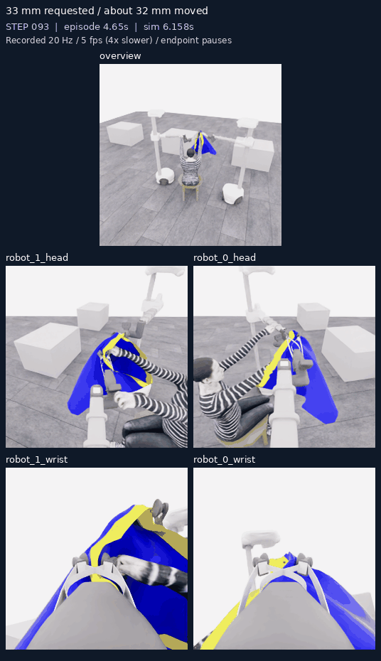
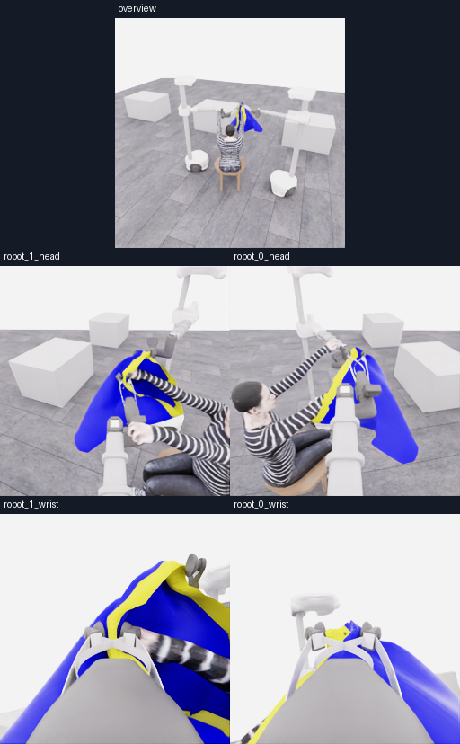

# 사용자 검토:33mm 요청 후 약32mm 추가 접근

**20261116-astra-m1-checkpoint-001 / hold-0010 · 촬영 당시 live HOLD, 이후 실제 사용자 답변으로 재개**

사용자가 같은 방향으로 손목 위 세 번째 줄무늬까지 계속 진행하도록 지시해 재개했습니다. 최신 상태는 저장소 최상단에서 확인하세요.

사용자가 이전 화면의 가림을 보고 “문제 없어 보입니다.33mm 이동 진행해주세요”라고 답해 같은 상태에서 이어 갔습니다. 추가XY순변위는 R0/R1 **31.97/31.45mm**, 높이 변화는 **+0.29/+0.50mm**입니다. 요청 방향33mm보다 **1.03/1.57mm 짧은 위치**에서 목표 근처 검토 HOLD했습니다.

새6 act·17전이(0.85초), 누적44호출·35 act·110전이입니다. 모든 새 행동의 lift 명령은0이며 stop은 실행하지 않았고 reset도 하지 않았습니다.

## 이번 움직임 GIF

실제20Hz 기록의93–110 경계18장을 모두 표시합니다. 중간 프레임은4배 느리게 재생하며 시작800ms·끝1000ms 정지를 포함합니다.33mm는 요청 거리이며 정확히33mm 완료한 영상은 아닙니다.

[전체 구간별 GIF](../../../../gallery/20261116-m1-guided-segments/README.ko.md) · [추가·전체 이동 분석](../../../reviews/20261116-m1-bodyward-33mm-completion.ko.md) · [이동 전 화면](../hold-0009/README.ko.md)

앞선HOLD8→9와 이번HOLD9→10을 합친 원래50mm 요청의 전체XY순변위는 **49.06/48.30mm**, 전체 높이 변화는 **+2.34/+2.54mm**입니다. 수치는 공개 로봇 상태의 파지 기준점 이동이며 손–몸통 거리나 천 재료점 이동량이 아닙니다. 추가 lift 명령0에서도 작게 상승했으므로 명령과 실제 높이 변화를 구분합니다.

R1 wrist에서 같은 손끝은 전경 그리퍼와 노란 옷 경계 뒤로 더 가려졌고 연결 전완은 계속 보입니다. 현재 공개 화면으로 실제 입구 진입·소매 통과를 확정하지 못했습니다. 사용자가 기존 가림을 허용해 진행한 사실과 실제 통과 여부는 별개입니다.

## 현재5카메라

관측 `fb30f5ece93bb11ceed23a030851eb89f1b8fb67c12e07ec1980da23389df43f` · 전이110 · 기록 tick1320 · 시뮬레이션7.008334s. 모든 정지 화면은 같은 경계입니다.

[overview](overview.png) · [robot_1_head](robot_1_head.png) · [robot_0_head](robot_0_head.png) · [robot_1_wrist](robot_1_wrist.png) · [robot_0_wrist](robot_0_wrist.png) · [metadata](observation-metadata.json)

열린 run으로 마감·QC·백업 전이며 이 경계의 대기는 실제 사용자 답변으로 끝났습니다. 이후 최신 상태는 [저장소 최상단](../../../../../README.md)에서 확인하세요.

이 화면을 검토한 사용자가 같은 방향으로 손목 위 세 번째 줄무늬까지 진행하도록 지시했습니다.
