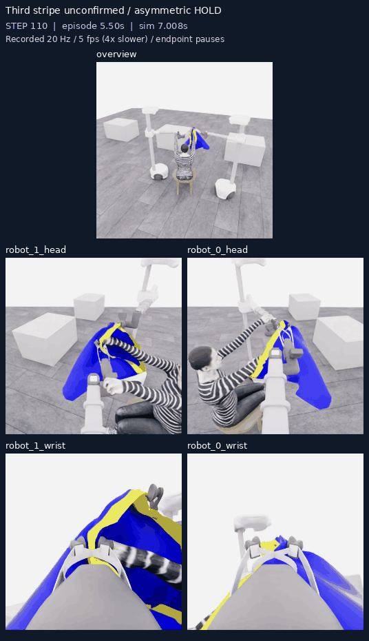
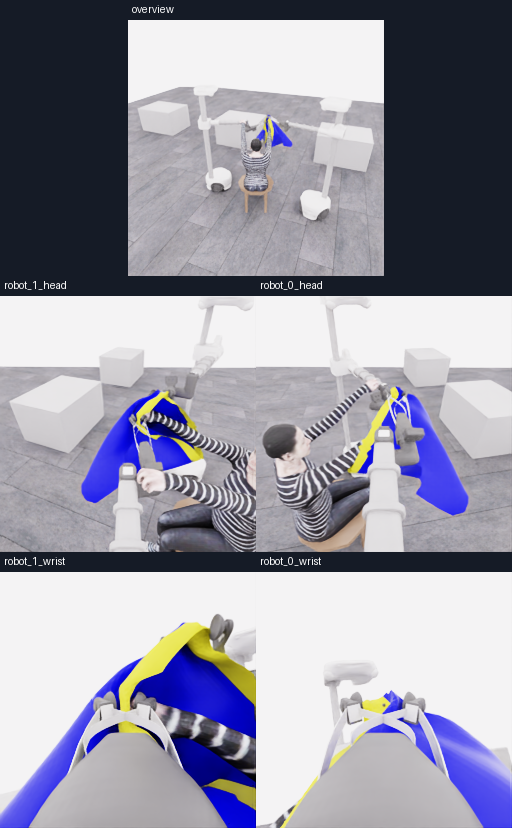

# 사용자 검토:세 번째 줄무늬 접근 중 양쪽 반응 차이로 HOLD

**20261116-astra-m1-checkpoint-001 / hold-0011 · 현재 live HOLD**

같은 방향으로 계속 밀어 넣어 손목 위 세 번째 줄무늬까지 진행하라는 지시를 수행했습니다. 추가XY순변위는 R0/R1 **18.37/13.55mm**이며, **세 번째 줄무늬 도달은 확인하지 못했습니다.** 마지막 짧은 구간의 양쪽 실제 운동 차이와 명령하지 않은R1 자세 변화를 확인해 검토 HOLD했습니다.

새3 act·10전이(0.50초), 누적48호출·38 act·120전이입니다. 같은 베이스 평면 명령만3+4+3전이 실행했고 lift·baseyaw·arm·wrist·gripper 명령은0이었습니다. stop은 실행하지 않았으며 reset도 하지 않았습니다.

## 이번 움직임 GIF

실제20Hz 기록의110–120 경계11장을 모두 표시합니다. 중간 프레임은4배 느리게 재생하며 시작800ms·끝1000ms 정지를 포함합니다. GIF 제목의 세 번째 줄무늬는 요청 목표이며 도달 판정이 아닙니다.

[전체 구간별 GIF](../../../../gallery/20261116-m1-guided-segments/README.ko.md) · [실측·목표 추적·비대칭 분석](../../../reviews/20261116-m1-third-stripe.ko.md) · [이동 전 화면](../hold-0010/README.ko.md)

## 이번에 달라진 반응

마지막3전이(117→120)에서 파지 기준점 worldY 변화는 R0/R1 **+5.31/+0.26mm**였습니다. R1은 X방향으로−1.45mm도 움직여 전체XY이동은1.48mm입니다. 따라서 R1이 전체적으로0.26mm만 움직였거나 베이스가 멈췄다는 뜻은 아닙니다. 같은 구간에 R1 베이스Y는+4.12mm 이동했고, 명령0인 베이스yaw는+0.294°, arm관절 연장합은+3.09mm 변했습니다.

이 수치는 공개 로봇 상태에서 계산한 실제 운동입니다. 파지 기준점·베이스·관절 변화를 구분하며, **접촉·끼임 등 원인은 아직 확정하지 못했습니다.** 천의 재료점 이동량이나 몸통까지 거리 측정값도 아닙니다.

손목의 피부–소매 경계에서 팔꿈치 쪽 세 번째 짙은 띠를 목표로 잠정 고정했습니다. 손목 시작점과 옷 경계가 일부 가려져 정확한 띠 정렬·입구 진입·소매 통과는 미확인입니다. 노란 경계가 더 펴져 보이는 변화와 실제 목표 도달은 구분합니다.

## 현재5카메라

관측 `1ae72bb8fe2b52ce3daebd876a58adbf06a455799ec330d12ca0eac110d75667` · 전이120 · 기록 tick1440 · 시뮬레이션7.508334s. 모든 정지 화면은 같은 경계입니다.

[overview](overview.png) · [robot_1_head](robot_1_head.png) · [robot_0_head](robot_0_head.png) · [robot_1_wrist](robot_1_wrist.png) · [robot_0_wrist](robot_0_wrist.png) · [metadata](observation-metadata.json)

열린 run으로 마감·QC·백업 전입니다. 사용자 답변 전에는 물리 진행·추가 정착·종료 없이 현재 상태를 유지합니다. 이후 최신 상태는 [저장소 최상단](../../../../../README.md)에서 확인하세요.

**GIF와 현재 화면을 보고 다음 진행 방향을 알려주세요.**
