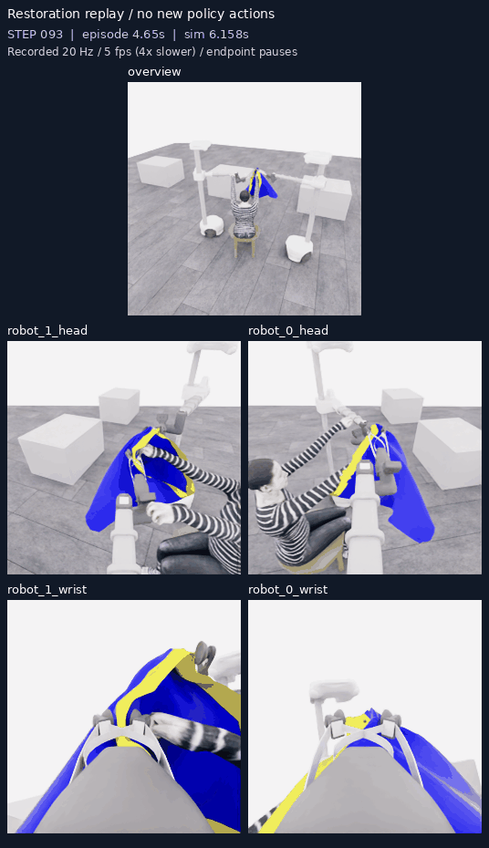
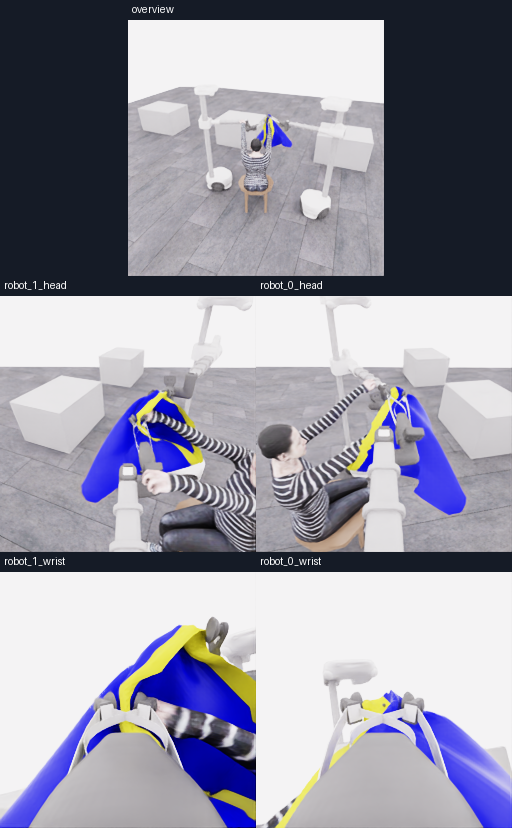

# 이전110전이 복귀 확인 · R0 단독 접근 출발점

**20261116-astra-right-hand-hold10-001 / hold-0001 · 출발 비교·게시 후 기존 사용자 지시로 재개**

사용자가 이전 구간으로 돌아가 오른손 가까운 로봇만 두 줄무늬 간격 정도 진행하도록 지시했다. 원래 초기slot에서 마감 M1의 앞110개 행동을 새로 실행했으며, 모델의 새 행동 호출은0이다. 고유 시작 checkpoint도 추가 물리 없이 저장했다.

기존 HOLD10과 새 파지점의 위치 차이는 **R0 1.86mm/R1 0.63mm**다. 공개5뷰에서 큰 배치·양쪽 지지·손 연결은 유지돼 보이며 옷 경계·주름에는 미세 차이가 있다. 정확한 물리 되감기나 천 상태 동일성을 보장하지 않는다. [수치·시각 비교](../../../reviews/20261116-right-hand-hold10-branch.ko.md)

## 복귀 재생의 마지막 구간

아래 GIF는 새run에서 재생한93–110 경계18장이다. 기존행동의재실행이며새R0단독접근과구분한다. 실제20Hz 기록을4배느리게보이고시작·끝정지를포함한다.

## 새 출발점5카메라

관측 `a22ece51b72d78fe73354dc26f67df987c662b81904bdec91347ec0a71cc2ac3` ·110전이·tick1320·7.008334s.

[overview](overview.png) · [robot_1_head](robot_1_head.png) · [robot_0_head](robot_0_head.png) · [robot_1_wrist](robot_1_wrist.png) · [robot_0_wrist](robot_0_wrist.png) · [metadata](observation-metadata.json)

공개어깨–팔–손연결의매핑은 **R0=오른손 쪽/R1=왼손 쪽**이다. 원격 게시 검증 후 기존 사용자 지시를 이월하여 R0 단독 접근으로 재개했다. R1은 중립 명령으로 지지를 유지한다. 중립은 물리적 고정이 아니므로 실제R1운동도확인한다. 다음 목표 검토에서 새 움직임GIF와5카메라를게시한다.

[원래HOLD10](../../20261116-astra-m1-checkpoint-001/hold-0010/README.ko.md) · [최신 상태](../../../../../README.md)
