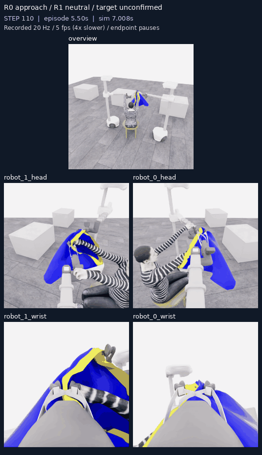
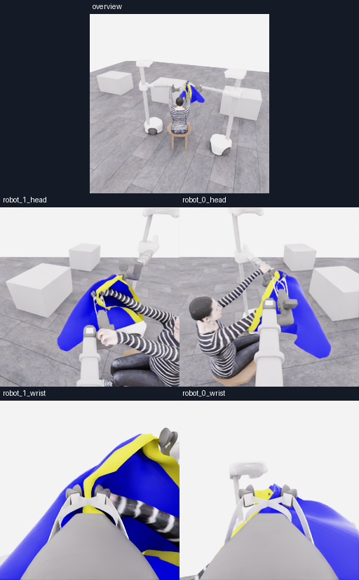

# 사용자 검토:이전 위치 복귀 후 R0 단독 접근

**20261116-astra-right-hand-hold10-001 / hold-0002 · 현재 live HOLD**

이전110전이 근처로 복귀한 뒤 **오른손 쪽 R0에만 접근 명령**을 주었다. 새 파지점 XY순변위는 **R0 41.57mm/R1 12.66mm**다. 왼손 쪽R1의 모든 명령은0이었지만 실제로 함께 움직였으므로 위치를 고정했다고 말할 수 없다.

**오른팔 줄무늬 두 칸만큼의 진행은 아직 확정하지 못했다.** 손·옷 경계가 파지부에 가려 남은 이동을 판단하기 어려워 모델 stop 제안을 물리0 HOLD로 전환했다. 실제 충돌·소매 통과도 미확인이다.

## 이번 단독 접근 GIF

새9 act는2+3+3+3+3+3+3+3+2=25전이(1.25초)다. 모두 R0의 같은 베이스 평면 명령만 실행했고 R1은9채널 전부0이었다. stop은 실행하지 않았다. 총10모델 호출, 기록135전이 중 앞110전이는 재생이다.

실제20Hz의110–135 경계26장을 모두 표시한다. 중간 프레임은4배 느리게 재생하며 시작800ms·끝1000ms 정지를 포함한다. [복귀 재생과 이번 접근을 나눈 GIF](../../../../gallery/20261116-right-hand-hold10/README.ko.md)

## 명령과 실제 움직임

| 로봇 | 명령 | 파지점 world ΔXYZ,mm | XY순변위,mm |
|---|---|---|---:|
| R0 · 오른손 쪽 | 기존 베이스 접근, 그 외0 | +3.716,+41.402,−0.658 | 41.569 |
| R1 · 왼손 쪽 | 9채널 모두0 | +1.041,+12.617,+0.521 | 12.660 |

R1 베이스 worldY도+7.79mm 이동했다. 첫 전환에서 줄어든 뒤 후반 동일3전이당 graspY 이동은 약1.02→1.62mm로 커졌다. 전체를 계속 줄어드는 잔류 운동으로 단정할 수 없으며, 잔류 제어·천/접촉 결합 등 원인은 미확정이다. 수치는 공개 로봇 기준점의 변위이며 천 이동량이나 실제 손 통과량이 아니다.

[좌우 식별·복귀 차이·최종 분석](../../../reviews/20261116-right-hand-hold10-branch.ko.md) · [복귀한 출발 화면](../hold-0001/README.ko.md)

## 현재5카메라

관측 `48101e32d536f9ce0a487fcba5204021815cc74b3cf9aeab4dc7e7b13aeba313` ·135전이·tick1620·8.258334s. 모두 같은 경계다.

[overview](overview.png) · [robot_1_head](robot_1_head.png) · [robot_0_head](robot_0_head.png) · [robot_1_wrist](robot_1_wrist.png) · [robot_0_wrist](robot_0_wrist.png) · [metadata](observation-metadata.json)

현재run은 열려 있으며 마감·QC·백업 전이다. 이전120전이run은 별도로 정상 마감·백업했다. 실제 다음 사용자 답변 전에는 추가 행동·정착·종료 없이 현재 상태를 유지한다.

**GIF를 보고 다음 진행 방향을 알려주세요.** [이후 최신 상태](../../../../../README.md)
