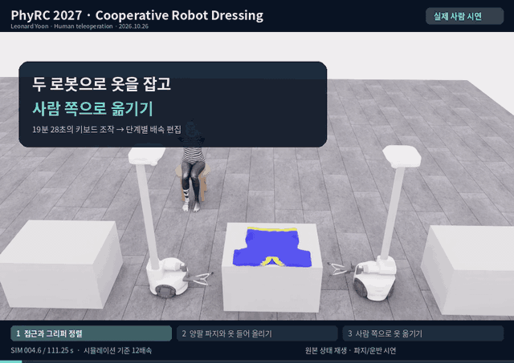
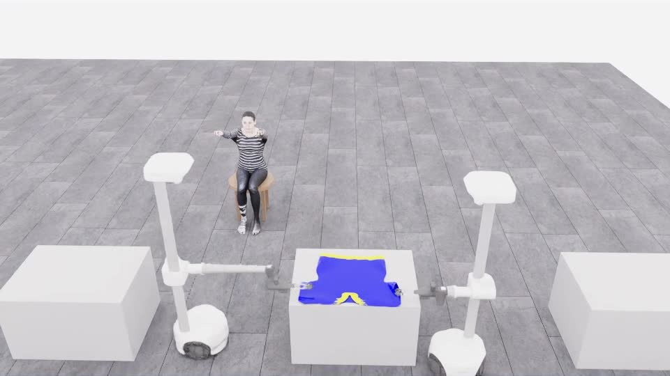
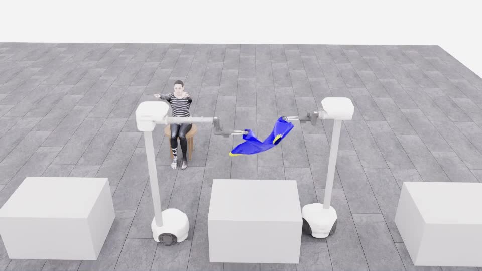
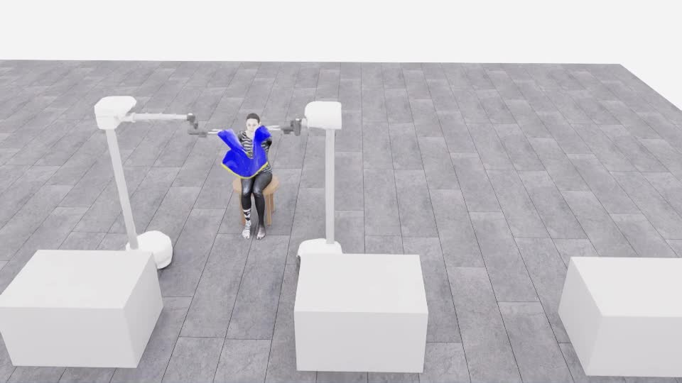

# 사람이 조작한 파지·들기·운반

[갤러리](README.ko.md) · [다음: Astra의 접근·파지 시도](20261106-astra-dressing-001.ko.md)

**자동 반복 GIF** · 640×453, 4fps, 33.0초, 약 4.82MB. 표시 너비는 800px입니다. 원본 MP4 전체 구간을 표본화했으며 프레임 시간 단위 때문에 원본 33.08초와 0.08초 차이가 있습니다. [변환 출처·용량 비교](assets/20261026-human-pickup-transport/provenance.json)

**[▶ 33.08초 시연 영상 보기](../videos/20261026-human-pickup-transport.mp4)**

맥북 Chrome에서 사람이 두 로봇을 조작했습니다. 옷 테이블 양옆의 고정 연습 배치에서 **접근 → 양쪽 파지 → 들기 → 마네킹 쪽 운반**을 기록했습니다. 공식 점수와 소매·목 통과, 전체 착의 성공은 확인하지 않았습니다.

## 세 장면

### 1. 옷 양옆으로 접근·정렬

옷의 양쪽을 향해 이동하고 팔·손목·그리퍼를 조정합니다. 대표 화면은 편집 영상의 8초 지점입니다.

### 2. 양쪽에서 잡고 들어 올리기

옷을 양쪽에서 잡은 뒤 테이블 위로 들어 올립니다. 대표 화면은 편집 영상의 20초 지점입니다.

### 3. 마네킹 쪽으로 운반

옷을 유지하면서 마네킹 쪽으로 이동합니다. 대표 화면은 편집 영상의 29초 지점입니다. 이 장면을 완전 착의로 표시하지 않습니다.

## 영상의 시간과 출처

| 원본 시뮬레이션 구간 | 과정 | 편집 재생 |
|---|---|---|
| 0–약 71초 | 접근·정렬 | 12배 빠르게 |
| 약 71–94초 | 파지·들기 | 2배 빠르게 |
| 약 94–111.25초 | 운반 | 1.5배 빠르게 |

제목 정지 화면과 자막을 포함한 영상 길이는 33.08초입니다. 저장된 상태를 재생해 렌더링했으며 새 동작이나 중간 상태를 합성하지 않았습니다. 위 JPG는 그 영상에서 자막 띠를 제외한 화면을 추출한 기존 이미지입니다. 모델의 행동 응답은 없는 사람 조작 기록입니다.

원본 run: `20261026T061140_546693Z_ab9e06`.

[장면 출처·이미지 SHA-256](../project/assets/visual-20261027/provenance.json) · [편집 구간·원본 manifest 식별자](../project/sessions/20261026-human-demo-edit.json) · [상세 수집 기록](../project/DEMO_20261026.ko.md)
