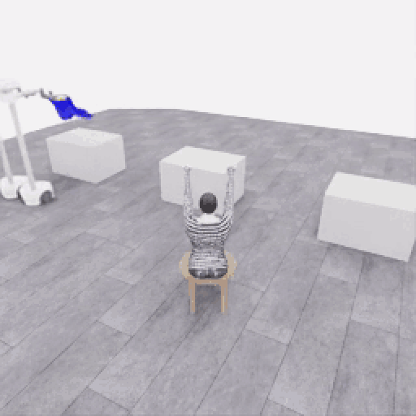
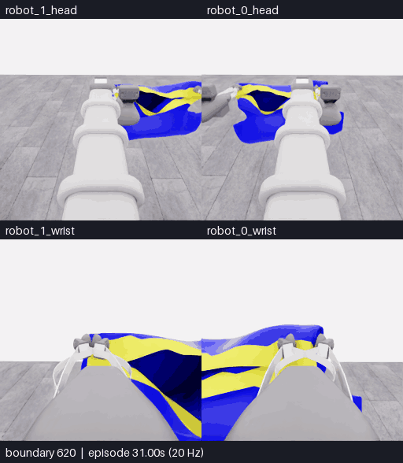
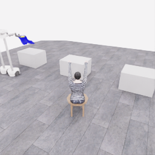
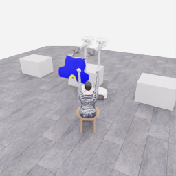
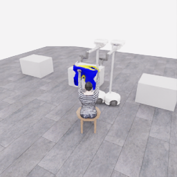

# E07: 함께 지지한 옷을 마네킹 앞으로 옮기기

**분할 화면 배치:** 위쪽은 머리, 아래쪽은 손목 카메라이며 두 행 모두 **왼쪽 robot_1·오른쪽 robot_0**입니다. 카메라 픽셀의 좌우 반전이 아니라 표시 타일만 옮겼습니다. 원본 관측·로봇 명령의 번호는 유지합니다.

[갤러리](README.ko.md) · [전체 시도·프롬프트·행동](../collection/attempts/20261106-astra-coordinated-fresh-001/README.ko.md) · [종료 검토](../collection/reviews/20261106-astra-coordinated-fresh-001.ko.md)

**두 로봇이 옷을 함께 지지하며 들어 올리고, 회전한 뒤 마네킹 방향으로 운반한 부분 과정**입니다. 공식 픽업 원점수는 **5/50점**입니다. 이후 소매 진입은 확인하지 못했고, 80개 결정 예산으로 종료했습니다. 최종 착의 `success=false`, 최종 산식 점수 `0 points/s`, 학습 승인 `unreviewed`입니다.

**자동 반복 · 선택한 345프레임·69.0초·5fps·4배 느리게.** 약 6.25MB입니다. 원본 256×256 MP4를 512×512 GIF로 확대하고 960px 너비로 표시합니다. 정사각형 비율은 유지했습니다. 전체 시도의 일부이며 선택 구간 안에서는 프레임을 생략하지 않았습니다. [변환 명령·시간·SHA](assets/20261106-astra-coordinated-fresh-001/provenance.json)

**[▶ 전체 213.4초 MP4](../collection/attempts/20261106-astra-coordinated-fresh-001/overview.mp4)** · [첫 5점·마네킹 접근의 원본 PNG](../collection/milestones/20261106-astra-coordinated-fresh-001/README.ko.md) · [종료 당시 소매 진입 미확인 검토](../collection/reviews/20261106-astra-coordinated-fresh-001.ko.md)

## 손 근처 접근 · 같은 시각의 네 카메라

위: 로봇 0·1 머리. 아래: 로봇 0·1 손목. **경계 620~700, 81프레임·16.2초·5fps·4배 느리게**, 약 4.58MB입니다. 같은 구간을 네 공개 카메라로 보며 카메라당 256×256 원본을 그대로 유지했습니다. 선택 구간 내 생략·보간·화면 자르기는 없습니다. 이 클립은 접근을 보여 주며 소매 진입 성공을 뜻하지 않습니다.

[네 카메라 MP4](assets/20261106-astra-coordinated-fresh-001-multiview/event.mp4) · [SHA·경계 매핑·인코딩 기록](assets/20261106-astra-coordinated-fresh-001-multiview/provenance.json) · [재사용 가능한 내보내기 도구](EVENT_EXPORT.ko.md)

## 반복 구간의 정확한 범위

| 항목 | 선택 범위 |
|---|---|
| 지정 카메라 | overview, 동일한 녹화 시점의 공개 관측 |
| 에피소드 경계 | **356~700**, 양끝 포함 |
| 물리 관측 시각 | 17.80~35.00초 |
| 원본 MP4 프레임 | 0부터 시작하는 **356~700**, 총 345장 |
| 원본 MP4 시간 | 71.20초 이상, 140.20초 미만 |
| 생략 | 선택 밖 앞 356장·뒤 366장, 선택 구간 안 0장 |
| GIF | 345장 각각 200ms, 총 69.0초, 무한 반복 |
| 전체 원본 | 1,067프레임·53.35 simulation초, 4배 저속 213.4초 |

MP4는 `obs/overview_rgb`를 순서대로 사용하므로 프레임 0이 첫 행동 전 경계 0입니다. 따라서 **MP4 프레임 356은 `next_obs[355]`, 프레임 700은 `next_obs[699]`와 같은 경계**입니다. 닫힌 E07 원본에서 두 경계의 픽셀과 시계가 실제로 일치하는지 다시 확인했습니다. `next_obs` 배열 번호와 MP4 프레임 번호를 한 칸 혼동하지 않았습니다.

첫 관측과 마지막 관측의 시각 차이는 17.20초이고, 마지막 표본도 한 프레임 길이만큼 표시하여 총 17.25초분의 프레임 지속 시간이 4배 저속으로 재생됩니다. 모델 응답을 기다린 실제 시간이나 새로운 물리 시뮬레이션은 넣지 않았습니다. 색상 양자화·확대 외에 동작 합성·시간 보간·화면 자르기는 하지 않았습니다.

## 첫 5점 이후의 공동 운반

| 첫 픽업 5점: 경계 356 | 마네킹 접근: 경계 700 |
|---|---|
|  |  |

두 로봇의 손끝 가까이에 천을 유지하며 테이블에서 벗어나 회전·전진하는 관측을 남겼습니다. GIF 시작은 이미 첫 픽업 점수가 기록된 경계이므로, 초기 접근·파지·들기의 전체 과정은 전체 MP4에서 확인할 수 있습니다. 중간의 손목 회전과 천이 감기는 형태, 반대 회전 복구도 보존했습니다.

경계 700의 모델 의도는 `approach / progressing`입니다. 마네킹에 접근한 실제 장면이며 운반·정렬 완료나 소매 삽입 성공으로 표시하지 않습니다. 5점 자체가 안정적인 양쪽 파지를 인증하는 것도 아닙니다. [양쪽 머리·손목 관측과 당시 판단](../collection/experiments/2026-11-06-coordinated-first5-review.ko.md) · [당시 700전이 접근 기록](../collection/experiments/2026-11-06-transport-waypoint.ko.md)

## 이 GIF 뒤에 이어진 소매 진입 시도

소매 시도는 GIF가 끝난 뒤 시작됐습니다. 모델이 `first_sleeve`라고 부른 24개 구간·254전이의 시각 판단은 모두 `uncertain`이었으며 공식 first_sleeve 점수는 0입니다. 방향 조정·접힘 복구를 반복했지만 최종 착의 성공을 확인하지 못했습니다. 마지막 단계와 결과는 [종료 검토](../collection/reviews/20261106-astra-coordinated-fresh-001.ko.md)에 별도로 기록했습니다.

전체 E07은 80개 행동 구간·73번 모델 호출·종료 중립 1전이를 포함한 1,067전이이고 전수 기술 검사를 통과했습니다. 실제 전체 경과는 83.90분입니다. 기술 검사·픽업 부분 점수·협력 운반의 시각 근거·전체 착의 성공을 구분하며, 동일 시도의 GIF를 새로운 독립 시연으로 추가 집계하지 않습니다.
