# Astra의 접근·파지 시도

[갤러리](README.ko.md) · [사람 부분 시연](20261026-human-pickup-transport.ko.md) · [작은 움직임 연결 시험](20261106-codex-robot-wiring-r5.ko.md)

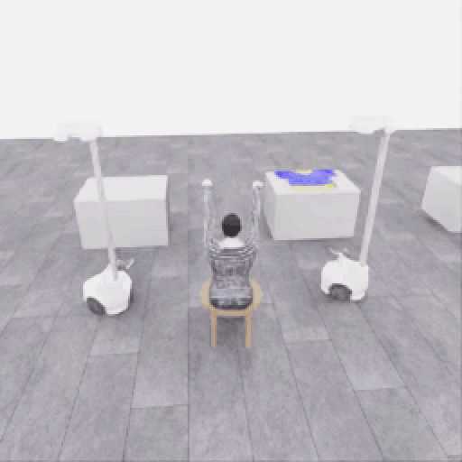

**자동 반복 GIF** · 전체 167프레임, 5fps, 33.4초, **4배 느리게**. 원본 256×256을 512×512 GIF로 확대하고 너비 720px로 표시합니다. [변환 출처](assets/20261106-astra-dressing-001/provenance.json)

**[▶ 33.4초 관측 영상 보기](../collection/attempts/20261106-astra-dressing-001/overview.mp4)**

`gpt-6-astra`·`ultra`가 공개 카메라와 로봇 상태를 보고 접근·닫기·시험 들기·재정렬을 시도한 기록입니다. **공식 결과는 0/50점·success=false**이며 파지 성공을 확인하지 못했습니다. 15개 모델 판단을 완료한 중단 시도입니다.

영상은 저장된 전체 화면 167프레임을 순서대로 보여 줍니다. **8.35 simulation초를 4배 느리게 재생한 33.4초 영상**이며 모델을 기다린 시간은 포함하지 않습니다.

## 시작과 종료의 공개 관측

이미지를 누르면 기존 PNG를 열 수 있습니다. 시작은 첫 관측, 종료는 마지막 행동 다음 관측입니다. 색·형태를 보정하거나 장면을 합성하지 않은 저장 RGB입니다.

| 카메라 | 시작 | 종료 |
|---|---|---|
| 전체 화면 | [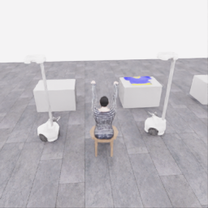](../collection/attempts/20261106-astra-dressing-001/images/initial-overview.png) | [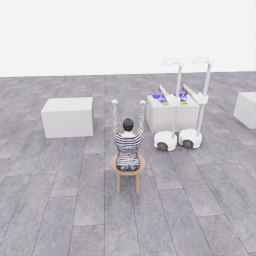](../collection/attempts/20261106-astra-dressing-001/images/final-overview.png) |
| 로봇 0 손목 | [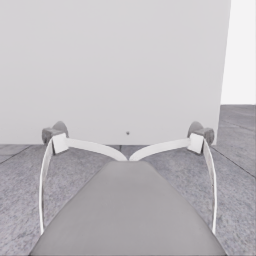](../collection/attempts/20261106-astra-dressing-001/images/initial-robot_0_wrist.png) | [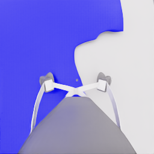](../collection/attempts/20261106-astra-dressing-001/images/final-robot_0_wrist.png) |
| 로봇 1 손목 | [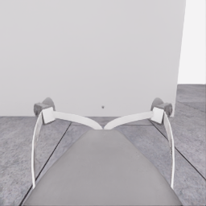](../collection/attempts/20261106-astra-dressing-001/images/initial-robot_1_wrist.png) | [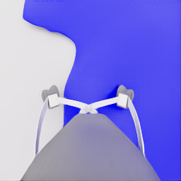](../collection/attempts/20261106-astra-dressing-001/images/final-robot_1_wrist.png) |
| 로봇 0 머리 | [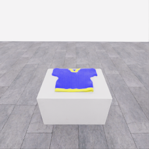](../collection/attempts/20261106-astra-dressing-001/images/initial-robot_0_head.png) | [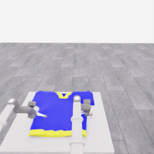](../collection/attempts/20261106-astra-dressing-001/images/final-robot_0_head.png) |
| 로봇 1 머리 | [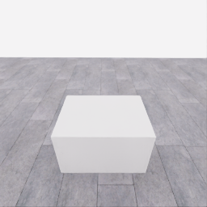](../collection/attempts/20261106-astra-dressing-001/images/initial-robot_1_head.png) | [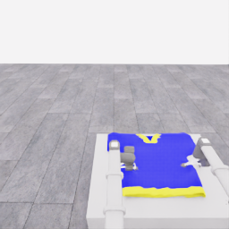](../collection/attempts/20261106-astra-dressing-001/images/final-robot_1_head.png) |

## 짧은 행동 응답과 과정

아래는 모델 **최종 행동 설명의 한국어 요약**입니다. 당시 관측에 대한 가설과 행동 의도이며, 실행 후 성공 판정이 아닙니다. 영상 지점은 각 행동이 시작되는 위치입니다.

| 영상 지점 | 결정 번호 | 응답과 실행 의도 |
|---|---:|---|
| 0.0초 | 0 | 양쪽 그리퍼를 연 채 접근 높이로 올린다. |
| 4.0초 | 1 | 로봇 0은 가까운 옷 모서리로, 로봇 1은 반대편 지원 위치로 이동한다. |
| 16.4초 | 5 | 테이블 접촉이 의심되어 손목을 올리고 접근 각도를 바꾼다. |
| 21.2초 | 8 | 양쪽 그리퍼를 닫고 위치를 유지한다. 이후 작은 들기로 옷이 따라오는지 확인해야 한다. |
| 22.8초 | 9 | 파지는 아직 확인되지 않았다. 닫기 의도를 유지하며 조금 들어 본다. |
| 26.4초 | 11 | 모델은 옷이 평평하게 남아 있다고 판단했다. 다시 열고 위치·각도를 조정한다. |
| 29.6초 | 13 | 다시 양쪽 그리퍼를 닫으며 로봇 위치와 손목을 유지한다. |
| 31.6초 | 14 | 테이블 접촉 가능성을 고려해 닫기 의도를 유지하며 조금 올린다. |

영상 마지막 0.2초에는 종료 정리를 위한 중립 행동 1전이가 포함됩니다. 저장된 167전이는 모델 행동 166전이와 정리 행동 1전이입니다. 공식 파지·들기 점수는 획득하지 않았습니다.

원본 run: `20261106-astra-dressing-001`.

[원본 파일·이미지·영상 manifest](../collection/attempts/20261106-astra-dressing-001/manifest.json) · [전체 과정·원본 행동 응답](../collection/attempts/20261106-astra-dressing-001/README.ko.md) · [종료 검토](../collection/reviews/20261106-astra-dressing-001.ko.md)
