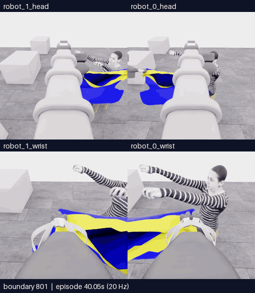

# E18 · 손 근처 접근, 추가 roll과 복구 후 감독 중단

[비교 갤러리](README.ko.md) · [공개 분석](../collection/reviews/20261106-astra-guide470-depth-001.ko.md) · [학습 검토 구간](../collection/reviews/20261106-astra-guide470-depth-001-learning-segments.json)

**5/50 · 픽업5 · 착의0 · success=false · 전수 검사928/928 통과.** 기존 파지로 운반·접근 방향을 바꾸고 공개 depth를3회 조회했지만, 전진 설명에 없는 robot1 roll이 두 번 반복됐습니다. 감독자가 SIGINT로 중단했으며 모델의 자율 finish나 사용자 중지 요청은 아닙니다. 최고5점·목표10점 미달성입니다.

**801~851경계 · 51프레임 · 10.2초 재생 · 5fps·4배 느리게.** [MP4 크게 열기](assets/20261107-e18-roll-recovery/event.mp4) · [영상 출처](assets/20261107-e18-roll-recovery/provenance.json)

위는 로봇0·1 머리, 아래는 로봇0·1 손목입니다. 카메라당 원본256×256이며 모델 응답 대기는 제외했습니다. 이 영상은50전이·2.5초의 물리 구간과 양 끝 관측51장을 포함합니다.

## 운반부터 종료까지

| 구간·영상 | 길이 | 실제 행동·관측 |
|---|---|---|
| [470~787 운반·접근](assets/20261107-e18-transport/event.mp4) · [출처](assets/20261107-e18-transport/provenance.json) | 318프레임·63.6초 | lift를 늘리고 횡이동·대형 회전으로 양 wrist에 상체·팔이 들어오게 했습니다. 실제 접근·관측 구성 변경입니다. |
| [787~928 손 접근·오류·복구·종료](assets/20261107-e18-entry-recovery/event.mp4) · [출처](assets/20261107-e18-entry-recovery/provenance.json) | 142프레임·28.4초 | 손과 rim 후보를 조회하고 전진·하강했습니다. 두 추가 roll과 각각의 복구, 마지막 감독 중립1전이를 포함합니다. |
| [801~851 첫 오류·복구](assets/20261107-e18-roll-recovery/event.mp4) | 51프레임·10.2초 | D16에서 robot1 roll+1이 실제 적용되고 D17–19에서 반대 roll 두 번·중립 관측으로 시야 방향을 되돌렸습니다. |

D21(865~879)에서도 전진 설명에 roll+1이 반복됐고 D22–24(879~915)가 복구 구간입니다. 화면 방향이 돌아온 것과 천 형상이 완전히 복구된 것은 다릅니다. 이 기록을 의도된 가이드 재파지의 실패로 합치지 않습니다. **E18에서는 새 가장자리로 open→재배치→reclose가 없었으므로 계획했던 소매 쪽 가이드 재파지는 미실행**입니다.

세 영상은 같은 실행의 겹치는 보기입니다. 선택 구간 안의 모든 원본 프레임을 유지했고 시간 보간은 하지 않았습니다. [실패·복구 학습 검토 JSON](../collection/reviews/20261106-astra-guide470-depth-001-learning-segments.json)은 오류와 회복도 검토 가능한 자료로 보존하되 자동으로 좋은 모방 행동으로 승인하지 않습니다. 승인 상태는 `unreviewed`이며 재실행 출처와 인접 프레임을 독립 표본으로 세지 않습니다.

[**이 영상에 피드백 남기기**](https://github.com/leonyoon-3dai/PhyRC_2027_phase1/issues/new?title=%5BE18+%ED%94%BC%EB%93%9C%EB%B0%B1%5D+%EC%98%81%EC%83%81+%EA%B5%AC%EA%B0%84%EA%B3%BC+%EA%B4%80%EC%B8%A1&body=%EC%8B%9C%EB%8F%84%3A+E18+%2F+20261106-astra-guide470-depth-001%0A%EC%98%81%EC%83%81+%EC%8B%9C%EA%B0%81+%EB%98%90%EB%8A%94+%EA%B2%BD%EA%B3%84%3A+%0A%EC%B9%B4%EB%A9%94%EB%9D%BC%3A+%EB%A1%9C%EB%B4%870+%EB%A8%B8%EB%A6%AC+%2F+%EB%A1%9C%EB%B4%871+%EB%A8%B8%EB%A6%AC+%2F+%EB%A1%9C%EB%B4%870+%EC%86%90%EB%AA%A9+%2F+%EB%A1%9C%EB%B4%871+%EC%86%90%EB%AA%A9%0A%0A%EA%B4%80%EC%B8%A1%ED%95%9C+%EC%9E%A5%EB%A9%B4%3A%0A%0A%EC%A0%9C+%ED%95%B4%EC%84%9D+%EB%98%90%EB%8A%94+%EC%A7%88%EB%AC%B8%3A%0A%0A%EB%8B%A4%EC%9D%8C%EC%97%90+%EB%B9%84%EA%B5%90%ED%95%98%EB%A9%B4+%EC%A2%8B%EC%9D%84+%EB%8F%99%EC%9E%91%3A%0A%0A%EA%B0%A4%EB%9F%AC%EB%A6%AC%3A+https%3A%2F%2Fgithub.com%2Fleonyoon-3dai%2FPhyRC_2027_phase1%2Fblob%2Fmain%2Fdocs%2Fgallery%2FREADME.ko.md%0A). E18, 영상 시각 또는 경계, 카메라와 관측한 장면을 적어 주세요. 링크는 작성 화면만 열며 제출은 사용자가 합니다.

## 실행 조건과 결과

| 항목 | 실제 기록 |
|---|---|
| 실행 ID / 소스 | `20261106-astra-guide470-depth-001` / `499b3b8cb29568e6d5530d7ce8bf039c73cd8f6a`, 시작 시 clean |
| 부모·분기 | E16의470전이 행동 재실행. 같은 출처 그룹이며 정확한 천 checkpoint 복원 아님 |
| 모델·입력 | Astra/ultra·CLI0.166.0/exec. 현재 공개 RGB5장·로봇 상태·depth·손목 depth 패널. 첫 호출에는 이번 재실행430·464경계의 RGB10장 추가 |
| 실제 depth 질의 | D6 overview6점, D15 wrist6점, D25 wrist8점.20/20 valid, 같은 현재 관측, **질의 물리 진행0** |
| 호출·판단 | **30호출 시도 = 26개 실행 행동 + 질의 초기 호출3개 + 중단 호출1개**. 마지막 call29/D26은 응답이 기록됐으나 최종 decision·행동 실행 없음 |
| 기록 | **470재실행 + 313모델 + 144제어기 settle + 1감독 중립 = 928전이** |
| 시뮬레이션 | 전체46.4초 / 새458전이·22.9초. 전이1개는0.05초이며 한 판단이 여러 전이를 진행 |
| 실제 경과 | 2026-11-06 23:58:53 → 2026-11-07 00:29:56 UTC · 1862.365559초(약31분2초) |
| 호출·환경 시간 | 모델 호출 경로1000.802692초 / 환경806.244306초. 모델 내부 추론시간과 다름 |
| 별도 평가 | **raw5/50 · pickup5 · 착의 항목 모두0 · success=false · no_dressing_points / 0.0** |
| 검사·종료 | 928/928통과·오류0. capture 마감, simulator exit0 / client130(SIGINT). 학습 승인은 unreviewed |
| 보존 | 공개 영상·분석·오류/복구 구간 보존. [비공개 원본 고정 HF 백업·재다운로드 SHA 검증 완료](../project/sessions/20261107-e18-backup-verification.json) |

공개 depth는 보이는 표면의 광축Z이며 클릭 대상의 의미·숨은 면·파지·소매 통과를 보증하지 않습니다. 실제 유효 조회와 착의 성능 향상은 별개입니다. E18의 점수율 `no_dressing_points / 0.0`은 E17의 `no_contact / null`과 다르며 파지 원인을 정답처럼 알려주지 않습니다.

## 후속 비교 · E19 실행 중

2026-11-07 00:45:20 UTC, main `9aad601`의 깨끗한 소스에서 실제 시작했습니다. 최종 결과는 [현재 상태](../project/STATUS.md)에 연결합니다.

손 근처 접근에서 얻은 시야와 거리 정보를 이어가기 위해 **E18의801경계(첫 추가 roll 직전)**를 재실행합니다. 같은 B 전략·depth 질의를 유지하고 이번 재실행771·787경계의 과거 RGB를 사용하되, 행동을 숫자 배열 대신 축 이름으로 작성해 기존9채널로 변환하는 기능을 비교합니다. 실제 착의 결과는 아직 없습니다.

명명 행동 기능은 **전체 CPU270검사·동일16이미지 실제 CLI 합성2턴**을 통과했습니다. [모델 없는 실제 GPU 연결](../collection/assets/20261107-named-action-candidate/model-free-gpu-wiring.json)도3/3전이 전수 검사를 통과했습니다. 실제 모델0회·fixture 질의1회이며 질의 물리 진행은0입니다. 이 기능은 E18에 사용하지 않았고 잘못된 의도 자체를 자동으로 고치거나 실제 과제 효과를 보장하지 않습니다. 목 우선 후보는 구현됐지만 아직 실제 실행하지 않았습니다.

[현재 상태와 실제 다음 명령](../project/STATUS.md) · [세션 기록](../project/sessions/20261106-evening-resume.ko.md)
