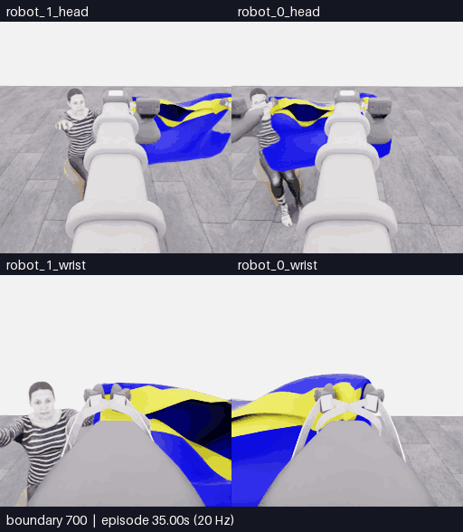
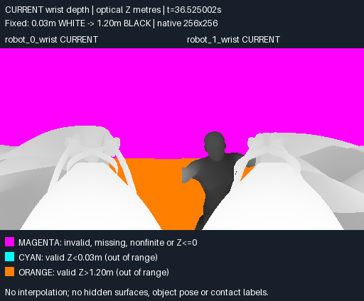

# E13 · 현재 손목 depth 추가 · 진입·복구 반복 뒤 모델 종료, 5점 유지

[갤러리](README.ko.md) · [전체 기록·프롬프트·행동](../collection/attempts/20261106-astra-hem-depth-001/README.ko.md) · [최종 구조화 결과](../collection/attempts/20261106-astra-hem-depth-001/manifest.json) · [앞선 E12](20261106-astra-hem-route-001.ko.md)

**결과: 공식 원점수 5/50, 첫 소매 0, 착의 `success=false`. 10점은 달성하지 못했습니다.** 현재 양쪽 손목 depth 패널을 추가한 상태에서 밑단 정렬·진입·복구를 반복했습니다. 손이 테두리를 넘어 들어가는 관계와 소매 출구 통과는 확인하지 못했고, 모델이 18번째 판단에서 `blocked`로 종료했습니다. **810/810전이 기술 검사 통과**와 착의 실패를 구분합니다.

**새 구간 전체 700~810경계 · 네 카메라 · 111프레임 · 22.2초 반복 · 5fps · 4배 느리게 · GIF 5.95MB(5,948,246바이트).** 새 물리 진행은 110전이·5.50초입니다. 위는 로봇 0·1의 머리, 아래는 로봇 0·1의 손목입니다. 카메라당 원본은 256×256, 합성 화면은 512×588이며 선택 구간의 프레임 생략·시간 보간·자르기가 없습니다. 양 끝 경계를 포함한 111장을 표시하므로 영상 길이는 22.2초이며, 모델 응답 대기는 포함되지 않습니다.

[**새 구간 MP4**](assets/20261106-astra-hem-depth-001/event.mp4) · [원본 SHA·경계 매핑·변환 근거](assets/20261106-astra-hem-depth-001/provenance.json) · [재실행 포함 전체 162초 overview MP4](../collection/attempts/20261106-astra-hem-depth-001/overview.mp4)

## 이번에 추가한 실제 입력

E12와 같은 E07 행동 700전이를 새로 재실행하고 `coordinated-hem-route` 지침을 사용했습니다. 이번 재실행의 264·320경계에서 얻은 과거 RGB도 유지했습니다. 여기에 **현재 양쪽 손목의 원본 해상도 depth를 고정 범위로 표시한 패널 한 장**을 각 모델 호출에 추가했습니다.

| 호출 | 이미지 순서 |
|---|---|
| 첫 호출 · 총 16장 | 현재 RGB 5장(0~4) → 이번 재실행 264경계 RGB 5장(5~9) → 320경계 RGB 5장(10~14) → **현재 손목 depth 패널(15)** |
| 이후 호출 · 각 6장 | 최신 현재 RGB 5장(0~4) → 같은 시각의 현재 손목 depth 패널(5) |

현재 공개 로봇 상태와 16×16 depth 중앙값 격자는 그대로 제공했습니다. 과거 사진은 같은 새 에피소드에서 직접 얻은 공개 관측이며, 과거의 로봇 상태·depth를 현재 수치로 섞지 않았습니다. [첫 호출 실제 16장·순서·현재/과거 표시·SHA256](../collection/attempts/20261106-astra-hem-depth-001/first-call-images.json) · [실제 기본 프롬프트](../collection/attempts/20261106-astra-hem-depth-001/prompt.txt)

**위 그림은 첫 호출에 전달한 실제 16번째 이미지입니다.** RGB 사진이나 물체 분류 마스크가 아니라 현재 손목의 광축 Z 깊이·유효성을 표시합니다. 0.03m는 흰색, 1.20m는 검은색이며 invalid는 자홍색, 하한 미만은 청록색, 상한 초과는 주황색입니다. 범위 밖의 실제 거리 차이와 가려진 표면은 이 표시로 읽을 수 없습니다. 색만으로 손·소매·접촉·통과 여부를 확정하지 않습니다. [고정 변환과 정보 손실 비교](../collection/research/2026-11-06-wrist-depth-input.ko.md)

## 실제 행동과 남은 불확실성

아래는 [공개 최종 결정·적용 기록](../collection/attempts/20261106-astra-hem-depth-001/decisions.jsonl)의 요약입니다. 손·밑단 위치와 `progressing` 같은 표시는 모델의 행동 전 시각 판단이며 공식 통과 판정이 아닙니다.

| 결정 · 0부터 시작 | 적용 경계 | 행동과 확인 한계 |
|---|---|---|
| D0~D2 · 정렬·복구 | 700→720 | 함께 앞·왼쪽으로 이동한 뒤, 손과 테두리 관계가 풀리지 않아 뒤로 물러나 높이 차이를 조정 |
| D3~D5 · 내려보기·철수 | 720→738 | 두 번 짧게 내려 진입을 시험했으나 통과를 보지 못함. 뒤로 이동하고 팔을 당겨 입구 형태·시야 복구 |
| D6~D8 · 접근·가림·대기 | 738→758 | 모델이 손끝을 다시 보았다고 판단해 전진·들기를 시도. 다시 가려지자 낮추고 **D8에서 6전이 중립 대기** |
| D9~D13 · 신장·형태 조정 | 758→792 | 높이를 유지하며 팔을 뻗고, 당기기·회전·높이 차이로 입구를 바꾼 뒤 재신장. 명확한 테두리 통과는 계속 미확인 |
| D14~D16 · 옆 정렬·재시험 | 792→810 | 로봇 기준 오른쪽 이동과 작은 신장·높이 조정. 모델은 손끝이 입구 오른쪽에 남아 있다고 평가 |
| D17 · 모델 종료 | 810→810 | `finish_episode`, `blocked`. 반복 복구에도 손과 테두리의 관계가 모호하고 소매 밖으로 나온 손을 보지 못했다는 이유로 종료 |

총 **16개 움직임 + 중립 대기 1개 + 종료 판단 1개**, 모델 호출 18회입니다. D8은 모델이 선택한 `act`로, 양쪽 로봇의 8개 속도 채널을 0으로 두고 gripper 닫기 명령 `+1`을 유지한 6전이 대기입니다. 종료 감독의 정리 동작이 아닙니다. D17 종료 명령은 물리를 추가 진행하지 않았고, 별도 종료 중립 전이도 없습니다. 이번 실행은 SIGTERM이나 결정 예산 소진으로 중단한 것이 아닙니다.

## 접촉 조건과 공식 점수

평가기의 첫 접촉 범위 조건 시각은 **에피소드 상대 35.8125초**입니다. 700경계의 상대 시각 35.00초에서 0.8125초 뒤이며, **20Hz 관측 경계와 정확히 일치하지 않습니다.** 환산 위치는 716·717경계 사이이므로 한 RGB 프레임을 정확한 접촉 순간으로 지정하지 않습니다. 공개 관측의 절대 simulation 시계와도 구분합니다.

이 값은 평가기의 충돌 메시 접촉 범위 조건이며, 실제 solver 접촉이나 손의 입구 통과를 증명하지 않습니다. E07·E12에도 접촉 판정이 있었으므로 새로운 최고 성과로 집계하지 않습니다. 최종 상태는 **`no_dressing_points`, `final_score=0.0 points/s`**이며 원점수 5점은 픽업입니다. 손 통과·착의 추가 득점·착의 성공은 확인되지 않았습니다.

## E12와 비교

| 측정·조건 | E12 · 밑단 진입 경로 | E13 · 같은 경로 + 현재 손목 depth |
|---|---|---|
| 부모 행동 재실행 | 700전이 | 700전이 |
| 첫 호출 / 이후 이미지 수 | 15 / 5 | 16 / 6 |
| 완료 결정 / 모델 요청 | 11 / 12 | 18 / 18 |
| 새 모델 적용 전이 | 80 | 110 · 중립 대기 6전이 포함 |
| 감독 종료 중립 전이 | 1 | 0 |
| 새 저장 전이 / 물리 시간 | 81 / 4.05초 | 110 / 5.50초 |
| 전체 전수 검사 | 781/781 통과 | 810/810 통과 |
| 전체 실제 경과 | 1,975.678초 · 32분 55.68초 | 2,010.295초 · 33분 30.29초 |
| Actor 호출 계측 합계 | 1,244.481초 · 20분 44.48초 | 1,253.547초 · 20분 53.55초 |
| 공식 원점수 / 첫 소매 | 5/50 / 0 | 5/50 / 0 |
| 착의 성공 / 최종 점수율 | `false` / 0 points/s | `false` / 0 points/s |
| 첫 접촉 상대 시각 | 36.65초 | 35.8125초 |
| 종료 방식 | 감독 SIGTERM · 진행 중 호출의 행동 폐기 | 모델이 `blocked`로 자율 종료 |

E13은 시작의 앞·왼쪽 이동, 중립 대기와 후속 팔 신장 등 E12와 다른 행동을 만들었습니다. 그러나 **depth 추가가 행동 차이나 과제 개선의 원인이라는 근거는 아직 없습니다.** 완료 결정 수·새 물리 진행 길이·종료 방식이 다르고 재실행이 천의 정확한 물리 상태 복원도 아니므로, 이 한 쌍을 통제된 성공률·속도 비교로 해석하지 않습니다. Actor 계측에는 입력 준비·CLI·요청/응답 대기가 포함되며 모델 내부 추론 시간만을 뜻하지 않습니다.

## 종료와 다음 후보

실행은 **10:35:22–11:08:52 UTC**, 상태는 `completed`, `finished=true`, `capture_complete=true`입니다. 저장 전이는 부모 재실행 700 + 새 모델 행동 110입니다. 학습 승인은 `unreviewed`이며 재실행 700전이를 독립 신규 시연으로 중복 집계하지 않습니다.

다음 후보는 **짧게 이동한 뒤 제어기가 중립 행동6전이(0.3 simulation초)를 더하는 비교**입니다. 모델 판단과 제어기의 추가 구간을 구분해 기록하며, 완전 정지나 목표 도달을 보장하지 않습니다. 관측과 제어 목표 사이의 잔여 움직임을 줄일 수 있는지 별도 시도에서 비교하는 계획이며, 아직 그 효과를 측정한 결과는 없습니다. 기존 실패와 영상은 보존하고 다른 시도를 이어갑니다.
