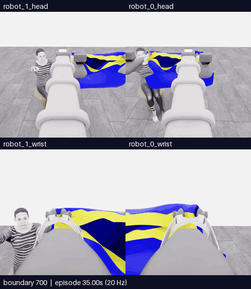

# E12 · 밑단 진입 경로 비교 · 접촉 범위 판정, 5점 유지

[갤러리](README.ko.md) · [전체 기록·프롬프트·행동](../collection/attempts/20261106-astra-hem-route-001/README.ko.md) · [최종 구조화 결과](../collection/attempts/20261106-astra-hem-route-001/manifest.json) · [앞선 E11](20261106-astra-sleeve-history-001.ko.md)

**결과: 공식 원점수 5/50, 첫 소매 0, 착의 `success=false`. 10점은 달성하지 못했습니다.** 밑단을 몸통 입구로 삼아 손을 넣고 소매 출구로 진행하는 경로를 시도했습니다. 평가기의 접촉 범위 조건은 충족했지만, 두 차례 진입 시도 뒤에도 손이 옷의 입구를 통과했다는 증거는 확인하지 못했습니다.

**새 구간 전체 700~781경계 · 네 카메라 · 82프레임 · 16.4초 반복 · 5fps · 4배 느리게 · GIF 약 4.69MB.** 새 물리 진행 4.05초는 모델 행동 80전이와 종료 중립 1전이를 포함합니다. 위는 로봇 0·1의 머리, 아래는 로봇 0·1의 손목입니다. 원본은 카메라당 256×256, 합성 화면은 512×588이며 선택 구간의 프레임 생략·시간 보간·자르기가 없습니다. 모델 대기 시간은 영상에 포함되지 않습니다.

[**새 구간 MP4**](assets/20261106-astra-hem-route-001/event.mp4) · [원본 SHA·경계 매핑·변환 근거](assets/20261106-astra-hem-route-001/provenance.json) · [재실행 포함 전체 156.2초 overview MP4](../collection/attempts/20261106-astra-hem-route-001/overview.mp4)

## 이번에 바꾼 조건

E11과 같은 E07 행동 700전이를 새 환경에서 재실행하고, 이번 재실행의 264·320경계 공개 RGB를 첫 호출에 제공했습니다. **현재 RGB 5장과 과거 RGB 10장의 순서는 유지하면서, 행동 지침을 `coordinated-hem-route`로 바꾸었습니다.** 밑단 입구와 소매 출구를 구분하고, 소매를 먼저 확정해야만 접근할 수 있다는 제한을 풀었습니다. 밑단 파지 자체를 오류로 간주하지 않으며, 손이 가려졌다는 이유만으로 진입했다고 판단하지 않도록 했습니다.

[실제 프롬프트](../collection/attempts/20261106-astra-hem-route-001/prompt.txt) · [첫 호출 실제 15이미지·현재/과거 구분·순서·SHA](../collection/attempts/20261106-astra-hem-route-001/first-call-images.json)

현재 공개 로봇 상태와 16×16 depth 중앙값 격자는 기존대로 제공했습니다. **전체 해상도 손목 depth 시각 패널은 E12에 적용하지 않았습니다.** 공식 참고 영상의 좌표·이미지나 평가 결과를 actor 입력으로 전달하지 않았습니다.

## 실제 행동과 확인하지 못한 점

아래는 [공개 최종 결정과 적용 기록](../collection/attempts/20261106-astra-hem-route-001/decisions.jsonl)의 요약입니다. 단계 이름과 `progressing` 같은 평가는 모델의 판단이며 공식 득점이나 입구 통과의 정답 라벨이 아닙니다.

| 완료 결정 · 0부터 시작 | 적용 경계 | 의도와 관측 한계 |
|---|---|---|
| D0~D3 | 700→732 | 함께 옆으로 이동하고 양쪽 높이를 조정해 추정 밑단 입구를 같은 손에 정렬. 손 진입 미확인 |
| D4 · 첫 진입 시도 | 732→738 | 함께 옆·앞·아래로 짧게 이동. 이 구간에서 평가기의 첫 접촉 범위 조건 충족 |
| D5~D6 · 가림 복구 | 738→752 | 손목 회전, 팔 당기기·들기로 손과 가장자리를 다시 보려 함. 모델은 손이 그리퍼에 가렸으며 입구 통과를 보지 못했다고 기록 |
| D7~D8 · 두 번째 진입 시도와 보정 | 752→766 | 손을 다시 확인한 뒤 옆·아래 이동과 작은 추가 보정. 손과 노란 가장자리는 가까워졌지만 통과 여부는 계속 불명확 |
| D9~D10 · 형태 복구 | 766→780 | 벌리기로 시야 확보를 시도했으나 모델은 보이는 입구가 좁아졌다고 평가. 안쪽 이동·pitch·리프트 조정으로 복구 시도 |
| 종료 처리 | 780→781 | 감독 중단 뒤 중립 명령 1전이. 새 모델 행동이나 성공 동작으로 집계하지 않음 |

첫 진입 직후의 공개 영상은 손이 그리퍼·옷 외부에 가려지는 설명과도 양립합니다. **손이 입구 테두리를 넘어 옷 안으로 들어가는 관계는 확인되지 않았습니다.** 이후 복구에서도 모델의 마지막 완료 판단은 `recovering`이었고, 입구 통과는 미확인으로 남았습니다.

## 접촉 판정과 점수의 의미

최종 평가의 `first_contact_time_s`는 **에피소드 상대 시간 36.65초**, 즉 **733경계**입니다. 첫 명시적 진입 시도 D4의 첫 전이에 해당합니다. 영상의 700경계는 에피소드 상대 35.00초이므로 새 구간 시작에서 1.65초 뒤입니다. 이는 actor 관측 파일의 절대 시뮬레이션 시각과 구분합니다.

여기서 접촉은 **평가기의 충돌 메시 접촉 범위 조건**입니다. 물리 solver의 실제 접촉이 입증됐거나 손이 밑단·소매를 통과했다는 뜻이 아닙니다. E10·E11의 `no_contact`에서 달라진 관측값이지만, **E07에도 접촉 판정이 있었으므로 프로젝트 최초 접촉 성과로 표시하지 않습니다.**

E12는 착의 추가 득점이 없어 `score_status=no_dressing_points`, `final_score=0.0 points/s`입니다. 원점수 5점은 픽업이며 점수율 계산의 착의 점수에서 제외됩니다. E10·E11의 `no_contact / final_score=null`을 0점/초로 바꾸지 않습니다.

## E10·E11과 비교

| 측정·조건 | E10 · 현재 관측 중심 | E11 · 과거 RGB 추가 | E12 · 밑단 진입 경로 |
|---|---|---|---|
| 부모 행동 재실행 | 700전이 | 700전이 | 700전이 |
| 첫 호출 RGB | 현재 5장 | 현재 5장 + 과거 10장 | 현재 5장 + 과거 10장 |
| 완료 새 행동 / 모델 요청 | 8개 움직임 + 종료 판단 / 9회 | 11개 / 12회 | 11개 / 12회 |
| 새 저장 전이 / 물리 시간 | 50 / 2.50초 | 77 / 3.85초 | 81 / 4.05초 |
| 종료 중립 전이 | 별도 없음 | 1 | 1 |
| 전체 전수 검사 | 750/750 통과 | 777/777 통과 | 781/781 통과 |
| 전체 실제 경과 | 27분 8.84초 | 30분 35.10초 | 32분 55.68초 |
| Actor 호출 계측 합계 | 15분 28.08초 | 18분 22.70초 | 20분 44.48초 |
| 공식 원점수 / 첫 소매 | 5/50 / 0 | 5/50 / 0 | 5/50 / 0 |
| 착의 성공 | `false` | `false` | `false` |
| 평가기 첫 접촉 상대 시각 | `null` | `null` | 36.65초 |
| 점수율 상태 / 값 | `no_contact` / `null` | `no_contact` / `null` | `no_dressing_points` / 0 points/s |
| 종료 방식 | 모델 종료 판단 | 감독 SIGTERM | 감독 SIGTERM |

E12는 실제 진입 시도까지 행동 경로가 달라졌지만 추가 득점은 없었습니다. 새 물리 진행 길이·결정 수·종료 방식이 다르고, 재실행이 천의 물리 상태를 비트 단위로 복원하지도 않으므로 이 세 번으로 일반적인 성공률이나 효율 개선을 주장하지 않습니다. Actor 계측에는 입력 준비·CLI·요청/응답 대기가 포함되며 모델 내부 추론 시간만을 뜻하지 않습니다.

## 종료와 다음 비교

실행은 **09:53:49–10:26:45 UTC**였습니다. 11개 행동 완료 뒤 12번째 모델 호출이 진행 중인 **10:25:05 UTC**에 감독 프로세스가 SIGTERM을 보냈습니다. 그 호출의 후속 행동은 폐기되어 적용되지 않았습니다. 사용자 중지 요청이나 10점 도달로 종료한 것이 아닙니다.

최종 상태는 `interrupted`이지만 `finished=true`, `capture_complete=true`이며 **781/781전이 검사를 통과**했습니다. 저장 전이는 부모 행동 재실행 700 + 새 모델 행동 80 + 종료 중립 1입니다. 학습 승인은 `unreviewed`이며 같은 source group의 재실행 구간을 독립 신규 시연으로 세지 않습니다.

후속 E13 비교에서는 같은 밑단 경로와 과거 RGB 조건을 유지하고 **현재 양쪽 손목의 고정 범위 depth 시각 패널**을 추가하는 방법을 준비했습니다. 손·테두리의 앞뒤 관계를 읽는 데 도움이 되는지 확인하려는 가설이며, E12에는 적용되지 않았고 과제 성능 효과는 아직 검증하지 않았습니다.
