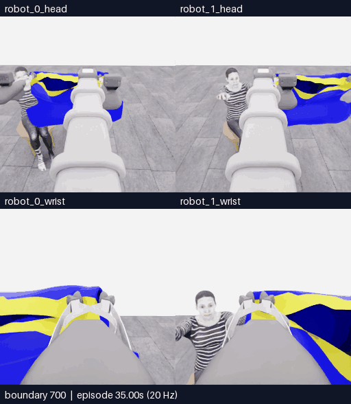

# E14 · 움직임 뒤 중립 대기 경로 확인 · 두 번의 이동 뒤 방향 전환으로 중단

[갤러리](README.ko.md) · [전체 기록·최종 행동](../collection/attempts/20261106-astra-hem-settle-001/README.ko.md) · [구조화 결과](../collection/attempts/20261106-astra-hem-settle-001/manifest.json) · [앞선 E13](20261106-astra-hem-depth-001.ko.md)

**짧은 제어 진단 결과: 모델 이동 2개 뒤 제어기 중립 대기 2개를 기록했고, 방향을 바꾸기 위해 감독 프로세스가 중단했습니다.** 공식 원점수는 **5/50, 첫 소매 0, 착의 `success=false`**입니다. **721/721전이 기술 검사 통과**는 정상 자료 마감을 뜻하며, 이 짧은 시도를 완주한 착의 성능 비교나 정착 효과 검증으로 해석하지 않습니다.

**새 구간 전체 700~721경계 · 네 카메라 · 22프레임 · 4.4초 반복 · 5fps · 4배 느리게 · GIF 1.07MB(1,067,900바이트).** 새 물리 진행은 21전이·1.05초입니다. 위는 로봇 0·1의 머리, 아래는 로봇 0·1의 손목이며 원본 256×256 네 장을 512×588 화면에 배치했습니다. 선택 구간의 프레임 생략·시간 보간·자르기는 없습니다. 양 끝 관측을 포함해 22장을 재생하며, 모델 응답 대기는 영상에 포함하지 않습니다.

[**새 구간 MP4**](assets/20261106-astra-hem-settle-001/event.mp4) · [영상 SHA·경계 매핑·변환 근거](assets/20261106-astra-hem-settle-001/provenance.json) · [재실행 포함 전체 144.2초 overview MP4](../collection/attempts/20261106-astra-hem-settle-001/overview.mp4)

## 실제 적용한 이동과 추가 대기

E13처럼 E07 행동 700전이를 새 환경에서 재실행하고 `coordinated-hem-route`를 사용했습니다. 첫 호출에는 현재 RGB 5장, 이번 재실행의 264·320경계 과거 RGB 10장, 현재 손목 depth 패널 1장을 전달했습니다. 이후에는 현재 RGB 5장과 손목 depth 패널 1장을 사용했습니다. **각 모델 이동 뒤 모든 행동 채널이 0인 중립 6전이(0.3 simulation초)를 제어기가 추가**한 것이 이번 변경입니다. 재실행 구간에는 추가하지 않았습니다. [실제 첫 호출 16장](../collection/attempts/20261106-astra-hem-settle-001/first-call-images.json) · [기본 프롬프트](../collection/attempts/20261106-astra-hem-settle-001/prompt.txt) · [제어 옵션과 검증](../collection/experiments/2026-11-06-move-settle.ko.md)

| 출처 | 적용 경계 | 실제 기록 |
|---|---|---|
| 모델 D0 | 700→704 · 4전이 | 두 로봇 모두 왼쪽 이동 명령, gripper 닫기 의도 유지 |
| 제어기 정착 대기 D0 연결 | 704→710 · 6전이 | `controller_settle`, 추가 모델 호출 없음, 모든 18채널 0 |
| 모델 D1 | 710→714 · 4전이 | 두 로봇 모두 앞·왼쪽 이동 명령, gripper 닫기 의도 유지 |
| 제어기 정착 대기 D1 연결 | 714→720 · 6전이 | `controller_settle`, 추가 모델 호출 없음, 모든 18채널 0 |
| 종료 정리 | 720→721 · 1전이 | 감독 중단 뒤 중립 1전이와 파일 종료 |

합계는 **부모 재실행 700 + 모델 이동 8 + 제어기 중립 12 + 종료 정리 1 = 721전이**입니다. 모델 호출은 3회였지만 완료·적용한 결정은 2개입니다. 중단 요청 이후 세 번째 호출의 반환 행동은 실행 전에 폐기했으며, 모델 행동이나 추가 득점으로 집계하지 않습니다. [결정·적용·폐기 기록](../collection/attempts/20261106-astra-hem-settle-001/decisions.jsonl)

**적용된 두 모델 행동은 모두 이동 베이스만 명령했습니다. 리프트·팔 신장·손목의 속도 명령은 0이었습니다.** 따라서 이번 구간으로 리프트·손목의 새 목표를 준 뒤 추종 오차가 줄어드는지를 시험했다고 말할 수 없습니다. 중립 명령은 기존 관절 위치 목표와 gripper 의도를 유지하므로 완전 정지나 천의 정착을 보장하지 않습니다. 확인한 것은 추가 중립 경로의 실제 실행·관측·출처 기록이며, 관절 지연 감소·입구 개선·소매 통과 효과는 미검증입니다.

## 종료와 E13 비교의 한계

사용자가 다른 준비 방향을 요청한 뒤 감독 프로세스가 **11:47:29 UTC에 SIGTERM**을 보냈습니다. 이 요청은 소매 성공이나 모델의 자율 실패 판정에 따른 종료가 아닙니다. 마지막 반환 행동을 폐기하고 정리한 뒤 **11:47:46 UTC**에 `interrupted`, `finished=true`, `capture_complete=true`로 마감했습니다. 소스 snapshot은 **`015226a8e3d571971cfaa389856f9d4f7b7dcb3b`**, 시작 당시 작업 트리는 변경 없음입니다.

| 측정·조건 | E13 · 손목 depth | E14 · 추가 중립의 짧은 진단 |
|---|---|---|
| 시작·종료 UTC | 10:35:22–11:08:52 | 11:33:49–11:47:46 |
| 완료 결정 / 모델 호출 | 18 / 18 | 2 / 3 · 마지막 행동 미실행 |
| 새 모델 적용 전이 | 110 · 모델 선택 중립 6 포함 | 8 · 이동 베이스 명령만 적용 |
| 제어기 추가 중립 / 종료 정리 | 0 / 0 | 12 / 1 |
| 새 저장 전이 / 물리 시간 | 110 / 5.50초 | 21 / 1.05초 |
| 전체 실제 경과 | 2,010.295초 · 33분 30.29초 | 837.047초 · 13분 57.05초 |
| Actor 호출 계측 합계 | 1,253.547초 | 160.744초 |
| 환경 요청·응답 합계 | 702.869초 | 628.102초 · 추가 중립 11.210초 포함 |
| 공식 원점수 / 첫 소매 | 5/50 / 0 | 5/50 / 0 |
| 최종 점수율 상태 | `no_dressing_points / 0 points/s` | `no_contact / null` |
| 종료 이유 | 모델이 `blocked`로 자율 종료 | 새 준비 방향으로 전환하기 위한 감독 중단 |

E14의 `no_contact / null`은 0점/초가 아닙니다. 이번 시도에서는 공식 첫 접촉 범위 조건도 기록되지 않았습니다. 시작 재실행 길이는 같지만 후속 행동·물리 진행·종료 이유가 달라 전체 경과 시간의 차이를 호출 가속이나 제어 성능 개선으로 해석하지 않습니다. Actor 계측에는 입력 준비·CLI·요청/응답이 포함되며 모델 내부 추론 시간만을 뜻하지 않습니다. 학습 승인은 `unreviewed`입니다.

## 다음 E15 후보

다음 후보는 **E07의 더 이른 264경계에서 새 공개 관측으로 입구 준비를 확인하는 시도**입니다. 처음에는 유용한 양쪽 파지를 유지하고, 짧은 형태 보정마다 새 관측을 확인합니다. 필요할 때만 테이블 지지와 한쪽 지지를 확인한 뒤 반대쪽을 한 번 다시 잡는 방안을 검토합니다. 현재 잡은 테두리가 잘못됐다고 단정하거나 소매 끝 파지를 강제하지 않습니다. 한 번에 한 구간을 판단하고, 지지·입구가 계속 불분명하면 반복 전진을 멈추는 계획입니다. **아직 이 페이지에 E15 실행 결과는 없습니다.**
