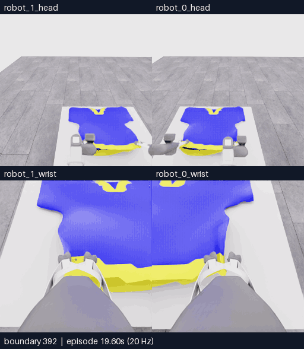

# E17 · 다른 입구 경계를 겨냥한 재파지, 지지·입구 미확인

[비교 갤러리](README.ko.md) · [공개 원인 분석](../collection/reviews/20261106-astra-layer352-001.ko.md) · [전체 최종 행동](../collection/attempts/20261106-astra-layer352-001/README.ko.md)

**최종5/50 · 픽업5 · 첫 소매0 · `success=false` · 452/452전이 검사 통과.** 다른 lower-rim 후보를 겨냥한 재파지는 실제 실행했지만 반대 입구 층을 잡았는지와 양측 지지는 확인하지 못했습니다. 모델은 운반 없이 종료했습니다. 최고 기록5/50이며10점은 아직 달성하지 못했습니다.

**392~452경계 · 61프레임 · 12.2초 재생 · 5fps·4배 느리게.** [MP4 크게 열기](assets/20261106-e17-regrasp/event.mp4) · [영상 출처](assets/20261106-e17-regrasp/provenance.json)

위는 머리, 아래는 손목 카메라입니다. 두 행 모두 **왼쪽 robot_1 · 오른쪽 robot_0**입니다. 원본 카메라당256×256이며 모델 응답 대기는 영상에서 제외했습니다. 60전이의3초 물리 구간에 양 끝 관측61장을 포함합니다. 전체 새 구간352~452는100전이·5초이며 이 영상보다 넓습니다.

| 구간 | 실제 행동과 확인한 내용 |
|---|---|
| 준비352~392 | 기존 파지를 유지한 lift·손목 각도·간격 보정. 시야가 넓어졌으나 입구는 좁은 slit으로 남았습니다. |
| 재파지392~432 | 로봇0만 열고, 별도로 보이는 lower-rim 후보를 목표로 하강·손목 yaw·팔 당기기를 두 차례 조정한 뒤 다시 닫았습니다. |
| 시험·종료432~452 | 양측 짧은 lift 후 로봇0 새 파지·서로 다른 경계를 확인하지 못해 내려놓고 종료했습니다. 종료 판단은 추가 전이0입니다. |

이 조작은 E16의 같은 오른쪽 가장자리 회복과 목표·접근 구성이 다릅니다. 그러나 **목표를 바꿨다는 사실과 실제 반대층 파지 성공은 별개**입니다. 한 번의 제한된 재파지로 방법 전체가 실패했다고 결론내리지 않으며 픽업5점에서 어느 파지가 지지했는지를 역추론하지 않습니다.

[**이 영상에 피드백 남기기**](https://github.com/leonyoon-3dai/PhyRC_2027_phase1/issues/new?title=%5BE17+%ED%94%BC%EB%93%9C%EB%B0%B1%5D+%EC%98%81%EC%83%81+%EA%B5%AC%EA%B0%84%EA%B3%BC+%EA%B4%80%EC%B8%A1&body=%EC%8B%9C%EB%8F%84%3A+E17+%2F+20261106-astra-layer352-001%0A%EC%98%81%EC%83%81+%EC%8B%9C%EA%B0%81+%EB%98%90%EB%8A%94+%EA%B2%BD%EA%B3%84%3A+%0A%EC%B9%B4%EB%A9%94%EB%9D%BC%3A+%EB%A1%9C%EB%B4%870+%EB%A8%B8%EB%A6%AC+%2F+%EB%A1%9C%EB%B4%871+%EB%A8%B8%EB%A6%AC+%2F+%EB%A1%9C%EB%B4%870+%EC%86%90%EB%AA%A9+%2F+%EB%A1%9C%EB%B4%871+%EC%86%90%EB%AA%A9%0A%0A%EA%B4%80%EC%B8%A1%ED%95%9C+%EC%9E%A5%EB%A9%B4%3A%0A%0A%EC%A0%9C+%ED%95%B4%EC%84%9D+%EB%98%90%EB%8A%94+%EC%A7%88%EB%AC%B8%3A%0A%0A%EB%8B%A4%EC%9D%8C%EC%97%90+%EB%B9%84%EA%B5%90%ED%95%98%EB%A9%B4+%EC%A2%8B%EC%9D%84+%EB%8F%99%EC%9E%91%3A%0A%0A%EA%B0%A4%EB%9F%AC%EB%A6%AC%3A+https%3A%2F%2Fgithub.com%2Fleonyoon-3dai%2FPhyRC_2027_phase1%2Fblob%2Fmain%2Fdocs%2Fgallery%2FREADME.ko.md%0A). E17, 영상 시각 또는 경계, 카메라와 관측한 장면을 적어 주세요. 링크는 작성 화면만 열며 제출은 사용자가 합니다.

## 실행 조건과 결과

| 항목 | 실제 기록 |
|---|---|
| 실행 ID | `20261106-astra-layer352-001` |
| 부모·분기 | E16 `20261106-astra-support264-002`의352전이 재실행. 같은 E07 출처 그룹이며 정확한 천 checkpoint 복원 아님 |
| 소스 | `98bb41ff6e83327a468abe5129517b4739ae33a1` · 실행 시 작업 트리 clean |
| 모델·입력 | Astra/ultra·CLI0.166.0/exec. 현재 RGB5장·공개 상태·depth 요약·현재 손목 depth 패널. 첫 호출에는 이번 재실행264·346경계의 과거 RGB10장 추가 |
| 픽셀 depth 질의 | **미사용. E16·E17 모두 실제 과제에 적용하지 않음** |
| 기록 | **352재실행 + 52모델 + 48제어기 중립 = 452전이** · 시뮬레이션22.6초 |
| 모델 판단 | **12호출·12판단 = act11 + finish1**. 각 act는 여러0.05초 전이를 진행 |
| 실제 경과 | 2026-11-06 23:37:50–23:51:35 UTC · **824.15784초(13분44.158초)** |
| 호출·환경 시간 | 모델 호출 경로378.759초 · 환경400.042초. 내부 추론시간은 미제공 |
| 공식 결과 | **5/50 · 픽업5 · 첫 소매0 · success=false · no_contact / null** |
| 검사 | **452/452전이 통과**. 학습 승인과 과제 성공을 대신하지 않음 |
| 보존 | 공개 영상·분석 정리 및 [비공개 원본 고정 HF 백업·재다운로드 SHA 검증 완료](../project/sessions/20261106-e17-backup-verification.json) |

`no_contact / null`은 평가기의 점수율 상태이며0 points/s와 다릅니다. 그리퍼–천 접촉 유무나 파지 실패 원인을 이 값에서 판단하지 않습니다.

## 다음 비교 · 아직 실행하지 않음

**E18 B**는 E16의470경계에서 시작하여 지지/가이드 역할을 나누고 소매 쪽 가시 가장자리로 재파지를 비교할 계획입니다. 이번 새 재실행의430·464경계 과거 RGB와 현재 관측을 구분하고, 보이는 표면의 거리 보조를 위해 픽셀 depth 질의를 켤 예정입니다. 준비 예산은 model timeout180초·35판단·최대1400전이입니다. 이는 실행 결과가 아니며 실제 시작·종료·적용 여부는 별도 기록합니다.

목부터 접근하는 다른 경로도 병렬로 준비 중이며 아직 실행하지 않았습니다. 목표는10점 이상과 반복 가능한 착의 진전이며 모든 방법의 첫 단계를 소매로 고정하지 않습니다.

[실제 프롬프트](../collection/attempts/20261106-astra-layer352-001/prompt.txt) · [공개 결과 JSON](../collection/attempts/20261106-astra-layer352-001/manifest.json) · [전체 overview MP4](../collection/attempts/20261106-astra-layer352-001/overview.mp4) · [세션 기록](../project/sessions/20261106-evening-resume.ko.md)
