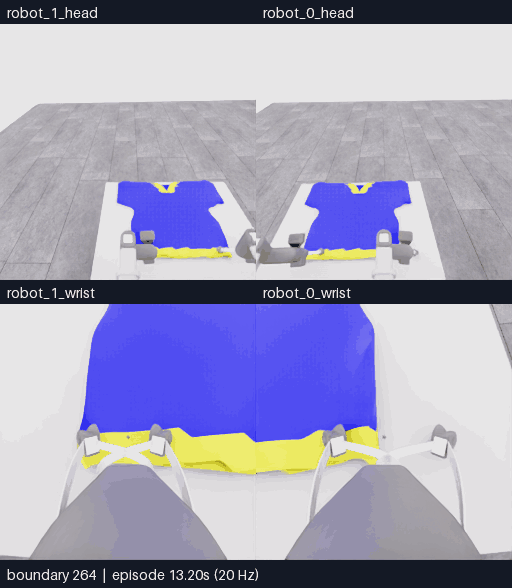
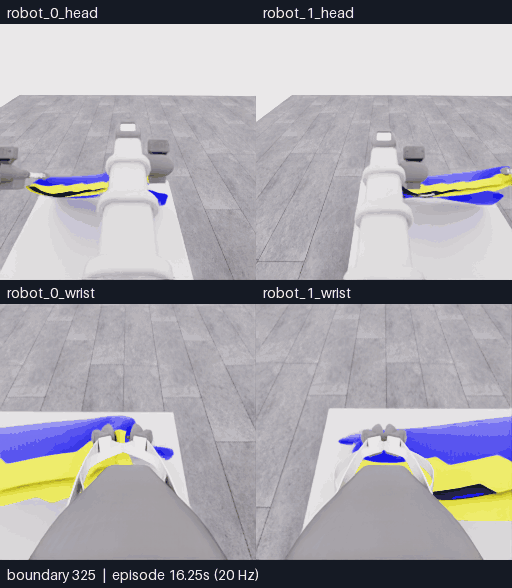
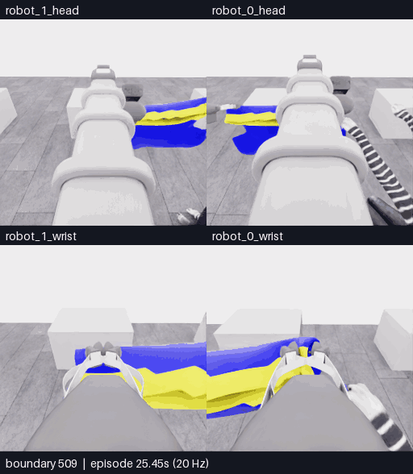

# E15 · 입구 준비→공동 운반→손 근처 복구

[비교 갤러리](README.ko.md) · [최종 원인 검토](../collection/reviews/20261106-astra-opening264-001.ko.md) · [모든 최종 행동](../collection/attempts/20261106-astra-opening264-001/README.ko.md)

**최종5/50 · 첫 소매0 · 착의 `success=false` · 611/611전이 검사 통과.** 모델이24번째 판단에서 종료했습니다. 손의 입구 통과는 확인하지 못했습니다. 아래 세 영상은 같은 시도의 연속 구간이며 새 득점이나 별도 시연이 아닙니다.

공통 화면은 **위: robot0·1 머리 / 아래: robot0·1 손목**입니다. 카메라당 원본256×256을512×588에 배치해 크게 표시합니다. 모든 GIF는5fps·4배 느린 재생이며 모델 대기는 제외합니다.

## 1 · 초기 입구 준비

**가장자리 층 분리가 드러나자 모델은 가능한 입구로 보고 상승을 계속했고, 큰 상승 뒤에는 가림이 늘었습니다.**

264~325경계 · 62프레임 · 12.4초 반복 · 물리3.05초 · GIF3.72MB. [MP4](assets/20261106-e15-preparation/event.mp4) · [첫5결정의 수치·원본 사진](../collection/experiments/2026-11-06-opening-first-partial-review.ko.md) · [출처](assets/20261106-e15-preparation/provenance.json)

## 2 · 옷을 든 채 공동 운반

**두 로봇이 옷을 들고 손 근처로 이동했습니다. 연결된 천이 따라오는 모습만으로 각 파지의 독립적 지지를 확정하지 않습니다.**

325~509경계 · 185프레임 · 37.0초 반복 · 물리9.20초 · GIF13.54MB. [MP4](assets/20261106-e15-transport/event.mp4) · [출처](assets/20261106-e15-transport/provenance.json)

## 3 · 손 근처 가림과 복구

**손과 천 경계가 가려지자 후퇴했고, 로봇0을 열고 철수했습니다. 마지막에는 로봇1 쪽에 천이 남았습니다.**

509~611경계 · 103프레임 · 20.6초 반복 · 물리5.10초 · GIF6.20MB. [MP4](assets/20261106-e15-hand-recovery/event.mp4) · [비의도적 벌어짐과 이후 명시적 열기의 구분](../collection/reviews/20261106-astra-opening264-001.ko.md) · [출처](assets/20261106-e15-hand-recovery/provenance.json)

## 실행 조건과 결과

| 항목 | 실제 기록 |
|---|---|
| 시작 | E07의264전이 행동을 새 환경에서 재실행한 뒤 새 actor 시작 |
| 입력 | 현재 RGB5장 + 현재 손목 depth 패널1장, 과거 RGB 없음 |
| 방법 | `coordinated-opening-first`, 한 번에 한 행동, 움직임 뒤 중립6전이 |
| 새 기록 | 모델 행동221 + 제어기 중립126 = 347전이·17.35초 |
| 전체 기록 | 재실행264 + 새347 = 611전이·30.55초 |
| 모델 판단 | 24회 호출·24개 완료 결정, 마지막은 `finish_episode` |
| 실제 경과 | 11:55:47–12:24:16 UTC · 1,709.785초 |
| 공식 평가 | 원점수5/50, 첫 소매0, `success=false`, `no_dressing_points / 0 points/s` |
| 기술 검사 / 학습 승인 | 611/611전이 통과 / `unreviewed` |

최초 접촉 범위 판정은 에피소드 상대26.729167초입니다. 이는 평가기의 범위 조건이며 실제 solver 접촉·손 진입·소매 통과의 증명이 아닙니다. 모델의 종료 판단과 전체 결과는 [공개 결과 JSON](../collection/attempts/20261106-astra-opening264-001/manifest.json), 입력은 [실제 첫6이미지](../collection/attempts/20261106-astra-opening264-001/first-call-images.json)에 있습니다.

선택 구간 안에서 프레임 생략·시간 보간·자르기는 없습니다. 양 끝 관측을 포함하므로 이웃 영상은325·509경계의 같은 한 프레임을 공유합니다. 3개 재생 길이를 더해도 독립된 물리 시간이나 시연 수가 늘어나지 않습니다.

[새 구간 전체264~611 MP4 · 69.6초](assets/20261106-astra-opening264-001/event.mp4) · [전체 새 구간 출처](assets/20261106-astra-opening264-001/provenance.json) · [재실행 포함 전체 overview MP4](../collection/attempts/20261106-astra-opening264-001/overview.mp4)
