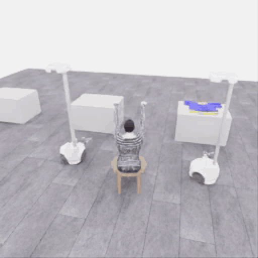
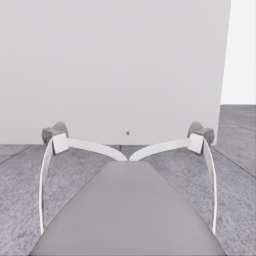
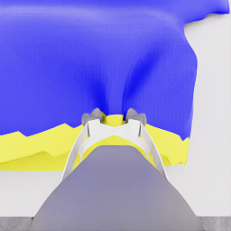

# Astra의 한 로봇 픽업 부분 점수 5점

[갤러리](README.ko.md) · [앞선 접근·파지 시도](20261106-astra-dressing-001.ko.md)

**한 로봇 픽업 부분 점수 5/50점 · 두 로봇 협력 들기 미확인 · 전체 착의 success=false**

자동 반복 · 전체 253프레임 · 5fps · 50.6초 · 약 4.08MB · **4배 느리게**. 원본 256×256을 512×512 GIF로 확대하고 너비 960px로 표시합니다. [GIF 변환 출처](assets/20261106-astra-pickup-hold5-001/provenance.json)

**[▶ 원본 50.6초 MP4](../collection/attempts/20261106-astra-pickup-hold5-001/overview.mp4)** · [최초 5점 순간의 원본 프레임·전이 246](../collection/milestones/20261106-astra-pickup-hold5-001/README.ko.md)

`gpt-6-astra`·`ultra`가 **로봇 0만으로** 옷자락을 잡아 올리고 유지해 공식 픽업 항목의 부분 점수 5점을 얻었습니다. **두 로봇이 양쪽을 잡고 함께 드는 협력 성공 시연은 아닙니다.** 첫 파지가 풀린 뒤 다시 접근해 잡는 과정도 함께 남겼습니다. 이 시도는 득점 확인 후 당시 행동의 응답 경계에서 종료했습니다. 이후 E06의 재실행을 중단·보존했고, [E07](20261106-astra-coordinated-fresh-001.ko.md)은 새 에피소드에서 공동 지지·운반을 관측하고 공식 원점수 5/50점·착의 `success=false`로 종료했습니다. 이 영상은 E05의 고정 기록으로 유지합니다.

## 반복 영상에서 볼 과정

행동 설명은 모델 최종 응답의 짧은 한국어 요약입니다. 당시 관측에 대한 판단과 이후 공식 평가 결과를 구분합니다. 영상은 모델 대기 시간을 제외한 물리 진행을 보여 줍니다.

| 영상 지점 | 과정 |
|---|---|
| 0.0초 | 그리퍼를 열고 옷자락으로 접근한다. |
| 16.4초 | 첫 닫기 후 작은 들기로 옷이 따라오는지 확인한다. |
| 22.8초 | 모델은 파지가 풀렸다고 판단하고 다시 열어 노란 옷자락 쪽으로 조정한다. |
| 27.2초 | 다시 닫고 파지가 안정될 시간을 둔다. |
| 33.2초 | 작은 들기로 옷자락이 따라오는지 확인하며 조금 더 올린다. |
| 38.4초 | 같은 그립을 유지하고 움직임 명령을 중립으로 바꾼다. |
| 49.2초 | 별도 공식 평가에서 첫 pickup 5점이 인정된다. |
| 50.4초 | 행동 응답 경계 뒤 중립 정리 1전이를 기록하고 종료한다. |

공식 파지·상승 연속 **3초** 조건을 충족해 득점했습니다. 종료 시 공식 유지 시간은 로봇 0 **3.35초**입니다. 프롬프트에 적은 5초는 여유를 둔 행동 목표였으며, **실제 5초 유지 완료나 전체 착의 성공을 뜻하지 않습니다.**

## 손목 카메라의 원본 관측

| 시작 | 종료 |
|---|---|
|  |  |

기존 공개 RGB 원본 PNG입니다. GIF는 기존 MP4를 확대·색상 변환한 미리보기이며 새 동작이나 중간 장면을 합성하지 않았습니다.

원본 run: `20261106-astra-pickup-hold5-001`.

[5점 획득·종료 과정 검토](../collection/reviews/20261106-astra-pickup-hold5-001.ko.md) · [전체 관측·행동·영상 기록](../collection/attempts/20261106-astra-pickup-hold5-001/README.ko.md) · [원본 파일·미디어 manifest](../collection/attempts/20261106-astra-pickup-hold5-001/manifest.json)
