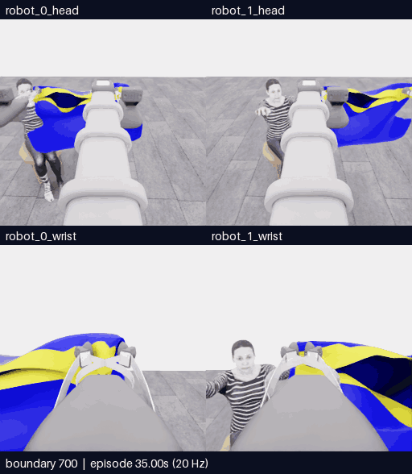

# E10 · 소매 식별을 위한 자세 탐색 · 5점에서 종료

**분할 화면 배치:** 위쪽은 머리, 아래쪽은 손목 카메라이며 두 행 모두 **왼쪽 robot_1·오른쪽 robot_0**입니다. 카메라 픽셀의 좌우 반전이 아니라 표시 타일만 옮겼습니다. 원본 관측·로봇 명령의 번호는 유지합니다.

[갤러리](README.ko.md) · [전체 기록·프롬프트·행동](../collection/attempts/20261106-astra-sleeve-branch700-003/README.ko.md)

**결과: 공식 5/50, 첫 소매 0, 착의 success=false.** 700전이 재실행으로 픽업 5점을 다시 얻었지만 새 8개 움직임에서는 추가 득점이 없었습니다. 9번째 판단에서 모델이 시야 악화·진전 없음으로 종료했습니다. 프로그램 종료·기록 검사는 정상이며 과제 성공과 구분합니다.

**이번에 새로 실행한 구간 전체 · 네 카메라 · 51개 경계 프레임 · 10.2초 반복 · 4배 느리게.** 실제 새 물리 진행은 2.50초입니다. 700~750 경계를 모두 포함하며 모델 대기 시간은 영상에서 제외합니다. 256px 원본을 크게 표시하며 확대가 원본 세부 정보를 늘리지는 않습니다.

[새 구간 MP4](assets/20261106-astra-sleeve-branch700-003/event.mp4) · [영상 출처·SHA·프레임 매핑](assets/20261106-astra-sleeve-branch700-003/provenance.json) · [재실행 포함 전체 750프레임 영상](../collection/attempts/20261106-astra-sleeve-branch700-003/overview.mp4)

| 실제 적용 순서 | 목적과 관측된 한계 |
|---|---|
| 공동 짧은 들기 | 천이 양쪽 손끝을 따라오는지 확인. 그리퍼 닫기만으로 파지를 인증하지 않음 |
| 반대 손목 회전 → 한쪽 팔 당기기 | 소매 테두리 노출을 시도했지만 식별 불확실 |
| 양쪽 벌리기 → 높이 차이 → 손목 pitch | 옷 개구부를 펼치고 아래를 보려 했지만 명확한 소매·손 통과가 드러나지 않음 |
| 로봇 1의 보정 옆걸음 두 번 | 팔의 가림을 줄이려 했으나 최종 모델 판단은 시야 악화·진전 없음 |

소매 접근으로 반복 전진하는 행동은 줄었지만 자세 탐색만 반복되는 병목이 남았습니다. 중앙 검은 틈은 목 구멍이나 접힌 개구부일 가능성도 있으며 소매로 확정하지 않습니다. 이 해석은 공개 영상 검토 가설입니다.

다음 비교 후보는 **장력을 완화하고 외곽·옆쪽 개구부 확인**, 또는 **더 이른 운반 전 경계에서 옷 방향을 먼저 식별**하는 방법입니다. 한쪽 지지와 접근 가능한 가장자리를 확인할 수 있다면 재파지도 별도 비교합니다. 아직 실행하거나 효과를 확인한 방법이 아닙니다.

| 측정 | 결과 |
|---|---|
| 실제 실행 시간 | 08:34:12–09:01:21 UTC · 27분 8.84초 |
| 모델 호출 | 9회 · 호출 계측 합계 15분 28.08초; 내부 추론 시간과 다름 |
| 물리 진행 | 전체 750전이·37.50초 = 원본 재실행 700 + 새 50 |
| 검증 | 750/750전이 통과 · 학습 승인 unreviewed |
| 평가 | raw_points=5 · first_sleeve=0 · success=false · no_contact · final_score=null |
| 송출 | OFF · idle render 0회 |

원본 재실행 700전이를 독립 신규 시연으로 세지 않습니다. source group은 E07과 같으며 정확한 물리 checkpoint 복원을 주장하지 않습니다. 실패한 E09 원본과 이번 정상 종료 자료는 별개입니다.
