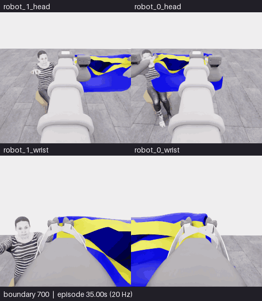

# E11 · 과거 관측을 더한 소매 식별 비교 · 5점에서 중단

[갤러리](README.ko.md) · [전체 기록·프롬프트·행동](../collection/attempts/20261106-astra-sleeve-history-001/README.ko.md) · [최종 구조화 결과](../collection/attempts/20261106-astra-sleeve-history-001/manifest.json) · [앞선 E10](20261106-astra-sleeve-branch700-003.ko.md)

**결과: 공식 5/50, 첫 소매 0, 착의 `success=false`. 10점은 달성하지 못했습니다.** 과거 공개 관측을 함께 받은 모델은 잡은 가장자리를 밑단으로 추정하고 측면 소매 후보를 별도로 지목했지만, 손 통과나 추가 득점은 확인하지 못했습니다. 판단 표현의 변화와 실제 과제 성능 향상을 구분합니다.

**새 구간 전체 700~777경계 · 네 카메라 · 78프레임 · 15.6초 반복 · 5fps · 4배 느리게 · GIF 용량은 출처 참조.** 새 물리 진행 3.85초는 모델 행동 76전이와 종료 중립 1전이를 포함합니다. 위는 머리, 아래는 손목 카메라입니다. 두 행 모두 **왼쪽 robot_1 · 오른쪽 robot_0**입니다. 선택 구간의 모든 경계를 포함하며 모델 대기 시간·프레임 보간은 없습니다.

[**새 구간 MP4**](assets/20261106-astra-sleeve-history-001/event.mp4) · [원본 SHA·경계 매핑·변환 근거](assets/20261106-astra-sleeve-history-001/provenance.json) · [재실행 포함 전체 155.4초 overview MP4](../collection/attempts/20261106-astra-sleeve-history-001/overview.mp4)

## 무엇을 바꾸었고 무엇이 달라졌는가

E10과 같이 E07의 행동 700전이를 새 환경에서 재실행했습니다. E11에서는 첫 모델 입력에 **이번 새 재실행의 264·320경계에서 직접 기록한 과거 공개 카메라 사진**을 추가하고, 현재 관측과 과거 관측을 명확히 구분했습니다. 이전 E07의 평가·배치·내부 옷 상태나 정답 라벨을 입력한 것은 아닙니다. [실제 기본 프롬프트](../collection/attempts/20261106-astra-sleeve-history-001/prompt.txt) · [첫 호출 실제15이미지·순서·SHA](../collection/attempts/20261106-astra-sleeve-history-001/first-call-images.json)

| 완료 결정 · 0부터 시작 | 모델의 의도와 남은 불확실성 |
|---|---|
| 0~1 · 들기·pitch | 과거 연속 관측을 근거로 양쪽 파지를 밑단으로 추정. 현재 파지·개구부 관계는 여전히 불확실 |
| 2~6 · 후퇴·팔 당기기·높이·손목 조정 | 측면 외곽과 가려진 소매 영역을 드러내려 함. 명확한 소매 입구 미확인 |
| 7 · 움직임 정착 대기 | 남은 리프트·손목 움직임을 관찰하기 위한 중립 움직임 명령. 파지·손 통과 인증이 아님 |
| 8 · 측면 정렬 | 넓은 노란 밑단과 다른 파란 측면 돌출부를 **소매 후보**로 지목하고 양쪽을 옆으로 이동. 판단은 `uncertain` |
| 9~10 · 철수·테이블 방향 이동 | 손을 둘러싼 소매를 확인하지 못해 팔을 당기고 테이블 지지를 준비하는 방향으로 이동. 테이블 지지 완료는 미확인 |

모델의 최종 행동 설명을 요약한 표입니다. 실제 명령과 적용 전이 범위는 [공개 결정 기록](../collection/attempts/20261106-astra-sleeve-history-001/decisions.jsonl)에 있습니다. 밑단·소매 후보라는 이름이 더 구체화됐다는 사실만으로 식별 정확도가 검증되거나 물리적 진행이 개선됐다고 판단하지 않습니다. **밑단을 잡는 행동 자체를 오류로 단정하지도 않습니다.**

## E10과 비교

| 측정·조건 | E10 · 현재 관측 중심 | E11 · 같은 에피소드 과거 관측 추가 |
|---|---|---|
| 부모 행동 재실행 | E07의 700전이 | E07의 700전이 |
| 새 모델 결정 | 9개: 움직임 8개 뒤 모델 종료 결정 | 11개 완료 행동 구간; 모델 요청 12회 시도 |
| 새 저장 전이 / 물리 시간 | 50 / 2.50초 | 77 / 3.85초; 종료 중립 1 포함 |
| 전체 저장·검사 전이 | 750/750 통과 | 777/777 통과 |
| 전체 실제 경과 | 27분 8.84초 | 30분 35.10초 |
| Actor 호출 계측 합계 | 15분 28.08초 | 18분 22.70초 |
| 공식 원점수 / 첫 소매 | 5/50 / 0 | 5/50 / 0 |
| 착의 성공 | `false` | `false` |
| 점수율 | `no_contact`, `final_score=null` | `no_contact`, `final_score=null` |
| 종료 방식 | 모델이 시야 악화·진전 없음으로 종료 | 감독 프로세스가 비교 구간을 마치고 SIGTERM으로 중단 |

두 시도 모두 추가 득점이 없었습니다. 결정 수·종료 방식이 다르고 재실행된 천·접촉 상태의 완전한 동일성을 보장하지 않으므로, 한 쌍의 결과를 과거 관측 추가의 일반적인 성공률·효율 효과로 해석하지 않습니다. Actor 계측에는 요청 준비·CLI·서비스 대기·응답 처리가 포함되며 내부 추론 시간만을 뜻하지 않습니다. `no_contact`의 점수율은 **0 points/s로 바꾸지 않습니다.**

## 실제 종료와 보존

E11은 **09:16:35–09:47:10 UTC** 실행됐습니다. **09:46:39 UTC**, 11개 결정 완료 후 12번째 모델 요청 중 감독 프로세스가 SIGTERM을 보냈습니다. 이는 사용자 중지 요청이나 10점 도달에 따른 종료가 아닙니다. 앞서 검토한 12결정 자동 중지 계획은 신호 전에 철회됐고, 이번 신호는 별도의 제한된 비교 종료였습니다.

최종 실행 상태는 `interrupted`지만 종료 처리는 마쳤으며 `finished=true`, `capture_complete=true`, **777/777전이 전수 검사 통과**입니다. 불완전 파일로 남았던 E09와 구분합니다. 학습 승인은 `unreviewed`이며 기술 검사 통과가 착의 성공을 대신하지 않습니다.

원본 재실행 700전이는 독립 신규 시연으로 세지 않습니다. E07·E10과 같은 source group을 유지하며 새 77전이도 성공 시연으로 표시하지 않습니다. 다음 비교 가설은 **밑단 진입 뒤 소매 출구를 찾는 경로**와 **더 이른 구간에서 지지를 확보하고 파지를 재설계하는 방법**입니다. 이 페이지는 종료된 E11의 결과이며 후속 시도의 실행·성공을 미리 주장하지 않습니다.
