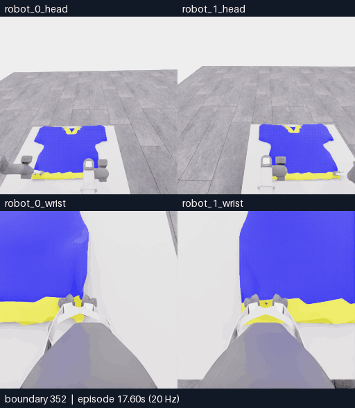
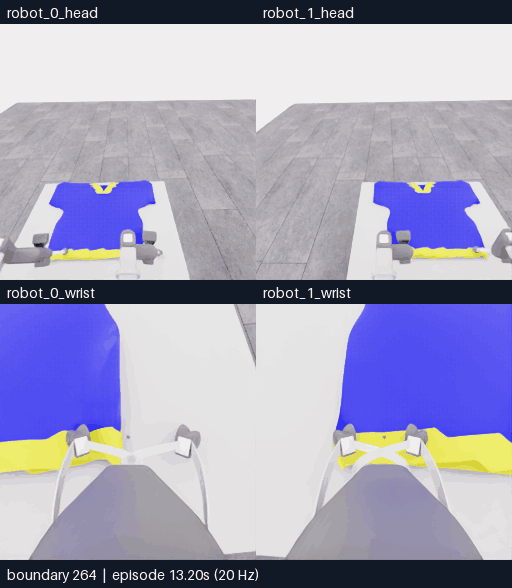
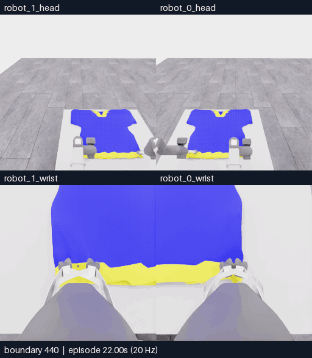

# E16 · 순차 지지 확인→한쪽 재파지→입구 준비

**분할 화면 배치:** 위쪽은 머리, 아래쪽은 손목 카메라이며 두 행 모두 **왼쪽 robot_1·오른쪽 robot_0**입니다. 카메라 픽셀의 좌우 반전이 아니라 표시 타일만 옮겼습니다. 원본 관측·로봇 명령의 번호는 유지합니다.

[비교 갤러리](README.ko.md) · [원인 검토](../collection/reviews/20261106-astra-support264-002.ko.md) · [전체 최종 행동](../collection/attempts/20261106-astra-support264-002/README.ko.md)

**최종0/50 · 첫 소매0 · `success=false` · 516/516전이 검사 통과.** 국소 천 동행의 시각적 근거는 얻었지만 연속 입구를 확인하지 못해 모델이 운반 없이 자율 종료했습니다. 최고 기록은5/50으로 그대로이며10점은 아직 달성하지 못했습니다. 아래 세 영상은 같은 시도의 이어지는 새 구간입니다.

화면은 **위: 로봇0·1 머리 / 아래: 로봇0·1 손목**입니다. 카메라당 원본256×256이며 GIF와 MP4는5fps·4배 느린 재생입니다. 모델 응답 대기는 포함하지 않습니다.

## 먼저 보기 · 한쪽 재파지 시도

**352~440경계 · 89프레임 · 17.8초 재생.** [MP4 크게 열기](assets/20261106-e16-regrasp/event.mp4) · [영상 출처](assets/20261106-e16-regrasp/provenance.json)

| 구분 | 확인할 내용 |
|---|---|
| 관측·행동 | 352~414경계에서 로봇0만 열기·철수·위치 조정·다시 닫기를 실행했습니다. 414~440경계 재시험에서 국소 천 접힘의 동행·유지·복귀를 관측했습니다. |
| 해석 | 재파지 후 국소 지지의 시각적 근거가 있습니다. 같은 오른쪽 가장자리의 회복이며 다른 입구·층으로 파지를 바꿨다는 근거는 없습니다. 닫기 명령만으로 파지 성공을 판정하지 않습니다. |
| 결과 | 국소 동행과 별개로 통과 가능한 연속 입구를 확인하지 못했고 픽업·소매 득점 없이 종료했습니다. 0점이라는 결과로 파지 실패를 단정하지 않습니다. |
| 다음 | E16의352경계부터 다른 가시 입구 경계·층에서의 한쪽 재파지를 비교하는 E17을 준비합니다. 새 재실행 관측으로 현재 지지를 다시 판단하며 아직 실행하지 않았습니다. |

피드백에는 **E16, 영상 시각 또는 경계, 카메라, 관측한 장면**을 적어 주세요. [갤러리의 피드백 링크·복사 양식](README.ko.md#최신-e16--각-파지를-따로-확인한-뒤-입구-접근)을 이용할 수 있습니다.

## 앞 구간 · 순차 지지 진단

264~352경계 · 89프레임 · 17.8초 재생. [MP4](assets/20261106-e16-support/event.mp4) · [출처](assets/20261106-e16-support/provenance.json)

E07의264전이 재실행 뒤 시작한 새 판단 구간입니다. 한쪽을 움직일 때 반대 로봇의 실제 움직임과 천의 반응을 함께 확인하는 것이 목적이었습니다. 이 영상만으로 독립 지지 여부를 자동 판정하지 않습니다.

## 뒤 구간 · 지지 재확인·입구 준비와 종료

440~516경계 · 77프레임 · 15.4초 재생. [MP4](assets/20261106-e16-opening/event.mp4) · [출처](assets/20261106-e16-opening/provenance.json)

440~470경계는 로봇1 복귀·재상승·관측을 포함합니다. 이후 높이·간격·들기를 조정했지만 연속적인 입구 경계와 내부 공간을 확인하지 못했습니다. 마네킹으로 운반하거나 소매를 통과시키는 단계에는 진행하지 않았습니다.

## 실행 조건과 결과

| 항목 | 실제 기록 |
|---|---|
| 실행 ID | `20261106-astra-support264-002` |
| 시작·부모 | E07 `20261106-astra-coordinated-fresh-001`의264전이 행동 재실행. E15는 비교 대상이며 직접 부모가 아님 |
| 실행 소스 | `05152fa4bf250257481cae988b6f8f26c817084a` |
| 방법 | `coordinated-support-diagnostic`, 한 번에 한 행동, 움직임 뒤 중립6전이 |
| 모델·입력 | Astra/ultra · CLI0.166.0/exec · 현재 RGB5장·손목 depth 패널1장·공개 로봇 상태·depth 요약 |
| 픽셀 depth 질의 | 사용하지 않음 |
| 전체 기록 | **264재실행 + 156모델 + 96중립 = 516전이** |
| 모델 판단 | **34호출·34판단**, 모델 자율 종료 |
| 실제 경과 | 22:46:26–23:19:06 UTC · **1,959.821초(32분39.821초)** |
| 시간 구분 | 모델 호출 경로1,451.035초 · 환경 요청456.810초. 순수 모델 추론시간은 미제공 |
| 로컬 공식 평가 | **0/50 · 첫 소매0 · `success=false` · `no_contact / null`** |
| 검사·승인 | **516/516전이 통과** · 학습 승인 `unreviewed` |
| 보존 | main 통합본에 공개 기록 정리. [E16 고정 HF 백업·재다운로드 SHA 검증 완료](../project/sessions/20261106-e16-backup-verification.json) |

`no_contact / null`은 평가기의 점수율 상태이며0 points/s와 다릅니다. 그리퍼와 천의 접촉 여부나 파지 실패 원인을 이 값으로 확정하지 않습니다. E07 행동 재실행은 정확한 천 상태 checkpoint 복원이 아닙니다.

각 영상은 선택 구간의 양 끝 관측을 포함하므로352·440경계 프레임을 공유합니다. 구간 영상의 수나 재생 시간을 더해 독립 시연 수·물리 진행 시간으로 해석하지 않습니다. [영상 내보내기와 경계 매핑](EVENT_EXPORT.ko.md)

[재실행 포함 전체 overview MP4](../collection/attempts/20261106-astra-support264-002/overview.mp4) · [공개 결과 JSON](../collection/attempts/20261106-astra-support264-002/manifest.json) · [실제 프롬프트](../collection/attempts/20261106-astra-support264-002/prompt.txt) · [이번 세션 기록](../project/sessions/20261106-evening-resume.ko.md)
