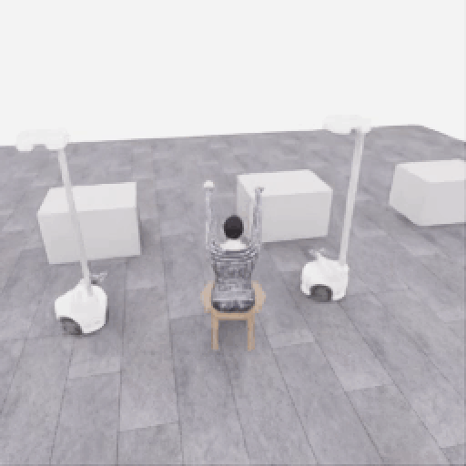
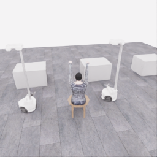
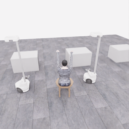

# Astra의 작은 움직임·정지 연결 시험

[갤러리](README.ko.md) · [Astra의 접근·파지 시도](20261106-astra-dressing-001.ko.md)

**자동 반복 GIF** · 전체 3프레임, 1fps, 3초, **20배 느리게**. 원본 256×256을 512×512 GIF로 확대하고 너비 720px로 표시합니다. 실제 움직임이 매우 작은 연결 시험입니다. [변환 출처](assets/20261106-codex-robot-wiring-r5/provenance.json)

**[▶ 3초 관측 영상 보기](../collection/attempts/20261106-codex-robot-wiring-r5/overview.mp4)**

`gpt-6-astra`·`ultra`의 세 응답을 **작은 리프트 명령 → 정지 → 종료** 순서로 적용한 연결 시험입니다. 총 3전이·0.15 simulation초입니다. 공식 결과는 **0/50점·success=false**이며 파지·착의를 시도한 자료가 아닙니다.

영상은 저장된 전체 화면 3프레임을 1fps로 재생합니다. **20배 느린 3초 영상**으로, 움직임이 매우 작고 모델 응답 대기 시간은 제외됩니다.

## 시작과 종료 화면

| 시작 공개 관측 | 종료 공개 관측 |
|---|---|
|  |  |

기존 저장 RGB 원본 PNG를 연결했습니다. 종료 이미지는 마지막 행동 다음 관측이므로 영상의 마지막 `obs` 프레임과 구분합니다.

## 세 번의 짧은 응답

아래는 모델 최종 행동 설명의 한국어 요약입니다. 미리 정한 연결 시험 순서를 수행한 것이며 자율 착의 전략의 결과로 해석하지 않습니다.

| 순서 | 응답 | 실제 진행 |
|---|---|---|
| 1 | 두 로봇에 작은 리프트 속도 `+0.03`과 그리퍼 열기 명령을 보낸다. | 2전이 · 0.10 simulation초 |
| 2 | 움직임을 정지하고 그리퍼의 열기 의도를 유지한다. | 1전이 · 0.05 simulation초 |
| 3 | 연결 시험을 종료한다. | 추가 물리 전이 없음 |

`+0.03`은 정규화 속도 명령이며 실제 이동 거리 3cm를 뜻하지 않습니다. 이 기록에서 확인한 것은 작은 행동의 전달·정지·종료 과정입니다.

원본 run: `20261106-codex-robot-wiring-r5`.

[원본 파일·이미지·영상 manifest](../collection/attempts/20261106-codex-robot-wiring-r5/manifest.json) · [5개 카메라·전체 응답과 상세 기록](../collection/attempts/20261106-codex-robot-wiring-r5/README.ko.md)
