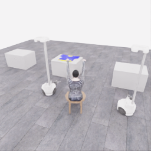
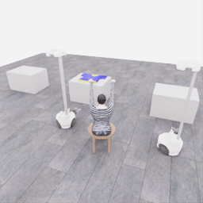

# 한 응답에 담은 세 행동

[갤러리](README.ko.md) · [세 번 호출한 연결 시험](20261106-codex-robot-wiring-r5.ko.md)

**[▶ 3초 관측 영상 보기](../collection/attempts/20261106-exec-plan3-wiring-001/overview.mp4)**

`gpt-6-astra`·`ultra`가 한 응답에 **작은 리프트 명령 → 정지 → 종료**의 세 구간을 담았습니다. 실행기는 전체 목록을 검사한 뒤 순서대로 적용했습니다. 실제 모델 호출은 1회, 행동 구간은 3개, 물리 전이는 3개입니다.

연결 시험으로 **공식 결과는 0/50점·success=false**입니다. 0.15 simulation초의 전체 화면 3프레임을 **20배 느린 3초 영상**으로 보여 줍니다. 움직임이 매우 작고 모델 응답 대기 시간은 포함하지 않습니다.

## 시작과 종료의 원본 관측

| 시작 공개 관측 | 종료 공개 관측 |
|---|---|
|  |  |

저장된 공개 RGB의 기존 PNG를 재사용했습니다. 종료 이미지는 마지막 행동 다음 관측입니다.

## 한 번에 받은 행동 목록

아래는 최종 응답의 한국어 요약입니다. 모든 구간은 첫 관측을 보고 미리 정한 목록입니다. 중간 관측은 저장하지만 후속 구간을 실행하기 전에 모델을 다시 호출하지 않았습니다.

| 구간 | 짧은 행동 응답 | 실제 진행 |
|---|---|---|
| 1 | 두 로봇에 작은 리프트 속도 `+0.03`과 그리퍼 열기를 적용한다. | 2전이 · 0.10 simulation초 |
| 2 | 중립 움직임으로 정지하고 그리퍼 의도를 유지한다. | 1전이 · 0.05 simulation초 |
| 3 | 착의를 시도하지 않고 연결 시험을 종료한다. | 추가 물리 전이 없음 |

`+0.03`은 정규화 속도 명령입니다. 이 시험은 한 응답의 여러 행동을 실행·기록한 과정이며, 중간 접촉을 보고 판단하는 조건부 계획이나 파지 성공 시연을 의미하지 않습니다.

원본 run: `20261106-exec-plan3-wiring-001`.

[원본 파일·이미지·영상 manifest](../collection/attempts/20261106-exec-plan3-wiring-001/manifest.json) · [5개 카메라·전체 응답과 상세 기록](../collection/attempts/20261106-exec-plan3-wiring-001/README.ko.md) · [방법별 실험 비교](../collection/experiments/2026-11-06-method-comparison.ko.md)
