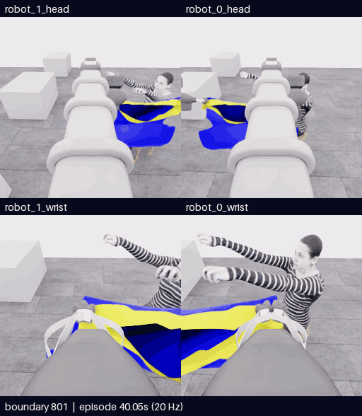

# E19 · 명명 행동으로 세 번 접근·복구한 뒤 자율 종료

[비교 갤러리](README.ko.md) · [공개 분석](../collection/reviews/20261107-astra-entry801-named-001.ko.md) · [실패·복구 학습 검토 구간](../collection/reviews/20261107-astra-entry801-named-001-learning-segments.json)

**5/50 · 픽업5 · 착의0 · success=false · 전수 검사932/932 통과.** 세 차례 접근과 각도·높이·시점 변경을 실제 수행했지만 연속 입구 통과를 확인하지 못해 모델이 되돌리고 자율 종료했습니다.12개 실제 행동에서 명명 축과9채널 배열은 일치했고 E18처럼 설명에 없는 roll은 재발하지 않았습니다. 최고5점·목표10점 미달성입니다.

**새 구간 전체801~932 · 132프레임 · 26.4초 · 5fps·4배 느리게.** [MP4 크게 열기](assets/20261107-e19-named-entry/event.mp4) · [원본 경계·영상 출처](assets/20261107-e19-named-entry/provenance.json)

위는 로봇0·1 머리, 아래는 로봇0·1 손목입니다. 원본은 카메라당256×256이며 모델 응답 대기는 제외했습니다.131전이·6.55초의 물리 구간에 양 끝 관측132장을 포함하며 구간 내 프레임 생략·시간 보간은 없습니다.

| 구간 | 영상에서 확인할 내용 |
|---|---|
| 801~843 · 첫 접근·복구 | 양 lift·pitch 뒤 extension. 가까운 손이 천에 가리자 되돌려 양 wrist에 다시 보이게 했습니다. |
| 843~878 · 기울여 재접근 | 공개 depth 조회 뒤 robot0만 낮춰 rim을 기울였지만 전진하면 다시 가렸습니다. 되돌리며 설명에 명시한 robot0 roll로 시야를 바꿨습니다. |
| 878~910 · 관측 방향 변경 | robot0 pitch·lift·extension 조합으로 위에서 보고, 실제 약10cm 횡이동·wrist yaw로 비스듬한 시야를 만들었습니다. |
| 910~932 · 세 번째 접근·종료 | 새 시야·높이에서도 손 가림이 반복돼 되돌렸습니다. 마지막 자율 finish는 추가 물리0전이입니다. |

**손이 가려졌다는 사실은 소매 통과 증거가 아닙니다.** 양 wrist를 계속 비교했지만 같은 손이 두 rim 사이를 지나는 연속 장면이나 소매에서 나오는 장면은 확인하지 못했습니다. 시점 변경은 새 정보를 줬으나 세 번째 접근에도 같은 한계가 남아 추가 단순 전진을 멈출 근거가 됐습니다.

계획했던 소매 쪽 가이드 재파지는 실제0회입니다. 기존 파지에 가이드·지지 역할을 붙인 것과 다른 가장자리로 release→재배치→reclose한 것을 구분합니다. 최종 설명은 현재 table support가 확보되지 않았다고 밝혔고 모델은 파지를 유지한 채 자율 종료했습니다. E18의 감독 중단과 다릅니다.

[**이 영상에 피드백 남기기**](https://github.com/leonyoon-3dai/PhyRC_2027_phase1/issues/new?title=%5BE19+%ED%94%BC%EB%93%9C%EB%B0%B1%5D+%EC%98%81%EC%83%81+%EA%B5%AC%EA%B0%84%EA%B3%BC+%EA%B4%80%EC%B8%A1&body=%EC%8B%9C%EB%8F%84%3A+E19+%2F+20261107-astra-entry801-named-001%0A%EC%98%81%EC%83%81+%EC%8B%9C%EA%B0%81+%EB%98%90%EB%8A%94+%EA%B2%BD%EA%B3%84%3A+%0A%EC%B9%B4%EB%A9%94%EB%9D%BC%3A+%EB%A1%9C%EB%B4%870+%EB%A8%B8%EB%A6%AC+%2F+%EB%A1%9C%EB%B4%871+%EB%A8%B8%EB%A6%AC+%2F+%EB%A1%9C%EB%B4%870+%EC%86%90%EB%AA%A9+%2F+%EB%A1%9C%EB%B4%871+%EC%86%90%EB%AA%A9%0A%0A%EA%B4%80%EC%B8%A1%ED%95%9C+%EC%9E%A5%EB%A9%B4%3A%0A%0A%EC%A0%9C+%ED%95%B4%EC%84%9D+%EB%98%90%EB%8A%94+%EC%A7%88%EB%AC%B8%3A%0A%0A%EB%8B%A4%EC%9D%8C%EC%97%90+%EB%B9%84%EA%B5%90%ED%95%98%EB%A9%B4+%EC%A2%8B%EC%9D%84+%EB%8F%99%EC%9E%91%3A%0A%0A%EA%B0%A4%EB%9F%AC%EB%A6%AC%3A+https%3A%2F%2Fgithub.com%2Fleonyoon-3dai%2FPhyRC_2027_phase1%2Fblob%2Fmain%2Fdocs%2Fgallery%2FREADME.ko.md%0A). 영상 시각 또는 경계, 카메라와 관측한 장면을 적어 주세요. 링크는 GitHub 작성 화면만 열며 제출은 사용자가 합니다.

## 실행 조건과 결과

| 항목 | 실제 기록 |
|---|---|
| 실행 / 소스 | `20261107-astra-entry801-named-001` / `9aad60138dc5cded2e0e5219fc12395d4c37ff0a`, 시작 시 clean |
| 부모·분기 | E18의801전이 행동 재실행. 정확한 천 checkpoint 복원 아님 |
| 모델·입력 | Astra/ultra·CLI0.166.0/exec. 공개 RGB5장·상태·depth·손목 depth 패널, 첫 호출에 이번 재실행771·787경계의 RGB10장 |
| 실제 변경 | 같은 B 전략·depth 질의에 명명 행동 적용.12개 act의 명명 축→9채널 변환 일치 |
| 실제 depth 질의 | D4 robot0 wrist6점·6/6 valid. 같은 현재 관측·질의 물리0 |
| 호출·판단 | **14호출 = act12 + finish1 + 질의 초기 호출1**.13개 최종 판단이며 finish는 물리를 진행하지 않음 |
| 기록 | **801재실행 + 59모델 + 72제어기 settle = 932전이** |
| 시뮬레이션 / 실제 | 전체46.6초·새6.55초 /1577.537494초(26분17.537초) |
| UTC | 2026-11-07 00:45:20–01:11:37 |
| 호출·환경 시간 | 모델 호출 경로736.917915초·환경793.905205초. 순수 내부 추론시간과 다름 |
| 별도 평가 | raw5/50·pickup5·착의 항목 모두0·success=false·no_dressing_points /0.0 |
| 검사·마감 | 932/932전이 통과·오류0·capture 마감·client0. 학습 승인 unreviewed |
| 보존 | 공개 영상·분석·학습 검토 구간 보존. [비공개 원본 고정 HF revision·재다운로드 SHA 검증 완료](../project/sessions/20261107-e19-backup-verification.json) |

D6의 robot0 roll+0.25는 최종 설명에 회전 의도가 명시됐고 실제 시야도 회전했습니다. E18의 설명에 없던 robot1 roll+1 오류와 구분하며 원본 오류·복구는 그대로 남깁니다. 한 시도의 명령 일치가 일반적인 오류 방지나 착의 성능 향상을 증명하지는 않습니다. depth 역시 보이는 표면의 광축 거리 보조이며 숨은 입구·파지·통과를 판정하지 않습니다.

[학습 검토 JSON](../collection/reviews/20261107-astra-entry801-named-001-learning-segments.json)은 새131전이를 준비·세 접근·복구·관측 변경으로 나누고 질의·finish를 물리0 사건으로 기록합니다. 실패·복구도 검토 자료지만 자동으로 좋은 모방 행동으로 승인하지 않습니다. 재실행 출처·인접 프레임을 독립 표본으로 세지 않고 숨은 평가값을 정책 교사 라벨에 넣지 않습니다.

## 후속 비교 · E20 목 우선 경로 실행 중

현재 grasp set의 손 방향 미세조정에서 같은 한계가 반복됐으므로 **E18의470경계에서 목 우선 접근 순서를 실제 비교**합니다. named actions·공개 depth 질의를 유지하고 이번 재실행430·464경계의 과거 RGB를 사용합니다. E19 백업·공개 기록을 마친 뒤 2026-11-07 01:18:21 UTC에 공개 main799fe80의 깨끗한 소스에서 시작했습니다. 아직 과제 결과는 없습니다.

[현재 상태·실제 다음 명령](../project/STATUS.md) · [세션 기록](../project/sessions/20261106-evening-resume.ko.md)
