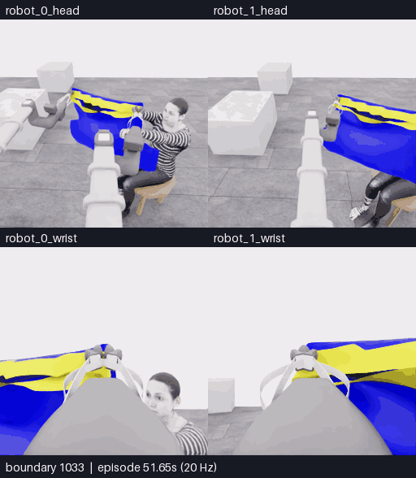

# E26 · 방향 변경·자세 보상과 손 관측

[메인 README](../../README.md) · [분석](../collection/reviews/20261107-astra-hand-swap787-named-001.ko.md) · [전체 실행 패키지](../collection/attempts/20261107-astra-hand-swap787-named-001/README.ko.md) · [피드백 남기기](https://github.com/leonyoon-3dai/PhyRC_2027_phase1/issues/new?title=%5BE26+%ED%94%BC%EB%93%9C%EB%B0%B1%5D+%EB%B0%A9%ED%96%A5+%EB%B3%80%EA%B2%BD%C2%B7%EC%9E%90%EC%84%B8+%EB%B3%B4%EC%83%81%C2%B7%EC%86%90+%EA%B4%80%EC%B8%A1&body=%EC%8B%9C%EB%8F%84%3A+E26+%2F+20261107-astra-hand-swap787-named-001%0A%EC%98%81%EC%83%81+%EC%8B%9C%EA%B0%81+%EB%98%90%EB%8A%94+%EA%B2%BD%EA%B3%84%3A%0A%EC%B9%B4%EB%A9%94%EB%9D%BC%3A%0A%0A%EB%B3%B4%EC%9D%B4%EB%8A%94+%EC%82%AC%EC%8B%A4%3A%0A%0A%ED%95%B4%EC%84%9D%C2%B7%EC%A7%88%EB%AC%B8%3A%0A%0A%EB%8B%A4%EC%9D%8C%EC%97%90+%EB%B9%84%EA%B5%90%ED%95%A0+%EB%B0%A9%EB%B2%95%3A%0A)

**5/50·픽업5·착의0·success=false.** 21회 조작과 마지막22번째 판단의 자율 종료로 마감했습니다. 예산이 강제로 끊었거나 감독자가 중단한 실행이 아닙니다. 1139/1139전수 검사 통과·학습 승인은unreviewed입니다.

## 보상 관측으로 손 후보를 더 드러내기

[MP4](assets/20261107-e26-view-orbit/event.mp4) · [출처](assets/20261107-e26-view-orbit/provenance.json) ·1033–1139·107프레임·21.4초·4배 느리게.

화면 끝의 손 조각이 보상 회전 뒤 손/짧은 손목으로 더 분명히 보입니다. 연결 전완·손 정체·소매 경계 통과는 미확인입니다. D17/D18의 작은 gripper 끝점 변화는 관측 제어의 근거이며 천 재료점이나 전체 이동 경로가 고정됐다는 뜻은 아닙니다. 뒤따른 낮춤·의도적인roll에서도 추가 통과 근거를 얻지 못했습니다.

## 방향 변경과 낮춘 접근

[MP4](assets/20261107-e26-lower-approach/event.mp4) · [GIF](assets/20261107-e26-lower-approach/preview.gif) · [출처](assets/20261107-e26-lower-approach/provenance.json) ·885–981·97프레임·19.4초.

D5 상대 배치 변경→D7 하강→D8 전진에서953경계의 두 손 관계가 재노출됐고 D9/D10에서도 유지됐습니다. 이후 가림이 생겼다는 이유로 이 유용한 관계를 없었던 것으로 기록하지 않습니다. [초기 손 비교](../collection/research/2026-11-07-e26-initial-hand-comparison.ko.md)와 [D5 실제 배치 분석](../collection/reviews/20261107-astra-hand-swap787-named-001-orientation.ko.md)은 각각의 부분 검토 범위를 명시합니다.

## 위치를 근사 유지하며 자세 바꾸기

[MP4](assets/20261107-e26-compensated-posture/event.mp4) · [GIF](assets/20261107-e26-compensated-posture/preview.gif) · [출처](assets/20261107-e26-compensated-posture/provenance.json) ·1009–1033·25프레임·5.0초.

D13은 양pitch변화 약−.460/−.461rad에 lift/arm 보상을 더했습니다. 각 robot base frame의 grasp 기준점 이동은약4.62/3.10mm였고 base도약.95/1.12mm 움직였습니다. 큰 자세 변화와 작은 끝점 차이를 확인했으나 입구 면·접촉·천 재료점 고정을 인증하지 않습니다. D14중립6은 모델이 선택한 추가 정착이며 자동settle설정은6을 유지했습니다.

## 전체와 기록

[전체 overview MP4](../collection/attempts/20261107-astra-hand-swap787-named-001/overview.mp4) ·1139프레임·20fps·56.95초. 세 클립은 같은 실행의 구간이며 독립 시연3개가 아닙니다. 모델 대기는 영상에서 제외했습니다.

전체1139=787replay+232model+120settle,새352전이·17.6sim초입니다.25calls/21act+finish1,3query22valid·질의물리0·마감0. 실행 기록05:51:36–06:42:28UTC·wall3051.140932266초,source53a58bb clean입니다. host78009=0·shellPython0·sim0·capturecomplete/operator_finished로 구분합니다.

[학습 검토21구간](../collection/reviews/20261107-astra-hand-swap787-named-001-learning-segments.json) · [원본 고정 백업](../project/sessions/20261107-e26-backup-verification.json). archive 2,544,928,271bytes·254member,revision`41c78439105eb3a6e1f5fd9c0943cee6039d041b`를 강제 재다운로드해 검증했습니다. raw5는 기존 픽업이며 손/역할 교환 성공이나 착의 득점으로 확대하지 않습니다.

E27은 E25/698의 새 파지 task-progress로06:58:14UTC·source1ff16b2 clean에서 실제 시작했으며 현재 지지를 새 replay에서 다시 확인합니다. [현재 실행 여부](../project/STATUS.md)
