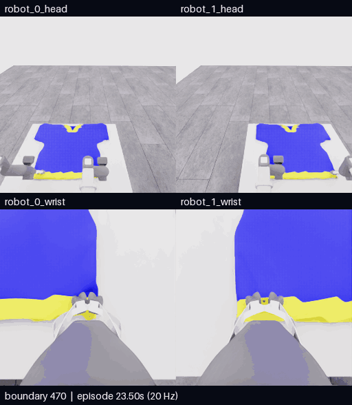

# E20 · 두 목 후보로 재파지, 개구부 미확인으로 운반 전 종료

[비교 갤러리](README.ko.md) · [공개 분석](../collection/reviews/20261107-astra-neckline470-named-001.ko.md) · [재파지·복구 학습 검토 구간](../collection/reviews/20261107-astra-neckline470-named-001-learning-segments.json)

**0/50 · success=false · 전수 검사726/726 통과.** 두 로봇이 기존 밑단을 놓고 먼 V형 목 후보 쪽으로 차례로 옮겨 다시 잡는 동작을 실제 수행했습니다. 국소 천 동행은 관측했지만 연결된 목 개구부를 확인하지 못해 천을 낮춘 뒤 모델이 자율 종료했습니다. 머리·소매 통과 시도는 없었습니다. 최고5점·목표10점 미달성입니다.

**새 구간 전체470~726 · 257프레임 · 51.4초 · 5fps·4배 느리게.** [MP4 크게 열기](assets/20261107-e20-neckline-regrasp/event.mp4) · [원본 경계·영상 출처](assets/20261107-e20-neckline-regrasp/provenance.json)

위는 로봇0·1 머리, 아래는 로봇0·1 손목입니다. 카메라당 원본256×256이며 모델 응답 대기는 제외했습니다.256전이·12.8초 물리 구간의 양 끝 관측257장을 포함하고 구간 내 프레임 생략·시간 보간은 없습니다.

| 구간 | 실제 행동과 확인할 장면 |
|---|---|
| 470~480 · 기존 파지 진단 | 가까운 밑단의 양 grip을 짧게 들어 봅니다. 먼 V형 후보와 현재 held edge는 다른 위치입니다. |
| 480~578 · robot0 재파지 | 한쪽을 열고 들어 뻗어 먼 후보로 이동·하강·닫습니다. 첫 close만으로 닫히지 않아 작은 상승과 중립 관측으로 수렴을 확인합니다. |
| 578~588 · 첫 새 파지 시험 | robot0만 실제 약2.65cm 올라가고 국소 주름이 jaw 쪽에 남아 따라옵니다. robot1은 거의 움직이지 않습니다. |
| 588~680 · robot1 재파지 | 위 시험 뒤 robot1을 열어 반대 후보로 옮깁니다. 공개 depth 조회 뒤 열린 그리퍼 방향을 돌려 하강·close·중립 관측을 수행합니다. |
| 680~712 · 공동 시험·입구 관측 | 양측 lift에서 국소 주름 동행을 관측하고 높이·간격·시점을 바꿉니다. 후보 내부는 파란 천으로 채워져 층 분리를 읽지 못합니다. |
| 712~726 · 낮춤·자율 종료 | 천을 테이블 쪽으로 낮춘 뒤 운반 전 종료합니다. 마지막 finish는 물리0전이입니다. |

**두 새 위치의 release→접근→close는 실제 방법 변경입니다.** 기존 파지에 목이라는 이름만 붙인 경로와 다릅니다. 다만 V형 띠가 실제 개구부의 마주 보는 자유 경계인지, 통과 가능한 목 입구를 만들었는지는 미확인입니다.

첫 robot0의 국소 지지 시험은 두 번째 재파지 전에 실행했습니다. 몸통이 테이블에 남아 있다는 이유로 국소 천 동행 근거를 무효화하지 않습니다. 반대로 이 시각적 근거를 센서 attachment 확정으로 부르지 않으며, robot1의 공동 lift를 독립 지지 검사로 해석하지 않습니다.0점에서 어느 파지가 실패했는지나 실패 원인을 역추론하지 않습니다.

[**이 영상에 피드백 남기기**](https://github.com/leonyoon-3dai/PhyRC_2027_phase1/issues/new?title=%5BE20+%ED%94%BC%EB%93%9C%EB%B0%B1%5D+%EC%98%81%EC%83%81+%EA%B5%AC%EA%B0%84%EA%B3%BC+%EA%B4%80%EC%B8%A1&body=%EC%8B%9C%EB%8F%84%3A+E20+%2F+20261107-astra-neckline470-named-001%0A%EC%98%81%EC%83%81+%EC%8B%9C%EA%B0%81+%EB%98%90%EB%8A%94+%EA%B2%BD%EA%B3%84%3A+%0A%EC%B9%B4%EB%A9%94%EB%9D%BC%3A+%EB%A1%9C%EB%B4%870+%EB%A8%B8%EB%A6%AC+%2F+%EB%A1%9C%EB%B4%871+%EB%A8%B8%EB%A6%AC+%2F+%EB%A1%9C%EB%B4%870+%EC%86%90%EB%AA%A9+%2F+%EB%A1%9C%EB%B4%871+%EC%86%90%EB%AA%A9%0A%0A%EA%B4%80%EC%B8%A1%ED%95%9C+%EC%9E%A5%EB%A9%B4%3A%0A%0A%EC%A0%9C+%ED%95%B4%EC%84%9D+%EB%98%90%EB%8A%94+%EC%A7%88%EB%AC%B8%3A%0A%0A%EB%8B%A4%EC%9D%8C%EC%97%90+%EB%B9%84%EA%B5%90%ED%95%98%EB%A9%B4+%EC%A2%8B%EC%9D%84+%EB%8F%99%EC%9E%91%3A%0A%0A%EA%B0%A4%EB%9F%AC%EB%A6%AC%3A+https%3A%2F%2Fgithub.com%2Fleonyoon-3dai%2FPhyRC_2027_phase1%2Fblob%2Fmain%2Fdocs%2Fgallery%2FREADME.ko.md%0A). 영상 시각 또는 경계와 카메라를 적어 주세요. 링크는 GitHub 작성 화면만 열며 제출은 사용자가 합니다.

## 실행 조건과 결과

| 항목 | 실제 기록 |
|---|---|
| 실행 / 소스 | `20261107-astra-neckline470-named-001` / `799fe804445c6e0fc401927f0ed82b4e5dd4f935`, 시작 시 clean |
| 전략·부모 | 목 우선 `coordinated-neckline-first`, E18의470전이 행동 재실행. 정확한 천 checkpoint 복원 아님 |
| 모델·입력 | Astra/ultra·CLI0.166.0/exec. 공개 RGB5장·로봇 상태·depth·손목 depth 패널, 첫 호출에 이번 재실행430·464경계 RGB10장 |
| 실제 명명 행동 | 23개 act에서 named9축→배열 변환 일치. 설명 없는 roll은 없었고 D14 robot1 roll은 의도된 접근 방향 변경 |
| 실제 depth 질의 | D14 robot1 wrist8점·8/8 valid. 동일 현재 관측·질의 물리0 |
| 호출·판단 | **25호출 = act23 + finish1 + 질의 초기 호출1**.24개 최종 판단 |
| 기록 | **470재실행 + 154모델 + 102제어기 settle = 726전이** |
| 시뮬레이션 / 실제 | 전체36.3초·새12.8초 /1783.289405초(29분43.289초) |
| UTC | 2026-11-07 01:18:21–01:48:05 |
| 호출·환경 시간 | 모델 호출 경로1090.693713초·환경640.649879초. 순수 내부 추론시간과 다름 |
| 별도 평가 | raw0/50·모든 항목0·success=false·no_contact / null |
| 검사·마감 | 726/726전이 통과·오류0·capture 마감·client0·모델 자율 종료. 학습 승인 unreviewed |
| 보존 | 공개 영상·분석·재파지/복구 구간 보존. [비공개 원본 고정 revision·재다운로드 SHA 검증 완료](../project/sessions/20261107-e20-backup-verification.json) |

깊이 조회는 후보 band·천 표면·두 손가락 사이 하강 여유를 비교하는 데 쓰였습니다. 보이는 표면의 광축Z이며 클릭 의미·숨은 면·개구부·파지 정답을 제공하지 않습니다. 명령 변환의 정확성과 실제 착의 진전도 별개입니다.

[학습 검토 JSON](../collection/reviews/20261107-astra-neckline470-named-001-learning-segments.json)은 새256전이를11개 구간으로 나누고, 질의·finish를 물리0 사건으로 기록합니다. 닫힘 지연과 작은 상승 복구, 첫 새 파지 시험, 두 번째 재파지, 입구 확인 미완료도 검토 자료로 남깁니다. 모두 unreviewed이며 같은 재실행 출처·인접 프레임을 독립 성공 표본으로 세지 않습니다.

## 다음 비교에서 구분할 점

새 grasp set을 만드는 단계는 실행했지만 머리 정렬·통과 단계는 시험하지 못했습니다. 다음 후보는 색 띠와 실제 자유 경계·앞뒤 층을 더 잘 구분하는 관측, 또는 테이블 지지를 유지한 다른 가시 경계 재파지입니다. 같은 위치의 높이·간격 보정과 실제 경계 변경을 별도 비교하며 아직 새로운 실행 결과로 집계하지 않습니다.

[현재 상태·실제 다음 명령](../project/STATUS.md) · [세션 기록](../project/sessions/20261106-evening-resume.ko.md)
