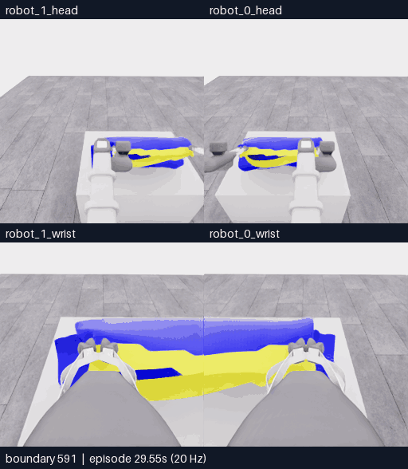
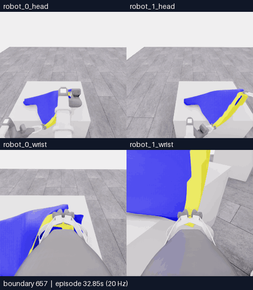

# E25 · 실제 재파지와 국소 동행, 입구 미확인으로 자율 종료

[비교 갤러리](README.ko.md) · [공개 분석](../collection/reviews/20261107-astra-opposing563-named-001.ko.md) · [학습 검토 구간](../collection/reviews/20261107-astra-opposing563-named-001-learning-segments.json)

**5/50 · 픽업5·착의0 · success=false · 전수 검사698/698 통과.** 로봇1이 실제로 놓고 다른 낮은 경계를 다시 잡았습니다. 작은 단독 lift에서 **새 국소 천 동행의 잠정 근거**가 있었지만, 서로 반대인 두 입구 경계인지는 확인되지 않았습니다. 모델은16판단을 남기고 자율 종료했으며 운반·착의 진입은 수행하지 않았습니다. 최고5점·중간 목표10점 미달성입니다.

**핵심591~698 · 108프레임 · 21.6초 · 5fps·4배 느리게.** [MP4 크게 열기](assets/20261107-e25-rim-regrasp/event.mp4) · [경계·출처](assets/20261107-e25-rim-regrasp/provenance.json)

위는 로봇0·1 머리, 아래는 로봇0·1 손목입니다.107전이·5.35초 물리 구간의 양 끝 화면108장을 포함합니다. 카메라당 원본256×256이며 구간 내 생략·보간과 모델 응답 대기는 없습니다. 앞선563~591의 공동하강 준비는 [전체 overview](../collection/attempts/20261107-astra-opposing563-named-001/overview.mp4)에 포함됩니다.

| 경계 | 실제 행동과 관측 |
|---|---|
| **591~599 · 한쪽 release** | 로봇0은 닫힌 파지를 유지하고 로봇1만 엽니다. 실제 손가락 간격이47.05→129.30mm로 늘고 천 모양이 대각으로 바뀝니다. |
| 599~639 · 초기 배치와 보정1회 | 열린 로봇1을 낮은 곡선 노란 경계로 내리고 당겨 회전합니다. 한 번 추가 보정하고 잔류 운동을 기다려 경계 끝을 jaw 중앙 가까이 맞춥니다. 초기 배치와 추가 보정은 구분합니다. |
| **639~657 · reclose와 닫힘 확인** | 로봇1을 한 번 닫습니다. 손가락 사이 노란 끝은 남지만 처음에는 실제 닫힘이 진행 중이어서 중립 관측으로 추종을 확인합니다. |
| **657~667 · 국소 동행 시험** | 로봇1만 실제26.62mm 들자 jaw 근처 경계가 함께 이동합니다. 반대쪽 기준점 이동은 작습니다. 추가 손가락 닫힘·테이블 지지가 남아 독립 하중/attachment 인증은 아닙니다. |
| 667~698 · 차등 형상·시점 확인 | 로봇1을 당기고 의도적으로 roll한 뒤 자세를 바꿉니다. 천은 남지만 두 자유 lip의 독립 개방은 미확인입니다. 정착 관측 뒤 자율 finish하며 추가 물리 전이는 없습니다. |

단순히 같은 파지의 위치·각도만 고친 시도와 달리 **release→다른 낮은 경계 배치→reclose를 실제 수행**했습니다. 다만 낮은 경계가 자유로운 반대 lip인지 같은 층의 다른 지점인지는 미해결입니다. 국소 동행이라는 유용한 변화와 입구 정체·착의 성과를 구분하며, 점수에서 잘못된 층이나 파지 실패를 역추론하지 않습니다.

## 국소 동행과 차등 시험 다시 보기

**657~698 · 42프레임 · 8.4초 · 5fps·4배 느리게.** [MP4 크게 열기](assets/20261107-e25-local-follow/event.mp4) · [경계·출처](assets/20261107-e25-local-follow/provenance.json)

위 핵심 영상에 포함된 같은41전이·2.05초 물리 구간입니다. 별도의 독립 시연이나 성공 표본으로 세지 않습니다. D10의 roll은 최종 설명에 명시된 차등시험이며 E18의 의도와 다른 roll 명령과 구분합니다. D11의 보상 자세는 높이를 거의 유지했지만 옆 방향 기준점 이동이 있어 고정 파지점 인증도 아닙니다. 추가 중립의 효과는 [공개 상태 정착 분석](../collection/reviews/20261107-astra-opposing563-named-001-settle.ko.md)에 별도 기록했습니다.

[**이 영상에 피드백 남기기**](https://github.com/leonyoon-3dai/PhyRC_2027_phase1/issues/new?title=%5BE25+%ED%94%BC%EB%93%9C%EB%B0%B1%5D+%EC%9E%AC%ED%8C%8C%EC%A7%80%EC%99%80+%EA%B5%AD%EC%86%8C+%EB%8F%99%ED%96%89&body=%EC%8B%9C%EB%8F%84%3A+E25+%2F+20261107-astra-opposing563-named-001%0A%EC%98%81%EC%83%81%3A+%EC%9E%AC%ED%8C%8C%EC%A7%80591%E2%80%93698+%2F+%EA%B5%AD%EC%86%8C+%EB%8F%99%ED%96%89657%E2%80%93698%0A%EC%98%81%EC%83%81+%EC%8B%9C%EA%B0%81+%EB%98%90%EB%8A%94+%EA%B2%BD%EA%B3%84%3A+%0A%EC%B9%B4%EB%A9%94%EB%9D%BC%3A+%EB%A1%9C%EB%B4%870+%EB%A8%B8%EB%A6%AC+%2F+%EB%A1%9C%EB%B4%871+%EB%A8%B8%EB%A6%AC+%2F+%EB%A1%9C%EB%B4%870+%EC%86%90%EB%AA%A9+%2F+%EB%A1%9C%EB%B4%871+%EC%86%90%EB%AA%A9%0A%0A%EA%B4%80%EC%B8%A1%ED%95%9C+%EC%9E%A5%EB%A9%B4%3A%0A%0A%EC%A0%9C+%ED%95%B4%EC%84%9D+%EB%98%90%EB%8A%94+%EC%A7%88%EB%AC%B8%3A%0A%0A%EB%8B%A4%EC%9D%8C%EC%97%90+%EB%B9%84%EA%B5%90%ED%95%98%EB%A9%B4+%EC%A2%8B%EC%9D%84+%EB%8F%99%EC%9E%91%3A%0A). 영상 시각 또는 경계와 카메라를 적어 주세요. GitHub 작성 화면만 열며 제출은 사용자가 합니다.

## 실행 조건과 결과

| 항목 | 실제 기록 |
|---|---|
| 실행 / 소스 | `20261107-astra-opposing563-named-001` / `68658c9d9bb7e47591fb330f08f4f996ec4fcbfb`, 시작 clean |
| 전략·부모 | `coordinated-opposing-rim`, E18 직접 부모·563전이 행동 재실행·이번510/542경계 과거 RGB |
| 모델·설정 | Astra/ultra·CLI0.166.0/exec·named+query+wrist-depth-panel·30판단/max1400/timeout180/settle6/review10 |
| 호출·판단 | **15모델 호출·14최종 결정 = 13act + 1자율 finish**. 예산16개 잔여·감독 중단0 |
| 재파지 | release1·초기 placement1·추가 보정1·reclose1. 운반/착의 진입0 |
| 질의 | R1 head6점·1회·6/6 valid·물리0. 후속 배치 행동은 실제 수행 |
| 기록 | **563재실행 + 93모델 행동 + 42제어기 정착 = 698전이**. 종료 추가중립0 |
| 시뮬레이션 / 실제 | 전체34.9초·새135전이6.75초 /1225.593759초(20분25.594초) |
| UTC | 2026-11-07 05:18:00–05:38:26 |
| 호출·환경 시간 | 모델 호출 경로568.194194초·환경609.287344초. 내부 추론시간과 다름 |
| 별도 평가 | raw5/50·pickup5·모든 착의0·success=false·no_contact / final_score=null |
| 검사·마감 | 698/698 통과·오류0·completed/errornull·host/Python0·simulator0 |
| 원본 보존 | 원본·실패/부분 동행 구간 보존. [비공개 고정 revision·재다운로드182member 검증 완료](../project/sessions/20261107-e25-backup-verification.json) |

전이1개는 관측→행동→다음 관측의0.05초 기록입니다. 모델의 중립 대기28전이도93모델 전이에 포함되고, 별도 제어기 정착은42전이입니다. D13 finish의 선언 steps1은 적용되지 않아 전이로 세지 않습니다.13개 act의 named→공식 배열→적용 float32는 일치합니다.

[학습 검토 JSON](../collection/reviews/20261107-astra-opposing563-named-001-learning-segments.json)은 새135전이를12개 연속 구간으로 보존합니다. 실제 release/reclose·잔류 운동·잠정 국소 동행·차등시험·가설 미해결을 구분하고 질의와 자율 finish는 물리0 사건으로 남겼습니다. 모두 `unreviewed`이며 평가 항목을 교사 행동 라벨로 넣지 않습니다. 같은 계보·prefix·인접 관측은 독립 성공 표본이 아닙니다.

다음 E26는 **M2 별도 방법, E18/787·과거719/771·22판단/max1400/settle6**으로 채택했고 후보 코드를 main에 통합했습니다. 실제 실행은 아직 시작하지 않았습니다. E25의 국소 동행을 인증된 반대 입구나 착의 출발점으로 승격하지 않습니다.

[전체 공개 기록](../collection/attempts/20261107-astra-opposing563-named-001/README.ko.md) · [전체 overview](../collection/attempts/20261107-astra-opposing563-named-001/overview.mp4) · [현재 상태](../project/STATUS.md) · [세션 기록](../project/sessions/20261106-evening-resume.ko.md)
