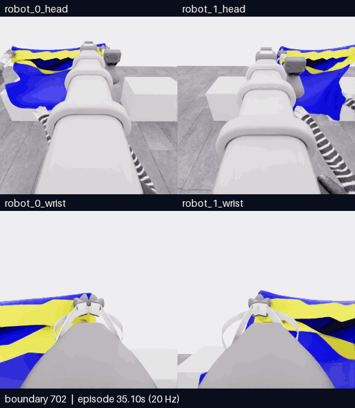
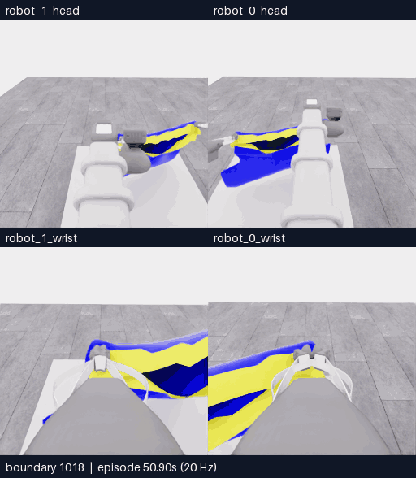

# E21 · 두 하강 시도 뒤 복귀·재파지, 40판단 예산 종료

[비교 갤러리](README.ko.md) · [공개 분석](../collection/reviews/20261107-astra-overhead470-named-001.ko.md) · [실패·복구 학습 검토 구간](../collection/reviews/20261107-astra-overhead470-named-001-learning-segments.json)

**5/50 · 픽업5·착의0 · success=false · 전수 검사1111/1111 통과.** 기존 가장자리 지지로 마네킹의 들린 손·팔 부근까지 높게 운반하고 두 차례 짧게 내렸습니다. 입구 통과는 확인하지 못했습니다. 테이블로 복귀해 한쪽 파지를 바꾼 뒤 새 지지를 검사하기 전에 **40판단 예산으로 종료**했습니다. 최고5점·목표10점 미달성입니다.

**하강·시야 복구702~856 · 155프레임 · 31초 · 5fps·4배 느리게.** [MP4 크게 열기](assets/20261107-e21-overhead-entry/event.mp4) · [경계·출처](assets/20261107-e21-overhead-entry/provenance.json)

위는 머리, 아래는 손목 카메라입니다. 두 행 모두 **왼쪽 robot_1 · 오른쪽 robot_0**입니다. 카메라당 원본256×256이며 모델 대기시간은 제외했습니다.154전이·7.7초 물리 구간의 양 끝 화면155장을 포함합니다. 구간 내 생략·시간 보간은 없습니다.

| 경계 | 실제 행동과 관측 |
|---|---|
| 702~760 · 첫 하강 | 기존 두 지지점으로 짧게 내리고 전후 위치를 바꿉니다. 손끝이 아래 경계 부근에 보이다 천에 가립니다. |
| 760~796 · 시야 복구 | 높이를 대체로 유지한 두 시점 변경으로도 불확실성이 남아 반대 pitch로 경계를 올립니다. 손끝이 다시 보입니다. |
| 796~844 · 두 번째 접근 | 공개 깊이 조회 뒤 전후 정렬을 바꾸고 다시 내립니다. 손과 경계의 연속 통과는 확인하지 못합니다. |
| 844~856 · 복귀 선택 | 반복 접근의 한계를 기록하고 옷을 올려 손 부근에서 경계를 띄웁니다. 테이블에서 파지 구성을 바꾸기로 합니다. |

**높은 운반과 실제 하강은 수행했습니다.** 머리·양팔 전체를 몸통 입구 안에 정렬했거나 통과시켰다는 근거는 없습니다. 같은 파지의 위치·시점 보정 이후에도 가림이 반복돼 다른 파지 구성으로 전환할 이유가 쌓였습니다.

## 테이블에 놓고 한쪽 재파지

**1018~1111 · 94프레임 · 18.8초 · 5fps·4배 느리게.** [MP4 크게 열기](assets/20261107-e21-table-regrasp/event.mp4) · [경계·출처](assets/20261107-e21-table-regrasp/provenance.json)

테이블 복귀 운반은856~1002, 천을 놓는 동작은1002~1066입니다. 위 영상은 배치 중간부터 시작합니다.1066에서 로봇1을 열고, 공개 depth 조회 뒤 열린 손가락을 다른 노출 경계 위치에 옮겨1102~1110에서 닫았습니다. 마지막1110~1111은 예산 종료 중립1전이입니다.

[최종 손목 영상](../collection/attempts/20261107-astra-overhead470-named-001/images/final-robot_1_wrist.png)에서는 직전보다 손가락 간격이 줄었습니다. 천 몸통은 테이블 위에 남아 있으며 **새 파지의 lift/hold 검사·반대층 선택·양측 지지는 미확인**입니다. release→재배치→close 명령은 수행했지만 성공한 지지 구성으로 집계하지 않습니다. 모델 자율 finish나 감독 SIGINT 중단도 아닙니다.

[전체 공개 기록](../collection/attempts/20261107-astra-overhead470-named-001/README.ko.md) · [전체 overview로 운반·복귀 보기](../collection/attempts/20261107-astra-overhead470-named-001/overview.mp4)

[**이 영상에 피드백 남기기**](https://github.com/leonyoon-3dai/PhyRC_2027_phase1/issues/new?title=%5BE21+%ED%94%BC%EB%93%9C%EB%B0%B1%5D+%ED%95%98%EA%B0%95%C2%B7%EB%B3%B5%EA%B5%AC%EC%99%80+%EC%9E%AC%ED%8C%8C%EC%A7%80+%EA%B4%80%EC%B8%A1&body=%EC%8B%9C%EB%8F%84%3A+E21+%2F+20261107-astra-overhead470-named-001%0A%EC%98%81%EC%83%81+%EA%B5%AC%EA%B0%84%3A+%ED%95%98%EA%B0%95%C2%B7%EB%B3%B5%EA%B5%AC702%E2%80%93856+%2F+%ED%85%8C%EC%9D%B4%EB%B8%94+%EC%9E%AC%ED%8C%8C%EC%A7%801018%E2%80%931111%0A%EC%98%81%EC%83%81+%EC%8B%9C%EA%B0%81+%EB%98%90%EB%8A%94+%EA%B2%BD%EA%B3%84%3A+%0A%EC%B9%B4%EB%A9%94%EB%9D%BC%3A+%EB%A1%9C%EB%B4%870+%EB%A8%B8%EB%A6%AC+%2F+%EB%A1%9C%EB%B4%871+%EB%A8%B8%EB%A6%AC+%2F+%EB%A1%9C%EB%B4%870+%EC%86%90%EB%AA%A9+%2F+%EB%A1%9C%EB%B4%871+%EC%86%90%EB%AA%A9%0A%0A%EA%B4%80%EC%B8%A1%ED%95%9C+%EC%9E%A5%EB%A9%B4%3A%0A%0A%EC%A0%9C+%ED%95%B4%EC%84%9D+%EB%98%90%EB%8A%94+%EC%A7%88%EB%AC%B8%3A%0A%0A%EB%8B%A4%EC%9D%8C%EC%97%90+%EB%B9%84%EA%B5%90%ED%95%98%EB%A9%B4+%EC%A2%8B%EC%9D%84+%EB%8F%99%EC%9E%91%3A%0A%0A%EA%B0%A4%EB%9F%AC%EB%A6%AC%3A+https%3A%2F%2Fgithub.com%2Fleonyoon-3dai%2FPhyRC_2027_phase1%2Fblob%2Fmain%2Fdocs%2Fgallery%2FREADME.ko.md%0A). 영상 시각 또는 경계와 카메라를 적어 주세요. GitHub 작성 화면만 열며 제출은 사용자가 합니다.

## 실행 조건과 결과

| 항목 | 실제 기록 |
|---|---|
| 실행 / 소스 | `20261107-astra-overhead470-named-001` / `d383063670085afccabfb51e6af530607d2efd44`, 시작 시 clean |
| 전략·부모 | `coordinated-overhead-drape`, **E18 직접 부모·470전이 행동 재실행**. E20 목 후보 파지를 이어받지 않음 |
| 모델·입력 | Astra/ultra·CLI0.166.0/exec. 지정 RGB5장·공개 로봇 상태·depth, 첫 호출에 이번 재실행430·464경계 과거 RGB10장 |
| 명명 행동·질의 | act40개 named→배열 일치, 설명 없는 roll 없음. 공개 depth4회·29/29점 valid·질의 물리0 |
| 호출·판단 | **44호출 = act40 + 질의 초기 호출4**. 최종 판단40개·finish0개 |
| 기록 | **470재실행 + 412모델 행동 + 228제어기 settle + 1예산 종료 중립 = 1111전이** |
| 시뮬레이션 / 실제 | 전체55.55초·새641전이32.05초 /3149.109434초(52분29.109초) |
| UTC | 2026-11-07 01:56:25–02:48:54 |
| 호출·환경 시간 | 모델 호출 경로2160.241971초·환경926.844498초. 순수 내부 추론시간과 다름 |
| 별도 평가 | raw5/50·pickup5·모든 착의 항목0·success=false·no_dressing_points / final_score=0.0 |
| 검사·마감 | 1111/1111전이 통과·오류0·capture 마감·client0·decision_budget 종료 |
| 원본 보존 | 공개 영상·분석 완료. [비공개 원본 고정 revision45e6adf·재다운로드 SHA 검증 완료](../project/sessions/20261107-e21-backup-verification.json) |

전이1개는 관측→행동→다음 관측의0.05초 기록입니다. 모델 판단 횟수와 다르며 settle·마감 중립도 포함합니다. 공개 깊이는 보이는 표면의 광축Z만 읽고 숨은 면·입구 연결·접촉·파지 정답은 제공하지 않습니다. 명령 표현의 일치와 착의 성공도 별개입니다.

[학습 검토 JSON](../collection/reviews/20261107-astra-overhead470-named-001-learning-segments.json)은 새641전이를15개 연속 구간으로 나누고 실패 접근·시야 복구·테이블 복귀·미검증 재파지·예산 마감을 보존합니다. 모두 `unreviewed`이며 같은 출처·재실행 prefix·인접 프레임을 독립 성공 표본으로 세지 않습니다.

다음은 E21 마지막 파지의 검증을 가정하지 않고 **E18/787경계에서18판단 진입 진단 후보**를 별도로 비교할 계획입니다. 아직 실행 결과는 없습니다. 목선 재파지는 현재 우선순위를 낮춘 별도 후보입니다.

[현재 상태·실제 다음 명령](../project/STATUS.md) · [세션 기록](../project/sessions/20261106-evening-resume.ko.md)
