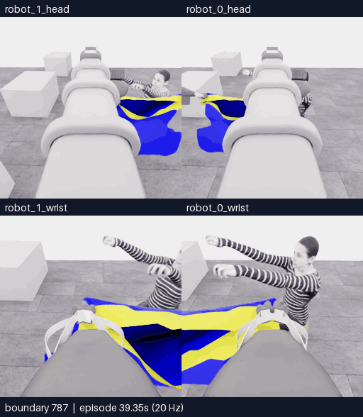

# E22 · 짧은 탐색·시점 보정 뒤 자율 종료

[비교 갤러리](README.ko.md) · [공개 분석](../collection/reviews/20261107-astra-probe787-named-001.ko.md) · [학습 검토 구간](../collection/reviews/20261107-astra-probe787-named-001-learning-segments.json)

**5/50 · 픽업5·착의0 · success=false · 전수 검사813/813 통과.** 기존 두 파지를 유지한4step 전진 한 번,4step 시점 보정,6step 중립 대기 뒤 모델이 자율 종료했습니다. 새 손–옷 경계 관계는 드러나지 않았습니다.18판단 예산 중4판단을 사용했으며 최고5점·중간 목표10점 미달성입니다.

**새 구간 전체787~813 · 27프레임 · 5.4초 · 5fps·4배 느리게.** [MP4 크게 열기](assets/20261107-e22-entry-probe/event.mp4) · [경계·출처](assets/20261107-e22-entry-probe/provenance.json)

위는 머리, 아래는 손목 카메라입니다. 두 행 모두 **왼쪽 robot_1 · 오른쪽 robot_0**입니다. 26전이·1.3초 물리 구간의 양 끝 화면27장을 포함합니다. 카메라당 원본256×256이며 구간 내 생략·보간과 모델 응답 대기는 없습니다.

| 경계 | 실제 수행과 관측 |
|---|---|
| 787~797 · 단일 전진 탐색 | 양 base_forward만4step, 이후 제어기 정착6step. pinch 주변 천과 노란 경계·어두운 틈은 유지되지만 새 손–경계 겹침은 보이지 않습니다. |
| 797~807 · 시점 보정 | 양 wrist_pitch만4step, 이후 정착6step. 손·마네킹의 영상상 위치가 바뀌지만 손은 여전히 경계 위쪽입니다. |
| 807~813 · 중립 관측 | 모델 all-zero6step으로 잔류 운동·천 완화를 확인합니다. 새 통과 관계는 드러나지 않습니다. |
| 813 · 자율 종료 | finish는 물리0입니다. 같은 미해결 탐색을 반복하지 않겠다고 종료했습니다. 예산 소진·사람 중단이 아닙니다. |

**실제 진입이 불가능하다는 결과는 아닙니다.** 새 겹침 자체가 나타나기 전에 종료돼 손이 입구를 통과하는 경우와 바깥 천에 가려지는 경우를 충분히 비교하지 못했습니다. “새 정보가 없음”과 “재파지 금지”가 최종 종료 설명에 함께 등장합니다. 정보 확인 조건이 조기 종료에 기여했을 가능성은 있지만, 다른 행동의 효과나 인과는 아직 비교하지 않았습니다.

[**이 영상에 피드백 남기기**](https://github.com/leonyoon-3dai/PhyRC_2027_phase1/issues/new?title=%5BE22+%ED%94%BC%EB%93%9C%EB%B0%B1%5D+%EC%A7%A7%EC%9D%80+%ED%83%90%EC%83%89%EA%B3%BC+%EC%9E%90%EC%9C%A8+%EC%A2%85%EB%A3%8C&body=%EC%8B%9C%EB%8F%84%3A+E22+%2F+20261107-astra-probe787-named-001%0A%EC%98%81%EC%83%81+%EC%8B%9C%EA%B0%81+%EB%98%90%EB%8A%94+%EA%B2%BD%EA%B3%84787%E2%80%93813%3A+%0A%EC%B9%B4%EB%A9%94%EB%9D%BC%3A+%EB%A1%9C%EB%B4%870+%EB%A8%B8%EB%A6%AC+%2F+%EB%A1%9C%EB%B4%871+%EB%A8%B8%EB%A6%AC+%2F+%EB%A1%9C%EB%B4%870+%EC%86%90%EB%AA%A9+%2F+%EB%A1%9C%EB%B4%871+%EC%86%90%EB%AA%A9%0A%0A%EA%B4%80%EC%B8%A1%ED%95%9C+%EC%9E%A5%EB%A9%B4%3A%0A%0A%EC%A0%9C+%ED%95%B4%EC%84%9D+%EB%98%90%EB%8A%94+%EC%A7%88%EB%AC%B8%3A%0A%0A%EB%8B%A4%EC%9D%8C%EC%97%90+%EB%B9%84%EA%B5%90%ED%95%98%EB%A9%B4+%EC%A2%8B%EC%9D%84+%EB%8F%99%EC%9E%91%3A%0A%0A%EA%B0%A4%EB%9F%AC%EB%A6%AC%3A+https%3A%2F%2Fgithub.com%2Fleonyoon-3dai%2FPhyRC_2027_phase1%2Fblob%2Fmain%2Fdocs%2Fgallery%2FREADME.ko.md%0A). 영상 시각 또는 경계와 카메라를 적어 주세요. GitHub 작성 화면만 열며 제출은 사용자가 합니다.

## 실행 조건과 결과

| 항목 | 실제 기록 |
|---|---|
| 실행 / 소스 | `20261107-astra-probe787-named-001` / `11faab3797cacd0160a725578d4a9dc65c6b018f`, 시작 clean |
| 전략·부모 | `coordinated-entry-probe`, E18 직접 부모·787전이 행동 재실행·이번 재실행719/771경계 과거 RGB. E21 마지막 재파지를 사용하지 않음 |
| 모델·설정 | Astra/ultra·CLI0.166.0/exec·named+query·18판단/max1300/timeout180/settle6/review10 |
| 명명 행동·질의 | act3+finish1의 named→배열 일치. R0 wrist7점·7/7 valid·질의 물리0 |
| 호출·판단 | **5호출 = act3 + finish1 + 질의 초기 호출1**, 최종 판단4개 |
| 기록 | **787재실행 + 14모델 행동(4+4+6) + 12제어기 정착 = 813전이** |
| 시뮬레이션 / 실제 | 전체40.65초·새1.3초 /1032.883288초(17분12.883초) |
| UTC | 2026-11-07 03:01:21–03:18:34 |
| 호출·환경 시간 | 모델 호출 경로294.325561초·환경694.749380초. 순수 내부 추론시간과 다름 |
| 별도 평가 | raw5/50·pickup5·다른 항목0·success=false·no_contact / final_score=null |
| 검사·마감 | 813/813전이 통과·오류0·모델 자율 finish·attempt completed·capture complete·simulator0 |
| 외부 실행 반환 | host exec143의 발신·원인은 현재 근거로 특정 불가. collector simulator0·정상 마감과 별개이며 client 반환값으로 단정하지 않음. 실행 담당자 직접 interrupt0회 |
| 보존 | 공개 영상·분석·실패 구간 보존. [고정 revision788a36e·재다운로드 SHA 및92개 구성 파일 검증 완료](../project/sessions/20261107-e22-backup-verification.json) |

전이1개는 관측→행동→다음 관측의0.05초 기록입니다.4step 탐색 뒤6step 정착도 관측 변화에 포함되므로4step만의 결과로 해석하지 않습니다. depth 조회는 카메라에서 보이는 표면 깊이 순서이며 숨은 면·입구 평면·접촉·파지를 확인하지 않습니다.

[학습 검토 JSON](../collection/reviews/20261107-astra-probe787-named-001-learning-segments.json)은 새26전이를3개 연속 구간으로 보존하고 질의·finish는 물리0 사건으로 분리합니다. 현재 `unreviewed`이며 실패·조기 종료의 보존을 좋은 행동의 자동 모방 승인으로 해석하지 않습니다. 같은 재실행 출처·인접 프레임도 독립 성공 표본이 아닙니다.

다음 E23은 **`coordinated-task-progress` 후보**를 준비 중입니다. 같은 E18/787·과거719/771·18판단에서 목표 진전용 유한 행동 선택을 비교하고, 정보 명료화를 필수 선행 조건으로 두는 것을 완화합니다. 공식20step 상한은 유지하며 구현·CPU 검사 중으로 실제 미실행입니다. 후보의 의도와 실제 새 조작 수행은 별개입니다. 한 번의 작은 전진 결과만으로 전체 접근이 소진됐다고 판단하지 않습니다.

[전체 공개 기록](../collection/attempts/20261107-astra-probe787-named-001/README.ko.md) · [전체 overview](../collection/attempts/20261107-astra-probe787-named-001/overview.mp4) · [현재 상태](../project/STATUS.md) · [세션 기록](../project/sessions/20261106-evening-resume.ko.md)
