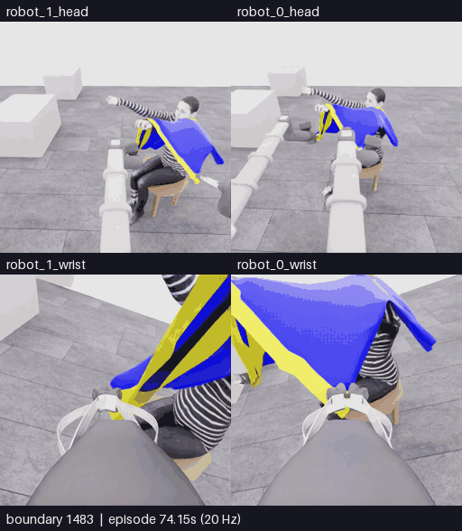
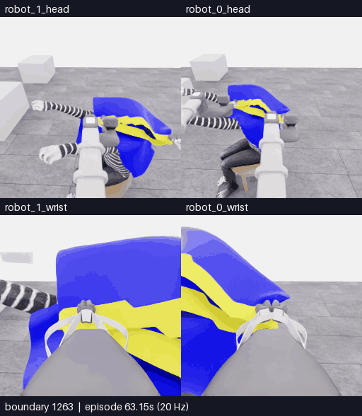

# E24 · 진입 시도와 부분 복구, 착의0으로 감독 종료

[비교 갤러리](README.ko.md) · [공개 분석](../collection/reviews/20261107-astra-progress1179-named-001.ko.md) · [학습 검토 구간](../collection/reviews/20261107-astra-progress1179-named-001-learning-segments.json)

**5/50 · 픽업5·착의0 · success=false · 전수 검사1610/1610 통과.** 손과 노란 경계의 겹침 뒤 몸통 방향으로 이동하자 큰 면이 접혀 손과 틈을 가렸습니다. 여러 복구 뒤 감독이 마감을 요청했으며, 마지막 행동의 **부분 틈 재노출**도 보존했습니다. 최고5점·중간 목표10점 미달성입니다.

**핵심1483~1610 · 128프레임 · 25.6초 · 5fps·4배 느리게.** [MP4 크게 열기](assets/20261107-e24-entry-recovery/event.mp4) · [경계·출처](assets/20261107-e24-entry-recovery/provenance.json)

위는 로봇0·1 머리, 아래는 로봇0·1 손목입니다.127전이·6.35초 물리 구간의 양 끝 화면128장을 포함합니다. 카메라당 원본256×256이며 구간 내 생략·보간과 모델 응답 대기는 없습니다.

| 경계 | 실제 행동과 관측 |
|---|---|
| 1483~1517 · 올려 접근 | 양측을 올리고 조금 물러나자 추적 손이 로봇1 손목뷰에 드러나고 손가락과 노란 rim이 겹칩니다. 투영 겹침만으로 통과를 확정하지 않습니다. |
| **1517~1535 · 몸통 방향 진입 시도** | 함께 전진·옆 이동·하강합니다. 큰 파란 면이 손목뷰를 채우고 추적 손과 어두운 틈이 사라집니다. 진입 대 외부 접힘은 미해결입니다. |
| 1535~1587 · 세 복구 | base 방향 일부 반전, 양측 높이차 변경, 한쪽 pitch/위치 보상을 실제 수행했으나 선택뷰의 손/틈은 복원되지 않았습니다. 첫 복구는 이전 하강까지 되돌린 완전 역행동이 아닙니다. |
| **1587~1609 · 부분 재노출** | 함께 물러나며 로봇1 쪽을 더 올립니다. 로봇1 head의 두 노란 띠 사이 어두운 틈이 다시 보입니다. 마지막 변화는 앞선 가림 반복과 구분합니다. |
| 1609~1610 · 감독 마감 | 마지막6점 질의 뒤 후속 행동은 미적용입니다. 끝1전이는 감독 중립이며 모델의 자율 finish나30판단 예산 소진이 아닙니다. |

최종5뷰에서도 부분 틈은 남지만 손의 연속 통과·자유 입구 정체·새 파지는 확인하지 못했습니다. 후퇴로 얼굴·몸통이 더 드러나는 것은 천이 몸에서 물러나는 효과일 수도 있어 가시성 증가를 착의 진전으로 대신하지 않습니다. 별도 평가의 착의0에서도 파지 정체나 실패 원인을 역추론하지 않습니다.

## 앞선 명령과 실제 운동

**1263~1317 · 55프레임 · 11초 · 5fps·4배 느리게.** [MP4 크게 열기](assets/20261107-e24-target-motion/event.mp4) · [경계·출처](assets/20261107-e24-target-motion/provenance.json) · [공개 상태 수치 분석](../collection/reviews/20261107-astra-progress1179-named-001-motion.ko.md)

D4에서 로봇1 arm 목표는38.720mm 줄었지만 실측은67.077mm 늘었습니다. 중립10전이 뒤에도 target−actual 오차−98.083mm가 남았습니다. D6의 큰 extension 목표 변경으로 오차가 줄었으나 이는 주로 **목표를 실측 쪽으로 옮긴 효과**이며 기존 수축 목표 추종·접촉 해소를 증명하지 않습니다. base/lift가 동시 실행돼 arm 단독 시험도 아닙니다.

22개 실행 행동의 named→공식 배열→적용 float32는 일치합니다. D9 counter-roll은 설명에 명시된 의도적 회전으로 E18의 의도와 다른 roll 명령과 구분합니다. 실제 그립을 놓고 다른 경계를 다시 잡은 횟수는0회입니다.

[**이 영상에 피드백 남기기**](https://github.com/leonyoon-3dai/PhyRC_2027_phase1/issues/new?title=%5BE24+%ED%94%BC%EB%93%9C%EB%B0%B1%5D+%EC%A7%84%EC%9E%85+%EC%8B%9C%EB%8F%84%EC%99%80+%EB%B6%80%EB%B6%84+%EB%B3%B5%EA%B5%AC&body=%EC%8B%9C%EB%8F%84%3A+E24+%2F+20261107-astra-progress1179-named-001%0A%EC%98%81%EC%83%81%3A+%EC%A7%84%EC%9E%85%C2%B7%EB%B3%B5%EA%B5%AC1483%E2%80%931610+%2F+%EC%9E%94%EB%A5%98+%EB%AA%A9%ED%91%9C+%EC%A1%B0%EC%A0%951263%E2%80%931317%0A%EC%98%81%EC%83%81+%EC%8B%9C%EA%B0%81+%EB%98%90%EB%8A%94+%EA%B2%BD%EA%B3%84%3A+%0A%EC%B9%B4%EB%A9%94%EB%9D%BC%3A+%EB%A1%9C%EB%B4%870+%EB%A8%B8%EB%A6%AC+%2F+%EB%A1%9C%EB%B4%871+%EB%A8%B8%EB%A6%AC+%2F+%EB%A1%9C%EB%B4%870+%EC%86%90%EB%AA%A9+%2F+%EB%A1%9C%EB%B4%871+%EC%86%90%EB%AA%A9%0A%0A%EA%B4%80%EC%B8%A1%ED%95%9C+%EC%9E%A5%EB%A9%B4%3A%0A%0A%EC%A0%9C+%ED%95%B4%EC%84%9D+%EB%98%90%EB%8A%94+%EC%A7%88%EB%AC%B8%3A%0A%0A%EB%8B%A4%EC%9D%8C%EC%97%90+%EB%B9%84%EA%B5%90%ED%95%98%EB%A9%B4+%EC%A2%8B%EC%9D%84+%EB%8F%99%EC%9E%91%3A%0A). 영상 시각 또는 경계와 카메라를 적어 주세요. GitHub 작성 화면만 열며 제출은 사용자가 합니다.

## 실행 조건과 결과

| 항목 | 실제 기록 |
|---|---|
| 실행 / 소스 | `20261107-astra-progress1179-named-001` / `b0513d43a87c813397c57d8a4fa6ec4e6ff6ba03`, 시작 clean |
| 전략·부모 | `coordinated-task-progress`, E23 직접 부모·1179전이 행동 재실행·이번1077/1161경계 과거 RGB |
| 모델·설정 | Astra/ultra·CLI0.166.0/exec·named+query+wrist-depth-panel·30판단/max2000/timeout180/settle6/review10 |
| 호출·판단 | **26모델 호출 시도·22최종 결정/실행act·finish0**. 마지막 query 뒤 후속 호출1회 미적용 |
| 질의 | R1 head6/4/6점·3회·16/16 valid·물리0. 첫2회는 action까지 완결, 마지막은 질의 뒤 감독 중단 |
| 기록 | **1179재실행 + 304모델 행동 + 126제어기 정착 + 1감독 마감 중립 = 1610전이** |
| 시뮬레이션 / 실제 | 전체80.5초·새431전이21.55초 /3025.995557초(50분25.996초) |
| UTC | 2026-11-07 04:11:53–05:02:19 |
| 호출·환경 시간 | 모델 호출 경로1443.976115초·환경1523.851616초. 순수 내부 추론시간과 다름 |
| 별도 평가 | raw5/50·pickup5·모든 착의 항목0·success=false·no_dressing_points / final_score=0.0 |
| 검사·마감 | 1610/1610 통과·오류0·attempt interrupted/KeyboardInterrupt·capture complete/operator_finished·host/Python130·simulator0 |
| 원본 보존 | 원본·실패/복구 구간 보존. [비공개 고정 revision·재다운로드263member 검증 완료](../project/sessions/20261107-e24-backup-verification.json) |

전이1개는 관측→행동→다음 관측의0.05초 기록입니다. D5의10전이 중립도 모델 행동이며, 다른21개 act 뒤 제어기 정착6전이가 붙습니다. 중립 중 잔류 운동이 있을 수 있습니다. 감독이05:01:38.460648UTC에 SIGINT를 한 번 요청했으며 사람의 직접 조작 행동은0입니다.

[학습 검토 JSON](../collection/reviews/20261107-astra-progress1179-named-001-learning-segments.json)은 새431전이를17개 연속 구간으로 보존합니다. 명령과 반대인 실측 운동·목표 재설정·의도적 roll·진입·부분 복구·감독 마감을 구분합니다. 질의와 미적용 응답은 물리0 사건이며 실행 교사 행동으로 만들지 않습니다. 모두 `unreviewed`이고 같은 계보·prefix·인접 관측은 독립 성공 표본이 아닙니다.

같은 E23 행동 prefix를 이어도 시작 천의 접힘은 달랐으며 정확한 checkpoint가 아닙니다. 다음 E25는 **M1 실제 파지 변경, E18/563·과거510/542·30판단/max1400**으로 채택했습니다. 코드 main 통합·전체310개 CPU 검사를 마쳤으며 실제 실행은 아직 시작하지 않았습니다. 기존 grip의 자세 보정과 다른 경계/층을 실제로 다시 잡는 방법을 비교하려는 계획입니다.

[전체 공개 기록](../collection/attempts/20261107-astra-progress1179-named-001/README.ko.md) · [전체 overview로 앞선 접근 보기](../collection/attempts/20261107-astra-progress1179-named-001/overview.mp4) · [현재 상태](../project/STATUS.md) · [세션 기록](../project/sessions/20261106-evening-resume.ko.md)

후속 실행 갱신: E25 `20261107-astra-opposing563-named-001`은2026-11-07 05:18:00UTC·source`68658c9d9bb7e47591fb330f08f4f996ec4fcbfb` clean으로실제시작했습니다. 위미실행표기는E24마감검토당시상태이며현재재실행중·새성과미확인입니다.
