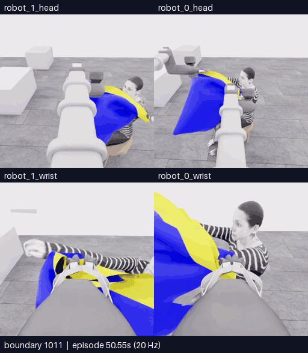
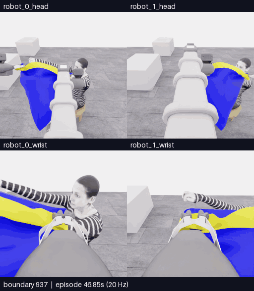

# E23 · 팔 노출 후보와 머리 접근, 착의0으로 예산 종료

[비교 갤러리](README.ko.md) · [공개 분석](../collection/reviews/20261107-astra-progress787-named-001.ko.md) · [학습 검토 구간](../collection/reviews/20261107-astra-progress787-named-001-learning-segments.json)

**5/50 · 픽업5·착의0 · success=false · 전수 검사1180/1180 통과.** 더 큰 전진과 상대 파지 배치 변경을 실제 수행했습니다. 옆 구멍 후보에서 손·전완이 더 드러난 뒤 머리 접근까지 진행했지만 **공식 소매·착의 득점은0**입니다.18행동 예산으로 종료했으며 최고5점·중간 목표10점 미달성입니다.

**핵심1011~1180 · 170프레임 · 34초 · 5fps·4배 느리게.** [MP4 크게 열기](assets/20261107-e23-arm-head-progress/event.mp4) · [경계·출처](assets/20261107-e23-arm-head-progress/provenance.json)

위는 로봇0·1 머리, 아래는 로봇0·1 손목입니다.169전이·8.45초 물리 구간의 양 끝 화면170장을 포함합니다. 카메라당 원본256×256이며 구간 내 생략·보간과 모델 응답 대기는 없습니다.

| 경계 | 실제 행동과 관측 |
|---|---|
| 1011~1033 · 팔 가까이 접근 | 바꾼 경계 방향을 유지한 대각 접근으로 손이 화면 밖으로 나가고 팔과 접힌 rim/panel이 인접합니다. |
| **1033~1077 · 손·전완 노출 후보** | 로봇1 경계를 올린 뒤 함께 옆으로 이동합니다. 로봇0 head에서 낮은 손이 노란 테두리의 옆 구멍 후보에 나타나고 이어 전완이 더 길게 드러납니다. |
| 1077~1143 · 경계 높이와 머리 접근 | 로봇0 경계를 올려 맞추고 양측을 들어 옮깁니다. 팔 노출은 유지되지만 머리–입구 관계는 천에 가립니다. |
| 1143~1180 · 하강·시야 복구·마감 | 천을 내리고 기울여 머리 출현을 확인하려 합니다. 마지막 공개5뷰에도 가림이 남습니다. 끝1전이는 예산 종료 중립입니다. |

**옆 구멍 후보의 손·전완 노출은 이전의 단순 가림보다 유의미한 관측 변화입니다.** 구멍 정체나 공식 통과를 시각 자료만으로 확정하지 않았으며 별도 평가에서도 착의점수는 없었습니다. 점수에서 잘못된 층·파지 실패 같은 원인을 역추론하지 않습니다. 머리 통과·목 안착도 미확인입니다.

## 앞선 방향 변경

**937~1011 · 75프레임 · 15초 · 5fps·4배 느리게.** [MP4 크게 열기](assets/20261107-e23-direction-change/event.mp4) · [경계·출처](assets/20261107-e23-direction-change/provenance.json)

한쪽은 전진하고 다른 쪽은 후퇴해 잡힌 경계 방향을 바꿨습니다. 원하는 팔–몸통 방향과 반대라고 판단해 전후 배치를 다시 반전한 뒤 대각 접근을 이어갔습니다. 이는 실제 상대 배치 변경이며 설명 없는 축 오류가 아닙니다. **그립을 놓고 다른 경계를 다시 잡은 횟수는0회**입니다.

E22와 같은 E18/787 행동 prefix를 사용했지만 시작 천의 접힘은 달랐습니다. 정확한 checkpoint 복원이나 프롬프트 한 요소의 성능 인과 비교로 설명하지 않습니다. 더 긴 행동, 새로운 관측 관계, 공식 점수 향상은 서로 다른 결과입니다.

[**이 영상에 피드백 남기기**](https://github.com/leonyoon-3dai/PhyRC_2027_phase1/issues/new?title=%5BE23+%ED%94%BC%EB%93%9C%EB%B0%B1%5D+%ED%8C%94+%EB%85%B8%EC%B6%9C+%ED%9B%84%EB%B3%B4%EC%99%80+%EB%A8%B8%EB%A6%AC+%EC%A0%91%EA%B7%BC&body=%EC%8B%9C%EB%8F%84%3A+E23+%2F+20261107-astra-progress787-named-001%0A%EC%98%81%EC%83%81%3A+%ED%95%B5%EC%8B%AC1011%E2%80%931180+%2F+%EB%B0%A9%ED%96%A5%EB%B3%80%EA%B2%BD937%E2%80%931011%0A%EC%98%81%EC%83%81+%EC%8B%9C%EA%B0%81+%EB%98%90%EB%8A%94+%EA%B2%BD%EA%B3%84%3A+%0A%EC%B9%B4%EB%A9%94%EB%9D%BC%3A+%EB%A1%9C%EB%B4%870+%EB%A8%B8%EB%A6%AC+%2F+%EB%A1%9C%EB%B4%871+%EB%A8%B8%EB%A6%AC+%2F+%EB%A1%9C%EB%B4%870+%EC%86%90%EB%AA%A9+%2F+%EB%A1%9C%EB%B4%871+%EC%86%90%EB%AA%A9%0A%0A%EA%B4%80%EC%B8%A1%ED%95%9C+%EC%9E%A5%EB%A9%B4%3A%0A%0A%EC%A0%9C+%ED%95%B4%EC%84%9D+%EB%98%90%EB%8A%94+%EC%A7%88%EB%AC%B8%3A%0A%0A%EB%8B%A4%EC%9D%8C%EC%97%90+%EB%B9%84%EA%B5%90%ED%95%98%EB%A9%B4+%EC%A2%8B%EC%9D%84+%EB%8F%99%EC%9E%91%3A%0A%0A%EA%B0%A4%EB%9F%AC%EB%A6%AC%3A+https%3A%2F%2Fgithub.com%2Fleonyoon-3dai%2FPhyRC_2027_phase1%2Fblob%2Fmain%2Fdocs%2Fgallery%2FREADME.ko.md%0A). 영상 시각 또는 경계와 카메라를 적어 주세요. GitHub 작성 화면만 열며 제출은 사용자가 합니다.

## 실행 조건과 결과

| 항목 | 실제 기록 |
|---|---|
| 실행 / 소스 | `20261107-astra-progress787-named-001` / `952ec8da68cdc0ef635d0d45329712eee006fd1f`, 시작 clean |
| 전략·부모 | `coordinated-task-progress`, E18 직접 부모·787전이 행동 재실행·이번719/771경계 과거 RGB |
| 모델·설정 | Astra/ultra·CLI0.166.0/exec·named+query·18판단/max1300/timeout180/settle6/review10 |
| 명명 행동·질의 | act18개 named→배열 일치·설명 없는 roll 없음. query enabled지만 실제 질의0회 |
| 호출·판단 | **18calls·18act·finish0**.18행동 예산 종료 |
| 기록 | **787재실행 + 284모델 행동 + 108제어기 정착 + 1예산 종료 중립 = 1180전이** |
| 시뮬레이션 / 실제 | 전체59.0초·새393전이19.65초 /1906.180018초(31분46.180초) |
| UTC | 2026-11-07 03:30:54–04:02:40 |
| 호출·환경 시간 | 모델 호출 경로821.402335초·환경1031.865206초. 순수 내부 추론시간과 다름 |
| 별도 평가 | raw5/50·pickup5·모든 착의 항목0·success=false·no_dressing_points / final_score=0.0 |
| 검사·마감 | 1180/1180전이 통과·오류0·capture complete/operator_finished·host exec0·shell 관측 Python0·simulator0 |
| 원본 보존 | 공개 영상·분석·진전/실패 구간 보존. [고정 revisionc115751·강제 재다운로드 SHA·218개 구성 파일 hash 검증 완료](../project/sessions/20261107-e23-backup-verification.json) |

전이1개는 관측→행동→다음 관측의0.05초 기록입니다. 행동 뒤 정착6전이도 다음 관측에 포함되며 중립 명령 중 잔류 운동이 있을 수 있습니다. named 변환의 정확성과 실제 착의 성공은 별개입니다.

[학습 검토 JSON](../collection/reviews/20261107-astra-progress787-named-001-learning-segments.json)은 새393전이를17개 연속 구간으로 보존합니다. 출구 후보 관측·접힘·복구·의도된 방향 반전·머리 접근·예산 종료를 구분하며 모두 `unreviewed`입니다. 시각적 가설을 검증된 소매 성공 교사 라벨로 만들지 않고, 같은 출처·인접 프레임을 독립 성공 표본으로 세지 않습니다.

다음 E24는 **E23/1179·과거1077/1161경계·30판단/max2000 이어가기**로 채택했으며 아직 미실행입니다.1179전이 CPU loader와22개 실행파일 hash 불변 검사를 통과했습니다. 마지막 관측을 공식 소매·목 성공이나 독립 지지가 인증된 출발점으로 승격하지 않습니다.

[전체 공개 기록](../collection/attempts/20261107-astra-progress787-named-001/README.ko.md) · [전체 overview로 초기 접근 보기](../collection/attempts/20261107-astra-progress787-named-001/overview.mp4) · [현재 상태](../project/STATUS.md) · [세션 기록](../project/sessions/20261106-evening-resume.ko.md)
