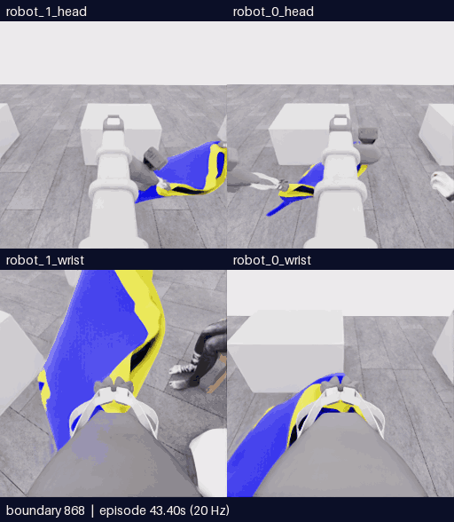

# E27 · 새 파지 운반·팔 접근과 복구

[메인 README](../../README.md) · [분석](../collection/reviews/20261107-astra-regrasp698-progress-named-001.ko.md) · [전체 실행 패키지](../collection/attempts/20261107-astra-regrasp698-progress-named-001/README.ko.md) · [피드백 남기기](https://github.com/leonyoon-3dai/PhyRC_2027_phase1/issues/new?title=%5BE27+%ED%94%BC%EB%93%9C%EB%B0%B1%5D+%EC%83%88+%ED%8C%8C%EC%A7%80+%EC%9A%B4%EB%B0%98%C2%B7%ED%8C%94+%EC%A0%91%EA%B7%BC%C2%B7%EB%B3%B5%EA%B5%AC&body=%EC%8B%9C%EB%8F%84%3A+E27+%2F+20261107-astra-regrasp698-progress-named-001%0A%EC%98%81%EC%83%81+%EC%8B%9C%EA%B0%81+%EB%98%90%EB%8A%94+%EA%B2%BD%EA%B3%84%3A%0A%EC%B9%B4%EB%A9%94%EB%9D%BC%3A%0A%0A%EB%B3%B4%EC%9D%B4%EB%8A%94+%EC%82%AC%EC%8B%A4%3A%0A%0A%ED%95%B4%EC%84%9D%C2%B7%EC%A7%88%EB%AC%B8%3A%0A%0A%EB%8B%A4%EC%9D%8C%EC%97%90+%EB%B9%84%EA%B5%90%ED%95%A0+%EB%B0%A9%EB%B2%95%3A%0A)

**5/50·픽업5·모든 착의0·success=false.** 22개 행동을 모두 사용한 뒤 판단 예산으로 제어기가 중립1전이를 추가해 종료했습니다. 모델의 자율 종료판단이나 사람의 중단 신호가 아닙니다. 1159/1159전수 검사·오류0 통과, 학습 승인은 `unreviewed`입니다.

**사용자 요청에 따라 E27 마감 후 새 시연을 중지했습니다. 최고5점·목표10점 미달성이며 E28은 미시작입니다.** 서버 종료 후 충분한 오프라인 리뷰와 전략 검토를 거쳐 후속 후보를 다시 선택합니다.

## 팔 접근과 목표 전환

[MP4](assets/20261107-e27-arm-approach/event.mp4) · [출처](assets/20261107-e27-arm-approach/provenance.json) · **868–968·101프레임·20.2초·4배 느리게**.

D7의 접근·상승 뒤 손과 전완이 노란 경계 가까이에 보입니다. D8 자세 변경과 D9 접근 뒤 **928경계에서 전완이 노란 띠 사이 큰 공간을 가로질러 보이는 새 관계**가 나타났습니다. 이후 일부 가림이 생겼고 D11은 다른 노출 손으로 접근 대상을 바꿨습니다. 첫 팔의 소매 출구는 그 전에 확인되지 않았으므로 `second_sleeve` 단계명을 성공으로 세지 않습니다. 928의 진전도 후속 가림 때문에 없었던 것으로 기록하지 않습니다.

## 새 파지를 유지한 상승·운반

[MP4](assets/20261107-e27-lift-transport/event.mp4) · [GIF](assets/20261107-e27-lift-transport/preview.gif) · [출처](assets/20261107-e27-lift-transport/provenance.json) · **698–842·145프레임·29초·4배 느리게**.

E25의 실제 재파지에서 이어진 이번 실행은 양측 상승·차등 상승 뒤 테이블 밖으로 운반했습니다. 양 jaw 주변 천이 남아 E25의 테이블 근처 국소 동행을 넘어선 **운반 중 유지 근거**가 추가됐습니다. 두 독립 하중 지지·반대 자유 입구 경계·attachment 센서 확정을 의미하지 않습니다. E27에서 추가 release/regrasp는 없었습니다.

## 후반 복구와 최종 상태

[전체 overview MP4](../collection/attempts/20261107-astra-regrasp698-progress-named-001/overview.mp4) · **1159프레임·20fps·57.95초** · [최종 R0 head](../collection/attempts/20261107-astra-regrasp698-progress-named-001/images/final-robot_0_head.png) · [최종 R1 wrist](../collection/attempts/20261107-astra-regrasp698-progress-named-001/images/final-robot_1_wrist.png)

후반에는 지지 간격·방향·높이를 바꾸며 접근했습니다. D17 복구에서 R0 arm의 실제 길이가422.776→305.699mm로 기존312.180mm 목표 쪽에 돌아왔습니다. 목표 자체를 옮겨 오차만 줄인 경우와 구분하며, 동시 base/lift 동작이라 접촉 원인은 확정하지 않습니다. D20/D21 뒤에는 팔과 경계 사이 공간이 일부 다시 드러났지만 손·입구 정체와 연속 소매 통과는 미확인입니다. 최종5뷰와 공식 평가를 별도로 검토했고 추가 착의 득점은 없었습니다.

## 기록과 다음 비교

| 구분 | 기록 |
|---|---|
| 실행 / 소스 | `20261107-astra-regrasp698-progress-named-001` / `1ff16b29e28bc9d43faf6bb0f4518e9a65868cb9`·시작clean |
| UTC / 실제 시간 | 2026-11-07 06:58:14–07:39:05 /2450.624436초(40분50.624초) |
| 전체 / 새 구간 | 1159전이57.95초 /461전이23.05초 |
| 구성 | 698재실행+334모델 행동+126자동 정착+1예산 종료 중립 |
| 호출 / 판단 | 23모델 호출·22act·모델finish0·질의1회6valid/물리0 |
| 처리 시간 | 모델 호출 경로1348.905617초·환경1046.465705초. 내부 추론시간과 다름 |
| 결과 | pickup5·모든 착의0·successfalse·no_dressing_points/final_score0.0 |
| 종료 | completed/errornull·capturecomplete/operator_finished·host/Python/simulator0. 실제 종료원인은 decision_budget |

전이는0.05초의 관측→행동→다음 관측 기록입니다. 두 선별 영상은 위에 양 head·아래 양 wrist이며 두 행 모두 **왼쪽 robot_1 · 오른쪽 robot_0**입니다. 5fps·4배 느리게 재생합니다. 전체 overview는20fps이고 모든 영상에서 모델 대기시간은 제외했습니다. 중첩 구간·동일 재실행 출처를 독립 시연이나 성공 표본으로 세지 않습니다. [23개 학습 검토 구간](../collection/reviews/20261107-astra-regrasp698-progress-named-001-learning-segments.json)은22행동 구간과 종료 중립1구간을 분리합니다.

[원본 고정 백업](../project/sessions/20261107-e27-backup-verification.json)은2026-11-07T07:45:20.494266UTC에 재다운로드·254개 구성 파일 SHA 검증을 완료했습니다. revision`6506b15378417c445bb8e84dbc43990a0c0fd291`·2,823,483,370bytes·archive SHA`941ac2a51d5aac4d885cbb0d6c851357ff2358a901fb745fb05f1b73ba7b65e8`입니다.

**E28은 준비된 후속 후보이며 실행을 보류합니다.** E27/928·과거890/906의 `coordinated-single-arm-progress`·24판단/max1600/settle6/timeout180·Astra/ultra·named/query/wrist-depth-panel은 검토한 설정이지 실행 명령이나 예약이 아닙니다. 오프라인 분석 뒤 다시 선택하며 자동 재개하지 않습니다. 같은 팔의 연속 진행을 우선하는 목표 순서 변형은 새 파지나 득점 보장이 아닙니다. [후보 근거](../collection/research/2026-11-07-e27-single-arm-continuation.ko.md)

후보`0c51a1a`는 E27 종료 후`4ec8be8`로 통합했습니다. 격리 전체325CPU 검사(38.190초)와 통합166개 소스/설정 해시 일치를 확인했으며 통합 뒤 전체검사를 다시 실행한 것으로 쓰지 않습니다. 실제 E28 착의 효과는 미검증이고 별도 손목 카메라 방향 보조는 통합·적용하지 않았습니다. [후보 검사](../project/sessions/20261107-single-arm-progress-validation.json) · [통합 대조](../project/sessions/20261107-single-arm-integration-verification.json) · [현재 실행 여부](../project/STATUS.md)

피드백에는 영상 시각 또는 경계·카메라·보이는 사실과 해석을 나눠 남겨 주세요. 위 GitHub 링크는 작성 화면만 열며 자동 제출하지 않습니다. [이전 E26](20261107-astra-hand-swap787-named-001.ko.md) · [갤러리 전체](README.ko.md)
