# 출발점 화면 비교 · 5점 후보와 0점 대조군

**검토된 다섯 출발점의 원본 공개 화면입니다.** 각 행은 한 시점의 overview와 로봇0·1 손목 화면입니다. 아래 이미지를 누르면 원본256×256 PNG가 열립니다. 그림을 자르거나 다시 압축하지 않았습니다. 실제 실행 상태는 [현재 상태](../project/STATUS.md)를 확인하세요.

[지지·점수 선택 근거](../collection/research/2026-11-07-support-startpoints-review.ko.md) · [출발점 DB](../collection/catalog/README.ko.md) · [원본 경로·SHA·경계 매핑](assets/20261107-support-startpoints/provenance.json)

| 출발점 | 당시 raw | actor 관측 | 비교 목적 | 근거가 있는 선택 관측 구간 | 피드백 |
|---|---:|---|---|---|---|
| [E18/470](#e18-470) | 0/50 | obs0 · D0 직전 | 테이블 위 준비 대조군 | 해당 단일 관측 | [남기기](https://github.com/leonyoon-3dai/PhyRC_2027_phase1/issues/new?title=%5B%EC%B6%9C%EB%B0%9C%EC%A0%90+%ED%94%BC%EB%93%9C%EB%B0%B1%5D+E18%2F470&body=%EC%B6%9C%EB%B0%9C%EC%A0%90%3A+E18%2F470%0A%EC%9B%90%EB%B3%B8+%EC%8B%A4%ED%96%89%3A+20261106-astra-guide470-depth-001%0A%EA%B4%80%EC%B8%A1%3A+obs0+%2F+%EA%B2%BD%EA%B3%84470%0A%ED%99%94%EB%A9%B4%3A+overview+%2F+robot_0_wrist+%2F+robot_1_wrist%0A%0A%EB%B3%B4%EC%9D%B4%EB%8A%94+%EC%82%AC%EC%8B%A4%3A%0A%0A%EC%A0%9C+%ED%95%B4%EC%84%9D+%EB%98%90%EB%8A%94+%EC%A7%88%EB%AC%B8%3A%0A%0A%EB%B9%84%EA%B5%90%ED%95%B4+%EB%B3%B4%EA%B3%A0+%EC%8B%B6%EC%9D%80+%EB%B0%A9%EB%B2%95%3A%0A) |
| [E18/563](#e18-563) | 5/50 | obs6 · D6 직전 | 들어 올린 뒤 운반 전 | 510→563의 선택 관측 | [남기기](https://github.com/leonyoon-3dai/PhyRC_2027_phase1/issues/new?title=%5B%EC%B6%9C%EB%B0%9C%EC%A0%90+%ED%94%BC%EB%93%9C%EB%B0%B1%5D+E18%2F563&body=%EC%B6%9C%EB%B0%9C%EC%A0%90%3A+E18%2F563%0A%EC%9B%90%EB%B3%B8+%EC%8B%A4%ED%96%89%3A+20261106-astra-guide470-depth-001%0A%EA%B4%80%EC%B8%A1%3A+obs6+%2F+%EA%B2%BD%EA%B3%84563%0A%ED%99%94%EB%A9%B4%3A+overview+%2F+robot_0_wrist+%2F+robot_1_wrist%0A%0A%EB%B3%B4%EC%9D%B4%EB%8A%94+%EC%82%AC%EC%8B%A4%3A%0A%0A%EC%A0%9C+%ED%95%B4%EC%84%9D+%EB%98%90%EB%8A%94+%EC%A7%88%EB%AC%B8%3A%0A%0A%EB%B9%84%EA%B5%90%ED%95%B4+%EB%B3%B4%EA%B3%A0+%EC%8B%B6%EC%9D%80+%EB%B0%A9%EB%B2%95%3A%0A) |
| [E18/787](#e18-787) | 5/50 | obs15 · D15 직전 | 손 가까운 접근 전 | 563→787의 선택 관측 | [남기기](https://github.com/leonyoon-3dai/PhyRC_2027_phase1/issues/new?title=%5B%EC%B6%9C%EB%B0%9C%EC%A0%90+%ED%94%BC%EB%93%9C%EB%B0%B1%5D+E18%2F787&body=%EC%B6%9C%EB%B0%9C%EC%A0%90%3A+E18%2F787%0A%EC%9B%90%EB%B3%B8+%EC%8B%A4%ED%96%89%3A+20261106-astra-guide470-depth-001%0A%EA%B4%80%EC%B8%A1%3A+obs15+%2F+%EA%B2%BD%EA%B3%84787%0A%ED%99%94%EB%A9%B4%3A+overview+%2F+robot_0_wrist+%2F+robot_1_wrist%0A%0A%EB%B3%B4%EC%9D%B4%EB%8A%94+%EC%82%AC%EC%8B%A4%3A%0A%0A%EC%A0%9C+%ED%95%B4%EC%84%9D+%EB%98%90%EB%8A%94+%EC%A7%88%EB%AC%B8%3A%0A%0A%EB%B9%84%EA%B5%90%ED%95%B4+%EB%B3%B4%EA%B3%A0+%EC%8B%B6%EC%9D%80+%EB%B0%A9%EB%B2%95%3A%0A) |
| [E18/801](#e18-801) | 5/50 | obs16 · D16 직전 | 한 차례 접근 뒤 | 563→801의 선택 관측 | [남기기](https://github.com/leonyoon-3dai/PhyRC_2027_phase1/issues/new?title=%5B%EC%B6%9C%EB%B0%9C%EC%A0%90+%ED%94%BC%EB%93%9C%EB%B0%B1%5D+E18%2F801&body=%EC%B6%9C%EB%B0%9C%EC%A0%90%3A+E18%2F801%0A%EC%9B%90%EB%B3%B8+%EC%8B%A4%ED%96%89%3A+20261106-astra-guide470-depth-001%0A%EA%B4%80%EC%B8%A1%3A+obs16+%2F+%EA%B2%BD%EA%B3%84801%0A%ED%99%94%EB%A9%B4%3A+overview+%2F+robot_0_wrist+%2F+robot_1_wrist%0A%0A%EB%B3%B4%EC%9D%B4%EB%8A%94+%EC%82%AC%EC%8B%A4%3A%0A%0A%EC%A0%9C+%ED%95%B4%EC%84%9D+%EB%98%90%EB%8A%94+%EC%A7%88%EB%AC%B8%3A%0A%0A%EB%B9%84%EA%B5%90%ED%95%B4+%EB%B3%B4%EA%B3%A0+%EC%8B%B6%EC%9D%80+%EB%B0%A9%EB%B2%95%3A%0A) |
| [E19/801](#e19-801) | 5/50 | obs0 · D0 직전 | 같은 prefix의 새 재실행 | 해당 단일 관측 | [남기기](https://github.com/leonyoon-3dai/PhyRC_2027_phase1/issues/new?title=%5B%EC%B6%9C%EB%B0%9C%EC%A0%90+%ED%94%BC%EB%93%9C%EB%B0%B1%5D+E19%2F801&body=%EC%B6%9C%EB%B0%9C%EC%A0%90%3A+E19%2F801%0A%EC%9B%90%EB%B3%B8+%EC%8B%A4%ED%96%89%3A+20261107-astra-entry801-named-001%0A%EA%B4%80%EC%B8%A1%3A+obs0+%2F+%EA%B2%BD%EA%B3%84801%0A%ED%99%94%EB%A9%B4%3A+overview+%2F+robot_0_wrist+%2F+robot_1_wrist%0A%0A%EB%B3%B4%EC%9D%B4%EB%8A%94+%EC%82%AC%EC%8B%A4%3A%0A%0A%EC%A0%9C+%ED%95%B4%EC%84%9D+%EB%98%90%EB%8A%94+%EC%A7%88%EB%AC%B8%3A%0A%0A%EB%B9%84%EA%B5%90%ED%95%B4+%EB%B3%B4%EA%B3%A0+%EC%8B%B6%EC%9D%80+%EB%B0%A9%EB%B2%95%3A%0A) |

점수는 기존 종료 원본 검토에서 가져온 개발용 선택 근거입니다. **픽업5점과 양측 지지·입구 확인은 별개**입니다. 같은 E07 계열 source group의 상관된 자료이며 독립 성공 시연 다섯 개가 아닙니다. 행동 prefix 재실행은 정확한 천 상태 checkpoint 복원이 아니므로 새 실행에서 현재 지지를 다시 확인해야 합니다.

## E18/470 · 테이블 위 준비 대조군

몸판이 테이블에 있습니다. 5→10 출발점과 구분합니다. 공개 clock **25.025001초**, obs0 / 경계470입니다.

| overview | 로봇0 손목 | 로봇1 손목 |
|---|---|---|
| [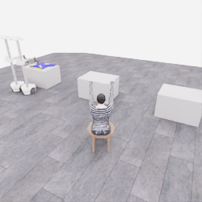](assets/20261107-support-startpoints/e18-0470-overview.png) | [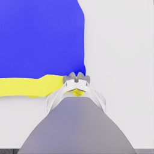](assets/20261107-support-startpoints/e18-0470-robot_0_wrist.png) | [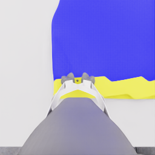](assets/20261107-support-startpoints/e18-0470-robot_1_wrist.png) |

## E18/563 · 들어 올린 뒤 운반 전

양 손가락 부근 경계와 들린 몸판을 비교하는 후보입니다. 공개 clock **29.675002초**, obs6 / 경계563입니다.

| overview | 로봇0 손목 | 로봇1 손목 |
|---|---|---|
| [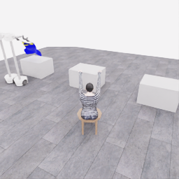](assets/20261107-support-startpoints/e18-0563-overview.png) | [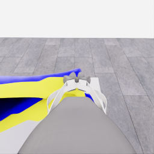](assets/20261107-support-startpoints/e18-0563-robot_0_wrist.png) | [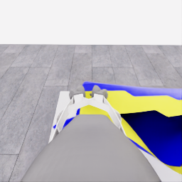](assets/20261107-support-startpoints/e18-0563-robot_1_wrist.png) |

## E18/787 · 손 가까운 접근 전

운반 뒤 손·팔과 경계 후보를 함께 보는 출발점입니다. 공개 clock **40.875002초**, obs15 / 경계787입니다.

| overview | 로봇0 손목 | 로봇1 손목 |
|---|---|---|
| [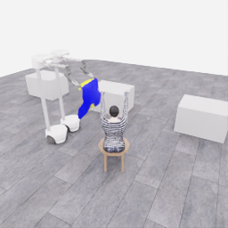](assets/20261107-support-startpoints/e18-0787-overview.png) | [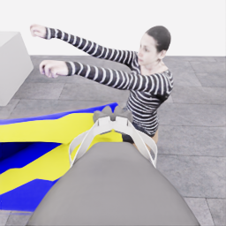](assets/20261107-support-startpoints/e18-0787-robot_0_wrist.png) | [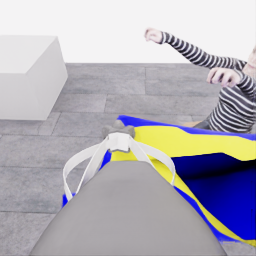](assets/20261107-support-startpoints/e18-0787-robot_1_wrist.png) |

## E18/801 · 한 차례 접근 뒤

설명에 없는 roll이 시작되는 D16 직전이며 해당 오류 동작은 prefix에 포함되지 않습니다. 공개 clock **41.575002초**, obs16 / 경계801입니다.

| overview | 로봇0 손목 | 로봇1 손목 |
|---|---|---|
| [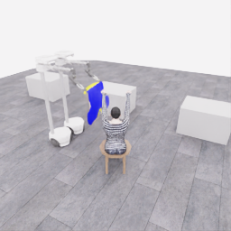](assets/20261107-support-startpoints/e18-0801-overview.png) | [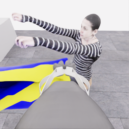](assets/20261107-support-startpoints/e18-0801-robot_0_wrist.png) | [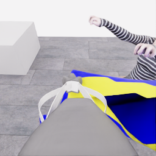](assets/20261107-support-startpoints/e18-0801-robot_1_wrist.png) |

## E19/801 · 같은 prefix의 새 재실행

E18/801의 짝 비교입니다. 비슷한 화면도 동일 물리 상태를 뜻하지 않습니다. 공개 clock **41.575002초**, obs0 / 경계801입니다.

| overview | 로봇0 손목 | 로봇1 손목 |
|---|---|---|
| [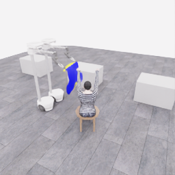](assets/20261107-support-startpoints/e19-0801-overview.png) | [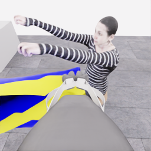](assets/20261107-support-startpoints/e19-0801-robot_0_wrist.png) | [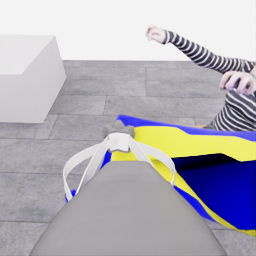](assets/20261107-support-startpoints/e19-0801-robot_1_wrist.png) |

선택된 시점의 시각적 지지 가설을 모았으며, 모든 중간 프레임 검수나 양쪽의 독립 하중 시험을 뜻하지 않습니다. 층·입구 정체·연속 통과·학습 승인은 미확인입니다. 유지 구간에서 실제로 검토한 표본은 위 근거 문서에 별도로 열거했습니다. E21 마지막의 지지 미검증 새 파지는 포함하지 않았습니다.

피드백 링크는 해당 출발점이 적힌 GitHub 작성 화면만 엽니다. **보이는 사실 / 해석·질문 / 비교할 방법**을 나누어 적고, 사용할 화면 이름을 표시하면 원본과 연결하기 쉽습니다. 제출은 사용자가 합니다.
