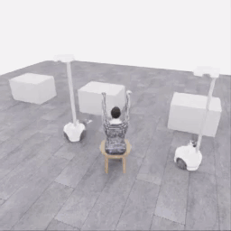

# E34 · 실제 시연 GIF

실제 원본 영상 전체 **0–41.8초**입니다. 원본256×256·20fps의836프레임에서2프레임마다1장을 선택해418프레임·10fps로 표시합니다. 프레임 생성·보간·좌우 반전 없이 팔레트만 변환했으며 모델 대기 시간은 원본 영상에 없습니다.

E33/470의 행동 prefix를 새 환경에서 재실행한 뒤, 파지를 유지한 들기·운반·짧은 하강을 시험했습니다. 20 act·24모델 호출·836전이, QC836/836이며 로컬5/50·착의0·success=false입니다. 재실행은 정확한 천 checkpoint 복원이 아니며 손목 걸침·소매 통과는 확인되지 않았습니다.

[원본 MP4](../../collection/attempts/20261114-astra-middle-grip470-retain-001/overview.mp4) · [보존된 실행 기록](../../collection/attempts/20261114-astra-middle-grip470-retain-001/README.ko.md) · [원본 manifest](../../collection/attempts/20261114-astra-middle-grip470-retain-001/manifest.json) · [GIF 변환·검증](provenance.json) · [리뷰](../../collection/reviews/20261114-astra-middle-grip470-retain-001.ko.md)

[후속 E35 GIF](../20261114-e35-overview/README.ko.md) · [후속 E36 GIF](../20261114-e36-overview/README.ko.md) · [전체 시연 목록](../../EPISODES.md)

이 페이지는 GIF 표시를 위한 별도 보기입니다. 원본 MP4와 manifest에 해시가 기록된 실행 README는 수정하지 않았습니다.
