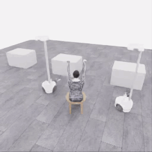

# E35 · 실제 시연 GIF

실제 원본 영상 전체 **0–49.15초**입니다. 원본256×256·20fps의983프레임에서2프레임마다1장을 선택해492프레임을 표시합니다. 기본10fps, 마지막 프레임50ms로 원본 재생 길이를 보존합니다. 프레임 생성·보간·좌우 반전 없이 팔레트만 변환했으며 모델 대기 시간은 원본 영상에 없습니다.

E34/723의 행동 prefix를 새 환경에서 재실행한 뒤, 아래 자유 구간의 형상 조절과 같은 손목을 향한 측면 접근을 시험했습니다. 18 act+finish·21모델 호출·983전이, QC983/983입니다. 새 구간은260전이·13시뮬레이션초이며 로컬5/50은 replay의 픽업5점입니다. 새 착의 득점0·success=false이며 입구 통과는 확인되지 않았습니다. 재실행은 정확한 천 checkpoint 복원이 아닙니다.

[원본 MP4](../../collection/attempts/20261114-astra-wide-hem723-001/overview.mp4) · [보존된 실행 기록](../../collection/attempts/20261114-astra-wide-hem723-001/README.ko.md) · [원본 manifest](../../collection/attempts/20261114-astra-wide-hem723-001/manifest.json) · [GIF 변환·검증](provenance.json) · [리뷰](../../collection/reviews/20261114-astra-wide-hem723-001.ko.md)

[직접 부모 E34 GIF](../20261114-e34-overview/README.ko.md) · [최근 E36 GIF](../20261114-e36-overview/README.ko.md) · [전체 시연 목록](../../EPISODES.md)

이 페이지는 GIF 표시를 위한 별도 보기입니다. 원본 MP4와 manifest에 해시가 기록된 실행 README는 수정하지 않았습니다.
