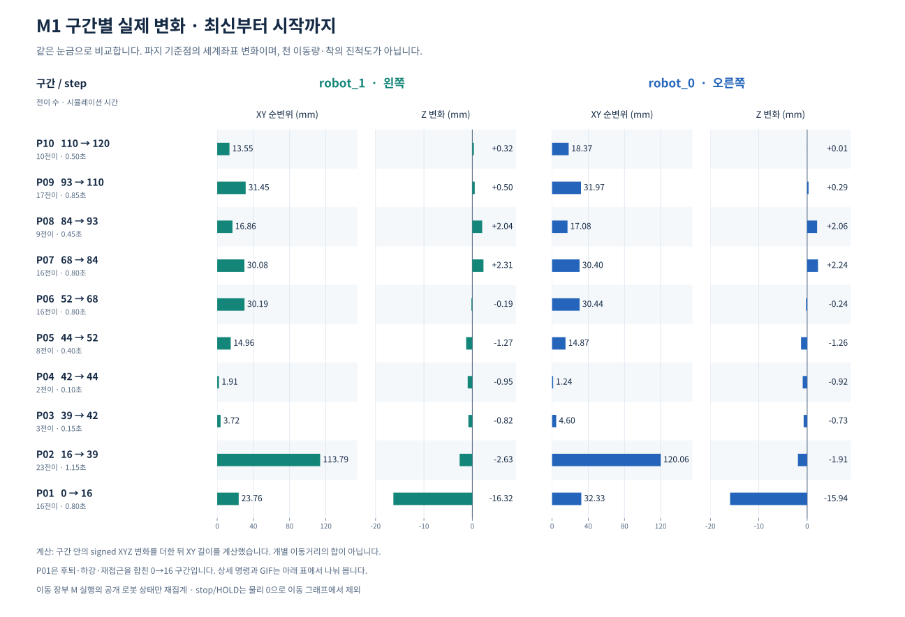
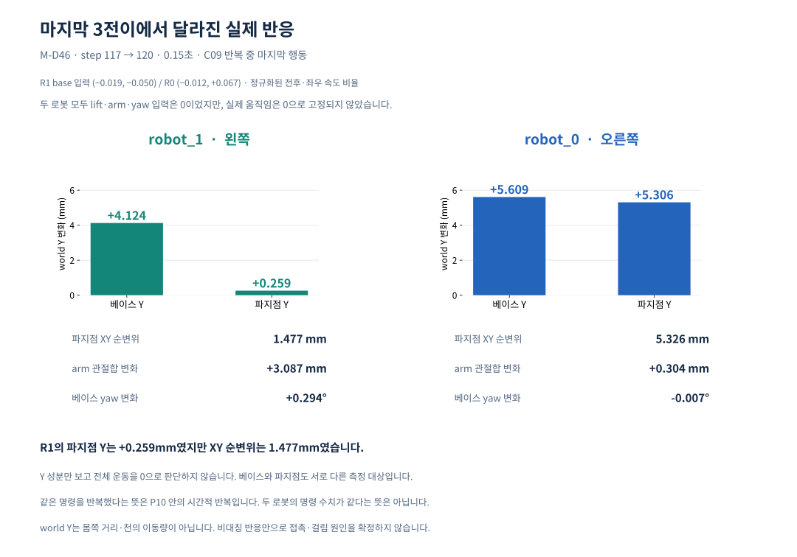
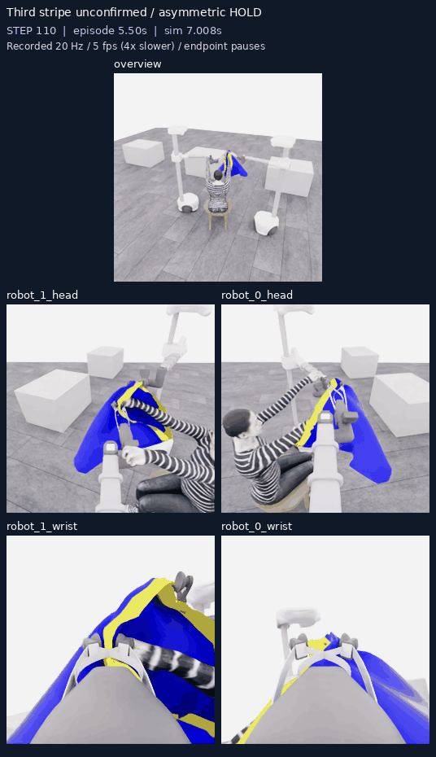
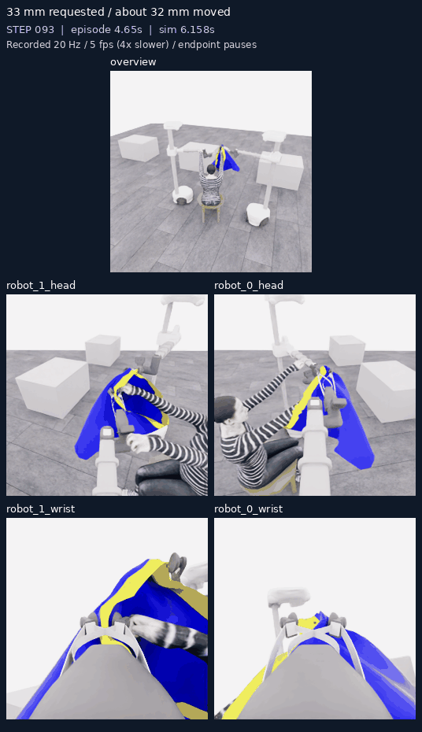
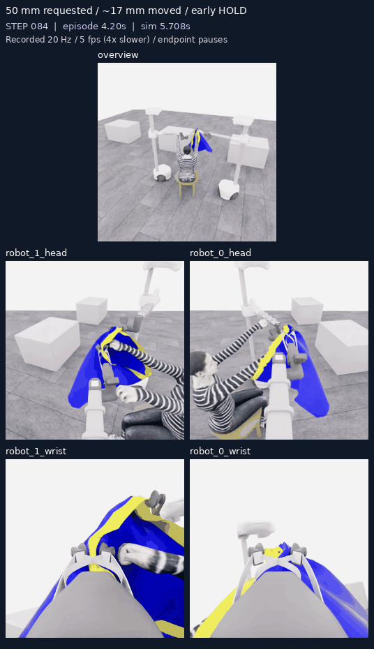
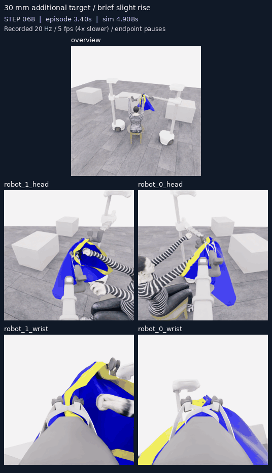
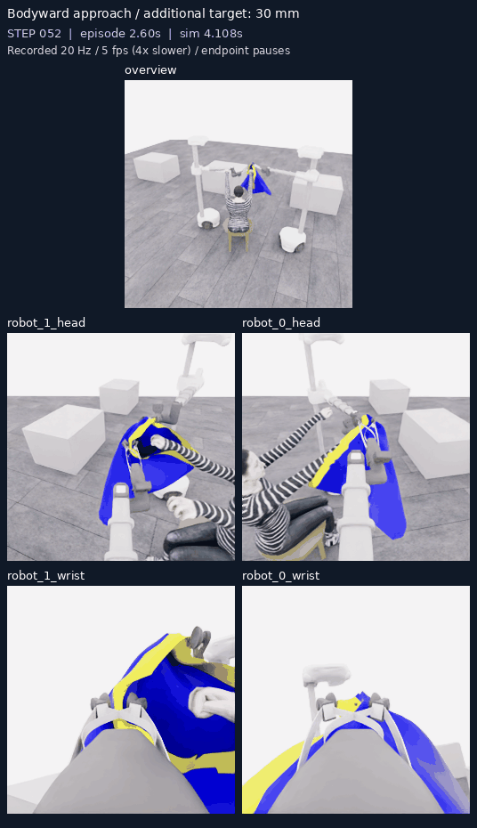
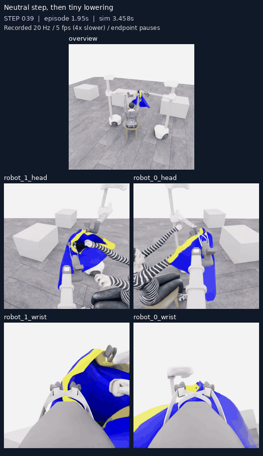
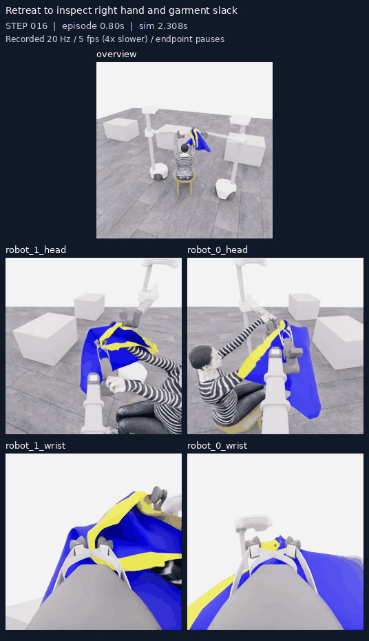

# M1 단계별 명령·실제 결과 · 최신 → 시작

**종료한 M1 본편을 P10부터 P01까지 거슬러 읽는 갤러리입니다.** 각 구간을 같은 표로 정리했습니다. 아래 GIF와 HOLD는 과거 기록이며 현재 실행 중인 시연은 없습니다.

[현재 계획](../../COLLECTION_PLAN.md) · [현재 상태](../../project/STATUS.md) · [38개 조작의 원본 장부](../../collection/reviews/20261116-user-guided-movement-ledger.ko.md) · [이후 R0 단독 접근 분기](../20261116-right-hand-hold10/README.ko.md)

| 범위 | 값 |
|---|---|
| 실행 ID | `20261116-astra-m1-checkpoint-001` |
| 실제 이동 기록 | **38 act · 120전이 · 6.00시뮬레이션초** |
| 모델 결정 | 48회 = 이동 act 38회 + stop 제안 10회 |
| stop 10회의 처리 | 물리 **0 HOLD**로 전환. 이동 합계에서 제외 |
| 최종 경계 | HOLD-0011 · step120에서 사용자 지시로 추가 물리0 정상 마감 |
| 기술 검사 / 과제 결과 | QC120/120 통과 / 새 착의 득점0. 두 판정은 별개 |
| 이 페이지 제외 범위 | 이후 B 분기의 새25전이와 복귀 재생110전이는 별도 페이지에 보존 |

## 표와 GIF 읽는 법

| 표기 | 뜻 |
|---|---|
| **P10 → P01** | 장부의 구간 번호. 이 페이지는 최신순, 각 GIF 안의 운동은 원래 시간 순서 |
| **step110→120** | 누적 전이 경계. 10전이·0.50초, 경계 이미지11장 |
| **M-D46** | M 실행의 0부터 시작하는 모델 결정 번호. D번호 빈칸은 아래 stop 기록 참고 |
| **C09** | 같은 적용 action을 묶은 명령 ID. 각 구간의 명령표에 실제 수치 표시 |
| **R1 / R0** | robot_1 / robot_0. 표와 영상 모두 **왼쪽 R1 · 오른쪽 R0** |
| **XY / ΔZ** | 로봇 파지 기준점의 world XY 순변위 크기 / world Z 변화 |
| **+ / −** | 해당 world 좌표 성분의 증가 / 감소. world Y가 곧 몸쪽 거리는 아님 |

**명령과 결과의 단위를 구분합니다.** 명령표의 `(전후, 좌우, lift)`는 로봇 기준의 **정규화 속도 비율**입니다. 나머지6채널(베이스 회전·arm·손목3축·gripper)은 본편의 모든 act에서0입니다. gripper0은 기존 의도 유지이며, 중립 입력이 실제 정지를 보장하지 않습니다. 원래 action 행 순서는 계속 R0, R1입니다.

결과표는 **로봇 파지 기준점**의 측정값입니다. 천의 이동량·몸통까지의 거리 감소·소매 통과를 직접 측정한 값은 아닙니다. 표의 수치는 소수 셋째 자리로 반올림했으며 측정 정확도를 뜻하지 않습니다.

## 전체 비교 · 최신 구간부터

구간별 길이와 행동이 다릅니다. 막대 크기는 속도·성공률 비교가 아니라 **각 구간 시작과 끝 사이의 순변위**입니다. 각 act의 부호 있는 XYZ를 먼저 합산한 뒤 XY 크기를 계산했습니다. 개별 XY 크기를 더한 이동거리와 다릅니다.

| 구간 · step | 요청 요약 | act / 전이 / 초 | R1 XY / ΔZ (mm) | R0 XY / ΔZ (mm) | 결과 |
|---|---|---:|---:|---:|---|
| [P10 · 110→120](#p10) | 세 번째 줄무늬 접근·비대칭 반응 | 3 / 10 / 0.50 | 13.553 / +0.321 | 18.372 / +0.012 | 목표 도달 미확인 |
| [P09 · 93→110](#p09) | 33mm 추가 요청·약32mm 이동 | 6 / 17 / 0.85 | 31.447 / +0.500 | 31.974 / +0.286 | 추가 이동 약32mm; 정확히33mm 완료 아님 |
| [P08 · 84→93](#p08) | 50mm 요청·약17mm에서 HOLD | 3 / 9 / 0.45 | 16.856 / +2.038 | 17.083 / +2.056 | 50mm 미완료 |
| [P07 · 68→84](#p07) | 30mm 추가 접근·아주 작은 상승 | 5 / 16 / 0.80 | 30.076 / +2.307 | 30.403 / +2.241 | 약30mm 이동·약2.3mm 상승 |
| [P06 · 52→68](#p06) | 같은 방향 30mm 추가 접근 | 5 / 16 / 0.80 | 30.186 / −0.186 | 30.435 / −0.240 | 약30mm 이동 |
| [P05 · 44→52](#p05) | 같은 방향 15mm 추가 접근 | 3 / 8 / 0.40 | 14.958 / −1.274 | 14.866 / −1.263 | 약15mm 이동 |
| [P04 · 42→44](#p04) | 몸쪽 미세 접근 | 1 / 2 / 0.10 | 1.914 / −0.951 | 1.240 / −0.917 | 작은 접근·미세 하강 관측 |
| [P03 · 39→42](#p03) | 중립 잔류 운동·미세 하강 | 2 / 3 / 0.15 | 3.718 / −0.815 | 4.598 / −0.725 | 잔류 운동과 미세 하강 구분 |
| [P02 · 16→39](#p02) | 손 노출·옷 처짐 확인을 위한 후퇴 | 5 / 23 / 1.15 | 113.786 / −2.628 | 120.059 / −1.911 | 손 노출 증가·옷 처짐 관측 |
| [P01 · 0→16](#p01) | 최초 후퇴·하강·재접근 | 5 / 16 / 0.80 | 23.758 / −16.320 | 32.331 / −15.936 | 파지점 약16mm 하강; 진입 미확인 |

**카드 구성:** 요청·경계 → 적용 명령 → 실측 결과 → GIF → 펼쳐 보는 개별 act. 명령표와 개별 act 표도 최신 step부터 표시합니다.

## P10 · step 110 → 120 · 세 번째 줄무늬 접근·비대칭 반응

| 항목 | 기록 |
|---|---|
| 사용자 요청·행동 목적 | 손목에서 팔꿈치 쪽 세 번째 짙은 줄무늬까지 같은 방향으로 접근 |
| 실행량 | 3 act · 10전이 · 0.50시뮬레이션초 · 경계 이미지11장 |
| 결과 | **목표 도달 미확인** |
| HOLD·검토 사유 | HOLD-0011 · 비대칭 반응에서 HOLD; 이후 사용자 종료 |
| 해석 | 마지막 D46에서 R1 파지점 world Y 변화 감소와 자세 변화 |

**적용 명령 — 최신 step부터**

| 적용 step | 명령 | act / 전이 | R1 (전후, 좌우, lift) | R0 (전후, 좌우, lift) |
|---|---|---:|---:|---:|
| 110→120 | C09 | 3 / 10 | `(-0.019, -0.050, 0)` | `(-0.012, +0.067, 0)` |

**실제 결과 — 구간 시작 대비 끝, 단위 mm**

| 측정값 | R1 · 왼쪽 | R0 · 오른쪽 |
|---|---:|---:|
| 파지점 XY 순변위 | 13.553 | 18.372 |
| 파지점 world Y 변화 | +13.475 | +18.325 |
| 파지점 world Z 변화 | +0.321 | +0.012 |
| lift 관절 변화 | −0.292 | +0.009 |

마지막3전이의 R1 **world Y +0.259mm**는 한 축 성분입니다. 같은 구간의 XY 순변위는 **1.477mm**이므로 “R1 전체 이동이0.259mm뿐”이라고 읽지 않습니다. 원인이 충돌·걸림이라고 확정하지 않습니다.

[원본 프레임·시간·SHA](third-stripe-approach.json) · [HOLD 사본 검증](source-hold-0011.json) · [당시 검토](../../collection/reviews/20261116-m1-third-stripe.ko.md)

P10 개별 act 3개 · 명령과 실제 ΔXYZ 펼치기

| 결정 | step | 전이 / 초 | 명령 ID | R1 파지점 ΔX, ΔY, ΔZ (mm) | R0 파지점 ΔX, ΔY, ΔZ (mm) |
|---|---|---:|---|---:|---:|
| M-D46 | 117→120 | 3 / 0.15 | C09 | −1.454, +0.259, +0.240 | +0.468, +5.306, −0.023 |
| M-D45 | 113→117 | 4 / 0.20 | C09 | −0.196, +7.645, +0.008 | +0.657, +7.384, +0.022 |
| M-D44 | 110→113 | 3 / 0.15 | C09 | +0.206, +5.572, +0.073 | +0.190, +5.635, +0.013 |

## P09 · step 93 → 110 · 33mm 추가 요청·약32mm 이동

| 항목 | 기록 |
|---|---|
| 사용자 요청·행동 목적 | 직전 검토 위치에서 같은 방향으로 33mm 추가 |
| 실행량 | 6 act · 17전이 · 0.85시뮬레이션초 · 경계 이미지18장 |
| 결과 | **추가 이동 약32mm; 정확히33mm 완료 아님** |
| HOLD·검토 사유 | HOLD-0010 · 목표 근처 검토 HOLD; 작은 잔여량 자동 실행 없음 |
| 해석 | R1 31.447mm / R0 31.974mm는 파지점 XY 순변위 |

**적용 명령 — 최신 step부터**

| 적용 step | 명령 | act / 전이 | R1 (전후, 좌우, lift) | R0 (전후, 좌우, lift) |
|---|---|---:|---:|---:|
| 93→110 | C09 | 6 / 17 | `(-0.019, -0.050, 0)` | `(-0.012, +0.067, 0)` |

**실제 결과 — 구간 시작 대비 끝, 단위 mm**

| 측정값 | R1 · 왼쪽 | R0 · 오른쪽 |
|---|---:|---:|
| 파지점 XY 순변위 | 31.447 | 31.974 |
| 파지점 world Y 변화 | +31.446 | +31.966 |
| 파지점 world Z 변화 | +0.500 | +0.286 |
| lift 관절 변화 | +0.352 | +0.344 |

| 별도 기준: 직전 이동 방향 투영 | R1 · 왼쪽 | R0 · 오른쪽 |
|---|---:|---:|
| 투영 변위 | 약31.433mm | 약31.974mm |
| 33mm 요청 대비 부족량 | 약1.57mm | 약1.03mm |

이 부족량은 위 XY 크기와 다른 **투영 기준**입니다. P08과 P09를 이어 본 step84→110의 XY 순변위는 R1 약48.298mm / R0 약49.057mm이며, 두 구간과 별개인 추가 실행은 아닙니다.

[원본 프레임·시간·SHA](bodyward-33mm-completion.json) · [HOLD 사본 검증](source-hold-0010.json) · [당시 검토](../../collection/reviews/20261116-m1-bodyward-33mm-completion.ko.md)

P09 개별 act 6개 · 명령과 실제 ΔXYZ 펼치기

| 결정 | step | 전이 / 초 | 명령 ID | R1 파지점 ΔX, ΔY, ΔZ (mm) | R0 파지점 ΔX, ΔY, ΔZ (mm) |
|---|---|---:|---|---:|---:|
| M-D42 | 108→110 | 2 / 0.10 | C09 | +0.071, +3.691, +0.033 | +0.082, +3.731, +0.003 |
| M-D41 | 105→108 | 3 / 0.15 | C09 | +0.077, +5.560, +0.042 | +0.164, +5.633, +0.001 |
| M-D40 | 102→105 | 3 / 0.15 | C09 | +0.100, +5.527, +0.048 | +0.147, +5.628, +0.003 |
| M-D39 | 99→102 | 3 / 0.15 | C09 | +0.058, +5.551, +0.069 | +0.118, +5.611, +0.022 |
| M-D38 | 96→99 | 3 / 0.15 | C09 | −0.003, +5.548, +0.105 | +0.095, +5.678, +0.075 |
| M-D37 | 93→96 | 3 / 0.15 | C09 | −0.015, +5.568, +0.203 | +0.110, +5.684, +0.182 |

## P08 · step 84 → 93 · 50mm 요청·약17mm에서 HOLD

| 항목 | 기록 |
|---|---|
| 사용자 요청·행동 목적 | 같은 방향으로 50mm 추가하면서 아주 조금 상승 |
| 실행량 | 3 act · 9전이 · 0.45시뮬레이션초 · 경계 이미지10장 |
| 결과 | **50mm 미완료** |
| HOLD·검토 사유 | HOLD-0009 · 모델 종료 제안을 HOLD로 전환; 남은 요청 자동 실행 없음 |
| 해석 | 약17mm 이동 후 가림 때문에 진행 판정 불확실 |

**적용 명령 — 최신 step부터**

| 적용 step | 명령 | act / 전이 | R1 (전후, 좌우, lift) | R0 (전후, 좌우, lift) |
|---|---|---:|---:|---:|
| 87→93 | C09 | 2 / 6 | `(-0.019, -0.050, 0)` | `(-0.012, +0.067, 0)` |
| 84→87 | C10 | 1 / 3 | `(-0.019, -0.050, +0.010)` | `(-0.012, +0.067, +0.010)` |

**실제 결과 — 구간 시작 대비 끝, 단위 mm**

| 측정값 | R1 · 왼쪽 | R0 · 오른쪽 |
|---|---:|---:|
| 파지점 XY 순변위 | 16.856 | 17.083 |
| 파지점 world Y 변화 | +16.852 | +17.079 |
| 파지점 world Z 변화 | +2.038 | +2.056 |
| lift 관절 변화 | +2.017 | +2.020 |

lift +0.010은 처음3전이에만 적용했습니다. 이후 lift0은 기존 목표 유지이며, 실제 높이 변화가 즉시 멈췄다는 뜻은 아닙니다.

[원본 프레임·시간·SHA](bodyward-50mm-slight-rise.json) · [HOLD 사본 검증](source-hold-0009.json) · [당시 검토](../../collection/reviews/20261116-m1-bodyward-50mm-slight-rise.ko.md)

P08 개별 act 3개 · 명령과 실제 ΔXYZ 펼치기

| 결정 | step | 전이 / 초 | 명령 ID | R1 파지점 ΔX, ΔY, ΔZ (mm) | R0 파지점 ΔX, ΔY, ΔZ (mm) |
|---|---|---:|---|---:|---:|
| M-D35 | 90→93 | 3 / 0.15 | C09 | −0.084, +5.595, +0.409 | +0.105, +5.710, +0.408 |
| M-D34 | 87→90 | 3 / 0.15 | C09 | −0.129, +5.628, +0.850 | +0.120, +5.686, +0.858 |
| M-D33 | 84→87 | 3 / 0.15 | C10 | −0.137, +5.629, +0.779 | +0.136, +5.682, +0.789 |

## P07 · step 68 → 84 · 30mm 추가 접근·아주 작은 상승

| 항목 | 기록 |
|---|---|
| 사용자 요청·행동 목적 | 같은 방향으로 30mm 추가하면서 아주 조금 상승·손 중앙 위치 확인 |
| 실행량 | 5 act · 16전이 · 0.80시뮬레이션초 · 경계 이미지17장 |
| 결과 | **약30mm 이동·약2.3mm 상승** |
| HOLD·검토 사유 | HOLD-0008 · 높이·손 위치 검토 HOLD |
| 해석 | 손의 중앙 정렬·통과는 미확인 |

**적용 명령 — 최신 step부터**

| 적용 step | 명령 | act / 전이 | R1 (전후, 좌우, lift) | R0 (전후, 좌우, lift) |
|---|---|---:|---:|---:|
| 71→84 | C09 | 4 / 13 | `(-0.019, -0.050, 0)` | `(-0.012, +0.067, 0)` |
| 68→71 | C10 | 1 / 3 | `(-0.019, -0.050, +0.010)` | `(-0.012, +0.067, +0.010)` |

**실제 결과 — 구간 시작 대비 끝, 단위 mm**

| 측정값 | R1 · 왼쪽 | R0 · 오른쪽 |
|---|---:|---:|
| 파지점 XY 순변위 | 30.076 | 30.403 |
| 파지점 world Y 변화 | +30.069 | +30.399 |
| 파지점 world Z 변화 | +2.307 | +2.241 |
| lift 관절 변화 | +2.249 | +2.244 |

lift +0.010은 처음3전이에만 적용했습니다. 이후 lift0은 기존 목표 유지이며, 실제 높이 변화가 즉시 멈췄다는 뜻은 아닙니다.

[원본 프레임·시간·SHA](bodyward-30mm-slight-rise.json) · [HOLD 사본 검증](source-hold-0008.json) · [당시 검토](../../collection/reviews/20261116-m1-bodyward-30mm-slight-rise.ko.md)

P07 개별 act 5개 · 명령과 실제 ΔXYZ 펼치기

| 결정 | step | 전이 / 초 | 명령 ID | R1 파지점 ΔX, ΔY, ΔZ (mm) | R0 파지점 ΔX, ΔY, ΔZ (mm) |
|---|---|---:|---|---:|---:|
| M-D31 | 82→84 | 2 / 0.10 | C09 | −0.111, +3.738, +0.047 | +0.089, +3.791, +0.043 |
| M-D30 | 79→82 | 3 / 0.15 | C09 | −0.156, +5.633, +0.120 | +0.111, +5.667, +0.118 |
| M-D29 | 75→79 | 4 / 0.20 | C09 | −0.171, +7.502, +0.377 | +0.118, +7.657, +0.369 |
| M-D28 | 71→75 | 4 / 0.20 | C09 | −0.139, +7.520, +1.013 | +0.062, +7.561, +0.983 |
| M-D27 | 68→71 | 3 / 0.15 | C10 | −0.096, +5.675, +0.749 | +0.083, +5.723, +0.728 |

## P06 · step 52 → 68 · 같은 방향 30mm 추가 접근

| 항목 | 기록 |
|---|---|
| 사용자 요청·행동 목적 | 직전 위치에서 같은 방향으로 30mm 추가 |
| 실행량 | 5 act · 16전이 · 0.80시뮬레이션초 · 경계 이미지17장 |
| 결과 | **약30mm 이동** |
| HOLD·검토 사유 | HOLD-0007 · 요청 구간 뒤 검토 HOLD |
| 해석 | 별도 lift 하강 명령 없음 |

**적용 명령 — 최신 step부터**

| 적용 step | 명령 | act / 전이 | R1 (전후, 좌우, lift) | R0 (전후, 좌우, lift) |
|---|---|---:|---:|---:|
| 52→68 | C09 | 5 / 16 | `(-0.019, -0.050, 0)` | `(-0.012, +0.067, 0)` |

**실제 결과 — 구간 시작 대비 끝, 단위 mm**

| 측정값 | R1 · 왼쪽 | R0 · 오른쪽 |
|---|---:|---:|
| 파지점 XY 순변위 | 30.186 | 30.435 |
| 파지점 world Y 변화 | +30.179 | +30.429 |
| 파지점 world Z 변화 | −0.186 | −0.240 |
| lift 관절 변화 | −0.186 | −0.190 |

[원본 프레임·시간·SHA](bodyward-30mm.json) · [HOLD 사본 검증](source-hold-0007.json) · [당시 검토](../../collection/reviews/20261116-m1-bodyward-30mm.ko.md)

P06 개별 act 5개 · 명령과 실제 ΔXYZ 펼치기

| 결정 | step | 전이 / 초 | 명령 ID | R1 파지점 ΔX, ΔY, ΔZ (mm) | R0 파지점 ΔX, ΔY, ΔZ (mm) |
|---|---|---:|---|---:|---:|
| M-D25 | 66→68 | 2 / 0.10 | C09 | −0.065, +3.768, +0.004 | +0.076, +3.749, −0.012 |
| M-D24 | 64→66 | 2 / 0.10 | C09 | −0.079, +3.768, −0.000 | +0.103, +3.790, −0.011 |
| M-D23 | 60→64 | 4 / 0.20 | C09 | −0.135, +7.619, −0.023 | +0.176, +7.628, −0.012 |
| M-D22 | 56→60 | 4 / 0.20 | C09 | −0.154, +7.506, −0.043 | +0.098, +7.617, −0.062 |
| M-D21 | 52→56 | 4 / 0.20 | C09 | −0.202, +7.518, −0.124 | +0.142, +7.645, −0.142 |

## P05 · step 44 → 52 · 같은 방향 15mm 추가 접근

| 항목 | 기록 |
|---|---|
| 사용자 요청·행동 목적 | 직전 위치에서 같은 방향으로 약15mm 추가 |
| 실행량 | 3 act · 8전이 · 0.40시뮬레이션초 · 경계 이미지9장 |
| 결과 | **약15mm 이동** |
| HOLD·검토 사유 | HOLD-0006 · 요청 구간 뒤 검토 HOLD |
| 해석 | lift 입력0 상태에서도 파지점 Z는 약1.3mm 하강 |

**적용 명령 — 최신 step부터**

| 적용 step | 명령 | act / 전이 | R1 (전후, 좌우, lift) | R0 (전후, 좌우, lift) |
|---|---|---:|---:|---:|
| 44→52 | C09 | 3 / 8 | `(-0.019, -0.050, 0)` | `(-0.012, +0.067, 0)` |

**실제 결과 — 구간 시작 대비 끝, 단위 mm**

| 측정값 | R1 · 왼쪽 | R0 · 오른쪽 |
|---|---:|---:|
| 파지점 XY 순변위 | 14.958 | 14.866 |
| 파지점 world Y 변화 | +14.953 | +14.866 |
| 파지점 world Z 변화 | −1.274 | −1.263 |
| lift 관절 변화 | −1.232 | −1.228 |

[원본 프레임·시간·SHA](bodyward-15mm.json) · [HOLD 사본 검증](source-hold-0006.json) · [당시 검토](../../collection/reviews/20261116-m1-bodyward-15mm.ko.md)

P05 개별 act 3개 · 명령과 실제 ΔXYZ 펼치기

| 결정 | step | 전이 / 초 | 명령 ID | R1 파지점 ΔX, ΔY, ΔZ (mm) | R0 파지점 ΔX, ΔY, ΔZ (mm) |
|---|---|---:|---|---:|---:|
| M-D19 | 50→52 | 2 / 0.10 | C09 | −0.065, +3.799, −0.132 | +0.046, +3.857, −0.138 |
| M-D18 | 47→50 | 3 / 0.15 | C09 | +0.142, +5.770, −0.366 | −0.028, +5.810, −0.376 |
| M-D17 | 44→47 | 3 / 0.15 | C09 | +0.289, +5.384, −0.775 | −0.044, +5.200, −0.749 |

## P04 · step 42 → 44 · 몸쪽 미세 접근

| 항목 | 기록 |
|---|---|
| 사용자 요청·행동 목적 | 몸쪽으로 아주 조금 이동하고 높이 재검토 |
| 실행량 | 1 act · 2전이 · 0.10시뮬레이션초 · 경계 이미지3장 |
| 결과 | **작은 접근·미세 하강 관측** |
| HOLD·검토 사유 | HOLD-0005 · 짧은 실행 뒤 검토 HOLD |
| 해석 | 추가 lift 하강 입력은0; 기존 목표 유지 중 변화 |

**적용 명령 — 최신 step부터**

| 적용 step | 명령 | act / 전이 | R1 (전후, 좌우, lift) | R0 (전후, 좌우, lift) |
|---|---|---:|---:|---:|
| 42→44 | C08 | 1 / 2 | `(-0.014, -0.037, 0)` | `(-0.007, +0.039, 0)` |

**실제 결과 — 구간 시작 대비 끝, 단위 mm**

| 측정값 | R1 · 왼쪽 | R0 · 오른쪽 |
|---|---:|---:|
| 파지점 XY 순변위 | 1.914 | 1.240 |
| 파지점 world Y 변화 | +1.913 | +1.240 |
| 파지점 world Z 변화 | −0.951 | −0.917 |
| lift 관절 변화 | −0.926 | −0.924 |

[원본 프레임·시간·SHA](tiny-bodyward-approach.json) · [HOLD 사본 검증](source-hold-0005.json) · [당시 검토](../../collection/reviews/20261116-m1-tiny-body-approach.ko.md)

P04 개별 act 1개 · 명령과 실제 ΔXYZ 펼치기

| 결정 | step | 전이 / 초 | 명령 ID | R1 파지점 ΔX, ΔY, ΔZ (mm) | R0 파지점 ΔX, ΔY, ΔZ (mm) |
|---|---|---:|---|---:|---:|
| M-D15 | 42→44 | 2 / 0.10 | C08 | +0.048, +1.913, −0.951 | −0.013, +1.240, −0.917 |

## P03 · step 39 → 42 · 중립 잔류 운동·미세 하강

| 항목 | 기록 |
|---|---|
| 사용자 요청·행동 목적 | 아주 조금 더 멀어지고 조금 낮춘 뒤 재검토 |
| 실행량 | 2 act · 3전이 · 0.15시뮬레이션초 · 경계 이미지4장 |
| 결과 | **잔류 운동과 미세 하강 구분** |
| HOLD·검토 사유 | HOLD-0004 · 미세 조정 뒤 검토 HOLD |
| 해석 | 39→40은 새 후퇴 입력 없이 중립1전이에서 이동 |

**적용 명령 — 최신 step부터**

| 적용 step | 명령 | act / 전이 | R1 (전후, 좌우, lift) | R0 (전후, 좌우, lift) |
|---|---|---:|---:|---:|
| 40→42 | C07 | 1 / 2 | `(0, 0, -0.020)` | `(0, 0, -0.020)` |
| 39→40 | C03 | 1 / 1 | `(0, 0, 0)` | `(0, 0, 0)` |

**실제 결과 — 구간 시작 대비 끝, 단위 mm**

| 측정값 | R1 · 왼쪽 | R0 · 오른쪽 |
|---|---:|---:|
| 파지점 XY 순변위 | 3.718 | 4.598 |
| 파지점 world Y 변화 | −3.694 | −4.585 |
| 파지점 world Z 변화 | −0.815 | −0.725 |
| lift 관절 변화 | −0.754 | −0.750 |

[원본 프레임·시간·SHA](neutral-and-tiny-lowering.json) · [HOLD 사본 검증](source-hold-0004.json) · [당시 검토](../../collection/reviews/20261116-m1-small-clearance-lower.ko.md)

P03 개별 act 2개 · 명령과 실제 ΔXYZ 펼치기

| 결정 | step | 전이 / 초 | 명령 ID | R1 파지점 ΔX, ΔY, ΔZ (mm) | R0 파지점 ΔX, ΔY, ΔZ (mm) |
|---|---|---:|---|---:|---:|
| M-D13 | 40→42 | 2 / 0.10 | C07 | −0.267, −0.944, −0.781 | +0.183, −1.570, −0.728 |
| M-D12 | 39→40 | 1 / 0.05 | C03 | −0.150, −2.750, −0.035 | +0.159, −3.016, +0.003 |

부분 GIF · 최신 구간부터 펼치기 (위 합본과 같은 기록)

아래 부분 영상은 위 합본의 재표시입니다. 전이·시연 횟수에 추가로 합산하지 않습니다.

### step 40 → 42 · 미세 하강

| 실행 | R1 파지점 ΔX, ΔY, ΔZ (mm) | R0 파지점 ΔX, ΔY, ΔZ (mm) |
|---|---:|---:|
| 2전이 · 0.10초 · 경계3장 | −0.267, −0.944, −0.781 | +0.183, −1.570, −0.728 |

[프레임·시간·SHA](tiny-lowering.json)

### step 39 → 40 · 중립 잔류 운동

| 실행 | R1 파지점 ΔX, ΔY, ΔZ (mm) | R0 파지점 ΔX, ΔY, ΔZ (mm) |
|---|---:|---:|
| 1전이 · 0.05초 · 경계2장 | −0.150, −2.750, −0.035 | +0.159, −3.016, +0.003 |

[프레임·시간·SHA](neutral-residual-motion.json)

## P02 · step 16 → 39 · 손 노출·옷 처짐 확인을 위한 후퇴

| 항목 | 기록 |
|---|---|
| 사용자 요청·행동 목적 | 손 전체 노출과 옷의 자연스러운 늘어짐을 확인하도록 추가 후퇴 |
| 실행량 | 5 act · 23전이 · 1.15시뮬레이션초 · 경계 이미지24장 |
| 결과 | **손 노출 증가·옷 처짐 관측** |
| HOLD·검토 사유 | HOLD-0003 · 노출·처짐 검토 HOLD |
| 해석 | 손의 해부학적 좌우는 어깨–팔꿈치–손 연결로 판정 |

**적용 명령 — 최신 step부터**

| 적용 step | 명령 | act / 전이 | R1 (전후, 좌우, lift) | R0 (전후, 좌우, lift) |
|---|---|---:|---:|---:|
| 36→39 | C06 | 1 / 3 | `(+0.043, +0.112, 0)` | `(+0.022, -0.118, 0)` |
| 16→36 | C05 | 4 / 20 | `(+0.071, +0.187, 0)` | `(+0.036, -0.197, 0)` |

**실제 결과 — 구간 시작 대비 끝, 단위 mm**

| 측정값 | R1 · 왼쪽 | R0 · 오른쪽 |
|---|---:|---:|
| 파지점 XY 순변위 | 113.786 | 120.059 |
| 파지점 world Y 변화 | −113.670 | −120.051 |
| 파지점 world Z 변화 | −2.628 | −1.911 |
| lift 관절 변화 | −2.178 | −2.140 |

[원본 프레임·시간·SHA](right-hand-retreat.json) · [HOLD 사본 검증](source-hold-0003.json) · [당시 검토](../../collection/reviews/20261116-m1-right-hand-clearance.ko.md)

P02 개별 act 5개 · 명령과 실제 ΔXYZ 펼치기

| 결정 | step | 전이 / 초 | 명령 ID | R1 파지점 ΔX, ΔY, ΔZ (mm) | R0 파지점 ΔX, ΔY, ΔZ (mm) |
|---|---|---:|---|---:|---:|
| M-D10 | 36→39 | 3 / 0.15 | C06 | −0.726, −13.050, −0.137 | +0.768, −13.873, −0.053 |
| M-D09 | 32→36 | 4 / 0.20 | C05 | −0.932, −24.163, −0.169 | +0.206, −25.247, −0.028 |
| M-D08 | 26→32 | 6 / 0.30 | C05 | −1.450, −36.040, −0.267 | −0.415, −37.813, −0.054 |
| M-D07 | 20→26 | 6 / 0.30 | C05 | −2.236, −36.284, −0.763 | +0.381, −37.525, −0.488 |
| M-D06 | 16→20 | 4 / 0.20 | C05 | +0.211, −4.133, −1.292 | +0.472, −5.592, −1.288 |

## P01 · step 0 → 16 · 최초 후퇴·하강·재접근

| 항목 | 기록 |
|---|---|
| 사용자 요청·행동 목적 | 후퇴하고 낮춘 뒤 같은 손에 짧게 재접근 |
| 실행량 | 5 act · 16전이 · 0.80시뮬레이션초 · 경계 이미지17장 |
| 결과 | **파지점 약16mm 하강; 진입 미확인** |
| HOLD·검토 사유 | HOLD-0002 · 짧은 재접근 후 모델 종료 제안을 HOLD로 전환 |
| 해석 | 하강3전이 뒤 중립4전이에서도 운동 지속 |

**적용 명령 — 최신 step부터**

| 적용 step | 명령 | act / 전이 | R1 (전후, 좌우, lift) | R0 (전후, 좌우, lift) |
|---|---|---:|---:|---:|
| 13→16 | C04 | 1 / 3 | `(-0.043, -0.112, 0)` | `(-0.022, +0.118, 0)` |
| 9→13 | C03 | 1 / 4 | `(0, 0, 0)` | `(0, 0, 0)` |
| 6→9 | C02 | 1 / 3 | `(0, 0, -0.080)` | `(0, 0, -0.080)` |
| 0→6 | C01 | 2 / 6 | `(+0.072, +0.187, 0)` | `(+0.037, -0.197, 0)` |

**실제 결과 — 구간 시작 대비 끝, 단위 mm**

| 측정값 | R1 · 왼쪽 | R0 · 오른쪽 |
|---|---:|---:|
| 파지점 XY 순변위 | 23.758 | 32.331 |
| 파지점 world Y 변화 | −23.715 | −32.322 |
| 파지점 world Z 변화 | −16.320 | −15.936 |
| lift 관절 변화 | −16.327 | −16.313 |

[원본 프레임·시간·SHA](full.json) · [HOLD 사본 검증](source-hold-0002.json) · [당시 검토](../../collection/reviews/20261116-m1-front-lower-wrist.ko.md)

P01 개별 act 5개 · 명령과 실제 ΔXYZ 펼치기

| 결정 | step | 전이 / 초 | 명령 ID | R1 파지점 ΔX, ΔY, ΔZ (mm) | R0 파지점 ΔX, ΔY, ΔZ (mm) |
|---|---|---:|---|---:|---:|
| M-D04 | 13→16 | 3 / 0.15 | C04 | −0.117, +7.555, −2.408 | +0.171, +6.538, −2.401 |
| M-D03 | 9→13 | 4 / 0.20 | C03 | +0.858, +1.208, −7.900 | −0.236, −0.742, −7.879 |
| M-D02 | 6→9 | 3 / 0.15 | C02 | −0.892, −8.187, −5.982 | +0.257, −9.431, −5.847 |
| M-D01 | 3→6 | 3 / 0.15 | C01 | −0.985, −16.964, −0.038 | +0.406, −18.619, +0.109 |
| M-D00 | 0→3 | 3 / 0.15 | C01 | −0.285, −7.327, +0.008 | +0.142, −10.067, +0.082 |

부분 GIF · 최신 구간부터 펼치기 (위 합본과 같은 기록)

아래 부분 영상은 위 합본의 재표시입니다. 전이·시연 횟수에 추가로 합산하지 않습니다.

### step 13 → 16 · 짧은 재접근

| 실행 | R1 파지점 ΔX, ΔY, ΔZ (mm) | R0 파지점 ΔX, ΔY, ΔZ (mm) |
|---|---:|---:|
| 3전이 · 0.15초 · 경계4장 | −0.117, +7.555, −2.408 | +0.171, +6.538, −2.401 |

[프레임·시간·SHA](reapproach.json)

### step 6 → 13 · 하강과 중립

| 실행 | R1 파지점 ΔX, ΔY, ΔZ (mm) | R0 파지점 ΔX, ΔY, ΔZ (mm) |
|---|---:|---:|
| 7전이 · 0.35초 · 경계8장 | −0.034, −6.979, −13.882 | +0.021, −10.173, −13.725 |

[프레임·시간·SHA](lower-and-neutral.json)

### step 0 → 6 · 최초 후퇴

| 실행 | R1 파지점 ΔX, ΔY, ΔZ (mm) | R0 파지점 ΔX, ΔY, ΔZ (mm) |
|---|---:|---:|
| 6전이 · 0.30초 · 경계7장 | −1.270, −24.291, −0.030 | +0.548, −28.686, +0.190 |

[프레임·시간·SHA](retreat.json)

## 이동표에서 빠진 stop·HOLD 기록

| 기준 | 처리 |
|---|---|
| 모델 stop 10회 | 물리0 HOLD. 이동 act38개에 넣지 않음 |
| 중립 act | 실제 물리가 진행되므로 포함. D03은4전이, D12는1전이 |
| HOLD-0001 | 출발 검토. 첫 이동 구간 P01 끝은 HOLD-0002 |
| 사용자 최종 종료 | step120에서 추가 물리0. 마지막 이동 이후 새 act 없음 |

stop 결정 10개와 HOLD 경계 · 최신순

| 결정 | step | 기록 | 추가 물리 전이 |
|---|---:|---|---:|
| M-D47 | 120 | HOLD-0011 | 0 |
| M-D43 | 110 | HOLD-0010 | 0 |
| M-D36 | 93 | HOLD-0009 | 0 |
| M-D32 | 84 | HOLD-0008 | 0 |
| M-D26 | 68 | HOLD-0007 | 0 |
| M-D20 | 52 | HOLD-0006 | 0 |
| M-D16 | 44 | HOLD-0005 | 0 |
| M-D14 | 42 | HOLD-0004 | 0 |
| M-D11 | 39 | HOLD-0003 | 0 |
| M-D05 | 16 | HOLD-0002 | 0 |

## 영상 규격·출처

| 항목 | 모든 GIF에 적용한 규격 |
|---|---|
| 화면 배치 | 위 overview; 왼쪽 R1·오른쪽 R0; 로봇별 위 head·아래 wrist |
| 원본 | 지정5카메라·각256×256픽셀·실제20Hz 기록 |
| 재생 | 중간 프레임 간격0.20초로 **4배 느리게**, 시작0.8초·끝1초 정지 |
| 해석 | GIF 재생 길이는 물리 실행 시간과 다름. 모델 호출·사용자 대기 시간은 영상에 삽입하지 않음 |
| 짧은 구간 | 39→40의2프레임 GIF에는 중간 재생 프레임이 없고 시작·끝 정지만 있음 |
| 경계 | 모든 기록 경계 포함. 인접 GIF의 공통 끝점은 같은 관측 |
| 변환 | 생성·보간·좌우 반전·천 보정 없음. GIF256색 변환 외 원본 크기 유지 |
| 픽셀 검사 | 최적화 GIF의 모든 디코딩 프레임이 팔레트 변환 프레임과 일치 |
| 사본 | 당시 열린 HOLD에서 SHA256·경계를 복사 전후 확인한 고정 사본 사용 |
| 메타데이터 | 당시 `source_capture_complete:false`는 열린 사본 상태. 이후 최종 종료·QC120/120과 구분 |
| 그래프 | 기존 공개 장부를 재집계한 설명 자료. 새 물리 실행·원본 데이터 변경 없음 |

[수치 원본 JSON](../../collection/reviews/20261116-user-guided-movement-ledger.json) · [실행 효과 해석 가이드](../../collection/research/2026-11-16-checkpoint-effect-feedback.ko.md) · [재정리 전 페이지](https://github.com/leonyoon-3dai/PhyRC_2027_phase1/blob/a47cd6b413d3230c133863aed235874c926226a3/docs/gallery/20261116-m1-guided-segments/README.ko.md)

**이 페이지는 기존 기록의 표시를 정리한 자료입니다.** 원본 GIF·메타데이터·검증 receipt는 그대로 보존했습니다. 기술 QC, 학습 승인, 손목 통과·착의 성공은 서로 다른 판정입니다.
