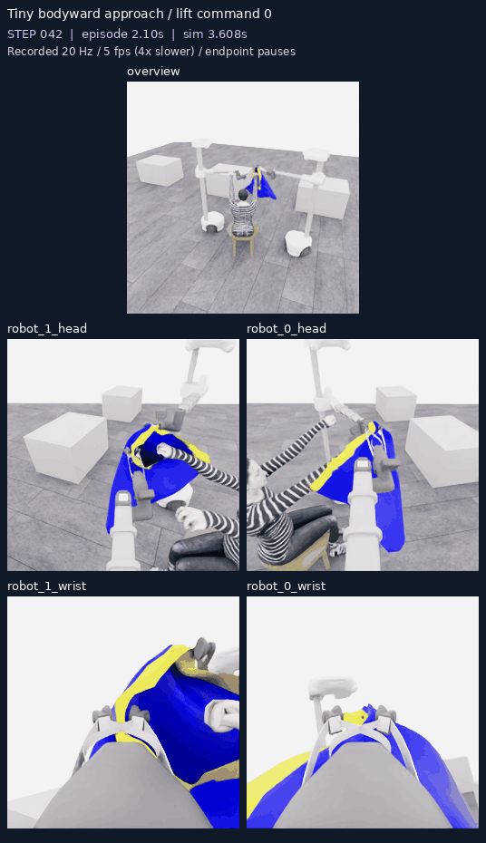
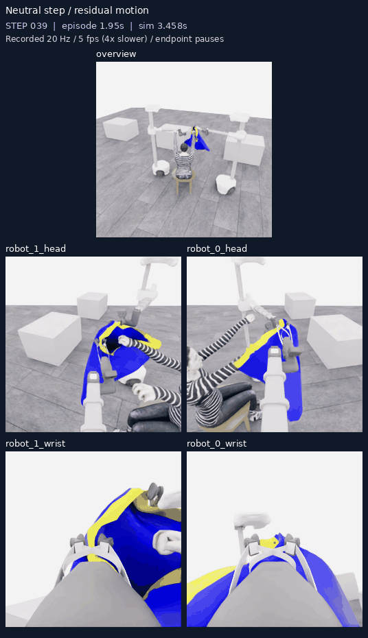
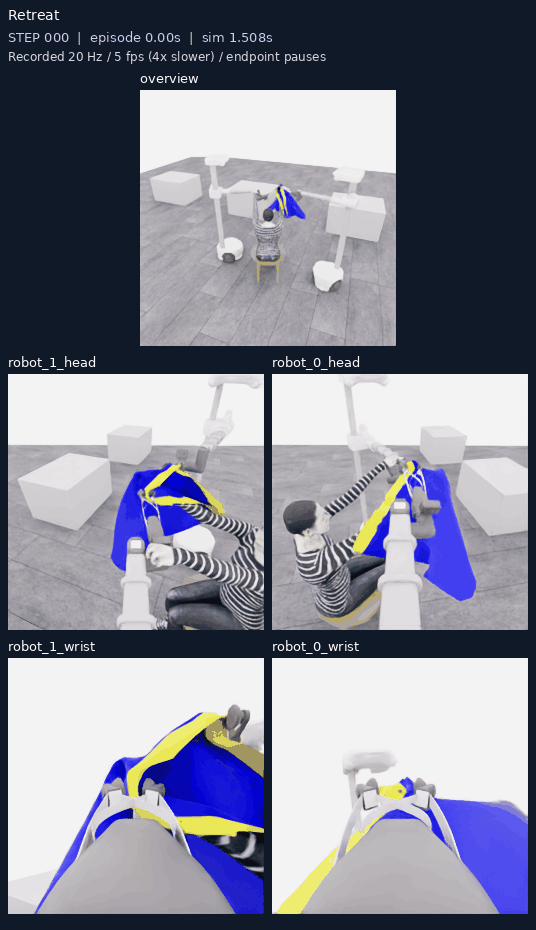
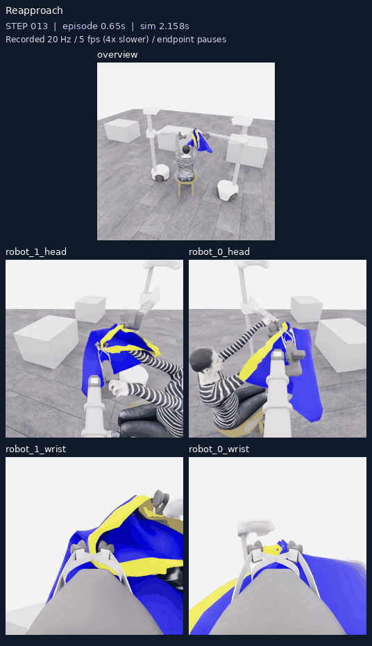
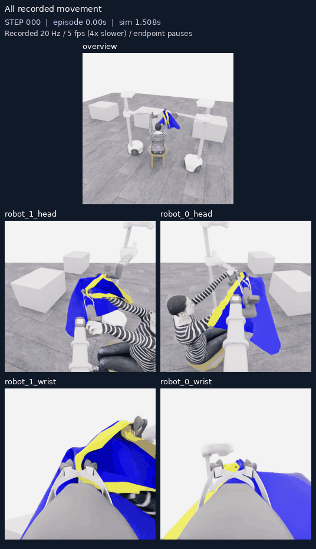

# M1 단계별 실제 움직임 · 사용자 검토

실행 `20261116-astra-m1-checkpoint-001`의 **실제 20 Hz 기록**에서 지정 카메라 5개를 모두 모았습니다. 최신 검토는 **HOLD-0007·step 68**이며, 이전 구간 GIF는 아래에 보존합니다. 시연은 아직 마감되지 않았습니다. 원본은 열린 채 HOLD에서 유지했고, SHA256과 HOLD 경계를 복사 전후 확인한 고정 사본만 읽었습니다. [복사 검증](source-hold-0002.json)

**아래 GIF는 4배 느린 재생입니다.** 실제 관측 사이 간격은 0.05초, GIF 중간 프레임은 0.20초입니다. 각 GIF 시작은 0.8초, 끝은 1초 정지합니다. 모든 기록 경계를 포함하고 중간 프레임을 생성하지 않았습니다. 각 카메라는 원본 256×256 픽셀로 표시합니다. 브라우저 확대를 사용할 수 있습니다. GIF의 256색 변환 외에 생성·반전·천 형태 보정은 없습니다. 변경된 영역만 저장하는 GIF 최적화 뒤 모든 디코딩 프레임이 팔레트 변환 프레임과 픽셀 단위로 같은지 검사했습니다.

화면은 **위 overview, 왼쪽 robot_1, 오른쪽 robot_0, 각 로봇 위 head·아래 wrist**입니다. 화면 제목의 단계는 명령 목적이며, 손 통과나 착의 성공을 뜻하지 않습니다.

## 최신: 같은 방향으로 30mm 추가 이동 요청 · step 52 → 68

사용자의 “같은 방향으로 30mm 이동”을 앞선 검토 위치에서 **약 30mm 추가 접근**하는 요청으로 적용한 구간입니다. GIF 제목의 30mm는 요청 목표입니다. 실제 명령은 같은 베이스 속도로 4+4+4+2+2전이, 총 16전이였고 lift 명령은 0으로 기존 목표를 유지했습니다.

공개 로봇 상태에서 파지점 XY 순변위는 **30.44/30.19mm**, 직전 이동 방향으로 투영한 변위는 **30.43/30.15mm**로 측정됐습니다(robot_0/robot_1). 이는 로봇 파지점의 변위이며 몸통까지의 거리 감소나 천의 이동량이 아닙니다. 별도 높이 하강 명령은 없었습니다.

실제 0.80초 · 경계 이미지 17장. 같은 방향의 연속 명령이라 하나의 GIF로 표시합니다. step 68에서 HOLD-0007에 들어갔습니다. [사본 검증](source-hold-0007.json) · [프레임·시간·SHA](bodyward-30mm.json)

## 이전: 같은 방향으로 약 15mm 접근 요청 · step 44 → 52

사용자가 앞선 몸쪽 접근과 같은 방향으로 약 15mm 더 이동하도록 요청한 구간입니다. **15mm는 요청 목표이며 GIF 제목만으로 실제 이동량 달성을 뜻하지 않습니다.** 실제 명령은 동일한 작은 베이스 속도로 3+3+2전이, 총 8전이입니다. 공개 로봇 상태의 파지점 XY 순변위는 **14.87/14.96mm**로 측정됐습니다(robot_0/robot_1). 이는 몸통까지의 거리 감소나 천의 이동량이 아닙니다. lift 명령은 0으로 기존 목표를 유지했습니다. 모든 구간의 명령이 같은 방향이므로 하나의 GIF로 표시합니다.

실제 0.40초 · 경계 이미지 9장. step 52에서 HOLD-0006으로 들어갔습니다. [사본 검증](source-hold-0006.json) · [프레임·시간·SHA](bodyward-15mm.json)

## 이전: 몸쪽으로 아주 조금 접근 · step 42 → 44

사용자가 현재 높이는 적절하다고 판단하고, 올린 손 자세에 맞춰 아주 조금 낮추면서 몸쪽으로 조금만 이동한 뒤 다시 검토하도록 요청한 구간입니다. 실제로는 **양쪽 베이스의 작은 몸쪽 이동 명령 1회·2전이**를 실행했습니다. lift 명령은 0으로 기존 목표를 유지했으며, 기록된 파지점의 world Y는 +1.24/+1.91mm, world Z는 −0.92/−0.95mm 변했습니다(robot_0/robot_1). world Y 변화는 몸통까지의 거리나 천의 변위가 아닙니다. 추가 하강 명령과 lift 명령0·기존 목표 유지 중 관측된 미세 하강을 구분하며, 하강 원인은 확정하지 않습니다.

실제 0.10초 · 경계 이미지 3장. 같은 한 동작이므로 별도 단계로 나누지 않았습니다. step 44에서 HOLD-0005로 들어갔습니다. [사본 검증](source-hold-0005.json) · [프레임·시간·SHA](tiny-bodyward-approach.json)

## 이전 미세 조정 · step 39 → 42

사용자의 “아주 조금만 더 멀어지고 조금만 더 밑으로 내리고 다시 확인” 지시 후의 실제 기록입니다. **중립 1전이에서 추가 후퇴**를 확인한 뒤 양쪽 lift를 `−0.02`로 2전이 내리고 HOLD-0004에 들어갔습니다. 첫 단계는 새 후퇴 속도 명령이 아니라 중립 명령 중 남아 있던 운동입니다. 세 GIF 모두 같은 실제 관측 경계이며, 반복된 경계를 별도 시연으로 세지 않습니다.

[HOLD4 사본 검증](source-hold-0004.json) · [통합 프레임·시간·SHA](neutral-and-tiny-lowering.json)

### 통합 · step 39 → 42

실제 0.15초 · 경계 이미지 4장.

### 중립 1전이에서 추가 후퇴 · step 39 → 40

실제 0.05초 · 경계 이미지 2장. 시작·끝을 각각 0.8초와 1초 표시하므로, 이 2프레임 GIF에는 중간 재생 구간이 없습니다. [프레임·시간·SHA](neutral-residual-motion.json)

### 아주 작은 하강 · step 40 → 42

실제 0.10초 · 경계 이미지 3장. [프레임·시간·SHA](tiny-lowering.json)

## 이전 후속: 오른손 전체와 옷 늘어짐을 확인하기 위한 후퇴 · step 16 → 39

사용자가 오른손 전체가 드러날 때까지 후퇴하여 옷의 자연스러운 늘어짐을 확인하도록 지시한 뒤의 실제 움직임입니다. 총 23전이·1.15시뮬레이션초·경계 이미지 24장을 모두 포함합니다. 이전 GIF의 마지막 step 16에서 바로 이어지며, 끝의 step 39에서 다시 HOLD했습니다. 제목은 조작 목적입니다. 손 노출과 옷 늘어짐의 적합성은 화면을 보고 판단합니다.

[HOLD3 사본 검증](source-hold-0003.json) · [프레임·시간·SHA](right-hand-retreat.json)

## 1. 최초 후퇴 · step 0 → 6

양쪽 로봇의 짧은 평행이동입니다. 실제 0.30초 · 경계 이미지 7장. [프레임·시간·SHA](retreat.json)

## 2. 하강과 중립 유지 · step 6 → 13

양쪽 lift 하강 3전이 뒤 중립 4전이입니다. 중립 명령에서도 기존 목표 추종 운동이 남을 수 있습니다. 실제 0.35초 · 경계 이미지 8장. [프레임·시간·SHA](lower-and-neutral.json)

## 3. 짧은 재접근 · step 13 → 16

양쪽 로봇이 반대 방향으로 짧게 이동한 뒤 모델 종료 제안으로 HOLD했습니다. 실제 0.15초 · 경계 이미지 4장. [프레임·시간·SHA](reapproach.json)

## 전체 · step 0 → 16

실제 0.80초 · 경계 이미지 17장. 모델 추론과 사용자 대기 시간에는 물리가 진행되지 않으므로 GIF에 대기시간을 삽입하지 않았습니다. [프레임·시간·SHA](full.json)

이 자료는 진행 중 시연의 시각 검토용입니다. 종료 원본 전수 QC, 학습 승인, 소매 진입·착의 득점 판정을 대신하지 않습니다. GIF 경계 중복은 서로 다른 시연이나 독립 표본이 아닙니다.
