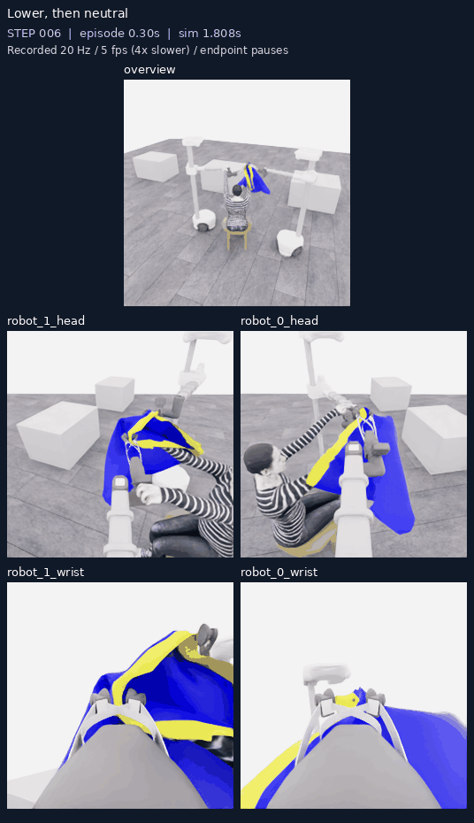

# M1 단계별 실제 움직임 · 사용자 검토

실행 `20261116-astra-m1-checkpoint-001`의 **실제 20 Hz 기록**에서 지정 카메라 5개를 모두 모았습니다. 첫 묶음은 HOLD-0002의 16전이까지이며, 최신 후속은 HOLD-0003의 39전이까지입니다. 시연은 아직 마감되지 않았습니다. 원본은 열린 채 HOLD에서 유지했고, SHA256과 HOLD 경계를 복사 전후 확인한 고정 사본만 읽었습니다. [복사 검증](source-hold-0002.json)

**아래 GIF는 4배 느린 재생입니다.** 실제 관측 사이 간격은 0.05초, GIF 중간 프레임은 0.20초입니다. 각 GIF 시작은 0.8초, 끝은 1초 정지합니다. 모든 기록 경계를 포함하고 중간 프레임을 생성하지 않았습니다. 각 카메라는 원본 256×256 픽셀로 표시합니다. 브라우저 확대를 사용할 수 있습니다. GIF의 256색 변환 외에 생성·반전·천 형태 보정은 없습니다. 변경된 영역만 저장하는 GIF 최적화 뒤 모든 디코딩 프레임이 팔레트 변환 프레임과 픽셀 단위로 같은지 검사했습니다.

화면은 **위 overview, 왼쪽 robot_1, 오른쪽 robot_0, 각 로봇 위 head·아래 wrist**입니다. 화면 제목의 단계는 명령 목적이며, 손 통과나 착의 성공을 뜻하지 않습니다.

## 최신 후속: 오른손 전체와 옷 늘어짐을 확인하기 위한 후퇴 · step 16 → 39

사용자가 오른손 전체가 드러날 때까지 후퇴하여 옷의 자연스러운 늘어짐을 확인하도록 지시한 뒤의 실제 움직임입니다. 총 23전이·1.15시뮬레이션초·경계 이미지 24장을 모두 포함합니다. 이전 GIF의 마지막 step 16에서 바로 이어지며, 끝의 step 39에서 다시 HOLD했습니다. 제목은 조작 목적입니다. 손 노출과 옷 늘어짐의 적합성은 화면을 보고 판단합니다.

[HOLD3 사본 검증](source-hold-0003.json) · [프레임·시간·SHA](right-hand-retreat.json)

## 1. 최초 후퇴 · step 0 → 6

양쪽 로봇의 짧은 평행이동입니다. 실제 0.30초 · 경계 이미지 7장. [프레임·시간·SHA](retreat.json)

## 2. 하강과 중립 유지 · step 6 → 13

양쪽 lift 하강 3전이 뒤 중립 4전이입니다. 중립 명령에서도 기존 목표 추종 운동이 남을 수 있습니다. 실제 0.35초 · 경계 이미지 8장. [프레임·시간·SHA](lower-and-neutral.json)

## 3. 짧은 재접근 · step 13 → 16

양쪽 로봇이 반대 방향으로 짧게 이동한 뒤 모델 종료 제안으로 HOLD했습니다. 실제 0.15초 · 경계 이미지 4장. [프레임·시간·SHA](reapproach.json)

## 전체 · step 0 → 16

실제 0.80초 · 경계 이미지 17장. 모델 추론과 사용자 대기 시간에는 물리가 진행되지 않으므로 GIF에 대기시간을 삽입하지 않았습니다. [프레임·시간·SHA](full.json)

이 자료는 진행 중 시연의 시각 검토용입니다. 종료 원본 전수 QC, 학습 승인, 소매 진입·착의 득점 판정을 대신하지 않습니다. GIF 경계 중복은 서로 다른 시연이나 독립 표본이 아닙니다.
