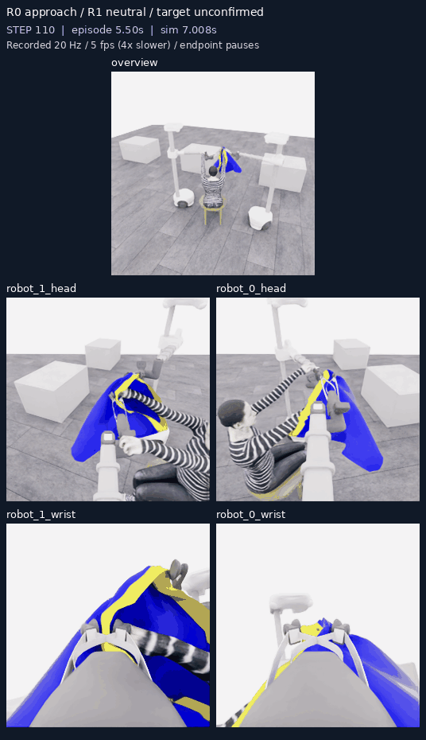

# 오른손 쪽 R0 단독 접근 분기 · 실제 5카메라 움직임

**실행 `20261116-astra-right-hand-hold10-001`은 사용자 종료 지시에 따라 135전이에서 마감했습니다.** 마지막 HOLD2 이후 추가 물리 전이는 0회입니다. 아래 HOLD는 촬영 당시의 경계이며 현재 대기 중인 시뮬레이터를 뜻하지 않습니다. 고정 사본·관측·GIF 메타데이터는 촬영 당시 값 그대로 보존합니다.

복귀를 위한 기존 행동 재생과 이후 새 행동을 구분합니다. 화면은 위 overview, 왼쪽 R1·오른쪽 R0이며 각 로봇의 head 아래에 wrist를 배치했습니다. 원본을 좌우 반전하지 않았습니다. [다음 실행 계획](../../COLLECTION_PLAN.md)은 아직 실행하지 않았습니다.

## 마지막 구간: R0만 접근 명령 · step 110 → 135 · 두 간격 도달 미확인

사용자가 오른손 가까운 로봇만 줄무늬 두 간격 정도 들어가도록 지시한 뒤의 실제 기록입니다. **R0 베이스에만 같은 접근 명령을 9회·25전이 실행**했고 R1의 9개 행동 채널은 모두 0이었습니다. 두 파지의 닫기 의도를 유지했으며 새 lift·arm·wrist 명령은 없었습니다. 모델은 오른팔의 옷 경계가 일부 가려져 두 간격까지의 남은 거리를 신뢰할 수 없다고 판단해 HOLD2로 전환했습니다. **두 간격 도달과 소매 통과는 확인되지 않았습니다.**

공개 파지 기준점의 평면 순변위는 R0 약 41.57mm, R1 약 12.66mm였습니다. world Y 변화는 각각 +41.40/+12.62mm, world Z 변화는 −0.66/+0.52mm입니다. **R1 중립 명령은 실제 위치 고정이 아니었습니다.** 이 수치를 천 이동량이나 소매 진입 깊이로 해석하지 않으며, R1이 함께 움직인 원인도 확정하지 않습니다. [공개 관측·변위 분석](../../collection/reviews/20261116-right-hand-hold10-branch.ko.md) · [HOLD2 원본 5뷰](../../collection/user-reviews/20261116-astra-right-hand-hold10-001/hold-0002/README.ko.md)

실제 1.25시뮬레이션초의 경계 이미지 26장을 모두 포함합니다. 중간 프레임은 4배 느리게 재생하고 처음 0.8초·마지막 1초 정지를 포함해 전체 재생은 6.6초입니다. 카메라당 256×256픽셀을 유지했으며 보간·반전하지 않았습니다. 동일한 명령이 이어진 한 구간이라 별도 단계로 나누지 않았습니다. 고정 사본과 원본의 복사 전후 SHA·HOLD 상태 일치, RGB 경계 연속성, GIF 전체 디코딩 프레임·시간을 검증했습니다. [HOLD2 고정 사본](source-hold-0002.json) · [프레임·시간·SHA](right-hand-only-two-stripes.json)

## 출발 복귀 재생 · step 93 → 110

같은 초기 근사 슬롯에서 기존 M1의 앞 110전이를 재생한 뒤 새 HOLD1에 들어갔습니다. GIF는 **새 run에서 실제로 재생한 마지막 17전이**이며, 새 R0 단독 접근은 포함하지 않습니다. 기존 HOLD10 상태를 정확히 되감은 영상이 아닙니다. [기존 HOLD10과 새 출발 비교](../../collection/reviews/20261116-right-hand-hold10-branch.ko.md)와 [새 HOLD1 원본 5뷰](../../collection/user-reviews/20261116-astra-right-hand-hold10-001/hold-0001/README.ko.md)를 함께 확인합니다.

실제 0.85시뮬레이션초의 경계 이미지 18장을 모두 담았습니다. 원본 20Hz를 중간 프레임 5fps로 표시해 4배 느리게 재생하며, 처음 0.8초·마지막 1초 정지를 포함한 전체 GIF 재생은 5초입니다. 카메라당 원래 256×256픽셀을 유지하고 시간 보간을 하지 않았습니다. GIF의 256색 변환과 차분 압축 후 모든 디코딩 프레임·재생 시간을 검증했습니다.

HOLD1의 step 110·tick 1320에서 모델 호출은 0회였습니다. 체크포인트 저장 요청은 추가 물리 전이 0회로 끝났고, 저장된 슬롯 SHA와 receipt가 일치했습니다. 이 슬롯은 마지막 R0 접근 전의 다음 출발 후보이며 재복원 검증은 아직 하지 않았습니다. [저장 검증](start-checkpoint-verification.json) · [정확한 슬롯 경로와 복원 한계](../../collection/reviews/20261116-right-hand-hold10-branch.ko.md#다음-출발점으로-남긴-체크포인트)

열린 원본은 직접 HDF5로 열거나 수정·종료하지 않았습니다. 물리가 멈춘 HOLD에서 일반 파일 사본을 만들고, 복사 전후 원본 SHA·사본 SHA·HOLD 상태가 같은지 확인한 뒤 사본만 읽었습니다. [고정 사본 검증](source-hold-0001.json) · [프레임·시간·SHA](restore-tail.json)

이 자료는 시각 검토용이며 종료 원본 전수 QC·학습 승인·착의 성공 판정을 대신하지 않습니다. 재생 구간을 새로운 독립 시연이나 성공 표본으로 세지 않습니다.
