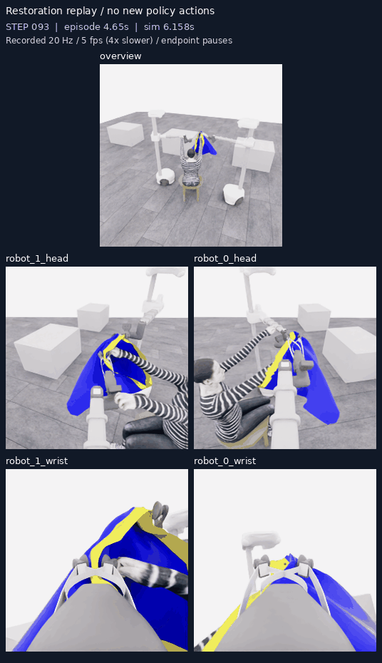

# 오른손 쪽 R0 단독 접근 분기 · 실제 5카메라 움직임

새 run `20261116-astra-right-hand-hold10-001`의 공개 관측을 기록한 영상입니다. 복귀를 위한 기존 행동 재생과 이후 새 행동을 구분합니다. 화면은 위 overview, 왼쪽 R1·오른쪽 R0이며 각 로봇의 head 아래에 wrist를 배치했습니다. 원본을 좌우 반전하지 않았습니다.

## 출발 복귀 재생 · step 93 → 110

같은 초기 근사 슬롯에서 기존 M1의 앞 110전이를 재생한 뒤 새 HOLD1에 들어갔습니다. GIF는 **새 run에서 실제로 재생한 마지막 17전이**이며, 새 R0 단독 접근은 포함하지 않습니다. 기존 HOLD10 상태를 정확히 되감은 영상이 아닙니다. [기존 HOLD10과 새 출발 비교](../../collection/reviews/20261116-right-hand-hold10-branch.ko.md)와 [새 HOLD1 원본 5뷰](../../collection/user-reviews/20261116-astra-right-hand-hold10-001/hold-0001/README.ko.md)를 함께 확인합니다.

실제 0.85시뮬레이션초의 경계 이미지 18장을 모두 담았습니다. 원본 20Hz를 중간 프레임 5fps로 표시해 4배 느리게 재생하며, 처음 0.8초·마지막 1초 정지를 포함한 전체 GIF 재생은 5초입니다. 카메라당 원래 256×256픽셀을 유지하고 시간 보간을 하지 않았습니다. GIF의 256색 변환과 차분 압축 후 모든 디코딩 프레임·재생 시간을 검증했습니다.

HOLD1의 step 110·tick 1320에서 모델 호출은 0회였습니다. 체크포인트 저장 요청은 추가 물리 전이 0회로 끝났고, 저장된 슬롯 SHA와 receipt가 일치했습니다. 이 슬롯의 재복원 검증은 아직 하지 않았습니다. [저장 검증](start-checkpoint-verification.json)

열린 원본은 직접 HDF5로 열거나 수정·종료하지 않았습니다. 물리가 멈춘 HOLD에서 일반 파일 사본을 만들고, 복사 전후 원본 SHA·사본 SHA·HOLD 상태가 같은지 확인한 뒤 사본만 읽었습니다. [고정 사본 검증](source-hold-0001.json) · [프레임·시간·SHA](restore-tail.json)

이 자료는 시각 검토용이며 종료 원본 전수 QC·학습 승인·착의 성공 판정을 대신하지 않습니다. 재생 구간을 새로운 독립 시연이나 성공 표본으로 세지 않습니다.
