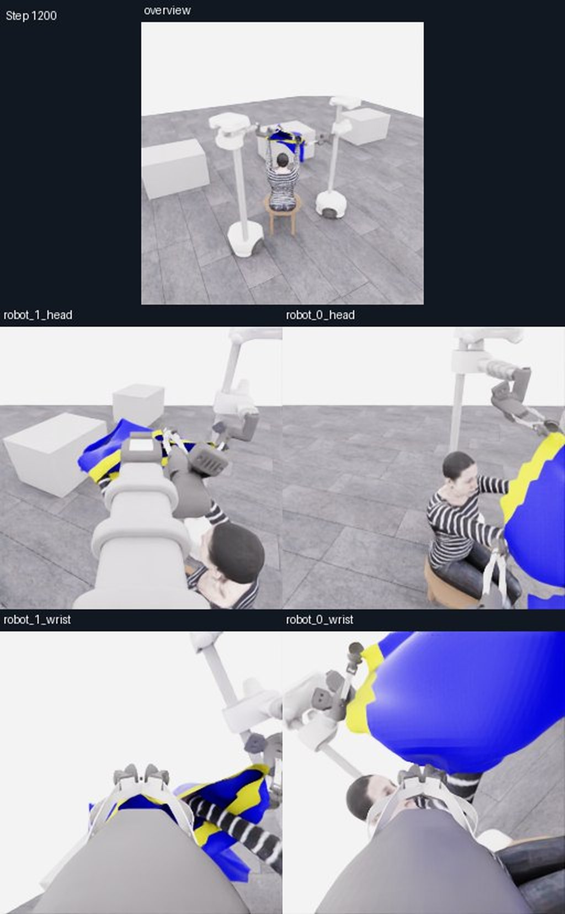
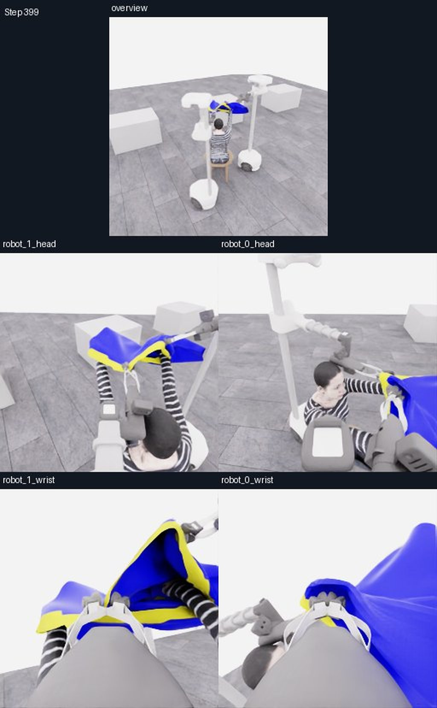
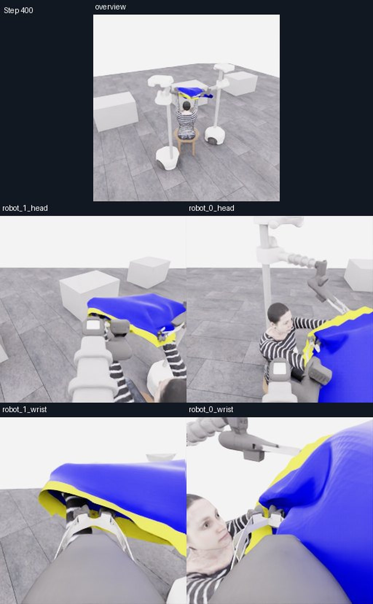
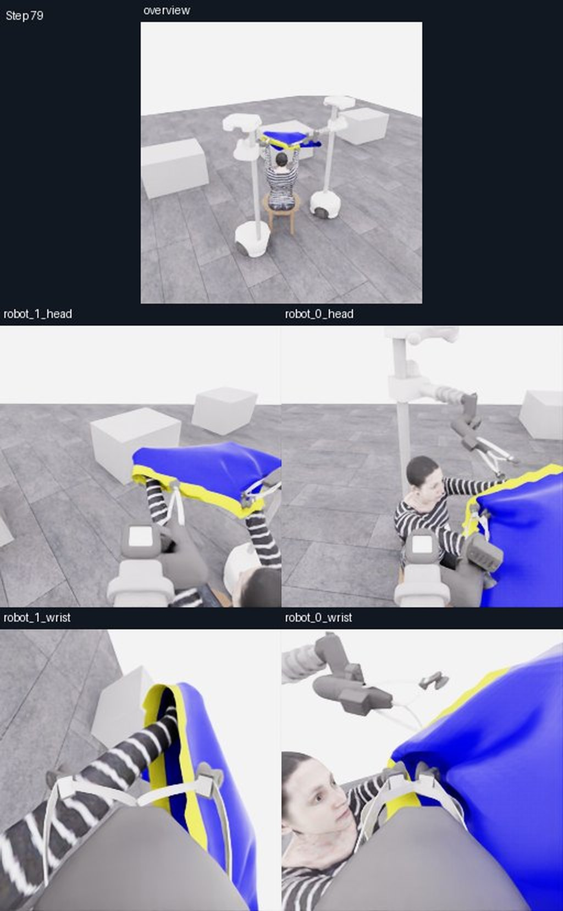
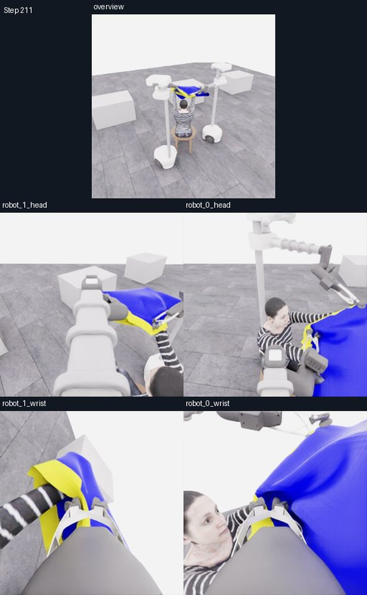
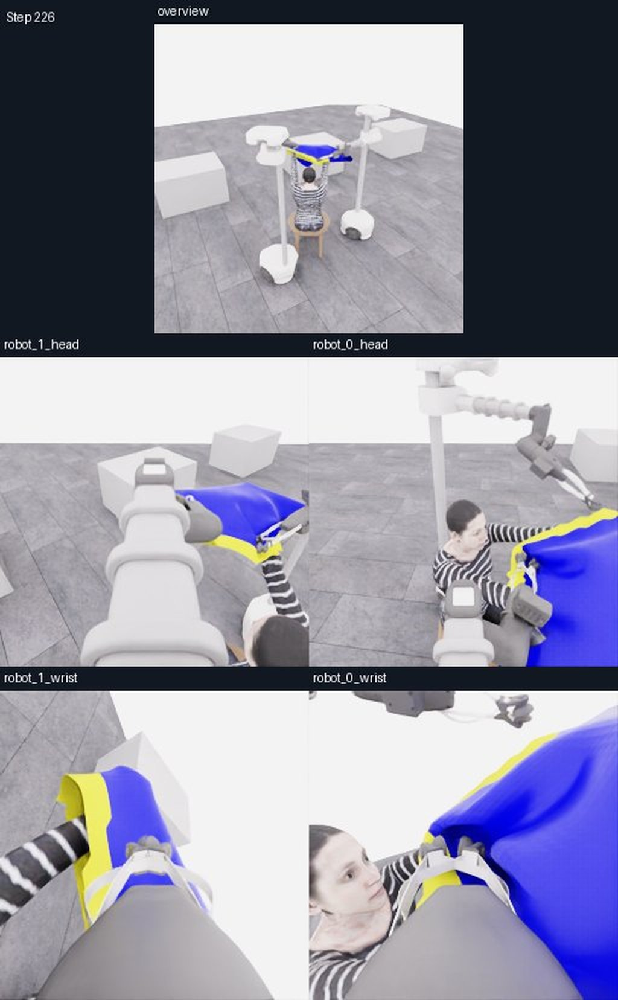
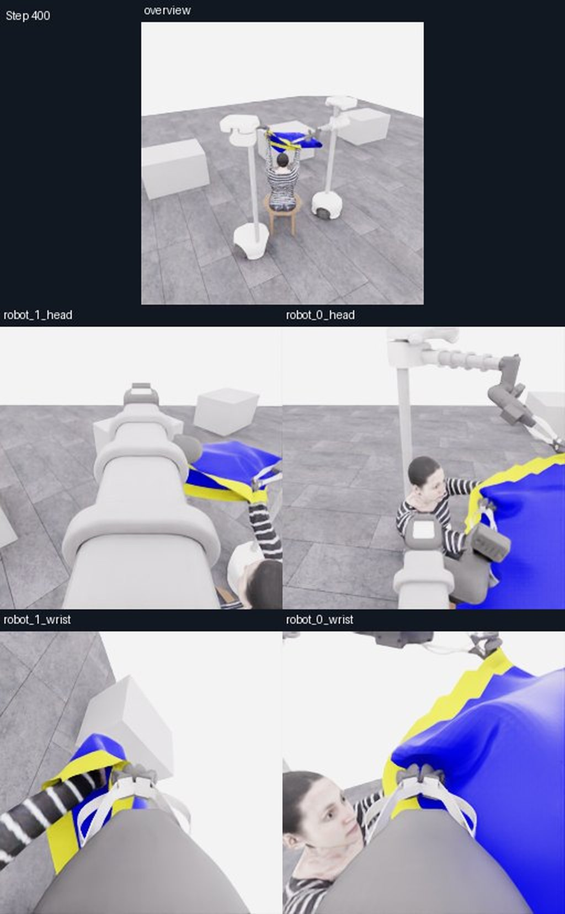
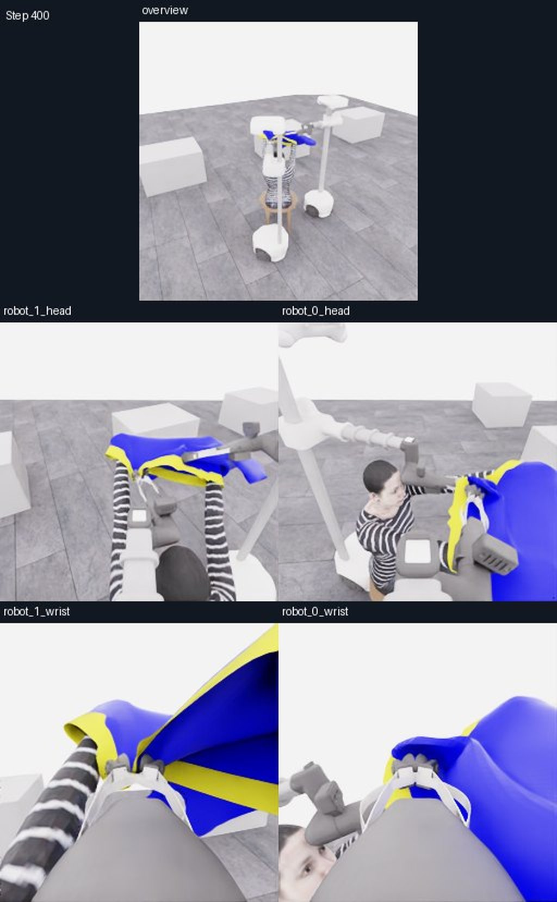
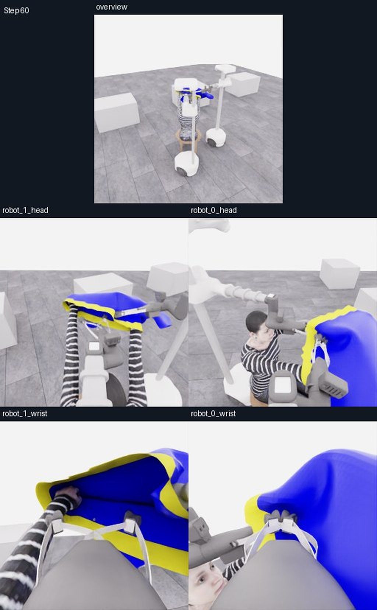
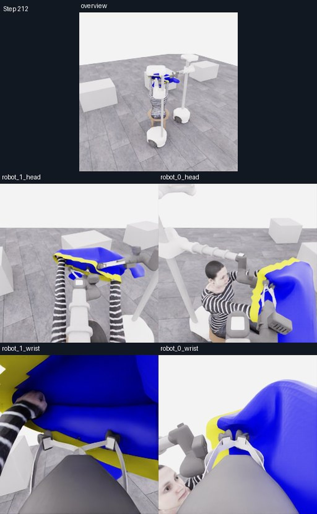

# 11월 27일 시연 44·45 분기 분석 · 손목에서 팔꿈치까지

[저장소 첫 화면](../../../README.md) · [시연 영상 모음](../README.md)

시연 25의 **1,200전이**에서 이어진 시연 38의 **399전이**를 공통 출발점으로, 두 수집 경로가 갈라졌습니다. **40 → 44**는 R1 집게를 돌려 노란 밑단을 들어 보는 경로였습니다. **42 → 45**는 R0가 파란 천을 지지하는 동안 R1 쪽 시야를 열어 같은 손목과 소매 출구를 찾는 경로였습니다. 44에서는 잠깐의 밑단 추종을, 45에서는 같은 팔의 손목과 손 일부를 확인했습니다. 두 분기 모두 **실제 소매 끝이 줄무늬를 지나 팔꿈치로 이동한 구간은 아직 확인되지 않았습니다**.

| 경로 | 저장 슬롯과 관측 전이 | 화면에서 확인한 변화 |
| --- | --- | --- |
| 공통 | 25 · 1,200 → 38 · 399 | 38의 헤드 화면에서 줄무늬 전완을 더 길게 추적할 수 있습니다. |
| 밑단 재파지 | 38 · 399 → 40 · 종료 400 → 44 · 종료 400 | 첫 파지는 후퇴 중 풀렸습니다. 348–359전이에 R1이 노란 밑단을 다시 들어 올렸고 종료까지 파지가 유지됐습니다. |
| 손목과 출구 확인 | 38 · 399 → 42 · 종료 400 → 45 · 수집 중 212 | 45의 60전이에서 줄무늬 끝에 이어진 손목과 손 일부가 드러났고 212전이에도 보입니다. |

**스냅샷 기준 시각은 2026년 11월 27일 06:43:27 UTC입니다.** 44는 400전이 종료 슬롯을 저장했고, 45는 같은 시각까지 수집기에서 확인한 최신 전이입니다. 40과 42는 같은 38 종료 슬롯을 각각 복원했고, 44와 45도 각자의 부모 슬롯을 복원하고 정착한 뒤 새 0전이부터 기록했습니다. 복원은 근사 방식으로 수행했습니다. [25 종료 기록](../../active/20261126-demo24-25-closeout.ko.md) · [37·38 수집 계획과 판정 기준](../../active/20261127-demo37-38-plan.ko.md) · [스냅샷 전이와 체크섬](assets/frames.json)

모든 그림의 상단은 전체 화면, 가운데는 왼쪽부터 R1·R0 헤드 화면, 아래는 왼쪽부터 R1·R0 손목 화면입니다. 이미지를 누르면 가로 1,024픽셀의 전체 5분할 화면을 열 수 있습니다.

## 공통 출발점 · 25에서 38로

**시연 25 · 1,200전이 저장 슬롯.** 시연 20의 행동을 재실행하던 중 저장한 장면입니다. R1 헤드에서 로봇 하우징과 옷 주름이 작업 팔 앞을 가립니다. 줄무늬 일부를 볼 수 있으며, 손끝과 실제 소매 끝의 연결은 가려져 있습니다.

**시연 38 · 399전이 종료 슬롯.** R0가 파란 몸판을 받칩니다. 헤드 화면에서 그 아래의 줄무늬 전완을 더 길게 볼 수 있습니다. 손목 쪽에서는 짧게 접힌 파란 천과 노란 몸통 밑단이 겹칩니다. 이 겹침 아래에 실제 소매 출구와 손끝이 어떻게 놓였는지는 화면에서 확인되지 않습니다.

## 분기 1 · 시연 40에서 44로 · 노란 밑단을 위아래로 파지

**시연 40 · 400전이 종료 슬롯.** R0가 파란 몸판을 받칩니다. R1 쪽의 줄무늬 전완을 따라가면 긴 노란 밑단과 짧은 파란 접힘에 가려집니다. 종료 화면에서 R1 턱과 노란 경계가 겹쳐 보여 물린 위치가 불확실합니다. 기술 검증을 통과했고 로컬 평가 착의 성공은 `false`였습니다.

**시연 44 · 79전이 · R1 턱 방향 변경.** 노란 밑단 윗부분을 위아래로 물리도록 R1의 집게 롤을 돌렸습니다. 69전이부터 롤 목표가 −1.135 rad에 제한됐고, 79전이의 실제 롤은 −1.1343 rad였습니다. 34전이 대비 약 **67°** 돌아간 각도입니다. 두 턱이 노란 천에 서로 다른 높이에서 접근합니다.

**시연 44 · 211전이 · 짧은 파지 확인.** 195–200전이의 닫힘 명령이 정착한 뒤 206–216전이에 R1이 약 30mm 올라갔고, R0 헤드·손목 화면에서 같은 노란 가장자리가 따라옵니다.

### 시연 44에서 집게가 다시 열린 이유

| 전이 | R1 명령과 실제 화면 |
| --- | --- |
| 216–226 | 216–221전이에 팔을 수축했습니다. 221–226전이는 중립 명령이었지만 이전 목표를 향해 약 18mm 더 후퇴했습니다. 닫힘 명령은 유지됐고 양쪽 턱은 더 닫혔습니다. 226전이에는 노란 밑단이 턱 아래로 빠져 보입니다. |
| 226–238 | 밑단이 빠진 뒤 수집기가 재파지를 위해 226–232전이에 열림을 명령했습니다. 이어진 232–238전이에도 같은 열림 상태를 향해 턱이 더 벌어졌습니다. |
| 258–289 | 258–263전이에 다시 닫았습니다. 273–284전이에 R1이 약 25mm 올라갔지만 밑단이 따라오지 않았습니다. 284전이까지 닫힘을 유지했고 284–289전이에 두 번째 열림을 명령했습니다. |

**226전이 · 천이 먼저 빠진 화면.** R0 헤드와 R0 손목에서 R1 턱과 밑단 아래쪽을 대조할 수 있습니다.

**232전이 · 열림 명령 직후.** 턱이 열리는 것은 천이 빠진 것을 관찰한 뒤 선택한 재파지 동작입니다. 첫 시험에서는 수직으로 들 때 파지됐지만, 후퇴 방향에서의 유지 여부는 별도로 확인해야 했습니다.

**시연 44 · 400전이 종료 슬롯.** 336–342전이에 다시 닫은 뒤 348–359전이에 R1을 올리자 같은 노란 밑단이 따라왔습니다. 옆 이동과 짧은 수축 뒤에도 밑단이 턱에 남았고 두 집게는 닫힘을 유지한 채 400전이에서 종료했습니다. R0는 몸판을 받치고 있습니다. 작업 팔의 손끝과 실제 소매 끝은 가려져 있습니다.

## 분기 2 · 시연 42에서 45로 · 같은 손목과 출구 추적

**시연 42 · 400전이 종료 슬롯.** 후반에 R1의 접근 위치와 높이를 조절하면서 줄무늬가 드러나는 각도를 찾았습니다. 종료 시 R0가 파란 몸판을 지지하고, R1 손목 화면의 줄무늬는 짧은 파란 접힘과 말린 노란 경계 아래로 들어갑니다. 손목과 손끝은 이때 명확히 보이지 않습니다. 기술 검증은 통과했고 로컬 평가의 원점수는 픽업 5점, 착의 0점이었습니다.

**시연 45 · 60전이 · 손목과 손 일부 노출.** R0가 지지를 유지한 채 51–55전이에서 R1만 열자 짧은 파란 접힘이 풀립니다. 중립 동작 후인 60전이에도 R1 손목 화면에서 같은 줄무늬 끝에 이어진 손목과 손 일부가 남아 있습니다. 헤드 화면에서는 손끝 부위가 천에 가려 실제 소매 출구와의 관계를 확인할 수 없습니다.

**시연 45 · 212전이 · 기준 시각 최신.** R0가 옆으로 움직일 때 파란 몸판이 따라왔고, 이후에도 지지가 유지됐습니다. R1은 긴 노란 몸통 밑단 근처에서 닫힘을 시험했습니다. R1 손목 화면에는 같은 줄무늬 끝의 손목과 손 일부가 보입니다. R1의 파지 유지, 실제 소매 끝의 연속된 둘레와 통과 경로는 아직 확인되지 않았습니다.

## 줄무늬 기준으로 확인된 착의 범위

| 확인 지점 | 40 → 44 | 42 → 45 |
| --- | --- | --- |
| 전완 줄무늬에서 손목으로 | 줄무늬를 노란 경계까지 추적했습니다. 그 아래 손목과 손끝은 가려졌습니다. | 같은 줄무늬 끝부터 손목과 손 일부까지 추적했습니다. |
| 손끝·손목의 실제 소매 출구 통과 | 몸통 밑단의 움직임을 확인했습니다. 소매 출구와 통과는 미확인입니다. | 손 일부가 보입니다. 소매 출구의 연속된 둘레와 통과는 미확인입니다. |
| 같은 소매 끝의 전완 이동과 팔꿈치 도달 | 같은 소매 끝이 어느 줄을 지났는지, 팔꿈치에 닿았는지 미확인입니다. | 같은 소매 끝이 어느 줄을 지났는지, 팔꿈치에 닿았는지 미확인입니다. |

줄무늬는 **같은 팔에서 손목 가까운 쪽부터 팔꿈치 굽힘으로 이어지는 위치 표지**로 씁니다. R1 손목 화면에서 손과 실제 소매 끝을 찾고, 헤드 화면에서 같은 팔의 굽힘과 소매 끝의 위치를 대조합니다. 노란 몸통 밑단과 짧은 파란 접힘의 위치는 별도로 기록합니다. 소매 끝이 연속해서 보이는 장면이 부족해 현재 화면으로는 남은 줄 수나 거리를 잴 수 없습니다.

## 다음 수집 방향

1. **44 이후 · 종료 슬롯에서 파지를 확인하고 이어갑니다.** 복원하고 정착한 뒤 R0가 몸판을 받치고 R1에 노란 밑단이 남아 있는지 확인합니다. R1을 한 축으로만 짧게 움직이고 관절이 정착하면, 같은 천이 턱 사이에 있는지 두 시점에서 확인합니다. 지지를 유지하며 생긴 공간에서 실제 소매 출구를 찾습니다. 천이 떨어지면 그때 R1을 열고 접근 위치 한 축을 바꿔 밑단 윗부분을 다시 물립니다.
2. **45 · 손목이 보이는 상태에서 출구를 찾습니다.** R0 지지를 유지하고 R1은 손에서 떨어진 한 축으로 접근해 두 턱과 파란 천 바깥면을 함께 보이게 합니다. 턱과 작업 팔 사이에 여유가 보이면 짧게 닫고 이동해 같은 천이 따라오는지 봅니다. 소매 둘레가 두 시점에서 이어져 보일 때 같은 손끝·손목의 통과를 기록합니다.
3. **두 분기 · 같은 소매 끝을 팔꿈치까지 추적합니다.** 접촉이나 가림이 불확실할 때는 **3–6전이**로 확인합니다. 파지와 이동 공간이 확보되고 같은 소매 끝이 줄무늬를 따라 움직이는 것이 보이면 **12–20전이**로 진행합니다. 두 시점에서 소매 끝이 팔꿈치 굽힘을 넘으면 **중립 3전이** 후에도 그 위치가 유지되는지 재확인합니다.
